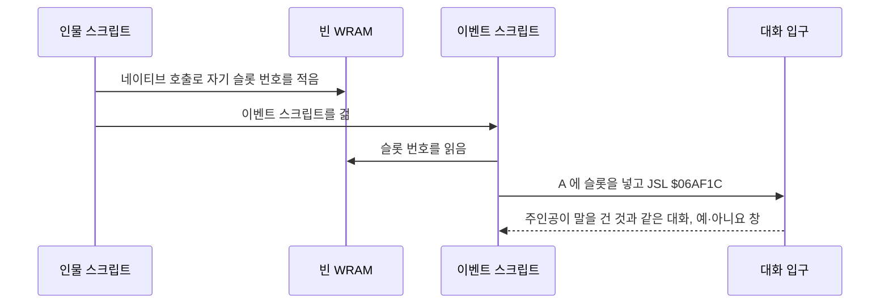
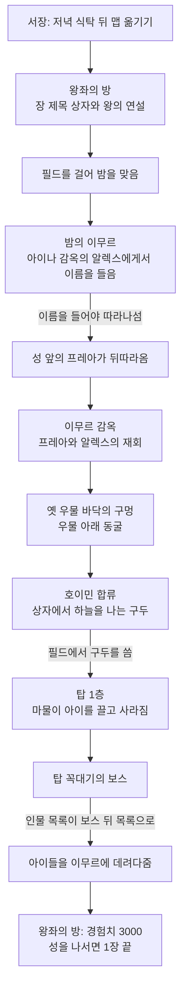
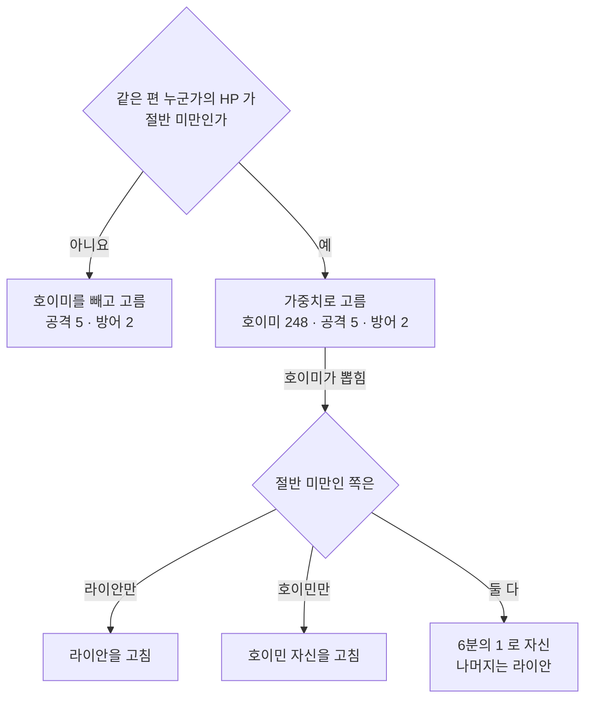
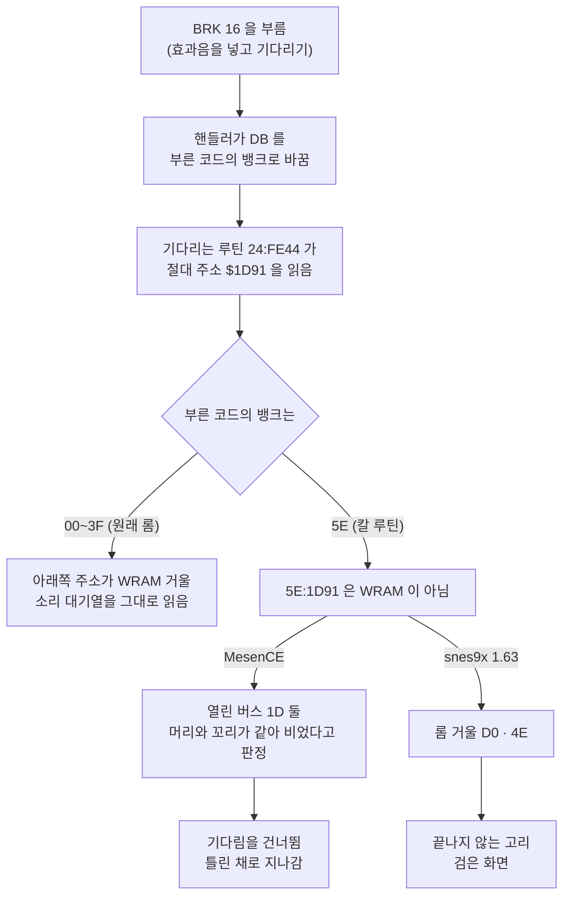
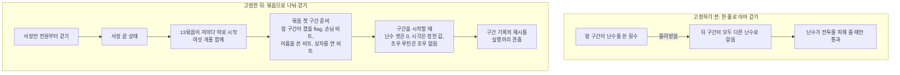

앞 편들에서는 DQ5 엔진을 읽고([맵과 걷기](/games/romhacking/journal/dq4/dq5-maps/), [대사와 사건](/games/romhacking/journal/dq4/dq5-events/)), 엔진에 새 맵·인물·대사를 [써 넣는 도구](/games/romhacking/journal/dq4/writing/)를 만들고, [한글 창](/games/romhacking/journal/dq4/windows/)과 [맵 그림·곡](/games/romhacking/journal/dq4/environment-sound/)을 갖췄습니다. 이번 편은 그 위에 실제 게임을 올리는 이야기입니다. 새 게임을 고르면 DQ5 의 첫머리 대신 DQ4 의 서장이 시작하고, 1장 「왕궁의 전사들」 을 끝까지 걸을 수 있게 만든 과정입니다.

연재의 마지막 편이라 다루는 범위가 넓습니다. 사건을 넣은 차례, 원작 숫자를 맞춘 일, 인물 그림, 가게 고치기, 배울 것이 컸던 멈춤 버그, 그리고 사람이 매번 플레이하지 않고도 「1장이 끝까지 간다」 를 보증하려고 만든 검사 순서로 적습니다. 전체 명세는 [형식 문서(1장)](https://github.com/perfectacle/sfc-dq4/blob/main/sfc/dq4/docs/dq4-chapter1-format.md)와 [서장 형식 문서](https://github.com/perfectacle/sfc-dq4/blob/main/sfc/dq4/docs/dq4-prologue-format.md)에 있습니다.

## 1. 새 게임을 DQ4 첫머리로

DQ5 는 새 게임을 고르면 주인공이 태어나는 장면, 로고, 배 순서로 프롤로그를 돌립니다. 이것을 통째로 걷어 내려면 새 게임이 첫 맵을 어디서 정하는지부터 알아야 했습니다. 전원을 켠 뒤 A 를 일정 간격으로 누르면서 맵 번호 변수 `$BC`·`$BD` 에 쓰는 곳을 감시했습니다. 처음에는 `7E:00BC` 에 감시를 걸었는데 한 번도 잡히지 않았습니다. 직접 페이지 쓰기는 CPU 주소 `00:00BC` 로 잡히기 때문이었습니다. 주소를 바꾸자 바로 나왔습니다.

```text
0000BC-0000BD pc=258327 first=362  val=02
0000BC-0000BD pc=258330 first=362  val=06
0000BC-0000BD pc=00C015 first=1611 val=02   ; 02/07 출산 방
0000BC-0000BD pc=0FD962 first=5732 val=17   ; 로고 뒤 배
```

`25:8321` 이 `25:8621` 의 6바이트 표에서 맵·좌표·층을 읽고, 새 게임은 항목 0(맵 `02/06`)을 씁니다. 이 항목 하나를 바트랜드 왕좌의 방으로 바꾸자 태어나는 장면도 로고도 함께 사라졌습니다. 둘 다 첫 맵이 `02/06` 일 때만 도는 코드였기 때문입니다.

| 항목 0 | 맵      | 셀      |
| ------ | ------- | ------- |
| 원래   | `02/06` | (38,14) |
| 1장    | `36/01` | (32,42) |

패미콤 원작은 이름을 정하면 검은 화면에 금테 상자로 장 제목을 띄우고, 검은 화면의 메시지 창에 서술을 쓴 뒤 왕좌의 방을 밝힙니다. DQ5 엔진에는 이런 장 제목 상자가 없어 직접 만들었습니다. 맵을 불러오는 루틴이 주화면 층을 켜는 한 줄(`2B:8293` 의 `LDA #$17 / STA $0733`)에 [후킹](/games/romhacking/sfc/hooking/)을 걸어, 연출 전이면 BG3(창 층)만 켜 둡니다. 맵과 인물은 불려 왔지만 그려지지 않아 검은 화면이 됩니다. 그 위에 메시지 창이 글자를 그리는 캔버스 타일을 빌려 상자를 그리고, 화면 밝기를 올렸다 내립니다. 테두리와 바탕 타일은 패미콤 롬에 있는 1비트 타일을 풀어 썼고, 제목 「제1장 왕궁의 전사들」 은 한글 글꼴을 한 점 겹쳐 굵게 했습니다.


_직접 만든 장 제목 상자. 맵과 인물은 이미 불려 와 있지만 창 층만 켜 두어 뒤가 검습니다. 금색 테두리와 파란 바탕이 패미콤 롬에서 푼 타일이고, 제목은 한 점 겹쳐 굵게 한 한글입니다._

상자 뒤의 연출은 왕 한 사람의 인물 스크립트가 맡습니다. 조작 막기, 상자, 서술, 맵 밝히기, 대신의 말, 왕이 계단에서 걸어 내려와 연설, flag 켜기, 조작 풀기 순서입니다. 줄 선 전사 여섯 명은 그 flag 를 기다렸다가 출구로 걸어 나갑니다. 화면에 올려 보니 하나씩 어긋났습니다.

| 겪은 것                                 | 까닭                                |
| --------------------------------------- | ----------------------------------- |
| 바로 앞에서 말을 걸어도 「아무도 없다」 | 인물 레코드의 층 값이 주인공과 다름 |
| 스크립트가 돌지 않음                    | 이동 간격을 0 으로 덮음             |
| 줄 선 전사들이 누워 있음                | 복사한 원본이 누운 선원             |
| 전사들이 통로에서 뭉쳐 멈춤             | 문지기와 가로 2셀 거리에서 늘 멈춤  |

DQ5 의 인물 엔트리는 처음부터 만들 수 없고 원래 롬의 엔트리를 복사해 필드만 바꿔 씁니다. 그래서 원본이 가진 성질(누운 자세, 횃불용 애니메이션 값)이 그대로 따라옵니다. 전사들은 두 줄로 나눠 걷게 하고, 길을 막던 문지기 둘을 한 블록 바깥으로 옮기자 여섯 명 모두 출구에서 사라졌습니다.


_고친 뒤의 왕좌의 방. 상자와 서술이 끝나 맵이 밝아지고, 계단을 내려온 왕이 연설을 시작한 순간입니다. 융단 위의 전사들이 눕지 않고 줄을 서 있습니다._

## 2. 서장: 산골 마을과 저절로 말을 거는 인물

닌텐도 DS 리메이크는 1장 앞에 짧은 서장을 더했습니다. 주인공이 산골 마을 지하에서 검술 수련을 하고, 마을을 돌다 개구리를 만나고, 소꿉친구 신시아의 변신 주문 모샤스에 속고, 부모와 저녁을 먹는 이야기입니다. 이 해킹롬은 패미콤판을 옮기지만 서장은 DS 판을 따라 넣기로 했습니다. 무대는 패미콤판의 산골 마을 맵이고, 사건 차례는 [DS 스크립트를 푼 것](/games/romhacking/journal/dq4/originals/)을 읽어 옮겼습니다.

DS 판은 장 제목 뒤 검은 화면에서 칼이 여섯 번 맞부딪치는 소리와 칼 효과만 보여 준 뒤 지하를 밝힙니다. 여섯 합의 간격(30·60·30·20·60·90프레임)과 효과음 번호를 스크립트에서 읽고, 칼 효과 그림은 DS 화면을 프레임마다 잘라 BG3 타일로 바꿔 올렸습니다. 이 루틴이 뒤에 다른 에뮬레이터에서 게임을 멈추게 하는데, 그 이야기는 10절에 있습니다.

### 예·아니요 창이 돌아오지 않았다

서장의 인물들은 주인공에게 먼저 말을 겁니다. 수련이 끝나면 검사가 묻고, 개구리가 다가와 묻습니다. 그런데 DQ5 의 인물 스크립트나 이벤트 스크립트 안에서 예·아니요 창을 직접 부르면 창 목록을 도는 고리에서 돌아오지 않았습니다. 세 가지 순서로 불러 보았지만 모두 같았습니다. 그래서 처음에는 주인공이 말을 걸어야 묻는 것으로 물러섰습니다.

풀린 것은 필드의 「대화」 명령이 쓰는 입구를 찾은 뒤입니다. 대화 갈래를 고르는 루틴을 부르는 곳을 거슬러 올라가자 다음이 나왔습니다.

```text
06:AF1C  JSR $AF20 / RTL
06:AF20  PHP / PHB / REP #$30 / PHA / PHX / PHY
         SEP #$20 / STA $0F1E      ; A = 인물 슬롯
         JSR $AF57 / JSR $AFF4     ; 준비, 대화 본체
```

메인 문맥에서 A 에 인물 슬롯을 넣고 `JSL $06AF1C` 를 부르면 주인공이 말을 건 것과 똑같은 대화가 돕니다. 다만 인물 스크립트는 인물 갱신 안에서 돌아 메인 문맥이 아닙니다. 그래서 두 단계로 나눴습니다. 인물 스크립트의 네이티브 호출 명령이 자기 슬롯 번호를 빈 WRAM 에 적고 이벤트 스크립트를 겁니다. 이벤트 스크립트는 메인 문맥에서 돌므로, 거기서 대화 입구를 부릅니다. 전원을 켜고 수련 도중에 버튼에서 손을 떼자 검사의 물음과 예·아니요 창이 스스로 떴습니다. 슬롯 번호가 인물 갱신 쪽에서 메인 문맥으로 건너가는 차례는 아래와 같습니다.



_인물 스크립트는 인물 갱신 안에서 돌아 대화 입구를 직접 부를 수 없습니다. 슬롯 번호만 WRAM 에 남기고, 메인 문맥에서 도는 이벤트 스크립트가 대신 부릅니다._


_수련 도중 검사가 먼저 묻고, 오른쪽 위에 예·아니요 창이 뜬 화면. 대사의 「라이안」 은 화면을 찍을 때 넣은 주인공 이름입니다. 이 포팅은 이름 입력에서 넣은 이름을 서장의 주인공과 1장의 전사가 함께 쓰므로, 서장 대사에도 같은 이름이 나옵니다._

### 개구리는 연못에서 뛰어오른다

처음 넣은 개구리는 꽃밭 옆에 서 있다가 주인공과의 거리에 따라 목소리를 내고 말을 걸었습니다. 그랬더니 근처 마을 사람에게 말을 걸려 할 때마다 「용사님 용사님……」 이 먼저 떴습니다. DS 판을 다시 읽으니 개구리는 맵에 서 있지 않았습니다. 주인공이 오두막을 나서는 순간, 다리 동쪽 끝, 다리 위 세 곳에서 차례로 목소리가 나고, 연못에서 개구리가 뛰어올라 다리 위에 내립니다.

거리 대신 「주인공이 이 사각형 안에 들어섰는가」 를 보는 판정 루틴으로 바꿨습니다. 그런데 첫 목소리 뒤로 아무것도 걸리지 않았습니다. 판정 루틴 입구에 실행 감시를 걸어 보니 루틴이 약 120프레임에 한 번만 불리고 있었습니다. 인물 스크립트는 그 인물의 이동 간격마다 한 번씩 도는데, 빌려 온 엔트리의 간격이 그만큼 길었던 것입니다. 주인공이 다리 끝에 머무는 8프레임 동안 판정이 한 번도 돌지 않았습니다. 이동 간격을 1 로 두자 오두막을 나선 바로 그 프레임에 목소리가 떴습니다. 뛰어오르는 모습은 칸마다 그림 높이를 6·10·4점으로 바꾸며 세 칸을 걷게 해 포물선처럼 보이게 했습니다.


_연못에서 뛰어올라 다리 위에 내린 개구리(주인공 오른쪽의 초록 그림)가 말을 거는 화면. 왼쪽 연못가에 서 있는 것은 마을 사람입니다._

### 저녁 식탁에서 1장으로

신시아를 만난 뒤 아버지에게 대답하면 부모가 식탁으로 걸어가 앉고, 저녁 대사 뒤 화면이 어두워지며 「이야기는 이렇게 시작된다……」 가 뜹니다. 이어 이벤트 명령 `90`(맵 옮기기)으로 1장 왕좌의 방에 갑니다. 1장 연출 flag 가 아직 꺼져 있으니 맵은 검게 불려 오고, 1절의 상자와 연출이 새 게임과 똑같이 돕니다.


_서장의 마지막 장면인 저녁 식탁입니다. 부모가 의자까지 걸어가 앉은 뒤 대사가 이어집니다._

이 장면은 직접 플레이하다가 멈춤을 찾았습니다. 아버지에게 길과 다른 쪽에서 말을 걸었더니, 아버지가 의자로 가는 길을 주인공이 막아 저녁이 영영 시작되지 않았습니다. 조작을 막은 채 인물을 걷게 하는 사건은 주인공이 어디에 서 있든 끝나야 합니다. 서장·1장의 사건을 모두 훑어 규칙으로 정리했습니다. 걷는 인물은 주인공을 통과하는 비트를 켭니다. 주인공을 걷게 할 때는 상대 걸음 수를 롬에 박지 않고, 선 자리에서 목표까지의 길을 그때 계산해 WRAM 에 이벤트 스크립트를 씁니다. 통과만 켜면 두 그림이 겹쳐 보이므로, 주인공을 미리 비켜 세우거나 걷는 인물이 돌아가는 길을 고르게 했습니다. 검사는 사건마다 주인공이 설 수 있는 칸을 모두 실측해, 일행과 인물의 그림이 한 프레임이라도 겹치면 실패합니다.

## 3. 바트랜드와 이무르를 새 맵 그룹으로

1장의 무대는 바트랜드 성과 이무르 마을입니다. 그전까지 패미콤 맵은 그림을 확인하려고 DQ5 의 실내 맵 자리를 하나씩 빌려 넣었습니다. 성 앞과 성 안이 서로 다른 DQ5 그룹에 흩어져 있어 계단 짝을 이을 수 없었고, 빌린 자리에는 원래 DQ5 인물과 출구가 남아 있었습니다. 그래서 패미콤의 맵 그룹 하나를 DQ5 의 새 그룹 하나에 맵 순서 그대로 넣기로 했습니다. 바트랜드는 그룹 `36`, 이무르는 `37` 입니다.


_새 그룹 36 의 첫 맵이 된 바트랜드 성 앞. 패미콤 블록 배치에 새 타일을 놓아 그린 그림이라 인물은 없습니다. 가운데 성문에 영역 이동을 놓고, 이 맵 위에 인물과 가게를 올렸습니다._

계단은 DQ5 의 출구 표시 셀로 옮기면 됐지만, 성문은 영역 이동 레코드(사각형 안에 들어서면 다른 맵으로 보내는 레코드)로 옮겨야 했습니다. 패미콤 칸 하나는 DQ5 셀 2×2 이므로 사각형을 두 줄 높이로 만들었더니, 성문으로 들어간 주인공이 기대보다 네 줄 위에 섰습니다. 루틴을 읽으니 까닭이 나왔습니다.

```text
2A:F636  LDY #$03 / LDA ($00),Y / DEY / DEY
         SEC / SBC ($00),Y / DEC A / BNE $F67C  ; 높이-1 ≠ 0 → 세로
2A:F686  EOR #$FF                               ; 세로는 폭을 뒤집어 씀
```

사각형 높이가 1 이 아니면 엔진은 그것을 세로로 긴 출구로 보고, 도착 Y 를 들어선 자리에 비례해 정합니다. 사각형을 한 줄로 줄이고 그 줄을 일행이 처음 밟는 줄에 두자 맞는 자리에 섰습니다. 이 식은 뒤에 우물 바닥의 구멍을 넣을 때 다시 쓰였습니다. 구멍 어디서 떨어져도 같은 칸에 서게 하려면 비례 폭을 1 로 두면 됩니다.


_새 그룹 37 의 이무르 마을. [맵 그림 편](/games/romhacking/journal/dq4/environment-sound/)에서 그린 맵 그대로이고, 이번 편에서는 카운터 너머에 가게·여관 주인을, 길과 집에 낮·밤 인물을 놓았습니다._

인물은 패미콤 인물 레코드에서 자리·방향·걸음·대화 번호를 읽어 낮 목록과 밤 목록을 그대로 옮겼습니다. 두 곳의 낮과 밤을 합쳐 101명입니다. 대사는 패미콤 대화 스크립트를 「1장 시작 상태」 로 돌려 인물마다 처음 보이는 메시지를 뽑았습니다. 돌아다니는 인물은 DQ5 의 「범위 안 돌아다니기」 스크립트를 가진 원본을 복사했는데, 이 스크립트가 출구 칸을 피하지 않아 개 한 마리가 계단 위에 서서 길을 막기도 했습니다. 패미콤도 그 인물들을 계단 근처에서 걷게 두므로 원작대로 두었습니다.


_인물을 놓은 뒤의 낮 이무르. 위 그림의 빈 맵에 낮 목록의 인물이 올라갔습니다. 카운터 뒤의 초록 옷 주인들이 DQ5 의 가게 기능에 이은 인물입니다._

가게·여관·교회는 대사가 아니라 DQ5 의 시설 기능에 이어야 합니다. 처음에는 대화 스크립트를 돌려 가게 서비스가 나오는 인물만 가게로 보았다가 두 곳을 놓쳤습니다. 바트랜드 방어구점과 이무르 여관은 「카운터 너머에서 말을 걸 때만」 가게를 여는 스크립트라, 시작 상태로 돌리면 대사만 나왔습니다. DQ5 는 무기·방어구·도구점의 품목 목록을 맵 그룹 번호로 찾으므로 그룹 `36`·`37` 의 목록을 새로 더했고, 끝 표시가 없어 늘릴 수 없던 여관 값 표는 빈 뱅크로 옮겨 두 항목을 더했습니다.

상자는 한 번에 되지 않았습니다. 첫 빌드에서는 새 맵에 상자 칸이 하나도 없었습니다. 맵 블록의 속성이 계단만 표시하고 있었기 때문입니다. 패미콤의 상자는 그 위를 걸을 수 있는 칸이라는 점도 달랐습니다. 왕좌의 방 상자는 3×2 로 붙어 있어 DQ5 처럼 막으면 가운데 상자를 열 수 없습니다. 걸을 수 있게 두자 이번에는 상자 위에 선 주인공이 상자 그림에 가려 보이지 않았고, 연 상자는 분홍 체크무늬로 깨졌습니다. 앞의 것은 블록 머리의 비트 하나(인물을 위층 앞에 그림)였고, 뒤의 것은 그림이 아니라 팔레트 줄이 달라서였습니다. 자세한 자리는 [환경 형식 문서](https://github.com/perfectacle/sfc-dq4/blob/main/sfc/dq4/docs/dq4-environment-format.md)에 있습니다.

## 4. 원작 차례대로 놓은 1장 사건

1장은 왕궁 전사 라이안이 사라진 아이들을 찾는 이야기입니다. 패미콤의 대화 스크립트와 [이야기 진행 문서](https://github.com/perfectacle/sfc-dq4/blob/main/fc/dq4/docs/dq4-story-format.md)에서 사건 차례와 flag 를 읽고, 여섯 묶음으로 나눠 하나씩 넣었습니다. 서장 끝에서 1장 끝까지 사건이 이어지는 차례를 먼저 그려 두면, 아래 여섯 묶음이 어디에 놓이는지 보입니다.



_서장 끝에서 1장 끝까지의 사건 차례. 사건마다 앞 사건이 켠 flag 로 열리고, 맵에 들어설 때 그 flag 에 따라 인물 목록이 통째로 바뀝니다._

**밤이 오지 않았다.** 첫 사건은 이무르의 밤입니다. 밤에 아이나 감옥의 알렉스에게서 이름을 들어야 성 앞의 프레아가 따라나섭니다. 그런데 패미콤 1장은 여관이 늘 아침으로 깨우므로, 밤은 필드를 걸어야만 옵니다. 필드로 나가 걸어 보니 시각 변수가 움직이지 않았습니다. DQ5 는 유년기에 flag 하나로 필드 시간을 멈추는데, 새 게임이 그 flag 를 켜는 길을 지나고 있었습니다. 그 4바이트를 `NOP` 으로 지우자 16걸음마다 시각이 올랐습니다. 재는 동안 필드에 나가자마자 슬라임 전투가 붙었는데, 조우를 막아도 붙었습니다. DQ5 의 첫 필드 이벤트(파파스와 슬라임 전투)였습니다. 새 게임 훅에서 「이미 봤음」 flag 를 켜 없앴습니다.


_밤의 이무르. 화면 전체가 청록빛으로 바뀌고 인물도 밤 목록으로 바뀝니다. 이 아이에게서 알렉스라는 이름을 들으면 성 앞의 프레아가 따라나섭니다._

**프레아와 감옥 재회.** flag 를 켜는 대화는 [덧붙인 대화 스크립트](/games/romhacking/journal/dq4/writing/)로, 걸어오고 사라지는 움직임은 인물 스크립트로 넣었습니다. 맵에 들어설 때 flag 에 따라 인물 목록을 통째로 바꾸는 DQ5 의 대체 목록이 이 장 내내 쓰입니다. 감옥은 「처음」·「재회」·「재회 뒤」 세 목록입니다. 창살은 패미콤처럼 너머로 말이 닿는 카운터 칸으로 두어, 밤에 창살 밖에서 알렉스에게 말을 걸 수 있습니다.


_이무르 감옥의 재회 장면. 가운데 쇠창살을 사이에 두고 왼쪽이 알렉스, 오른쪽이 따라온 프레아와 라이안입니다. 이름이 있는 인물은 대사 창 첫머리에 이름이 붙습니다._

**우물 아래와 호이민.** 옛 우물 바닥의 구멍으로 떨어지면 우물 아래 동굴입니다. 여기서는 정해진 칸에 정해진 방향으로 서면 「이쪽으로 와……」「그쪽이 아니야.」 같은 아이 목소리가 뜹니다. 보이지 않는 인물 하나가 판정 루틴으로 주인공의 칸과 방향을 보다가 메시지를 띄우게 했습니다. 동굴 안쪽의 호이미 슬라임 호이민은 「예」 라고 답하면 동료가 됩니다. 대화 스크립트의 네이티브 호출은 뱅크 `06` 안의 루틴만 부를 수 있어, 대화는 합류 flag 만 켜고 호이민의 인물 스크립트가 그 flag 를 기다렸다가 일행 기록 42바이트를 씁니다.


_우물 아래 동굴의 호이민(라이안 왼쪽의 파란 그림). 이 물음 뒤에 「예」 라고 답하면 합류 flag 가 켜지고, 호이민의 인물 스크립트가 일행 기록을 씁니다._

**하늘을 나는 구두와 탑.** 우물 아래 상자의 「하늘을 나는 구두」 는 DQ5 에도 같은 이름의 물건이 있습니다. 필드에서 써 보니 엉뚱한 바다로 날아갔습니다. 롬에서 도착 좌표의 즉값을 찾아 처리 루틴 `11:8D77` 을 얻었고, 목적지를 탑이 있는 섬으로 바꿨습니다. 패미콤은 날아간 뒤 곧바로 탑 1층에 세우므로, 날기가 끝난 뒤 맵 옮기기 이벤트가 돌게 했습니다. 탑에 들어서면 마물이 「자, 따라와! 꼬마!」 하며 아이를 끌고 계단으로 사라집니다.

**보스.** 탑 꼭대기의 보스는 대화에서 전투를 겁니다. DQ5 의 이벤트 전투 입구는 지면 스스로 진 장면을 그리는데, 1장 보스에게 지면 원작은 보통의 전멸입니다. 전투 입구 넷을 읽어, 상자 몬스터가 쓰는 입구가 보통 조우와 같은 전멸 처리로 간다는 것을 찾아 그쪽으로 걸었습니다. 몬스터는 처음에 능력치가 비슷한 DQ5 몬스터로 대신했다가, 이 해킹에서 나오지 않는 DQ5 이벤트 보스 번호 둘을 빌려 패미콤의 피사로의 부하(HP 250)와 큰 눈알의 레코드로 덮었습니다. 레벨 1 로 덤비면 첫 턴의 불 숨결과 공격에 쓰러집니다.


_탑 꼭대기의 보스 전투가 시작되는 화면. 왼쪽이 피사로의 부하, 오른쪽이 큰 눈알입니다. 둘 다 DQ5 이벤트 보스의 번호를 빌려 패미콤 레코드로 덮은 몬스터입니다._

**귀환과 1장 끝.** 보스를 이기면 패미콤은 성 앞·성 안·이무르·탑의 인물 목록을 통째로 바꿉니다. 「보스 뒤」 목록을 대체 목록으로 더했습니다. 아이들을 이무르에 데려다주고 왕좌의 방에 들어서면, 병사들이 갈라서고 일행이 왕 앞까지 저절로 걸어갑니다. 왕은 칭찬과 함께 경험치 3000 을 내리고, 레벨이 오를 때마다 「힘이 3포인트 올랐다!」 같은 줄이 창에 이어집니다. 성을 나서면 서술과 함께 1장이 끝납니다.


_왕이 경험치를 내리는 순간. 경험치 173 은 올라가는 도중의 값입니다. 레벨이 오르는 동안 오른쪽에 능력치 창이 겹쳐 뜨는데, 보이는 대로 이 창이 왕의 대사 오른쪽 끝을 가립니다._

왕의 선물을 재다가 라이안이 말없이 주문을 배우고 있는 것을 찾았습니다. 선물 뒤 주인공 기록의 주문 습득 비트가 `00 00 00` 에서 `03 0F 00` 이 되어 있었습니다. 라이안의 기록이 DQ5 주인공 자리라, DQ5 주인공의 습득 표를 따라간 것입니다. 원작의 라이안은 주문을 하나도 배우지 않으므로 그 사람의 습득 항목을 비웠습니다.

진행에 따라 대사가 바뀌는 인물도 옮겨야 했습니다. 1장 맵의 낮·밤·보스 뒤 목록을 모두 풀어, 장과 낮밤 조건을 뺀 뒤에도 조건이나 flag 쓰기가 남는 패미콤 대화를 세니 열두 개였습니다. 구두를 가졌는지에 따라 달라지는 왕, 말을 걸 때마다 차례로 다른 말을 하는 동굴 병사, 「예」 라고 답하면 느릿느릿 뒤따라오는 성 앞 노인 같은 것들입니다. 모두 덧붙인 대화나 대체 목록으로 옮겼습니다.


_왕에게 보고하고 나면 다음 장의 제목과 함께 여기서 끝납니다. 1장 롬은 이 화면 뒤 타이틀로 돌아갑니다._

## 5. 뒤따라 걷는 동료와 손님

DQ5 는 동료를 주인공 뒤에 줄 세우는 엔진입니다. 그런데 호이민이 합류해도 주인공 혼자 걸었습니다. 일행 수는 2 인데 걷는 그림 수 `7E:1967` 이 1 그대로였습니다. 이 값을 쓰는 곳을 찾아 일행 그림을 다시 세우는 루틴을 합류 직후에 불렀더니 호이민이 나타났지만, 세 가지가 더 틀려 있었습니다.

첫째, 호이민이 DQ5 주인공 차림으로 그려졌습니다. 호이민의 기록 첫 바이트는 `C5` 입니다. 종류 `05` 에 몬스터 동료 비트(bit7)와, 명령을 받지 않는 손님 비트(bit6)를 켠 값입니다. 그림 번호를 고르는 루틴이 `AND #$7F` 로 bit7 만 떼고 표를 읽어, `45` 번이라는 표 밖의 값을 읽었습니다. `AND #$3F` 로 바꾸자 호이미 슬라임 그림이 나왔습니다.

둘째, 맵을 옮기면 다시 혼자가 되었습니다. `1967` 쓰기에 감시를 걸고 맵을 옮기자 범인이 잡혔습니다.

```text
f00082 02C640 001967=02
f00082 02CAE2 0000A5=6E   ; 02:B16E
f00082 02CA46 001967=01
```

맵을 불러올 때 도는 조건 표에 「어느 맵이든 `7E:2191` bit5 가 꺼져 있으면 `02:B16E` 를 부른다」 는 항목이 있고, 그 루틴이 걷는 수를 1 로 되돌렸습니다. 1장 롬에서는 그 flag 가 늘 꺼져 있습니다. 걷는 수를 쓰는 명령 하나만 지웠습니다. 처음에는 손님 비트가 그림을 막는다고 의심했지만, 손님 비트를 꺼도 똑같이 혼자였습니다.


_고친 뒤의 성 마을. 우물 아래에서 합류한 호이민이 맵을 옮긴 뒤에도 라이안 뒤를 따라 걷고, DQ5 주인공 차림이 아니라 호이미 슬라임 그림으로 나옵니다._

셋째, 프레아와 구한 아이들은 일행 기록이 아닙니다. 기록에 넣으면 전투와 메뉴에도 나와 버립니다. 그래서 걷는 수를 정하는 루틴의 끝을 빈자리로 돌려, 따라옴 flag 가 켜진 동안 걷는 그림 목록 끝에 그림 번호만 더하고 수를 늘렸습니다. 이무르 감옥에 들어서면 줄에서 프레아가 빠지고 계단에 선 프레아가 걸어와 재회합니다.

## 6. flag 자리와 저장

DQ4 의 사건 flag 는 어딘가에 두어야 합니다. DQ5 의 이야기 flag 는 `7E:2190`~`220F` 에 있고 이 범위가 통째로 저장됩니다. 그 안에서 빈 비트를 빌리면 저장과 이어 하기가 공짜로 따라옵니다. 문제는 「빈」 의 뜻이었습니다.

처음에는 급한 대로 DQ5 의 태어나는 장면이 켜는 비트를 1장 연출 flag 로 빌렸습니다. 새 게임에서는 꺼져 있으니 문제가 없어 보였습니다. 그런데 검사에 쓰던 세이브스테이트(DQ5 중반에서 만든 것)에서는 이미 켜져 있어 연출이 통째로 건너뛰어졌습니다. 다음에는 「DQ5 가 켜기만 하고 읽지 않는 비트」 를 썼습니다. 이것도 모자랐습니다. 다른 코드가 그 바이트를 통째로 다시 쓰는 곳이 있었습니다.

마지막 기준은 이렇습니다. [flag 를 다루는 곳을 모두 모으는 도구](https://github.com/perfectacle/sfc-dq4/blob/main/sfc/dq5/docs/dq5-flags.md)의 전체 출력에 한 번도 나오지 않는 비트여야 하고, 그 바이트와 앞 바이트(16비트 쓰기에 휩쓸리는 경우)를 바이트 단위로 읽고 쓰는 곳도 없어야 합니다. `21EF` 부터 뒤쪽은 참조가 없는 바이트가 많았지만 `STA $21EF,X` 같은 색인 쓰기가 덮는 범위라 뺐습니다. 이 기준에 드는 비트는 18개였고, 옮길 flag 도 서장 8개와 1장 10개로 꼭 18개였습니다.

남은 두 flag(탑의 병사, 왕에게 보고)는 빈 비트가 없어 DQ5 의 어느 성 맵 인물 스크립트가 쓰는 비트에 그대로 두었습니다. 대신 그 자리가 정말 무해한지를 쟀습니다. 인물 스크립트는 그 맵을 불러올 때만 돌므로, 1장 롬에서 그 맵에 닿을 길이 없으면 됩니다. 필드 입구 표, 순간이동 주문 루라(ルーラ)의 목록, 모든 맵의 출구와 영역 이동을 그룹 단위로 넉넉하게 따라가도 그 그룹에는 닿지 않았습니다.

메시지 자리도 같은 문제였습니다. 1장·서장 대사가 DQ5 의 태어나는 장면 메시지와 마을 대사를 덮어 쓰고 있었습니다. 인물에게 대화 번호만 주면 뜨는 덧붙인 메시지 자리 70개를 한글 대사가 먼저 쓰게 순서를 바꿔, DQ5 원문을 덮지 않게 했습니다.

저장과 이어 하기는 따로 걸어서 확인했습니다. 진행 다섯 지점에서 교회에 기록하고, 리셋하고, 이어 한 뒤 flag 범위와 SRAM 과 인물 목록을 견줍니다. 고칠 버그는 나오지 않았지만 한 가지를 배웠습니다. 전멸하면 어느 교회로 가는가입니다. 원래 DQ5 는 마지막에 들어간 마을의 교회로 보냅니다. 바트랜드에서 기록하고 이무르 쪽 우물에서 전멸하면 이무르 교회에 섰습니다. 패미콤은 마지막에 기록한 교회로 가므로, 전멸 뒤 자리를 고르는 `01:899F` 에 훅을 걸어 기록한 자리를 쓰게 했습니다.

## 7. 원작 숫자 맞추기

걸을 수 있게 된 뒤에는 숫자를 원작에 맞췄습니다. DQ5 엔진의 숫자가 그대로 남아 있으면 1장의 난이도가 원작과 달라집니다.

### 가게 값

옮긴 가게는 DQ5 값으로 팔고 있었습니다. 곤봉이 원작 30골드인데 60골드였습니다. DQ5 의 물건 값은 가게마다가 아니라 물건 표에 「바탕 값 × 10의 거듭제곱」 으로 들어 있습니다. 게임 전체가 DQ4 가 되는 해킹롬이니 표를 원작 값으로 바꾸면 됩니다. 원작 값은 모두 이 꼴로 나타낼 수 있었습니다. 이무르 무기점의 철 창은 DQ5 에 없는 물건이라, 이름 글자 수가 같은 대나무 창 자리를 빌려 이름·공격력·값을 덮었습니다.


_원작 값으로 바꾼 이무르 무기점. 맨 아래 철 창이 빌린 자리의 물건입니다._

### 조우율

조우율은 식이 달라 숫자만 옮길 수 없었습니다. 패미콤의 한 걸음은 16픽셀 블록이고, DQ5 는 8픽셀 셀마다 조우를 판정합니다. 걸음 수에 따라 확률을 바꾸는 방식도 다릅니다. 패미콤은 전투 뒤 처음 세 걸음만 확률을 낮추고 넷째 걸음부터 같은 확률입니다. DQ5 는 걸은 거리가 길어질수록 확률을 계속 올립니다.

필드는 「전투까지 평균 거리」 를 맞추는 것으로 정했습니다. 지형마다의 조우율은 패미콤 지형 배수를 그대로 넣어 지형끼리의 비를 지키고, 구역마다의 계수를 평균 거리가 원작에 가장 가까운 값으로 골랐습니다. 이무르 둘레 풀밭을 오가며 첫 전투까지 걸은 거리를 양쪽에서 40번쯤 쟀습니다.

| 롬                       | 평균   | 셈   |
| ------------------------ | ------ | ---- |
| DQ5 계수 `40`(고치기 전) | 30.9셀 | 29.0 |
| DQ5 계수 `10`(고친 뒤)   | 61.9셀 | 55.4 |
| 패미콤                   | 51.8셀 | 51.0 |

던전은 한 걸음 더 나아가 분포까지 맞췄습니다. DQ5 가 확률을 난수와 비교하기 직전의 자리에 훅을 걸어, 던전 구역이면 패미콤의 걸음 확률 표로 덮습니다. 셀 둘에 한 번만 판정하고, 맵 안에서 구역이 바뀌는 걸음은 85/256 으로 판정하는 패미콤의 규칙도 맵마다 구역 표를 두어 옮겼습니다. 우물 아래 동굴은 특별합니다. 패미콤은 이 동굴에서 정해진 칸을 밟아야 조우가 켜지고 꺼지는데([패미콤 조우 형식](https://github.com/perfectacle/sfc-dq4/blob/main/fc/dq4/docs/dq4-encounter-format.md)), 그 스위치 칸 28개도 훅으로 옮겼습니다.

여기서 원작과 일부러 다르게 한 조정이 하나 있습니다. 조우를 원작의 3/4 로 줄이고, 전투 경험치와 금화를 4/3 배로 늘렸습니다. 걸은 거리당 얻는 양은 같게 두면서 전투 횟수만 줄이자는 결정입니다. 보상을 더하는 곳을 찾을 때 한 번 헤맸습니다. 경험치 합 `7E:10FC` 에 쓰기 감시를 걸었는데 전투 시작 때 0 으로 지우는 것만 잡혔습니다. 쓰는 코드의 데이터 뱅크가 `04` 였기 때문입니다. 낮은 WRAM 은 뱅크 `00`~`3F` 어디서나 [거울](/games/romhacking/sfc/banks/)로 보이므로, 거울 주소를 모두 감시하자 `04:10FC` 에 쓰는 코드가 나왔습니다. 몬스터마다 곱하면 경험치 1짜리 슬라임에서 반올림 손실이 커서, 합이 다 모인 뒤의 승리 처리 첫 호출에 훅을 걸었습니다.

### 라이안의 성장 곡선

레벨 10 의 라이안을 원작과 견주니 모두 달랐습니다. 최대 HP 76(원작 82), MP 28(원작 0), 수비에 해당하는 값은 11(원작 41)이었습니다. DQ5 주인공의 성장 레코드로 오르고 있었으니 당연합니다.

처음에는 그 레코드를 고쳐 원작 곡선을 넣으려 했습니다. DQ5 의 성장 레코드는 꺾이는 레벨 일곱 개를 모든 능력치가 함께 쓰고 그 사이를 직선으로 잇습니다. 원작 곡선도 구간마다 직선이지만 꺾이는 레벨이 능력치마다 달랐습니다. 힘은 11·26·42, 체력은 6·16·30·41 에서 꺾입니다. 모으면 여덟 곳이라 일곱 칸에 들어가지 않습니다. 그래서 레코드를 버리고 레벨 0~100 의 값을 표로 두었습니다. 성장 레코드를 읽는 곳은 능력치 값과 경험치 두 루틴뿐이라 훅이 적었습니다. 검사는 표를 만든 식에서 기대값을 내지 않고, 패미콤 롬에서 레벨업 난수를 고정해 라이안을 직접 키운 값과 견줍니다. 표와 검사가 같은 식을 쓰면 둘이 같이 틀려도 통과하기 때문입니다. 자세한 것은 [성장 형식 문서](https://github.com/perfectacle/sfc-dq4/blob/main/sfc/dq4/docs/dq4-growth-format.md)에 있습니다.

### 호이민은 누구를 고치나

DQ5 의 동료는 작전에 따라 움직이지만, 패미콤의 손님은 몬스터 AI 로 움직입니다. 호이민의 몬스터 레코드를 읽으면 행동 칸이 회복 주문 호이미 셋·공격·방어·공격이고, 칸마다 가중치가 있으며(같은 행동을 합치면 호이미 248·공격 5·방어 2), 호이미는 같은 편 누군가의 HP 가 절반 미만일 때만 고릅니다. 이 가중치를 DQ5 의 행동 고르기에 훅으로 넣었습니다.

대상 고르기는 패미콤 코드를 끝까지 풀지 못했습니다. 그래서 쟀습니다. 패미콤 1장 필드에서 라이안과 호이민의 HP 를 묶어 두고 슬라임과 싸우며, 호이미 뒤 처음 바뀌는 HP 자리를 셌습니다.

| 장면               | 결과                    |
| ------------------ | ----------------------- |
| 라이안만 절반 미만 | 모두 라이안             |
| 호이민만 절반 미만 | 모두 호이민             |
| 둘 다 절반 미만    | 라이안 564 : 호이민 112 |

둘 다 다쳤을 때 자기를 고칠 확률이 16.6%, 곧 6분의 1 이었습니다. HP 비율이나 일행 차례를 바꿔도 같았습니다. 이 규칙을 옮긴 뒤 DQ5 쪽에서 같은 실험을 하니 109번 가운데 17번(15.6%)이 호이민 자신이었습니다. 고치기 전에는 대상 번호가 즉값 1 로 박혀 있어 호이민이 늘 자기만 고쳤습니다. 옮긴 규칙을 행동 고르기부터 대상 고르기까지 한 줄기로 이으면 이렇게 갈립니다.



_호이민의 한 턴. 위쪽 갈래는 패미콤 몬스터 레코드에서 읽은 가중치이고, 아래쪽 대상 갈래는 패미콤에서 잰 비율입니다._

## 8. 인물 그림

인물 그림은 이 프로젝트에서 가장 많이 엎은 부분입니다. 도구 이야기가 아니라 「무엇을 만들 것인가」 를 찾는 과정이었습니다.

첫 시안은 색 번호를 문자 행렬에 한 칸씩 적어 그린 라이안이었습니다. 마음에 들지 않아 버렸습니다. 처음에는 눈과 광택이 문제라고 적었지만 원작을 재 보지 않은 짐작이었습니다. DQ5 주인공의 도트를 OAM 과 VRAM 덤프에서 꺼내 재니 폭 14, 높이 17줄에 8색이었고, 윤곽·머리카락·눈이 한 색이었습니다. 버린 시안은 16×24 를 꽉 채우고 15색을 썼습니다. 눈 모양 이전에 크기와 색 수가 달랐던 것입니다. 걸음도 원작은 방향마다 두 장뿐이고 머리는 고정인데, 시안은 세 장이었습니다.


_위는 DQ5 주인공(왼쪽)과 실측 규격으로 다시 그린 라이안, 아래는 필드에 올려 본 화면입니다._

실측 규격 안에서 다시 그린 라이안은 훨씬 나았습니다. 그러나 톨네코와 용사로 넘어가자 다시 막혔습니다. 네 번 고쳐도 맛이 살지 않았습니다. 잘 그린 SFC 인물을 뜯어 보고 원칙을 세웠습니다. 재질마다 윤곽색을 바꾸고, 어두운 쪽이 면적의 절반을 넘고, 흰색은 면이 아니라 주름 몇 획이라는 것들입니다. 같은 색이 이어지는 길이와 색 경계 밀도를 재는 지표까지 만들어 깎았지만, 결론은 문자 행렬에 한 칸씩 찍는 방식으로는 그 품질에 닿지 못한다는 것이었습니다.


_손으로 그린 마지막 시안. 여기서 만드는 방식을 바꿨습니다._

그래서 만드는 방식부터 다시 정했습니다. 다른 게임 인물의 몸에 장식을 바꿔 붙이는 것, 이미지 생성 모델을 쓰는 것, DS 리메이크의 인물 시트를 줄이는 것 세 가지를 시험했습니다. 생성 모델은 큰 화면에서 도트처럼 보이는 그림은 내놓았지만 16×24 격자에 맞지 않았습니다. 격자로 읽으면 색이 70~200개 섞이고 1~2픽셀짜리 눈이 사라졌습니다. DS 시트(24×32)를 단순히 줄이고 DS 색으로 되돌린 것이 오히려 나아 보여 이것으로 정했습니다.

줄이는 규칙은 DQ5 실측에서 왔습니다. 키는 처음에 24줄을 다 썼더니 장 주인공 혼자만 너무 컸고, 주인공 실측대로 19줄로 줄이니 병사 옆에서 작았습니다. 병사를 덤프해 재니 16×22 에 발이 21행이었고, 이 배율(DS 의 몸 28줄을 22줄로)이 기준이 되었습니다. 뒤에 인물을 다시 줄이면서 사람은 인물 상자 16×24 를 끝까지 쓰고 발을 맨 아랫줄에 두도록 바꿨습니다. 배율은 22줄을 넘지 않되 모자나 투구까지 24줄에 들어가는 값으로 잡아 머리 장식이 잘리지 않습니다. 몬스터와 동물은 22줄 배율 그대로 발을 21행에 둡니다. 줄일 때 칸마다 평균을 내지 않고 가장 많은 색을 골라 윤곽이 번지지 않게 하고, 눈은 DQ5 처럼 1×2 를 따로 찍습니다. 걸음 둘째 장은 DQ5 처럼 아래쪽(16행부터)만 바꿉니다. 프레임 전체를 바꾸면 거의 모든 인물이 타일 한도를 넘었습니다.

색도 한도가 있습니다. 인물이 쓸 수 있는 OBJ [팔레트](/games/romhacking/sfc/graphics/) 줄은 몇 줄뿐이라, 서장·1장 인물 30종이 줄을 나눠 쓰면 색이 거칠어집니다. 그래서 맵 그룹마다 팔레트 줄의 색을 따로 싣게 했습니다. 인물의 색 번호는 하나뿐이므로, 「그룹마다 칸 색을 그 칸에 모인 색의 평균으로」 와 「인물 색마다 가장 가까운 칸으로」 를 번갈아 여섯 번 고쳐 정합니다. 같은 마을 사람도 마을에 따라 옷 색이 조금 달라질 수 있습니다.

세부에서 배운 것도 몇 가지 있습니다. 어느 DS 시트가 어느 인물인지는 생김새로 고르지 않고 DS 스크립트에서 「이 모습 번호의 오브젝트가 부르는 대사의 화자 이름」 으로 맞췄습니다. 생김새로 고른 첫 대응은 여럿이 틀려 있었습니다. 장 주인공과 호이민에게 전용 팔레트 줄을 주자 필드에서 반투명하게 보였는데, SFC 의 색 연산이 OBJ 팔레트 4~7 에만 걸리고 DQ5 가 필드에서 그것을 켜 두기 때문이었습니다. 그리고 플레이하다 보니 성 앞의 프레아가 노인으로 나왔습니다. 따라가 보니 패미콤 그림 번호를 DQ5 그림 번호로 바꾸는 표의 한 줄이 처음부터 여자 그림을 노인으로 적고 있었습니다. 원작 그림 종류와 포팅 롬이 싣는 그림을 인물마다 견주는 검사를 만들자 같은 어긋남이 여섯 쌍 나왔습니다. 규격 전체는 [스프라이트 형식 문서](https://github.com/perfectacle/sfc-dq4/blob/main/sfc/dq4/docs/dq4-sprite-format.md)에 있습니다.

## 9. 가게를 조금 편하게

가게는 원작과 DQ5 가 똑같이 불편한 곳입니다. 그래서 원작에 없는 개선을 몇 가지 넣었습니다. 불편은 세 갈래였습니다.

먼저 값이 잘 보이지 않았습니다. 사기 목록은 「약초 8」 처럼 숫자만 있었고, 팔기 목록에는 값이 아예 없어 팔겠다고 고른 뒤에야 얼마인지 알 수 있었습니다. 두 목록 모두 값 뒤에 「G」 를 붙이고 팔기 목록에 파는 값을 보였습니다. 목록 아래 동료 창은 고른 물건을 가졌는지만 「소지 중」 으로 알려 줄 뿐 몇 개인지는 보여 주지 않았습니다. 「3개 소지」 처럼 개수로 바꿨습니다.


_고친 사기 목록. 값 뒤에 「G」 가 붙었습니다. 아래 창은 커서가 놓인 약초를 라이안이 몇 개 가졌는지 보이는 자리이고, 하나도 없어 「없음」 으로 나옵니다._

다음은 잘못 누르기입니다. 물건과 사람을 고르면 곧바로 돈이 빠져, 잘못 눌러도 되돌릴 수 없었습니다. 돈을 빼기 전에 「8골드인데 사시겠어요?」 를 묻게 했습니다. 반대로 파는 쪽은 입고 있는 장비도 아무 말 없이 팔렸습니다. 고른 칸이 장착 중이면 값 확인 앞에 「지금 장착하고 있는 물건이다.」 를 먼저 띄웁니다.


_돈을 빼기 전에 묻는 확인 창. 아래에서 이야기할 개수 고르기로 약초 세 개를 고른 뒤라 24골드를 묻고, 오른쪽 위의 금화는 아직 1000 그대로입니다._

마지막은 되풀이입니다. 약초처럼 여럿 갖고 다니는 도구도 하나씩만 살 수 있어, 같은 흐름을 개수만큼 되풀이해야 했습니다. 도구는 「몇 개 사시겠어요?」 로 개수를 골라 한 번에 사고팔게 했습니다. 엔진에는 개수를 고르는 창이 없어, 맡기는 곳의 금액 입력에 쓰는 다섯 자리 숫자 창을 빌려 끝 자리만 썼습니다. 써 보니 얼마를 쓰고 얼마가 남는지는 그 뒤의 확인 창에서야 알 수 있었습니다. 그래서 개수 메시지 아래에 쓰는 돈과 남는 돈을 두어 위·아래를 누를 때마다 바뀌게 하고, 창도 1 부터 시작해 숫자 위아래에 ▲·▼ 를 둔 모양으로 다듬었습니다. 창의 글자 처리는 [한글 창 편](/games/romhacking/journal/dq4/windows/)에서 다뤘고, 여기서는 두 가지 사고만 적습니다.


_약초 개수를 3 으로 올린 화면. 오른쪽의 작은 창이 빌려 온 숫자 창이고, 메시지 아래의 쓰는 돈과 남는 돈이 개수를 바꿀 때마다 함께 바뀝니다._

하나는 공짜 물건입니다. 개수를 두는 변수 `$0F21` 을 「사기 흐름에서는 쓰지 않는 자리」 로 보고 도구를 살 때만 값을 넣었습니다. 코드를 다시 읽어 보니 장비를 사는 갈래도 같은 「주기」 코드를 지났습니다. 그 변수에는 팔기나 도구 메뉴가 남긴 값이 그대로 있을 수 있습니다. 고치기 전 롬에서 3 을 남겨 두고 체인 메일을 사 보니 350골드에 세 벌이 들어왔습니다.

다른 하나는 확인 창을 띄우자 화면이 멈춘 일입니다. 새 코드를 빈 뱅크 `60` 에 두고 거기서 창을 여는 `BRK` 명령을 불렀는데 돌아오지 않았습니다. 같은 코드를 뱅크 `06` 끝으로 옮기자 돌았습니다. 이것은 다음 절의 둘째 버그와 같은 뿌리입니다.

## 10. 배울 것이 컸던 멈춤 넷

### 전투에 이기면 멈췄다

곡을 얹은 롬으로 1장을 걷자 보스를 이긴 뒤 화면이 검어지고 맵 번호가 엉뚱한 값으로 바뀌었습니다. 곡 없는 롬은 같은 입력으로 통과했습니다. 실행 주소를 모으니 CPU 가 WRAM 을 코드로 실행하고 있었습니다. 거슬러 가니 소리 루틴의 `RTS` 가 `2B:C0E3` 이 아니라 `2B:40E3` 으로 돌아갔습니다. 돌아갈 주소가 든 스택이 덮인 것입니다.

스택 포인터를 찍어 보니 레벨업 뒤 곡을 바꾸는 소리 명령에서 한 번에 `1C` 씩 일곱 번 내려갔습니다. [곡 포팅](/games/romhacking/journal/dq4/environment-sound/)에서 더한 코드가 샘플을 보내는 루틴을 부르고, 그 루틴은 샘플 하나를 보낼 때마다 소리 대기열을 한 바퀴 돌립니다. 그런데 지금 처리 중인 명령이 아직 대기열에 남아 있어, 대기열은 그 명령을 처음부터 다시 돌렸습니다. 다시 돌면 또 같은 코드에 닿습니다. 일곱 겹 들어가자 스택이 소리 드라이버의 변수 자리까지 내려와 그것을 덮었습니다. 더한 코드가 도는 동안에는 대기열을 돌리지 않게 받침을 넣어 고쳤습니다. 재진입은 얕을 때는 아무 탈이 없다가 조건이 맞는 순간 터진다는 것, 그리고 「곡을 바꿨는데 전투 뒤에 멈춘다」 처럼 원인과 증상이 멀 수 있다는 것을 배웠습니다.

### MesenCE 에서만 돌던 코드

분석과 검사는 줄곧 MesenCE 로 했습니다. 다른 에뮬레이터에서도 도는지 보려고 1장 롬을 snes9x 와 bsnes 에 걸자, snes9x 가 이름 입력 직후 검은 화면으로 멈췄습니다. 서장의 칼 여섯 합이었습니다.

멈춘 곳은 소리 대기열이 빌 때까지 기다리는 루틴 `24:FE44` 였고, 데이터 뱅크 레지스터 DB 가 `5E` 였습니다. DQ5 는 `BRK` 명령을 시스템 호출처럼 씁니다. `BRK` 핸들러는 뒤따르는 인자 바이트를 읽으려고 DB 를 「BRK 를 부른 코드의 뱅크」 로 바꿉니다. 원래 롬의 코드는 모두 뱅크 `00`~`3F` 에 있고, 이 뱅크들은 아래쪽 주소가 WRAM 의 거울입니다. 그래서 핸들러가 부르는 루틴이 `$1D91` 같은 절대 주소로 WRAM 을 읽어도 문제가 없었습니다. 칼 루틴은 새로 늘린 뱅크 `5E` 에 있습니다. 거기서 `BRK 16`(효과음을 넣고 기다리기)을 부르자 기다리는 루틴이 `5E:1D91` 을 읽었습니다. WRAM 이 아닌 자리입니다. 같은 `BRK 16` 이 부른 뱅크에 따라, 그리고 에뮬레이터에 따라 어디로 갈리는지는 아래와 같습니다.



_`BRK` 핸들러가 바꾼 DB 가 뱅크 `5E` 이면 같은 `$1D91` 이 WRAM 밖을 가리키고, 그 자리에서 무엇이 읽히는지는 에뮬레이터마다 다릅니다._

| 에뮬레이터  | 읽은 값           | 결과             |
| ----------- | ----------------- | ---------------- |
| MesenCE     | 열린 버스 `1D` 둘 | 기다림을 건너뜀  |
| snes9x 1.63 | 롬 거울 `D0`·`4E` | 끝나지 않는 고리 |

MesenCE 에서는 아무것도 이어지지 않은 주소를 읽으면 직전에 버스에 있던 값이 나옵니다. 대기열의 머리와 꼬리가 우연히 같은 값으로 읽혀 「비었다」 로 판정됐고, 기다림을 그냥 건너뛰었습니다. 맞게 돈 것이 아니라 틀린 채로 지나간 것입니다. `BRK 16` 대신 DB 를 0 으로 두고 같은 루틴을 직접 부르게 고쳤습니다. 앞 절의 가게 확인 창이 멈춘 것도 같은 원인이었습니다. 높은 뱅크의 코드가 불러도 되는 `BRK` 명령은 실측으로 확인한 다섯 가지뿐이라는 것을 규칙으로 두고, 새 코드를 흐름을 따라 역어셈블해 목록 밖의 `BRK` 를 찾는 검사를 CI 에 넣었습니다.

### 전멸하면 서장 마을로

필드에서 전멸하자 서장의 마을 지하에서 다시 시작했습니다. 서장 마을은 1장 땅과 이어지지 않으니 그대로 갇힙니다. 전멸 처리는 마지막 마을의 그룹을 「다시 시작 자리 표」 에서 찾고, 없으면 항목 0 을 씁니다. 항목 0 은 1절에서 고친 새 게임 자리입니다. 표에 DQ4 그룹이 하나도 없었던 것입니다. 표 뒤에는 빈자리가 없었지만, 이제 아무도 가리키지 않는 DQ5 그룹의 항목 일곱 개가 남아 있어 그 자리에 바트랜드와 이무르의 교회 앞을 넣었습니다.

### 상자가 없던 1장 롬

사건마다 flag 를 켜고 따로 재 오다가, 처음으로 flag 를 건드리지 않고 서장부터 끝까지 이어 걸었습니다. 우물 아래의 구두 상자 앞에서 「조사」 를 고르자 「발밑을 조사했다」 만 나왔습니다. 상자 검사를 1장 롬에 돌리니 50개가 모두 실패했습니다. 3절에서 넣은 상자는 맵 그룹만 얹은 시험 롬에서 재 왔고, 1장 빌드가 가져오는 패치 목록에는 상자 패치가 처음부터 빠져 있었습니다. 구두가 없으면 탑에 갈 수 없으니 1장은 깰 수 없는 상태였습니다. 조각마다의 검사가 모두 통과해도 실제로 내보내는 롬에서 처음부터 끝까지 걸어 보지 않으면 모른다는 것을 이때 알았고, 다음 절의 검사가 여기서 나왔습니다.

## 11. 운에 기대지 않는 검사

이 프로젝트의 목표 가운데 하나는 사람이 매번 플레이하지 않아도 롬이 깨지지 않았음을 아는 것입니다. 에뮬레이터를 화면 없이 돌리는 [헤드리스 검사](/games/romhacking/sfc/emulator/)를 1장 전체로 넓혔습니다.

### 한 번에 걷는 1장

걷기 검사는 새 게임부터 2장 제목 상자까지를 스물몇 구간으로 나눠 걷습니다. 필드 길을 다 적고 걸음 전투까지 이기게 하기는 어려워, 맵 사이는 순간이동 도구로 옮기고 맵 안의 사건만 실제 버튼 입력으로 걷습니다. flag 는 손대지 않습니다. 각 사건은 앞 사건이 켠 flag 로만 열리므로, 사건 사이의 연결이 끊기면 그 구간에서 멈춥니다. 구간마다 끝에 세이브스테이트를 남기고 다음 구간이 거기서 시작합니다. 처음 만들었을 때 전원부터 약 49,700프레임, 3분이 조금 안 걸렸습니다.

### 흔들리는 것을 고정하기

이 검사가 한동안 「난수가 전투를 피해 줄 때만」 통과했습니다. 에뮬레이터는 같은 상태에 같은 입력이면 같은 결과를 냅니다. 흔들리는 것은 구간이 앞 구간에게서 물려받는 상태였습니다. 롬의 상관없는 자리, 예를 들어 다른 맵의 인물 하나가 바뀌면 그 맵에서 난수를 쓴 횟수가 달라지고, 뒤 구간이 모두 다른 난수로 걷게 됩니다.

난수 루틴 `00:9878` 은 변수 셋(`075B`~`075D`)을 섞어 값을 냅니다. 구간을 시작할 때 이 셋을 0 으로, 시각을 낮이나 밤의 정한 값으로 한 번 둡니다. 조우는 조우 루틴 첫머리를 「조우 없음」 으로 덮어 끕니다. 그러자 구간을 독립으로 만들 수 있었습니다. 서장만 전원부터 걷고, 나머지는 13묶음으로 나눠 서장 끝 상태에서 따로 시작하게 했습니다. 묶음의 첫 구간에는 앞 구간들이 켰을 flag 를 직접 둡니다. 여섯 개를 함께 돌리면 1분 41초입니다.

「flag 만 두면 앞 구간을 대신할 수 있다」 는 생각은 틀렸습니다. 이어 걸은 상태와 묶음으로 시작한 상태의 저장 범위를 바이트로 견주니 flag 말고도 호이민의 손님 비트, 이름을 쓴 비트, 상자를 연 비트가 달랐습니다. 이것들을 준비에 더했습니다. 결과가 정말 같은지는 구간 기록의 해시를 실행끼리 견줘 확인합니다. 인물 하나만 다른 두 롬에서, 값을 고정하면 27구간이 모두 같았고 고정하지 않으면 서너 구간이 달랐습니다. 고정하기 전과 뒤에 구간이 무엇을 물려받는지 나란히 놓으면 차이가 보입니다.



_위는 구간이 앞 구간의 난수 상태를 물려받던 때, 아래는 구간마다 시작 상태를 직접 두는 지금입니다. 물려받는 것이 없으니 묶음을 따로, 함께 돌릴 수 있습니다._

조우를 끈 검사는 전투 코드를 지나지 않습니다. 그래서 조우 루틴을 「정한 무리를 쓰고 조우 있음으로 돌아옴」 으로 덮어 첫 걸음에 그 무리와 싸우는 검사를 따로 두었습니다.

### 저장 기록에서 시작하기

세이브스테이트는 에뮬레이터마다 형식이 다르고 롬이 바뀌면 다시 만들어야 합니다. 그래서 게임의 저장 기록(SRAM)을 직접 만들어 넣고 「이어 하기」 로 원하는 자리와 상태에서 시작하는 도구를 만들었습니다([저장 기록으로 시작하는 검사](https://github.com/perfectacle/sfc-dq4/blob/main/sfc/dq4/docs/dq4-savefixture-format.md)). 기록 칸은 WRAM `7E:2000`~`2A9F` 의 사본에 체크섬을 붙인 것입니다. 맨바닥에서 머리 문자열과 칸 하나만 만들어도 게임은 정상으로 이어 했습니다. 금화, 레벨, 소지품, 동료, flag, 이어 할 자리를 고친 기록으로 가게·전투·마을 장면을 몇 초 만에 시작할 수 있습니다. 한 가지 함정은 새 게임의 첫 기록을 밑판으로 썼더니 이어 한 뒤 소리가 나지 않은 것입니다. 첫 기록은 서장의 검은 화면에서 쓰이는데, 그때 켜져 있던 「맵 곡 건너뛰기」 flag 가 함께 저장되어 있었습니다.

이 기록으로 시작하는 [전투 장면 검사](https://github.com/perfectacle/sfc-dq4/blob/main/sfc/dq4/docs/dq4-battle-scene-format.md)는 걷기 검사가 지나지 않는 길(도망, 전멸, 도구, 레벨업, 진짜 능력치의 보스)을 한 판씩 돌립니다. 7절의 성장 곡선도 이 검사가 지킵니다.

### 화면과 다른 에뮬레이터

장면 검사는 대부분 메모리 값으로 판정합니다. 플레이어가 보는 그림 전체가 그대로인지는 따로 봅니다. 기준 화면은 롬에서 나온 그림이라 저장소에 둘 수 없으므로, 화면을 8×8 칸으로 나눠 칸마다 해시만 저장소에 두었습니다. 해시로는 그림을 되살릴 수 없고, 롬이 있는 어느 머신에서나 판정이 같습니다([화면 기준 비교](https://github.com/perfectacle/sfc-dq4/blob/main/sfc/dq4/docs/dq4-screen-baseline-format.md)).

10절의 사고 뒤로는 snes9x 와 bsnes 에서도 1장을 끝까지 걷습니다. 세이브스테이트는 에뮬레이터끼리 오가지 못하므로 코어 하나에서 처음부터 끝까지 이어 걷고, 순간이동 도구의 롬 쓰기는 치트 코드로 합니다. snes9x 는 처음부터 27구간을 모두 지났습니다. bsnes 는 세 번 실패했는데 셋 다 시험 도구 탓이었습니다. 그 가운데 하나는 bsnes 가 치트를 풀 때 「켜기 전 값」 을 되돌려, 그 사이 게임이 쓴 값을 덮은 것이었습니다. 코어는 바이너리를 저장소에 넣지 않고 공식 저장소의 커밋을 고정해 빌드합니다. 라이선스 문제도 있고, 누가 돌려도 같은 코어여야 하기 때문입니다. 여기에 MesenCE 걷기 전체에 「높은 뱅크의 아래쪽 주소를 읽고 쓰는 접근」 을 적는 프로브를 붙여, 열린 버스에 기대는 코드가 다시 들어오면 잡습니다. 정리는 [호환성 형식 문서](https://github.com/perfectacle/sfc-dq4/blob/main/sfc/dq4/docs/dq4-compat-format.md)에 있습니다.

## 틀렸던 것들

- **직접 페이지 쓰기를 `7E:00BC` 로 감시했습니다.** 한 번도 잡히지 않았습니다. CPU 주소 `00:00BC` 로 잡힙니다. 경험치 합을 `7E:10FC` 로 감시했을 때도 같은 꼴로 놓쳤습니다. WRAM 은 거울 주소까지 감시해야 합니다.
- **패미콤 좌표를 10진수로 읽었습니다.** 통행 지도의 (10,15)는 16진수라 (16,21)입니다. 주인공을 엉뚱한 칸에, 서장의 문지기를 벽 속에 세웠습니다.
- **영역 이동 사각형을 두 줄 높이로 두면 된다고 보았습니다.** 높이가 2 이상이면 엔진이 세로 출구로 보고 도착 자리를 비례로 정합니다.
- **인물·이벤트 스크립트에서 예·아니요 창을 직접 부를 수 있다고 보았습니다.** 세 가지로 불러도 돌아오지 않았고, 필드 「대화」 명령의 입구를 찾아 빌리는 쪽이 답이었습니다.
- **손님 비트가 뒤따르는 그림을 막는다고 보았습니다.** 손님 비트는 그림 번호만 틀리게 했고, 혼자 걷게 만든 것은 맵을 불러올 때 도는 조건 표의 루틴이었습니다.
- **DQ5 가 켜기만 하는 비트는 빌려 써도 된다고 보았습니다.** 다른 코드가 바이트째 다시 쓰는 곳이 있었습니다. 참조가 전혀 없는 비트만 안전합니다.
- **DQ5 성장 레코드에 원작 곡선을 맞춰 넣을 수 있다고 보았습니다.** 꺾이는 레벨이 능력치마다 달라 일곱 칸을 넘었습니다.
- **MesenCE 에서 돌면 도는 것이라고 보았습니다.** 열린 버스가 우연히 맞는 값을 내 준 것이었고, snes9x 에서는 멈췄습니다.

## 남은 것

- 실기와 플래시 카트에서는 돌려 보지 않았습니다. 높은 뱅크의 아래쪽 주소가 실기에서 어떻게 읽히는지는 카트에 달렸고, 재지 않았습니다.
- 걷기 검사는 맵 사이를 순간이동으로 건너뛰고 보스를 약하게 한 채 이깁니다. 필드 길을 걷고 레벨을 올려 이기는 길은 걷지 않습니다.
- 필드 조우는 평균 거리만 원작에 맞췄습니다. 분포는 DQ5 식 그대로입니다.
- 패미콤 레벨업은 오르는 양에 난수가 섞이는데, 지금은 곡선 값 그대로 오릅니다.
- 서장의 개구리가 나타날 때의 물결 효과와 카메라 이동은 넣지 못했습니다.
- 2장부터는 만드는 중입니다.

연재는 여기까지입니다. DQ5 엔진을 읽는 데서 시작해, 읽은 것으로 쓰는 도구를 만들고, 한글 창과 맵 그림과 곡을 올리고, 마지막으로 서장과 1장을 끝까지 걸을 수 있게 했습니다. 돌아보면 가장 오래 남는 것은 주소나 표가 아니라 「잰 것만 사실로 적는다」 와 「고친 것에는 검사를 남긴다」 는 두 가지 버릇이었습니다. 처음부터 읽으려면 [개요](/games/romhacking/journal/dq4/overview/)로 가면 됩니다.
