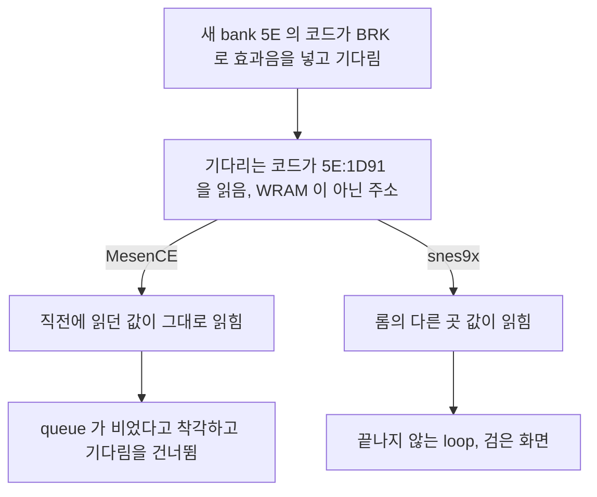

앞 편들에서 DQ5 엔진을 읽고, 맵·인물·대사를 넣는 도구를 만들고, 한글 window와 맵 그림과 곡까지 갖췄다.
이번 편은 그 위에 진짜 게임을 올리는 이야기다.
새 게임을 누르면 DQ5 대신 DQ4의 서장이 시작하고, 1장 왕궁의 전사들을 끝까지 깰 수 있다.

연재의 마지막 편이니 1장을 처음부터 끝까지 같이 걸어 보면서, 그 장면을 만들 때 뭐가 터졌는지 이야기해보려 한다.
(전부 적으면 끝이 없어서 재미있었던 것만 골랐다.)

## 네 줄 요약

- DQ5 엔진 위에서 DQ4의 서장과 1장이 새 게임부터 "다음에 계속"까지 이어진다.
- 만드는 내내 DQ5의 흔적이 튀어나왔다. 바트랜드 앞에서 파파스의 슬라임 전투가 벌어지고, 호이민은 DQ5 주인공 옷을 입고 따라왔다.
- 원작과 일부러 다르게 한 곳이 있다. encounter는 3/4, 전투 보상은 4/3배, 가게는 여러 개를 한 번에 사고 사기 전에 물어본다.
- 에뮬레이터 하나에서 잘 된다고 다 된 게 아니었다. snes9x에서는 이름을 넣자마자 멈췄고, 그 뒤로는 1장 전체를 기계가 대신 걸어 본다.

## 새 게임을 눌렀는데 DQ5가 시작하면 안 된다

DQ5는 새 게임을 고르면 주인공이 태어나는 장면, 로고, 배 순서로 오프닝이 흐른다. 이걸 통째로 걷어 내야 한다.
찾아보니 새 게임은 table의 첫 entry에서 첫 맵을 읽고 있었고, 이 entry 하나를 DQ4 맵으로 바꾸자 태어나는 장면도 로고도 같이 사라졌다.
둘 다 첫 맵이 그 방일 때만 실행되는 코드였기 때문이다.
(생각보다 싱겁게 끝났다. 고생은 그 다음부터다...)

## 산골 마을 사람들은 먼저 말을 건다

패미콤판에는 서장이 없다. DS 리메이크가 1장 앞에 덧붙인 짧은 이야기다.
산골 마을 지하에서 검술 수련을 하고, 개구리를 만나고, 소꿉친구 신시아의 변신 주문 모샤스에 속고, 부모와 저녁을 먹는다.
이 롬은 패미콤판을 옮기는 것이지만 서장만은 DS판을 따라 넣기로 했다. 무대는 패미콤판의 산골 마을 맵이고, 사건 순서는 [DS script를 푼 것](/games/romhacking/journal/dq4/originals/)에서 읽어 왔다.

그런데 서장의 인물들은 주인공에게 먼저 말을 건다.
수련 도중에 버튼에서 손을 떼고 있으면 수련 상대인 검사(劍士)가 "벌써 항복이냐?" 하고 묻고, 예/아니요 window가 뜬다.
DQ5 엔진에서 이게 안 됐다. 인물의 script 안에서 예/아니요 window를 직접 열면 엔진이 돌아오지 않는다. 호출 순서를 세 가지로 바꿔 봐도 똑같아서 여기서 한참 헤맸다.

결국 정면으로 푸는 걸 포기하고 엔진을 속였다.
필드에서 "대화" command를 고르면 실행되는 코드의 시작 주소를 찾아낸 다음, 인물은 자기 번호만 메모리에 적어 두고 event script가 그 번호를 들고 "주인공이 이 사람에게 말을 걸었다"를 대신 실행한다.
엔진 입장에서는 평소 하던 대화라서 예/아니요 window도 멀쩡히 열리고 닫힌다.

_가만히 있으면 상대가 먼저 묻는다. 서장 주인공이 왜 라이안인지는 아래 "원작과 뭐가 다를까?"에서._

### 개구리는 왜 안 나오지?

DS판의 개구리는 맵에 서 있지 않다.
주인공이 오두막을 나서는 순간, 다리 동쪽 끝, 다리 위에서 차례로 목소리가 나고, 연못에서 개구리가 뛰어올라 다리 위에 내린다.
그래서 "주인공이 이 사각형 안에 들어왔나"를 확인하는 코드를 붙였는데, 첫 목소리 뒤로 아무 일도 일어나지 않는다...

확인해보니 그 코드가 약 120 frame(2초)에 한 번만 실행되고 있었다.
인물의 script는 그 인물의 이동 간격마다 한 번씩 실행되는데, 복사해 온 인물의 이동 간격이 그만큼 길었다.
주인공이 다리 끝을 지나는 시간은 8 frame이니 2초에 한 번 봐서는 걸릴 리가 없다. 이동 간격을 1로 줄이자 오두막을 나선 바로 그 frame에 목소리가 났다.

_연못에서 뛰어올라 다리 위에 내린 개구리._

서장의 마지막 장면인 저녁 식탁은 내가 직접 플레이하다가 멈춤을 찾았다.
아버지에게 엉뚱한 방향에서 말을 걸었더니, 아버지가 의자로 걸어가는 경로를 주인공이 막고 서 있어서 저녁이 영영 시작되지 않았다 ㅠㅠ
그 뒤로 조작을 막아 놓고 인물을 걷게 하는 사건은 주인공이 어디에 서 있든 끝나도록 서장과 1장 전부를 손봤다. 걷는 인물이 주인공을 통과하거나 돌아가고, 주인공을 걷게 할 때는 서 있는 곳에서 목표까지의 경로를 그때 계산한다.

_부모가 의자까지 걸어가 앉아야 저녁이 시작된다._

## 왕 앞에 전사들이 누워 있었다

저녁이 끝나면 화면이 어두워지고 "이야기는 이렇게 시작된다……"와 함께 1장으로 넘어간다.
패미콤판은 검은 화면에 금테 box로 장 제목을 띄우는데 DQ5에는 이런 box가 없어서 직접 만들었다.
맵과 인물은 다 불러오되 BG3(window가 그려지는 layer)만 켜 두면 화면이 검게 남고, 그 위에 box를 그린다.
테두리와 바탕은 패미콤 롬에 든 tile을 풀어 썼고, 제목은 한글 글꼴을 한 픽셀 옆으로 한 번 더 찍어 굵게 했다.

_뒤가 검을 뿐, 왕좌의 방은 이미 다 불려 와 있다._

box가 사라지고 왕좌의 방이 밝아졌는데, 줄 서 있어야 할 전사 여섯 명이 융단 위에 누워 있었다.
DQ5의 인물은 처음부터 새로 만들 수가 없어서 원래 롬에 있는 인물을 복사해 고쳐 쓰는데, 하필 복사한 원본이 누워 자는 선원이었다. (복사하면 자세까지 따라온다...)
일으켜 세우고 나니 이번에는 퇴장하던 전사들이 통로에서 뭉쳐 멈춘다. 통로 양옆의 문지기 때문이었고, 문지기 둘을 한 블록 바깥으로 옮기고 전사들을 두 줄로 걷게 하니 여섯 명 모두 무사히 나갔다.

_이제는 서서 듣는다._

## 바트랜드에는 왜 밤이 안 오지?

성을 나서면 바트랜드 성 마을이다.
바트랜드와 이무르는 패미콤의 맵 배치를 그대로 새 맵 group에 넣었고, 인물도 패미콤의 낮 목록과 밤 목록에서 위치·방향·대사를 그대로 옮겼다. 두 곳의 낮과 밤을 합치면 101명이다.

성 마을에는 알렉스의 아내 프레아가 있다.
그런데 플레이하다 보니 프레아가 노인으로 나온다. 패미콤 그림 번호를 DQ5 그림 번호로 바꾸는 table의 한 줄이 처음부터 여자를 노인이라고 적고 있었다.
원작의 그림 종류와 이 롬의 그림을 인물마다 비교하는 test를 만들어 보니 같은 실수가 여섯 쌍이나 더 나왔다.

프레아는 그냥은 따라오지 않는다. 밤의 이무르에서 아이나 감옥에 갇힌 남자에게서 알렉스라는 이름을 듣고 와야 한다.
여기서 원작의 사정이 하나 있다. 패미콤 1장의 여관은 늘 아침에 깨워 주기 때문에, 밤은 필드를 걸어야만 온다.
그래서 필드를 걸어 봤는데 아무리 걸어도 해가 지지 않는다.

DQ5는 유년기 동안 flag 하나로 필드의 시간을 멈춰 두는데, 새 게임이 그 flag를 켜는 코드를 지나고 있었다. 그 4바이트를 지우자 16걸음마다 시각이 흘렀다.
이걸 확인하는 동안 이상한 일이 하나 더 있었다. 필드에 나가자마자 슬라임과 전투가 붙는다. encounter를 아예 꺼도 붙는다.
DQ5에서 처음 필드에 나가면 슬라임과 싸우게 되고 파파스가 달려오는 바로 그 전투였다. 바트랜드 성문 앞에서 파파스를 만날 뻔했다.
새 게임을 시작할 때 "이미 봤음" flag를 켜서 없앴다.

_걸어서 맞은 이무르의 밤. 이 아이에게서 알렉스라는 이름을 듣는다._

## 프레아는 일행이 아닌데 따라와야 한다

이름을 듣고 돌아가면 프레아가 "이무르 마을까지 데려가 주세요!" 하고 따라나선다.
프레아는 싸우는 동료가 아니다. party에 넣으면 전투와 menu에도 나와 버린다.
그래서 주인공 뒤를 따라 걷는 sprite 목록 끝에 그림만 하나 더 붙였다. 이무르 감옥에 들어서면 줄에서 빠져 알렉스 쪽으로 걸어간다.

_이무르 감옥의 재회. 창살은 패미콤처럼 너머로 말이 통하게 해서, 밤에 창살 밖에서도 알렉스에게 말을 걸 수 있다._

## 호이민이 DQ5 주인공 옷을 입고 따라왔다

다음은 옛 우물이다. 바닥의 구멍으로 떨어지면 우물 아래 동굴이고, 걷다 보면 "이쪽으로 와……", "그쪽이 아니야." 하는 아이 목소리가 들린다.
(보이지 않는 인물 하나가 주인공의 위치와 방향을 지켜보다가 메시지를 띄운다.)
동굴 안쪽에는 호이미 슬라임 호이민이 기다리고 있다.

_여기서 "예"라고 답하면 동료가 된다._

DQ5는 동료를 주인공 뒤에 줄 세우는 엔진이니 호이민도 알아서 따라올 줄 알았다. 그런데 합류해도 라이안 혼자 걷는다.
일행 수는 2인데 걷는 sprite 수가 1 그대로였고, 줄을 다시 세우는 코드를 합류 직후에 실행하자 드디어 뒤에 누가 나타났는데...
DQ5 주인공이었다. 호이민이 DQ5 주인공 차림으로 라이안 뒤를 따라온다.

호이민의 record에는 "명령을 받지 않는 손님"이라는 표시 bit가 켜져 있다.
그림 번호를 고르는 코드가 이 bit까지 번호의 일부로 읽는 바람에 table 밖의 엉뚱한 값을 집어 온 것이었다. bit 하나를 더 가리도록 고치자 호이미 슬라임이 나왔다.

끝이 아니다. 맵을 옮기면 호이민이 또 사라진다.
맵을 불러올 때 실행되는 코드 가운데 걷는 인원을 1로 되돌리는 것이 있었다. DQ5에서는 어떤 flag가 꺼져 있을 때만 실행되는데, 이 롬에서는 그 flag가 늘 꺼져 있다.
인원을 되돌리는 명령 하나만 지웠다. (처음엔 손님 bit가 범인인 줄 알고 그쪽만 팠는데 아니었다.)

_맵을 옮겨도, 제 모습으로 따라오는 호이민._

## 구두가 든 상자가 안 열린다

우물 아래 상자에는 하늘을 나는 구두가 들어 있다. 이게 없으면 탑에 갈 수 없다.
그동안은 사건마다 flag를 켜 놓고 하나씩 따로 확인해 왔는데, 처음으로 아무것도 건드리지 않고 서장부터 쭉 이어서 걸어 봤다.
구두 상자 앞에서 "조사"를 골랐더니 "발밑을 조사했다"만 나온다. 상자가 없다...??

상자 test를 1장 롬에 실행해보니 50개가 전부 실패였다.
상자는 맵만 올린 시험용 롬에서 확인해 왔고, 정작 1장 build가 가져오는 patch 목록에는 상자 patch가 처음부터 빠져 있었다.
그때까지의 1장 롬은 아무도 깰 수 없는 롬이었던 거다.
조각마다 test가 통과해도 실제로 내보낼 롬으로 처음부터 끝까지 가 보지 않으면 모른다는 걸 이때 배웠다.

구두 자체도 말썽이었다. DQ5에도 같은 이름의 도구가 있어서 그대로 써 봤더니 엉뚱한 바다로 날아간다.
목적지를 아이들이 잡혀 있는 탑으로 바꾸고(DS판에서 호수의 탑이라고 부르는 그 탑이다), 패미콤처럼 날아간 뒤 곧바로 탑 1층에 서게 했다.
탑에 들어서면 마물이 "자, 따라와! 꼬마!" 하며 아이를 끌고 계단으로 사라진다.

## 탑 꼭대기에서 지면 어떻게 될까?

탑 꼭대기에는 피사로의 부하와 큰 눈알이 기다린다.
DQ5의 event 전투는 지면 그 전투만의 패배 장면으로 넘어가게 돼 있다. 하지만 원작의 1장 보스는 지면 그냥 전멸이다.
그래서 전투를 시작하는 코드 네 가지를 읽어, 지면 보통 전멸로 이어지는 것(상자 속 몬스터가 쓰는 것)을 골라 썼다.
몬스터는 이 롬에 나올 일이 없는 DQ5 event 보스 번호 둘을 빌려 패미콤의 능력치로 덮었다. 피사로의 부하는 HP 250이고, 레벨 1로 덤비면 라이안이 첫 턴에 쓰러진다.

_왼쪽이 피사로의 부하, 오른쪽이 큰 눈알._

## 왕의 선물을 받았더니 라이안이 주문을 배웠다

보스를 이기면 성과 이무르와 탑의 인물이 통째로 보스 뒤 목록으로 바뀐다.
아이들을 이무르에 데려다주고 왕좌의 방에 들어서면 병사들이 갈라서고 일행이 왕 앞까지 저절로 걸어간다. 왕은 칭찬과 함께 경험치 3000을 내린다.

_레벨이 오르는 동안 뜨는 status window가 왕의 대사 오른쪽을 가린다. 이건 아직 못 고쳤다._

이 장면을 확인하다가 라이안이 말없이 주문을 배우고 있는 걸 발견했다.
라이안의 record가 DQ5 주인공의 slot에 들어 있어서 레벨이 오를 때 DQ5 주인공의 주문 습득 table을 따라가고 있었다.
원작의 라이안은 주문을 하나도 못 쓰는 전사이니 그 table을 비웠다.

성을 나서면 서술과 함께 1장이 끝난다.

_1장만 든 롬은 이 화면 뒤 타이틀로 돌아간다. 물론 원작에는 없는 화면이다._

## 원작과 뭐가 다를까?

팬이라면 제일 먼저 궁금할 것 같아서 모아 봤다.

**이름을 서장의 주인공과 라이안이 같이 쓴다.**
원작에서 이름을 짓는 인물은 용사뿐이고 라이안은 처음부터 라이안이다.
이 롬은 name entry 화면에서 넣은 이름을 서장의 주인공도 쓰고 1장의 전사도 쓴다. 원작 대사에 "라이안"이라고 박혀 있던 곳도 전부 입력한 이름으로 바뀐다.
라이안의 record가 DQ5 주인공 slot에 들어 있어서 주인공 이름이 그대로 따라온 결과다. (위 화면들이 전부 라이안인 것은 찍을 때 이름을 그렇게 넣어서다.)
용사와 라이안이 만나는 5장에서 어떻게 할지는 거기까지 만들 때 풀어야 할 숙제다.

**encounter는 3/4, 전투 보상은 4/3배.**
전투가 원작의 3/4만큼만 일어나고, 대신 전투에서 얻는 경험치와 골드가 4/3배다.
걸은 거리만큼 얻는 양은 원작과 같게 두고 전투 횟수만 줄이자는 결정이다. 왕의 선물 3000 같은 사건 보상은 그대로다.

**가게에서 여러 개를 사고, 사기 전에 물어본다.**
원작도 DQ5도 약초를 하나씩만 살 수 있고, 고르는 순간 돈이 빠진다.
도구는 "몇 개 사시겠어요?"로 개수를 고르게 했고(엔진에 개수 window가 없어서 예금할 때 쓰는 숫자 window를 빌렸다), 돈을 빼기 전에 "24골드인데 사시겠어요?"를 묻는다.
목록에는 값 뒤에 G를 붙였고, 팔 때는 얼마에 팔리는지 미리 보이고, 장착 중인 물건을 팔려 하면 한 번 경고한다.

_약초 3개. 쓰는 돈과 남는 돈이 개수를 바꿀 때마다 같이 바뀐다._

이걸 만들다가 공짜 장비 버그도 냈다. 개수를 담는 변수를 도구를 살 때만 채웠는데, 장비를 살 때도 같은 코드를 지나고 있었다.
앞에서 3이 남아 있는 채로 체인 메일을 사면 350골드에 세 벌이 들어왔다. (고쳤다.)

그 밖에 문은 "문" command를 고르지 않아도 걸어서 부딪히면 열린다.
반대로 숫자는 원작에 맞췄다. 물건 값은 패미콤 값이고, 라이안의 능력치는 패미콤의 성장 곡선대로 오르고, 전멸하면 DQ5처럼 마지막에 들른 마을이 아니라 패미콤처럼 마지막에 기록한 교회로 간다.

_이무르 무기점. 한글 name entry를 만들기 전에 찍은 화면이라 이름이 ああああ 다._

DS판만 해 본 사람이라면 가시 채찍과 부메랑을 보고 어? 할 것 같다. DS판에는 이 두 무기가 없고, 같은 번호에 성스러운 나이프와 크로스 보우가 들어 있다.
(그러니 DS판 이무르도 그 둘을 팔 것 같은데, DS판 가게 목록까지 직접 확인하지는 못했다.)
이 롬은 패미콤판을 옮기는 것이라 다섯 품목과 값 모두 패미콤 그대로다.
가시 채찍과 부메랑은 DQ5에도 있는 무기라 그 slot을 그대로 썼고, 철 창만 DQ5에 없어서 대나무 창의 slot을 빌려 이름·공격력·값을 덮었다.

## 호이민은 누구를 고칠까?

결론부터 말하면, 라이안과 호이민이 둘 다 다쳤을 때 호이민이 자기를 고칠 확률은 6분의 1이다.

패미콤의 호이민은 동료가 아니라 몬스터 AI로 움직인다.
몬스터 data를 읽어 보면 행동의 weight가 호이미 248, 공격 5, 방어 2이고, 호이미는 일행 가운데 누군가의 HP가 절반 아래일 때만 고른다. 여기까지는 롬에 적혀 있다.
문제는 "그래서 누구에게 쓰나"인데, 이 부분의 패미콤 코드는 끝까지 읽어 내지 못했다.

그래서 세어 봤다.
패미콤 1장 필드에서 라이안과 호이민의 HP를 고정해 놓고 슬라임과 계속 싸우게 하면서, 호이미가 누구의 HP를 올렸는지를 기록했다.

| 상황          | 호이미를 받은 쪽        |
| ------------- | ----------------------- |
| 라이안만 다침 | 전부 라이안             |
| 호이민만 다침 | 전부 호이민             |
| 둘 다 다침    | 라이안 564 : 호이민 112 |

676번 가운데 112번이니 16.6%, 딱 6분의 1이다. HP 비율이나 줄 선 순서를 바꿔도 똑같았다.
호이민은 여섯 번에 다섯 번은 자기보다 라이안을 먼저 챙기는 착한 슬라임이었다.

이 규칙을 그대로 옮겼고, 옮긴 롬에서 같은 실험을 하니 109번 가운데 17번(15.6%)이 호이민 자신이었다.
참고로 옮기기 전에는 대상 번호가 코드에 고정돼 있어서 호이민이 늘 자기만 고쳤다. (원작과 정반대인 이기적인 호이민이었다...)

## 인물 그림은 손으로 그리다 포기했다

숨기지 않고 적자면, 위 화면에 나온 인물들은 DS 리메이크의 sprite sheet를 줄여서 만들었다.
처음부터 그러려던 건 아니다. 처음에는 색 번호를 한 점씩 적어 가며 손으로 그렸다.

_버린 손그림 시안. 위 스크린샷의 라이안이나 프레아와 비교해보면 왜 버렸는지 보인다._

마음에 안 들어서 DQ5 주인공의 sprite를 꺼내 크기를 확인해봤더니 실제로 그려진 부분은 14×17에 8색뿐이었다.
시안은 16×24를 꽉 채우고 15색을 썼으니 눈 모양 이전에 크기와 색 수부터 달랐다.
그 규격에 맞춰 다시 그린 라이안은 훨씬 나았는데, 톨네코와 용사는 네 번을 고쳐도 살지 않았다.
이미지 생성 모델도 써 봤지만 16×24 격자에 맞춰 읽으면 색이 70~200개로 번지고 1~2픽셀짜리 눈이 사라졌다.
결국 DS의 sheet(24×32)를 줄이고 눈만 DQ5처럼 따로 찍는 쪽이 가장 나아서 그렇게 정했다.

## snes9x에서는 이름을 넣자마자 멈췄다

가장 많이 배운 버그다.
분석도 test도 줄곧 MesenCE라는 에뮬레이터로 해 왔다. 다른 에뮬레이터에서도 되는지 보려고 1장 롬을 snes9x에 넣어 봤더니, 이름을 넣은 직후 검은 화면에서 멈춘다.
서장이 시작하자마자 검은 화면에서 칼이 여섯 번 부딪치는 그 장면이었다.

DQ5는 `BRK` 라는 명령을 "효과음을 넣고 끝날 때까지 기다려" 같은 공용 기능을 부르는 데 쓴다.
이때 엔진은 지금 어느 bank(64KB 단위의 주소 구역)의 data를 읽을지를 정하는 DB register를, `BRK` 를 부른 코드의 bank로 바꿔 놓는다.
원래 롬의 코드는 전부 bank `00`~`3F` 에 있고, 이 bank들은 낮은 주소가 WRAM(게임이 쓰는 메모리)으로 이어져 있다. 그래서 기다리는 코드가 `$1D91` 같은 짧은 주소로 메모리를 읽어도 문제가 없었다.
그런데 칼 소리 코드는 새로 늘린 bank `5E` 에 넣었다. 거기서 `BRK` 를 부르면 기다리는 코드는 `5E:1D91` 을 읽는다. 여기는 WRAM이 아니다. 아무것도 없는 주소다.

_같은 코드인데, 아무것도 없는 주소에서 무엇이 읽히느냐가 에뮬레이터마다 달랐다._

MesenCE에서는 그 주소를 읽으면 직전에 읽던 값이 그대로 나온다. 소리 queue의 시작과 끝이 우연히 같은 값으로 읽혀서 "queue가 비었네" 하고 기다림을 건너뛰었다.
맞게 실행된 게 아니라 틀린 채로 지나갔을 뿐이다.
가게의 확인 window를 처음 붙였을 때 화면이 멈췄던 것도 같은 원인이었다.

`BRK` 를 쓰지 않고 DB를 0으로 맞춘 뒤 같은 코드를 직접 부르도록 고쳤다.
그리고 새 bank의 코드가 써도 되는 `BRK` 는 확인을 마친 다섯 가지뿐이라고 정해 두고, 그 밖의 것을 쓰면 CI에서 잡히게 했다.

## 끝까지 가는지 매번 직접 깨 봐야 할까?

상자 없는 롬과 snes9x 사건을 겪고 나니, 고칠 때마다 사람이 1장을 깨 볼 수는 없다는 생각이 들었다.
그래서 에뮬레이터를 화면 없이 실행해 버튼 입력만으로 1장을 걷는 test를 만들었다.

새 게임부터 제2장 box까지를 27구간으로 나눠 걷는다.
필드 이동은 순간이동 도구로 건너뛰지만 맵 안의 사건은 진짜 버튼 입력으로 진행하고, flag에는 손대지 않는다. 사건은 앞 사건이 켠 flag로만 열리니 연결이 하나라도 끊기면 그 구간에서 멈춘다.

처음에는 이 test가 운이 좋을 때만 통과했다.
롬에서 상관없는 인물 하나만 바뀌어도 random 값을 쓴 횟수가 달라지고, 그 뒤 구간이 전부 다른 random 값으로 걷게 되기 때문이다.
그래서 구간을 시작할 때마다 random seed와 시각을 정해진 값으로 맞추고 encounter를 꺼서, 같은 롬이면 몇 번을 실행해도 같은 결과가 나오게 했다.
구간이 서로 독립이 되니 13묶음으로 나눠 동시에 실행할 수 있고, 여섯 개씩 실행하면 1분 41초에 끝난다.
(encounter를 끈 test는 전투를 지나지 않으니 첫 걸음에 정해진 몬스터와 싸우는 test는 따로 있다.)

snes9x 사건 뒤로는 같은 걷기를 snes9x와 bsnes에서도 실행한다.

## 아직 못 한 것

- 왕의 선물 장면에서 status window가 대사를 가린다.
- 실기와 플래시 카트에서는 실행해보지 못했다.
- 서장의 개구리가 나타날 때의 물결 효과와 카메라 이동이 없다.
- 2장부터는 만드는 중이다.

## 더 보기

연재는 여기까지다. 처음부터 읽으려면 [개요](/games/romhacking/journal/dq4/overview/)로 가면 된다.
주소와 table까지 궁금하다면 아래 문서에 다 있다.

- [서장 형식 문서](https://github.com/perfectacle/sfc-dq4/blob/main/sfc/dq4/docs/dq4-prologue-format.md), [형식 문서(1장)](https://github.com/perfectacle/sfc-dq4/blob/main/sfc/dq4/docs/dq4-chapter1-format.md)
- [성장 곡선](https://github.com/perfectacle/sfc-dq4/blob/main/sfc/dq4/docs/dq4-growth-format.md), [인물 sprite](https://github.com/perfectacle/sfc-dq4/blob/main/sfc/dq4/docs/dq4-sprite-format.md)
- [다른 에뮬레이터 호환성](https://github.com/perfectacle/sfc-dq4/blob/main/sfc/dq4/docs/dq4-compat-format.md)
