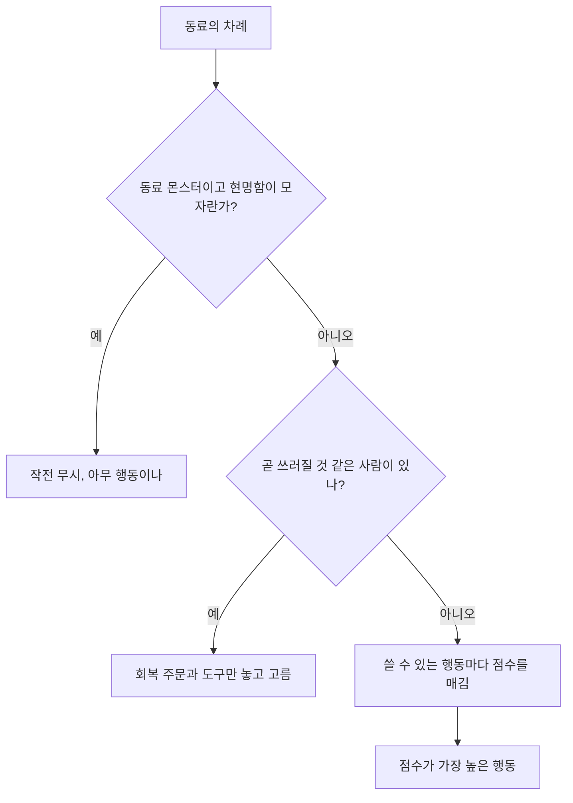

드래곤 퀘스트를 하다 보면 누구나 한 번쯤 궁금해지는 숫자들이 있다.
적은 몇 걸음마다 나오는 걸까? 도망은 왜 어떨 땐 되고 어떨 땐 안 될까? 회심의 일격은 얼마나 자주 터질까?
공략 사이트에 다 적혀 있긴 한데, DQ4의 몬스터와 주문을 DQ5 엔진에 넣으려면 남이 적어 둔 숫자가 아니라 롬에 진짜 들어 있는 숫자를 알아야 한다.
그래서 이번 편은 DQ5의 전투 규칙을 롬에서 직접 읽고, 에뮬레이터로 싸워서 확인해본 기록이다.
([맵](/games/romhacking/journal/dq4/dq5-maps/)과 [대사·사건](/games/romhacking/journal/dq4/dq5-events/)에 이은 세 번째 분석 편이다.)

## 네 줄 요약

1. 풀밭에서는 전투가 끝나고 여섯 걸음까지는 적이 절대 안 나오고, 21걸음째부터 확률이 두 배로 뛴다.
2. 도망은 민첩과 아무 상관이 없다. 몇 번째 시도인지와 레벨 차이만 본다.
3. 회심의 일격은 1/32, 데미지는 (공격력 − 수비력/2) / 2 에서 조금 흔들리는 값이다.
4. 동료 몬스터는 현명함이 20은 돼야 작전을 제대로 따르고, 한 번 싸워 본 적에게 안 통하는 주문은 기억해 뒀다가 다시는 안 쓴다.

## 전투는 매번 다른데 어떻게 실험하지?

맵은 한 번 보면 끝인데 전투는 random이 끼어 있어서 한 번 본 걸로는 아무 말도 못 한다.
그래서 같은 전투를 몇 번이고 다시 붙일 수 있는 장면부터 골랐다.

DQ5를 시작하면 어린 주인공이 배에서 내려 산타로즈로 가는 길에 슬라임 셋을 만나고, 조금 버티면 아버지 파파스가 달려와서 대신 싸워 준다.
이 전투 하나로 이번 편 실험을 거의 다 했다.
화면을 눈으로 읽는 대신 전투 메시지가 뜰 때마다 그 번호를 받아 적는 Lua script를 [에뮬레이터](/games/romhacking/sfc/emulator/)에 붙였더니, "주문을 외웠다", "몬스터가 데미지를 받았다", "듣지 않았다" 같은 줄만 봐도 전투가 어떻게 흘렀는지 알 수 있었다.

여기서 제일 쓸모 있었던 게 파파스다.
파파스는 일행처럼 보이지만 사실은 몬스터 record로 움직인다. (몬스터 목록에 파파스가 한 줄 들어 있다...)
몬스터 record에는 그 몬스터가 쓸 행동 여섯 개가 적혀 있어서, 파파스의 여섯 개를 전부 메라로 바꾸면 파파스가 슬라임에게 메라만 외워 준다.
반대로 슬라임 쪽 여섯 개를 바꾸면 몬스터가 우리에게 쓰는 주문을 볼 수 있다.
슬라임 HP를 200으로 올려 두면 전투가 끝나지도 않는다.

또 하나는 random을 고정하는 방법이다.
주문 데미지의 범위를 알려면 보통은 수십 번 싸워서 표본을 모아야 하는데, 난수 함수가 늘 같은 값만 돌려주게 patch하면 그럴 필요가 없다.
늘 0을 돌려주게 하면 최솟값이, 늘 255를 돌려주게 하면 최댓값이 나온다.
기라는 딱 두 판 싸워서 16과 24를 얻었다. 끝.

## 몇 걸음마다 적이 나올까?

걸음마다 게임은 두 가지를 정한다. 지금 어느 구역에 서 있는지와, 그곳의 조우율이다.

필드(세계 지도)에서는 조우율이 발밑 지형으로 정해진다. 풀밭은 12, 바다는 2다.
던전 같은 실내 맵은 어디든 7인데, 방과 방의 경계를 넘는 걸음만 20으로 뛴다. (방에 들어서자마자 적이 나온다 싶었다면 기분 탓이 아니다.)

이 조우율이 그대로 확률이 되는 건 아니고, 마지막 전투 뒤로 몇 걸음 걸었는지에 따라 깎이거나 불어난다.
기준은 256 / 조우율 걸음이다. 풀밭이면 21걸음이다.

```text
마지막 전투 뒤 걸음   조우율에 곱하는 값       풀밭에서 한 걸음의 확률
0~2                   0                        0%
3~4                   1/64                     0%
5~6                   1/16                     0%
7~8                   1/4                      1.2%
9~10                  1/2                      2.3%
11~20                 3/4                      3.5%
21~41                 1.5                      7%
42~                   4                        19%
```

맨 오른쪽 숫자는 조우율에 가운데 열의 값을 곱하고(소수점 아래는 버린다), 거기에 구역 계수를 곱한 다음 256으로 나눈 값이다. 예를 들어 7~8걸음은 12 × 1/4 = 3 이니 3/256, 약 1.2%다.
구역 계수는 구역마다 여덟 단계(0.25배~2배) 가운데 하나가 정해져 있고, 위 표는 딱 1배인 구역으로 계산했다.
정리하면 풀밭에서는 전투 직후 여섯 걸음은 안전하고, 스무 걸음쯤까지는 드물게 나오다가, 그걸 넘기면 금방 걸린다.

걸음 수로 깎고 불리는 저 단계 값은 코드를 읽어서 얻은 것이고, 걸어서 확인한 건 구역과 조우율 쪽이다.
조우 계수를 0으로 patch해서 전투가 안 붙게 해 놓고 필드를 1,182걸음 걸으면서, 걸음마다 게임이 정한 구역·조우율을 롬의 table에서 계산한 값과 비교했더니 전부 같았다.


_이건 DQ5가 아니라 이 엔진 위에 옮긴 DQ4 화면이다. 성 밖을 걷다가 위 규칙대로 걸린 전투이고, 같은 판정 코드가 그대로 돌고 있다._

### 바다에서는 왜 전투가 안 붙었지?

배를 타고 바다 전투를 확인하려는데 아무리 저어도 전투가 안 붙었다.
구역을 잘못 읽었나 싶어 한참 뒤졌는데, 알고 보니 위아래로 몇 번 왔다 갔다 한 게 전부라 걸음 수가 모자랐던 거였다.
바다는 조우율이 2라서 걸음 보정까지 받으면 초반 확률이 사실상 0이다.
그냥 오래 저었더니 붙었다...


_이쪽은 진짜 DQ5다. 아무것도 patch하지 않고 배로 오래 저어서 만난 저릿해파리와 유령 선장._

### 누가 몇 마리 나오는지는?

구역마다 22바이트짜리 record가 있고 그 안에 slot이 11개 있다.
slot마다 weight가 있어서 그 비율대로 하나를 뽑는데, 앞의 다섯은 여러 종이 섞인 무리, 그다음 다섯은 한 종만 나오는 무리, 마지막 하나는 미리 짜 둔 고정 무리다.

record 맨 앞 바이트는 구역 레벨이다. 팬들이 보통 적 레벨이라고 부르는 그 값이고, 여기저기서 쓰인다.

- 토헤로스와 성수는 주인공 레벨이 구역 레벨 이상일 때만 듣는다. 구역 레벨 9인 곳에서 레벨 1로는 조우율이 그대로였고, 9로 올리니 0이 됐다.
- 냄새 주머니와 마물의 먹이는 조우율을 8배로 올린다.
- 주인공 레벨이 구역 레벨 + 4 보다 크면 몬스터가 도망간다. 레벨 13까지는 슬라임들이 끝까지 남아 있었고 14에서 달아났다.

마릿수는 record에 적힌 대로 안 나올 때도 있다.
킹 슬라임을 8마리로 적어 넣어 봤는데 화면에는 3마리만 나왔다.
몬스터 그림마다 너비가 있고 한 줄에 28 미만까지만 세우기 때문이다. 킹 슬라임은 너비가 7이라 셋(21)까지만 들어간다.

## 도망은 언제 성공할까?

민첩이 높으면 잘 도망칠 것 같지만 DQ5는 민첩을 아예 읽지 않는다.

- 선제공격을 잡았거나, 주인공 레벨이 구역 레벨 + 5 이상이면 무조건 성공한다.
- 아니면 몇 번째 시도인지만 본다. 성공 확률은 첫 번째와 두 번째가 1/2, 세 번째가 3/4, 네 번째부터 7/8 이다.
- 실패하면 몬스터에게 한 턴을 그냥 내준다.
- 도망칠 수 없는 event 전투는 무리에 flag 하나가 켜져 있어서 random 없이 늘 실패한다.

실제로 무작위 전투 32판을 잡아서 계속 도망쳐 봤더니 첫 시도는 30번 중 18번 성공했다.
레벨 1과 레벨 13은 결과가 똑같았고, 14(구역 레벨 9 + 5)가 되자 13번 모두 첫 시도에 바로 성공했다.

사실 여기서 한참 헤맸다.
처음 실험하던 슬라임 셋 전투에서는 아무리 도망을 눌러도 실패만 해서, 실패하게 만드는 숨은 조건이 따로 있는 줄 알고 그걸 찾아다녔다.
하필 그 전투가 도망 못 치는 flag가 켜진 event 전투였다 ㅠㅠ

전투가 시작될 때 정해지는 선제와 기습도 구역 record에 확률 번호가 들어 있다.
확률은 1/32 아니면 4/32 이고(기습은 아예 0인 구역도 있다), 기습을 막는 조건이 하나 있다.
몬스터가 전부 잠들었거나 마비된 채로 시작하면 기습 판정에 걸려도 "그러나 슬라임은 잠들어 있다!"로 바뀐다.

## 회심의 일격은 얼마나 자주 나올까?

1/32 이다.
일행이 공격할 때마다 0~31 가운데 하나를 뽑아서 0이면 회심이다.
아무것도 고치지 않은 롬으로 슬라임을 594번 때려 보니 24번(4.0%)이 회심이어서 1/32(3.1%)과 어긋나지 않았다.

보통 공격의 데미지는 이렇게 계산한다.

```text
h = (공격력 − 수비력/2) / 2

h 가 8 이상이면      h × 7/8 에서 h × 9/8 쯤까지
h 가 8 미만이면      h − 1 에서 h + 1 까지
h 가 0 이하면        0 아니면 1
회심이면             공격력의 86%~102%, 수비력은 무시
```

공격력에서 수비력의 절반을 빼고 다시 반으로 나눈다는 건 팬이라면 다들 아는 식인데, 롬에도 정말 그렇게 들어 있었다.
공격력 200으로 수비력 5인 슬라임을 때리면 식으로는 86~110 이 나와야 하고, 실제로 34번 때린 값이 모두 그 안이었다.
(처음에는 67부터 나와서 식을 잘못 읽은 줄 알았다. 옆에서 같이 때리던 파파스의 데미지가 섞인 거였다.)

예외가 하나 있는데, 맞는 쪽이 일행일 때는 h가 아무리 작아도 0~공격력/16 까지는 들어온다.
수비력을 아무리 올려도 강한 몬스터에게 0만 맞을 수는 없게 해 둔 장치로 보인다.

방어를 고르면 받는 데미지가 절반이 된다.

### 통한의 일격은 어디서 나오지?

몬스터 쪽 회심인 통한의 일격은 켜는 곳을 찾느라 애먹었다.
몬스터에게 어떤 상태 비트가 켜져 있으면 그 몬스터의 공격이 통한의 일격이 되는데, 이 비트를 켜는 코드가 롬 전체에 딱 한 군데뿐이었다.
몬스터가 외운 팔푼테(무슨 일이 일어날지 모르는 주문)의 효과 가운데 "몸에 힘이 넘쳐 온다!"다.
슬라임에게 팔푼테만 외우게 하고 효과를 그걸로 고정했더니 그 메시지와 함께 비트가 켜졌고, 비트를 켜 둔 슬라임은 공격 열 번이 전부 통한의 일격이었다.

(몬스터가 평소에 쓰는 강한 일격은 이것과 별개의 행동 두 가지다. 하나는 1/4 확률로 수비력을 무시하고, 다른 하나는 늘 공격력의 다섯 배다.)

### 주문은 얼마나 깎일까?

주문 데미지는 주문마다 기본값과 random 폭이 정해져 있다. 메라는 12~15 다.
여기에 몬스터의 내성이 곱해진다. 내성은 네 단계이고 약한 쪽부터 100%, 80%, 33%, 0% 다.

```text
메라를 맞은 슬라임의 데미지
내성 0: 12~15    내성 1: 9~12    내성 2: 3~4    내성 3: 듣지 않는다
```

라리호 같은 상태 주문도 몬스터에게는 같은 숫자를 확률로 쓴다. 내성 1이면 80%로 잠든다.
그리고 주인공 레벨이 구역 레벨보다 10 이상 높으면 80%가 100%로, 33%가 66%로 바뀐다. 한참 약한 상대에게는 주문이 더 잘 듣는다.

반대로 일행이 주문에 맞을 때는 내성 단계가 없고, 입고 있는 갑옷과 방패가 정해진 값을 빼 준다.
마법의 갑옷을 입히니 메라미 데미지가 매번 10씩 줄었고, 파멸의 방패를 들리니 20씩 늘었다. (저주받은 장비답다.)

### HP 4500은 어디에 적혀 있을까?

몬스터 한 마리는 25바이트 record인데 HP에 쓸 수 있는 비트가 11개뿐이라 2047까지만 적을 수 있다.
그런데 미르드라스 둘째 모습의 HP는 4500이다. 어떻게 넣었을까?

HP가 2046이라고 적혀 있으면 4500으로, 2045면 9000으로 바꿔 읽는다. 꼼수다 ㅋㅋ
2046이 적힌 몬스터는 게마, 부온, 이부르, 미르드라스 둘째 모습이고, 2045는 에스타크 하나다.
미르드라스 전투를 붙여 놓고 HP가 쓰이는 순간을 잡아 보니 정말 그 코드를 지나서 4500이 들어갔다.
(2044를 3000으로 바꾸는 코드도 있는데 그 값을 쓰는 몬스터는 없다.)

## 몬스터는 행동을 어떻게 고를까?

몬스터 record의 행동 여섯 개 가운데 무엇을 쓸지는 두 단계로 정해진다.

먼저 쓸모없는 행동을 뺀다.
메간테는 자기 HP가 최대의 1/3 아래일 때만, 호이미는 다친 동료가 있을 때만, 라리호는 아직 안 잠든 상대가 있을 때만 후보에 남는다.
슬라임 여덟 마리가 모여 킹 슬라임이 되는 합체도 이 조건이다. 7마리일 때는 그냥 공격만 했고 8마리를 채우자 합체했다.
다만 이 조건을 볼지 말지가 몬스터마다 record에 정해져 있어서, 안 보는 몬스터는 쓸모없는 행동도 그냥 고른다.
마호톤으로 주문을 봉인해 보면 차이가 보인다. 조건을 안 보는 슬라임은 턴마다 메라를 외우려다 "주문은 봉인되어 있다!"만 띄웠고, 조건을 보게 고친 슬라임은 바로 때리기로 바꿨다.

그다음 남은 후보에서 하나를 뽑는다. 뽑는 방식도 몬스터마다 다르다.
여섯 개에서 고르게 뽑는 몬스터, weight table대로 뽑는 몬스터(예를 들어 210, 29, 10, 4, 2, 1 이면 거의 첫 번째만 쓴다), 첫 번째부터 차례대로 쓰는 몬스터가 있다.

한 사람만 물고 늘어지는 몬스터도 있다.
record의 값 하나를 켜면 처음 고른 일행을 기억해 두고 그 사람만 노린다. 켜 보니 공격 25번 중 24번이 주인공이었다.

### 원작의 버그로 보이는 것

조건 table을 찾는 코드는 행동 번호가 작은 것부터 큰 순서로 적혀 있다고 믿고, 찾는 번호보다 큰 번호를 만나면 거기서 멈춘다.
그런데 table에 순서가 뒤집힌 곳이 하나 있다.
그 바로 뒤에 적힌 달콤한 숨결(잠), 독 숨결, 불타는 숨결(이름과 달리 불 공격이 아니라 맞으면 마비된다) 세 가지의 조건은 영영 찾지 못한다.
세 행동만 넣은 슬라임으로 싸워 보니 조건 코드가 한 번도 실행되지 않았다.

조건의 내용은 "아직 그 상태가 아닌 상대가 있을 때만"이니까, 원래대로라면 이미 다 잠든 일행에게 달콤한 숨결을 또 뱉는 일은 없어야 한다.
이 버그 때문에 게임에서는 그런 헛손질이 나올 수 있을 것 같다. (이 장면까지는 확인하지 못했다.)

## 동료는 뭘 보고 행동을 고를까?

DQ4는 동료가 알아서 싸우는 게임이다. 패미콤판 5장은 동료에게 명령을 아예 못 내린다.
그래서 DQ5의 작전 AI가 어떻게 생겼는지가 이 프로젝트에서 꽤 중요했다.

작전은 일행 전체에 하나이고 여섯 가지다.
원문 뜻대로 옮기면 팍팍 가자, 모두 힘내, 주문 절약, 주문 쓰지 마, 목숨을 소중히, 명령하게 해 줘다.
(이 프로젝트 용어집은 NDS 한글 팬패치 표기를 따라 첫째를 "한방에 끝내자구", 뒤의 둘을 "생명을 소중히", "명령을 내려줘"로 적는다.)

### 현명함 20은 진짜 롬에 있었다

실험을 시작하자마자 막혔다.
호이미 슬라임을 동료로 넣고(DQ5에서 호이미 슬라임을 동료로 삼으면 붙는 첫 이름이 호이민이다. DQ4 1장의 그 호이민과는 다른 녀석이다) 주인공 HP를 바닥까지 깎았는데도 호이미를 안 써 준다.

원인은 현명함이었다.
동료 몬스터는 현명함이 20이 안 되면 말을 안 듣는다는 건 DQ5 팬이면 다 아는 얘기인데, 그 숫자가 코드에 그대로 있었다.

- 10 미만: 작전을 완전히 무시하고 공격과 배운 주문 가운데 아무거나 고른다.
- 10~19: 반반이다.
- 20 이상: 늘 작전대로 움직인다.

내가 넣은 호이민의 현명함은 6이었다...
현명함을 바꿔 가며 세어 보니 6과 9에서는 35번 모두 제멋대로였고, 10~19에서는 24번 중 8번만 작전을 따랐고, 20에서는 17번 모두 작전대로였다.
사람 동료는 현명함과 상관없이 늘 작전을 따른다.

### 작전 AI는 점수를 매긴다

작전을 따르는 동료의 차례는 이렇게 흘러간다.



_작전에 따라 달라지는 건 둘이다. 어디서부터 위급으로 볼지와, 점수에 들어가는 weight._

먼저 위급한 사람이 있는지 본다.
HP가 절반 이하이면서, 이번 턴에 맞을 것 같은 데미지를 빼고 나면 최대 HP의 일정 비율 아래로 떨어지는 사람이다.
그 비율이 팍팍 가자는 약 16%, 목숨을 소중히는 약 29%다.
최대 HP 24인 주인공으로 확인해 보니 팍팍 가자의 호이민은 HP가 2까지 떨어져야 호이미를 썼고, 목숨을 소중히에서는 6에서 벌써 썼다.

위급한 사람이 없으면 쓸 수 있는 행동마다 점수를 낸다.
식은 좀 복잡한데 줄여 말하면, 적을 많이 깎을수록 점수가 오르고, MP를 많이 쓸수록, 내가 맞을 데미지가 클수록 점수가 깎인다.
작전마다 32바이트짜리 record가 있어서 이 가감의 weight를 정한다.
주문 절약은 MP가 2만 넘어도 점수를 크게 깎는다. 그래서 같은 장면에서 팍팍 가자의 마린(마법사를 동료로 삼으면 붙는 이름이다)은 기라와 공격을 번갈아 썼고, 주문 절약으로 바꾸자 공격만 했다.

주문 쓰지 마는 MP가 드는 주문을 아예 후보에서 뺀다.
여기서 삽질을 하나 했다. 전투에서 깎는 MP를 0으로 patch했는데도 주문을 여전히 안 쓰는 것이다.
알고 보니 주문의 MP가 롬에 세 군데 따로 적혀 있었다. 전투에서 실제로 깎는 값, 주문 목록 window에 보여 주는 값, 필드에서 외울 때 깎는 값이다.
주문 쓰지 마가 보는 건 엉뚱하게도 window에 보여 주는 값이었다.
그러고 보니 호이미의 MP를 3에서 9로 고친 롬이 window에는 9라고 보여 주면서 필드에서 외우면 3만 깎던 것도 같은 이유였다.
주문을 고치는 도구는 이 셋을 같이 고쳐야 한다.

### 한 번 헛쓴 주문은 다시 안 쓴다

이 편에서 제일 마음에 드는 발견이다. DQ5의 AI는 배운다.

메모리에 몬스터 종류마다 2비트씩이 있고, 그 종류와 몇 라운드 싸워 봤는지(최대 3)를 센다.
처음 만난 적은 주문이 전혀 안 듣는 내성이라도 85%쯤은 들을 거라고 낙관하고, 한 라운드가 지나면 0으로 본다.

메탈 슬라임 셋을 상대로 마린을 싸우게 해봤다.
첫 차례에 베기라곤을 외우고 "듣지 않았다!"를 본 뒤로는 끝까지 공격만 골랐다.
그 2비트를 미리 채워 놓고 시작하면 첫 차례부터 공격이었다.

이 기억은 세이브에도 남는다. 한번 배운 건 껐다 켜도 안 잊는다.
(패미콤판 DQ4의 AI도 싸우면서 배우는 걸로 유명하다. 보스에게 쟈키를 외우던 크리프트가 떠오른다...)

한계도 하나 봤다.
파파스에게 자오랄을 외우게 하면 쓰러진 동료가 옆에 있어도 살아 있는 사람에게 걸고 "아무 일도 일어나지 않았다"로 끝난다.
몬스터 record로 움직이는 쪽은 대상을 고를 때 살아 있는 사람만 후보에 넣기 때문이다.

## 그 밖에 알게 된 것들

- 아이템 drop은 통설과 조금 달랐다. 그 전투에서 처음 쓰러뜨린 몬스터가 후보가 되고, 그 뒤에 다른 종류를 쓰러뜨리면 후보가 지워진다. drop 확률을 100%로 patch해도 슬라임과 드라키가 섞인 무리를 다 잡으면 상자가 안 나왔고, 슬라임만 있는 무리에서는 나왔다. 확률은 몬스터마다 1/1 에서 1/4096 까지 여덟 단계다.
- 경험치는 일행 수로 나누지 않는다. 무리의 경험치 합계를 살아 있는 사람 각자가 통째로 받는다.
- 레벨이 오를 때 "힘이 올랐다" 같은 메시지는 힘, 몸의 수비, 최대 HP, 최대 MP 넷만 뜬다. 민첩이나 현명함은 올라도 조용하다.
- 독은 한참 못 찾았다. 독 비트를 켜고 걸어도 HP가 안 줄길래 비트를 잘못 짚은 줄 알았는데, 지금 HP라고 믿고 보던 주소가 최대 HP였다 ㅠㅠ 다시 보니 보통 독은 8걸음마다 1, 맹독은 4걸음마다 최대 HP의 1/6 을 깎는다.
- 일행이 전투에서 잠들면 길어야 세 턴이다. 첫 차례에 1/2, 둘째에 3/4 로 깨고 셋째에는 반드시 깬다. 반면 몬스터의 마비는 쓰러뜨릴 때까지 안 풀린다.

## 아직 못 한 것

- 몬스터 record에 173종이 값을 갖고 있는데 읽는 코드를 끝내 못 찾은 6비트가 있다. 안 쓰는 값이라고 적는 게 쓰는 값 찾는 것보다 훨씬 귀찮았다. record를 읽는 코드를 전부 뒤지고, 그 주소에 읽기 감시를 걸고 전투를 여러 판 해본 뒤에야 "읽는 곳이 없다"고 적을 수 있었다.
- 작전 record의 값 가운데 몇 개는 바꿔도 결정이 달라지는 장면을 못 만들어서 코드로 읽은 데서 멈췄다.

## 더 보기

- 주소와 table 전체는 [데이터 형식 문서](https://github.com/perfectacle/sfc-dq4/blob/main/sfc/dq5/docs/dq5-data-format.md)에 있다.
- 이 편에서 쓴 도구: [dq5battle.lua](https://github.com/perfectacle/sfc-dq4/blob/main/sfc/dq5/tools/lua/dq5battle.lua)(전투 메시지 받아 적기), [dq5encounter.py](https://github.com/perfectacle/sfc-dq4/blob/main/sfc/dq5/tools/dq5encounter.py)(구역과 무리), [dq5damage.py](https://github.com/perfectacle/sfc-dq4/blob/main/sfc/dq5/tools/dq5damage.py)(데미지 식), [dq5spell.py](https://github.com/perfectacle/sfc-dq4/blob/main/sfc/dq5/tools/dq5spell.py)(주문 수치), [dq5tactics.py](https://github.com/perfectacle/sfc-dq4/blob/main/sfc/dq5/tools/dq5tactics.py)(작전 AI).
- 전투 화면의 그림과 소리는 [다음 편](/games/romhacking/journal/dq4/dq5-graphics-sound/)에서, 여기서 읽은 table을 DQ4의 몬스터와 주문으로 바꿔 쓰는 일은 [엔진에 쓰는 편](/games/romhacking/journal/dq4/writing/)에서 다룬다.
