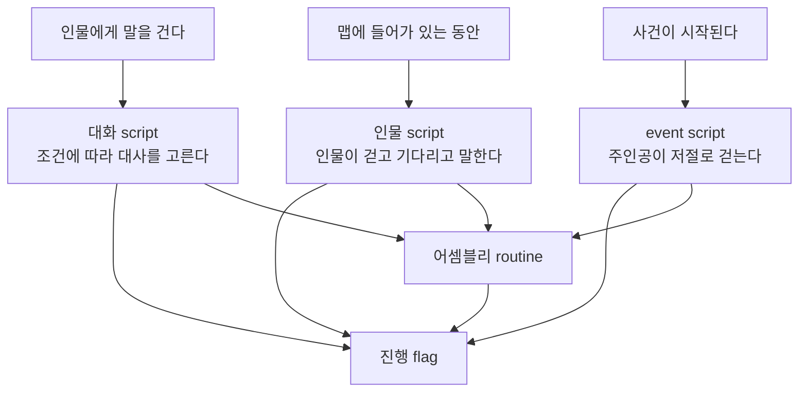
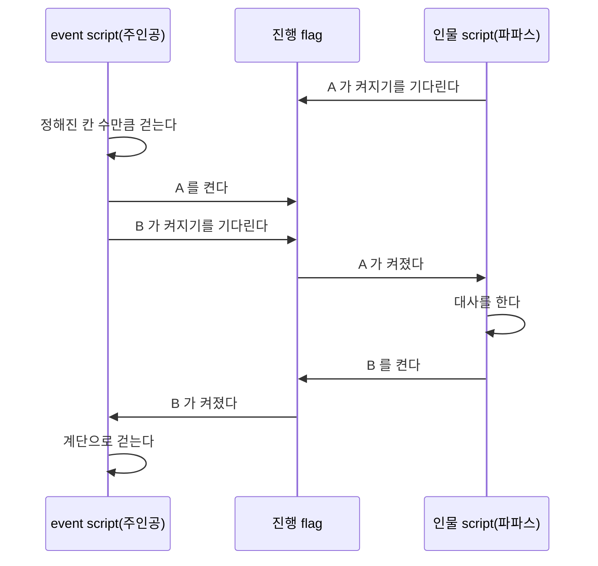

[1편](/games/romhacking/journal/dq4/dq5-maps/)에서 DQ5 엔진이 맵을 어떻게 담고 있는지 봤다.
그런데 맵만 있으면 아무 일도 안 일어난다. 마을 사람은 말을 걸면 대답하고, 병사는 혼자 성 안을 순찰하고, 헨리가 납치되면 주인공은 패드를 놓고 있어도 파파스를 따라 달려간다.
DQ4의 대사와 사건을 이 엔진에 옮기려면 이런 장면들이 롬에 어떻게 적혀 있는지부터 알아야 했다. 이번 편은 그걸 읽은 이야기다. (적어 넣는 쪽은 [6편](/games/romhacking/journal/dq4/writing/)에서 다룬다.)

## 네 줄 요약

1. 대사 3,200개는 Huffman 부호로 압축돼 있고, 고개 젓기나 기침 같은 연기 지시가 대사 문자열 안에 같이 들어 있다.
2. script는 한 종류가 아니라 세 종류다. 말을 걸었을 때 실행되는 대화 script, 인물이 스스로 움직이는 인물 script, 주인공을 대신 조종하는 event script.
3. 셋은 서로를 부르지 않는다. 진행 flag를 켜고, 상대가 켜 주기를 기다리는 것만으로 한 장면을 만든다.
4. 롬에는 개발용 debug switch가 남아 있고, 특정 물건 여섯 개를 순서대로 들고 있으면 확률 판정 없이 몬스터가 동료가 되는 숨은 조건도 있다.

## 마을 사람에게 말을 걸면 무슨 일이 일어날까?

큰 그림부터 보자.

인물마다 대화 번호가 하나씩 붙어 있다. 말을 걸면 엔진은 이 번호부터 읽는데, 번호의 범위에 따라 하는 일이 다르다.
늘 같은 말만 하는 한 줄짜리 마을 사람은 번호에 정해진 값을 더한 것이 곧 메시지 번호라서 대사를 바로 띄운다.
무기점·여관·교회는 번호 `000`~`010` 의 특수 기능 17개 중 하나로 간다.
그리고 이야기 진행에 따라 말이 달라지는 인물만 **대화 script**를 가진다. 574개 있다.

대화 script는 말을 걸어야 실행된다. 그럼 말을 안 걸어도 혼자 걸어 다니는 병사는 뭘까?
이건 다른 script다. 맵의 인물 목록에 인물마다 짧은 script가 붙어 있고, 엔진이 매 frame(1/60초) 그 인물의 명령을 하나씩 실행한다. 이걸 **인물 script**라고 부르겠다. 1,034개 있다.

마지막으로 주인공이 저절로 걸어가는 장면이 있다. 인물 script는 그 인물만 움직일 수 있어서 주인공은 못 건드린다.
그래서 패드 입력 대신 주인공에게 명령을 넣어 주는 **event script**가 따로 있다. 106개다.

| script       | 언제 실행되나               | 누구를 움직이나       |
| ------------ | --------------------------- | --------------------- |
| 대화 script  | 말을 걸었을 때              | message window와 대사 |
| 인물 script  | 가만히 있어도 매 frame      | 그 인물               |
| event script | 사건이 시작되면 끝날 때까지 | 주인공                |

문법도 명령 번호도 셋이 다 다르다. (왜 하나로 안 만들었는지는 모르겠다...)
대신 공통점이 둘 있다. 셋 다 script로 표현하기 번거로운 일은 어셈블리로 짠 routine을 직접 부를 수 있고, 셋 다 같은 진행 flag를 켜고 끄고 읽는다.



_세 script는 서로 부르지 않고 진행 flag에서만 만난다._

여기서 flag는 "배가 항구에 도착했다", "헨리가 납치됐다" 같은 사실 하나를 비트 하나로 기억해 두는 것이다. WRAM(게임이 쓰는 메모리)의 `7E:2190` 부터 줄지어 있다.
이제 하나씩 보자.

## 대사 3,200개는 어떻게 들어 있을까?

DQ5의 대사는 3,200개다. 롬에서 문자열로 검색해도 안 나오는데, [Huffman 부호](/games/romhacking/huffman/)로 압축돼 있기 때문이다.
자주 나오는 글자는 짧은 비트열로, 드문 글자는 긴 비트열로 적는 방식이라 글자 하나가 바이트 단위로 안 떨어진다.

출발점은 일본의 DQ5 해석 자료에 적혀 있던 주소 하나였다. 메시지 번호를 받아서 대사를 찾는 routine이 `24:8BAF` 에 있다는 것이다.
진짜인지 에뮬레이터로 확인해보자. 이 프로젝트는 MesenCE를 화면 없이 띄워 놓고 Lua script로 입력을 넣고 메모리를 감시한다([에뮬레이터와 Lua 로 확인하기](/games/romhacking/sfc/emulator/)).
게임 맨 처음의 배 선실에서 아무도 없는 쪽을 보고 말을 걸면서, 그 routine이 불릴 때 register 값을 찍어 봤다.

```text
248BAF A=0129 X=02DA Y=0000
```

A register에 `0129` 가 들어 있고, 화면에는 "그쪽에는 아무도 없다."가 떴다. 이게 메시지 `129` 번이다(16진수다. 이 글의 메시지 번호는 전부 16진수로 적는다).


_위가 게임 화면, 아래가 메시지 `129` 번을 직접 압축 해제해서 롬의 글꼴로 그린 것이다._

메시지를 찾는 방법이 좀 특이하다.
메시지마다 pointer를 두면 3,200개가 필요한데, DQ5는 16개마다 하나만 둔다. `129` 번을 읽으려면 `120` 번의 시작 위치로 가서 메시지 아홉 개를 끝까지 풀어서 버리고, 그다음 것을 읽는다.
table을 줄이려고 속도를 조금 내준 것으로 보인다. (어차피 대사는 한 번에 하나만 띄우니까 티가 안 난다.)

decoder를 Python으로 옮겨서 3,200개를 전부 풀어 봤는데 중간에 막히는 것 없이 끝 표시까지 풀렸다.
다만 풀려 나온 건 글자가 아니라 글자 번호다. 그리고 이 번호가 가나 순서가 아니다.
DQ5의 글꼴은 크기가 같은 글자끼리 묶여 있고(마침표는 9×3 픽셀, 한자는 11×13 픽셀 이런 식이다) 번호는 그 묶음 순서를 따른다.
그래서 글꼴 986자를 전부 그림으로 그려 놓고 눈으로 읽어서 글자표를 만들어야 했다. 히라가나 へ와 가타카나 ヘ처럼 모양이 똑같은 쌍은 문맥으로 구분했다.

### 대사 안에 연기 지시가 들어 있다

글자 번호 중 `1000` 번대는 글자가 아니라 제어 코드다. 줄바꿈, 버튼 기다리기, 주인공 이름 넣기 같은 것들이다.
여기까지는 어느 게임에나 있는데, `1100` 번대가 뜻밖이었다. 말하는 인물의 몸짓이다.

- 고개를 좌우로 젓는다.
- 제자리에서 두 번 뛰어오른다.
- "으~ 추워" 하면서 몸을 떤다.
- "콜록" 하면서 sprite가 1픽셀 내려갔다 올라온다. (딸꾹질은 반대로 1픽셀 올라간다.)
- "앗!" 하는 순간 message window가 튀어 오르듯 커졌다 돌아온다.
- 대사 도중 화면이 어두워진다.

인물이 대사에 맞춰 움찔거리는 그 연출이 별도 script가 아니라 대사 문자열 한가운데에 들어 있었던 것이다.


_주인공 이름(시험용 ああああ)과 아이들 이름이 제어 코드로 들어간 대사다. 이런 코드를 하나씩 띄워 가며 확인했다._

DQ4에는 없던 연출이지만, 대사를 옮길 때 그대로 빌려 쓸 수 있는 도구가 생겼다.

## 선실의 파파스를 실험용 마네킹으로

제어 코드가 무슨 일을 하는지는 코드만 읽어서는 확신이 안 선다. 직접 띄워 봐야 한다.
그러려면 아무 메시지나 내 마음대로 띄우는 방법이 있어야 하는데, 여기서 게임 시작하자마자 선실에 서 있는 파파스가 큰 일을 했다.

파파스의 대화 script는 이렇게 생겼다.

```text
07 1B 01 01     if flag(배가 항구에 도착했다)
06                {
41 3A               메시지 "그래, 항구에 닿았구나!"
18 02 80            flag 켜기(선실에 파파스를 두지 않는다)
3E                }
0B              else
41 2D             메시지 "아버지는 여기 있을 테니…"
3F              끝
```

`07` 이 if, `1B` 가 flag 검사, `41` 로 시작하는 두 바이트가 메시지 띄우기, `18` 이 flag 켜기다.
볼 곳은 넷째 줄이다. 도착한 뒤에 말을 걸면 파파스는 대사를 하고 flag를 하나 켠다. 그런데 이 flag가 맵 쪽에서는 "선실에 파파스를 놓지 않는다"는 조건으로 쓰인다. 그래서 다음에 선실에 들어오면 파파스가 없다.
대사와 flag와 인물 배치가 이렇게 이어지는 걸 여기서 처음 봤다.

이제 이 script의 바이트를 실행 직전에 바꿔치기해보자. 메시지 번호를 바꾸면 파파스가 원하는 대사를 한다.
대화 번호를 바꾸면 파파스가 무기점이 되고 교회가 된다. script 전체를 "이 routine을 불러라" 한 줄로 덮으면 다른 마을의 사건 routine을 선실에서 실행할 수 있다.
이 편에 나오는 실험은 거의 다 이 방법이다. 장면마다 세이브 파일을 찾아다닐 필요 없이 게임을 시작하자마자 실험대가 준비된다.

대화 script의 decoder가 맞는지도 확인해야 했는데, 이게 한 번에 안 됐다.
게임에는 script의 길이를 알아내는 방법이 둘 있다. 하나는 실제로 실행하면서 명령마다 정해진 길이만큼 넘어가는 것이고, 다른 하나는 번호로 script를 찾을 때 앞의 script들을 건너뛰는 별도 규칙이다.
내 decoder로 읽은 script의 끝이, 게임의 건너뛰기 규칙으로 찾은 다음 script의 시작과 같아야 한다. 574개 전부.
처음엔 444개가 틀렸다 ㅠㅠ if 뒤에는 항상 중괄호 block이 온다고 생각한 게 문제였다(block 표시가 없으면 명령 하나만 묶인다). 고치니 16개가 남았고, 나머지는 어셈블리 routine을 부르는 명령 `00` 뒤에 주소 두 바이트가 붙는다는 걸 빼먹은 탓이었다.

### 어셈블리인데 어셈블리가 아니다

그 `00` 명령이 부르는 routine은 142곳이다. 가게 8곳, 대사를 띄우는 것 52곳, 맵을 다시 그리는 장면 24곳, 값만 쓰는 것 12곳, 다른 bank(64KB 단위의 주소 구역)의 routine을 부르는 것 45곳, 그리고 아무것도 안 하는 빈 routine이 1곳.
그런데 이 routine들을 disassemble 해 보면 이상한 게 나온다.

```text
BRK 95 00     ; message window 열기
BRK 99 5B     ; 메시지 띄우기
BRK 95 32     ; 예/아니오 window
LDA $E8
BEQ ...
BRK 0C 08 09  ; flag 켜기
```

`BRK` 는 원래 프로그램을 멈추고 interrupt handler로 넘어가는 CPU 명령이다. 보통 게임에서는 쓸 일이 거의 없다.
DQ5는 이걸 공용 기능 호출로 쓴다. `BRK` 바로 뒤 바이트가 기능 번호고, 그 뒤 몇 바이트가 인자다. 어셈블리 사이사이에 끼워 쓰는 매크로 같은 것이다.
flag 켜기·끄기·검사, window 열기, 메시지 띄우기, 일행 중 누가 살아 있는지 묻기가 다 이렇게 돼 있다.

문제는 disassembler다. `BRK` 뒤 인자를 명령으로 읽어 버려서 그 뒤가 전부 엉뚱한 코드로 나온다.
그래서 기능마다 인자가 몇 바이트인지부터 세어 table로 만들었고, 그제야 142곳이 "이 메시지를 띄우고 이 flag를 켠다"로 읽히기 시작했다.

## 헨리가 납치되면 파파스는 어떻게 움직일까?

이번엔 인물 script를 보자. 제일 쉬운 예는 성 안을 도는 순찰 병사다.

```text
13 25 2f     (37,47) 로 걷기 시작
14           도착할 때까지 기다림
1d 20        이동 간격 정하기
13 2c 2f     (44,47) 로 걷기 시작
...
03 e5        처음으로 돌아가기
```

기다리는 방식이 재미있다. 이 해석기에는 "대기 중"이라는 상태가 없다.
명령이 "아직 아니다" 싶으면 다음 명령으로 넘어가지 않고 그냥 끝낸다. 그러면 다음 frame에 같은 명령이 또 실행된다. 도착할 때까지, flag가 켜질 때까지, 주인공이 정해진 사각형 안에 들어올 때까지 기다리는 명령이 모두 이런 식이다.
병사 하나를 4,000 frame(약 67초) 동안 지켜봤더니 script에 적힌 대로 네모를 그리며 27초쯤마다 한 바퀴씩 돌았다.

이 인물 script가 사건의 뼈대다. 라인하트 성에서 헨리 왕자가 납치되는 장면으로 가 보자.
헨리의 방에서 도적들이 헨리를 데려가면 "헨리가 납치됐다" flag가 켜진다. 그리고 이 flag가 켜지면 다른 층의 인물 목록이 통째로 바뀐다(같은 맵이라도 flag에 따라 인물 목록을 바꿔 쓰는 table이 있다).
바뀐 목록 속 파파스는 이런 script를 갖고 있다.

1. 주인공이 방 안 정해진 사각형에 들어올 때까지 기다린다.
2. "뭣이! 왕자가 납치됐다고!?"를 띄운다.
3. 방 구석으로 달려간다.
4. 도착하면 어셈블리 routine을 불러 그 구석에 계단을 놓는다.

4번에서 고개를 갸웃했다. 파파스가 계단을 만든다고?
맵 데이터에는 원래 그 계단이 없다. 파파스의 script가 구석에 도착한 뒤에 맵을 고쳐서 계단 block을 놓는다. 숨은 계단을 찾아내는 연출을 인물 script가 맵을 직접 고치는 것으로 처리한 것이다.


_초록 선이 파파스가 달려가는 경로, 빨간 네모가 새로 놓이는 계단이다. 한가운데 검은 빈 공간의 노란 네모를 봐 두자._

그림 한가운데, 벽으로 둘러싸여 아무도 못 들어가는 빈 공간에 노란 네모가 있다. 여기에 출구 cell이 하나 놓여 있다. 밟을 수 없는 곳에 출구가 왜 있을까?
[1편](/games/romhacking/journal/dq4/dq5-maps/)에서 본 것처럼 DQ5의 출구는 좌표로 연결되지 않는다. 맵의 출구 cell을 앞에서부터 센 순서가 출구 번호다.
그러니 사건 도중에 계단이 하나 생기면 그 뒤 출구들의 번호가 전부 하나씩 밀린다. 이걸 막으려고 계단이 생길 순서에 미리 가짜 출구를 하나 넣어 둔 것이다. 파파스의 routine은 계단을 놓으면서 이 가짜 출구를 지운다. 출구 개수는 그대로니 번호도 안 밀린다.
맵만 볼 때는 설명이 안 되던 cell인데 사건 쪽을 읽고 나서야 이해가 됐다.

## 파파스가 기다리는 flag는 누가 켜지?

계단이 생기면 주인공은 패드를 안 눌러도 파파스를 따라 걷는다. event script가 주인공을 넘겨받은 것이다.
이 장면의 event script를 그대로 옮기면 이렇다.

```text
오른쪽 14칸, 아래 12칸 걷기
flag A 켜기
flag B 가 켜질 때까지 기다림      ← 파파스가 대사를 하고 B 를 켜 준다
아래 2칸, 오른쪽 3칸 걷기          ← 계단을 지나 다음 맵으로
flag C 켜기
flag D 가 켜질 때까지 기다림
위 4칸, 오른쪽 3칸 걷기            ← 또 그다음 맵으로
flag C 켜기
flag D 가 켜질 때까지 기다림
```

걷기 명령은 방향과 칸 수뿐이고, 나머지는 전부 flag를 켜고 기다리는 것이다.
event script는 파파스에게 "이제 말해"라고 시킬 방법이 없다. 대신 flag A를 켜고 멈춘다. 파파스의 인물 script는 A가 켜지기를 기다리고 있다가 대사를 하고 flag B를 켠다. 그러면 B를 기다리던 주인공이 다시 걷는다.



_두 script는 서로를 모른다. flag를 켜고, 상대가 켜 주기를 기다릴 뿐이다._

DQ5의 사건 장면은 이런 릴레이로 짜여 있다. 등장인물이 늘면 flag를 주고받는 script가 그만큼 늘 뿐이다.

### 켜는 곳이 없는 flag

이 장면에서 한참 못 푼 수수께끼가 하나 있었다.
다음 맵에 서 있는 파파스는 위의 flag C(`21A1` 의 bit7)가 켜지기를 기다린다. 그런데 이 flag는 맵을 옮길 때마다 지워지는 임시 flag다. 그 맵에 들어서는 순간 0이 된다.
그럼 들어온 뒤에 누군가 다시 켜 줘야 하는데, 그 맵의 인물 script에도 맵에 딸린 routine에도 켜는 코드가 없었다.

위의 event script에 이미 나와 있다. 맵을 옮기면 flag는 지워지지만 event script는 안 끊기고 계속 실행된다. 계단을 지나 다음 맵에 선 직후의 명령이 바로 "flag C 켜기"다. 그다음 맵에서도 또 켠다.
flag를 켜는 곳 목록에는 이 event script가 처음부터 들어 있었다. "다른 맵에서 시작한 event니까 상관없겠지" 하고 후보에서 뺀 게 문제였다.

임시 flag 이야기를 조금 더 하면, 수명이 두 가지다.
`219F` 부터 네 바이트에 `11 22 33 44` 를 써 놓고 선실의 사다리를 타 봤다. 같은 건물 안의 다른 맵으로 가면 `11 22 00 00`, 아예 다른 장소로 가면 전부 0이 됐다.
"이 방에 있는 동안만"과 "이 성에 있는 동안만", 두 종류의 임시 flag가 있는 것이다. (처음엔 이 구분을 몰라서 문서에 틀리게 적었다가 고쳤다.)

### 맵 밖으로 걸어 나간 주인공

event script 106개를 전부 실제로 실행해 보는 것도 일이었다. 제 장면에서 실행하려면 그 맵에 가서 앞 사건들의 flag를 다 맞춰 줘야 한다.
조건을 끝까지 못 맞춘 것들은 꼼수를 썼다. 이미 잘 실행되는 다른 장면의 event 번호를 롬에서 바꿔치기한 것이다.
그랬더니 걸어갈 목표 좌표가 그 맵에 없는 곳이라, 주인공이 벽을 뚫고 맵 밖의 파란 허공으로 뚜벅뚜벅 걸어 나갔다...
그래도 script는 끝까지 실행됐고 명령 경계가 decoder와 같다는 건 확인할 수 있었다.

## flag는 전부 몇 개일까?

세 script와 `BRK` 가 전부 같은 flag를 건드린다는 걸 알았으니, 이제 flag를 다 세어 볼 차례다.
DQ4의 장과 사건 진행을 여기에 넣으려면 어디가 쓰이고 어디가 비었는지 알아야 한다.

롬 전체에서 flag를 켜고 끄고 읽는 곳을 모았더니 비트 525개, 참조 5,050곳이 나왔다.
`7E:2190` 부터 50바이트에 몰려 있고 거의 빈틈이 없다. 장소마다 대체로 가까운 바이트를 쓴다.

목록을 만들고 나니 이상한 flag가 보였다.
읽는 곳은 있는데(대부분 대화 script다) 롬 어디에서도 켜지 않는 flag가 6개 있다. 이 flag가 켜졌을 때 나오게 돼 있는 대사는 정상적인 방법으로는 볼 수 없다는 뜻이다. 왜 남아 있는지는 모른다.
반대로 켜기만 하고 아무도 안 읽는 flag도 24개 있었다.

마지막으로 이걸 [이야기 진행 지도](https://github.com/perfectacle/sfc-dq4/blob/main/sfc/dq5/docs/dq5-story.md)로 엮었다. 주인공이 태어나는 장면부터 엔딩까지 사건을 순서대로 놓고, 사건마다 어떤 flag를 켜고 그 flag로 어느 맵의 인물 목록이 바뀌는지 붙인 문서다.
여기서 DQ4 쪽 설계도 정했다. 맵을 옮기면 지워지는 임시 flag는 진행에 쓰지 않고, 사건 flag는 DQ5처럼 장소마다 몇 바이트씩 묶는다. 실제로 어떻게 넣었는지는 [10편](/games/romhacking/journal/dq4/chapter1/)에서 이어진다.

## 롬에 남아 있는 개발의 흔적

[1편](/games/romhacking/journal/dq4/dq5-maps/)에서 벽 통과를 켜던 그 바이트 이야기를 조금 더 해보자.
사건 코드를 따라다니다 보면 롬의 `01:8000` 과 바로 옆의 `01:8001`, 이 두 바이트를 읽는 코드가 여기저기서 나온다.
팔린 롬에서는 둘 다 `FF` 다. 이걸 `00` 으로 바꾸면 숨어 있던 기능이 켜진다. 개발용 debug switch다.

| 바꾸는 바이트 | `00` 으로 바꾸면                                    |
| ------------- | --------------------------------------------------- |
| `01:8000`     | B 버튼을 누른 채 걸으면 벽이고 바다고 그냥 지나간다 |
| 둘 다         | 몬스터 격투장이 배당 대신 시합 번호를 묻는다        |
| `01:8001`     | 루라의 목적지 목록이 다른 것으로 바뀐다             |

벽 통과는 실제로 나무 위와 바다 위를 걸어 봤다. (처음엔 X 버튼인 줄 알았는데 메뉴만 열렸다. 코드를 다시 읽으니 B였다.)
격투장은 선실의 파파스를 격투장 접수원으로 바꿔서 확인했다. 원래 롬에서는 배당 window가 뜨는데, switch를 켜면 숫자 입력 window가 뜬다. 3을 넣었더니 슬라임 세 마리가 싸우는 시합이 나왔다. 50개 시합을 골라서 볼 수 있게 한 테스트 기능으로 보인다.

루라 쪽은 켜도 동작하지 않는다. 목적지 54곳의 이름 table 주소가 bank `30` 인데, 이 롬은 1.5MB라 bank `30` 이 없다.
개발 중에는 더 큰 롬에 debug용 데이터가 실려 있었고, 팔 때 그 부분을 잘라낸 것 같다. 내용이 뭐였는지는 알 방법이 없다.

### 몬스터가 무조건 동료가 되는 소지품

하나 더 있다. 이건 switch 없이 팔린 롬에서 그대로 동작한다.

몬스터가 동료가 될지 판정하는 routine을 읽다가 이상한 branch를 찾았다. 확률을 계산하기 전에 주인공의 소지품 앞 일곱 slot을 정해진 값 일곱 개와 차례로 비교하고, 전부 같으면 확률 판정을 건너뛰고 바로 동료로 만든다.
그 일곱 개는 이렇다.

1. 노송나무 막대(ひのきのぼう)
2. 뾰족한 뼈(とがったホネ)
3. 행복의 모자(しあわせのぼうし)
4. 곤봉(こんぼう)
5. 톱칼(のこぎりがたな)
6. 회피의 옷(みかわしのふく)
7. 빈 slot

주인공이 이 여섯 개를 이 순서대로 들고, 일곱째 slot이 비어 있어야 한다. (한글 이름은 내가 옮긴 것이다.)
슬라임이 동료가 될 확률을 1/256로 낮춰 놓고 싸워 봤다. 소지품을 이렇게 맞추면 동료가 됐고, 안 맞추면 안 됐다.
다만 이것만으로 아무 몬스터나 다 되는 건 아니다. 동료가 될 수 있는 몬스터여야 하고, 진행 flag 같은 나머지 조건은 그대로 필요하다. 건너뛰는 건 확률뿐이다.

같은 소지품 검사가 한 군데 더 쓰인다. 이 상태에서는 일행의 회심의 일격이 나오지 않는다.
왜 이런 조건이 들어 있는지는 롬만 봐서는 알 수 없었다.

### 모험의 서가 사라지는 조건

마지막은 세이브다. 구조는 단순했다. WRAM의 `7E:2000` 부터 `AA0` 바이트(2.7KB쯤)를 카트리지의 배터리 메모리에 통째로 복사하는 게 전부다.
일행, flag, 보물 상자를 열었는지가 다 그 범위 안에 있다. slot은 셋이고 끝에 checksum 두 바이트가 붙는다.

그럼 checksum이 틀리면? 세이브 데이터의 이름 두 바이트만 고치고 켜 봤다.

> まことに　ざんねんですが　ぼうけんのしょ(번호)は　消えてしまいました。

참으로 안타깝지만 모험의 서가 사라져 버렸다는, 바로 그 메시지다. (에뮬레이터라서 다행이다.)

이 구조는 이 프로젝트에도 편하다. DQ4에 필요한 상태를 그 2.7KB 안에만 넣어 두면 세이브와 불러오기는 엔진이 알아서 해 준다.

## 아직 못 한 것

- 켜는 곳이 없는 flag 6개가 원래 무엇에 쓰려던 것인지는 모른다.
- debug switch가 가리키는 bank `30` 의 데이터는 팔린 롬에 없어서 내용을 알 수 없다.
- event 전투 중 몇 개는 부르는 곳을 끝내 못 찾았다. 안 쓰이는 것인지 내가 못 찾은 것인지 아직 모른다.

## 더 보기

- [메시지·글꼴·대화 script 형식](https://github.com/perfectacle/sfc-dq4/blob/main/sfc/dq5/docs/dq5-text-format.md): Huffman, 제어 코드 전체 표, 대화 번호, `BRK` 기능
- [맵 형식](https://github.com/perfectacle/sfc-dq4/blob/main/sfc/dq5/docs/dq5-map-format.md): 인물 목록과 인물 script 명령
- [event script 형식](https://github.com/perfectacle/sfc-dq4/blob/main/sfc/dq5/docs/dq5-event-format.md)과 [flag 목록](https://github.com/perfectacle/sfc-dq4/blob/main/sfc/dq5/docs/dq5-flags.md)
- [데이터 형식](https://github.com/perfectacle/sfc-dq4/blob/main/sfc/dq5/docs/dq5-data-format.md): 일행, 동료가 되는 몬스터, 세이브
- decoder: [dq5text.py](https://github.com/perfectacle/sfc-dq4/blob/main/sfc/dq5/tools/dq5text.py), [dq5talk.py](https://github.com/perfectacle/sfc-dq4/blob/main/sfc/dq5/tools/dq5talk.py), [dq5npc.py](https://github.com/perfectacle/sfc-dq4/blob/main/sfc/dq5/tools/dq5npc.py), [dq5event.py](https://github.com/perfectacle/sfc-dq4/blob/main/sfc/dq5/tools/dq5event.py), [dq5flags.py](https://github.com/perfectacle/sfc-dq4/blob/main/sfc/dq5/tools/dq5flags.py)
