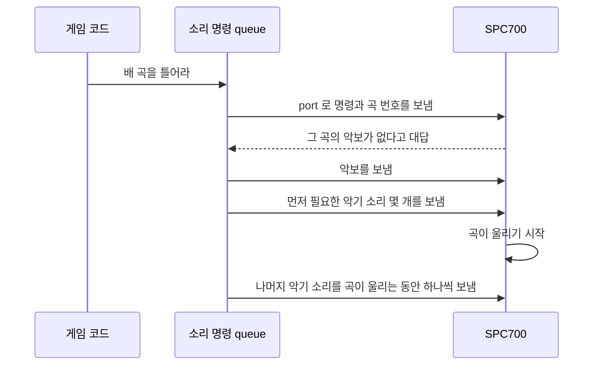

[맵](/games/romhacking/journal/dq4/dq5-maps/), [대사와 사건](/games/romhacking/journal/dq4/dq5-events/), [전투](/games/romhacking/journal/dq4/dq5-battle/)에 이어 DQ5 엔진을 읽는 마지막 편이다.
이번에는 눈에 보이고 귀에 들리는 것, 그러니까 그림과 소리다.

DQ4를 이 엔진 위에 올리려면 결국 DQ4의 몬스터 그림을 넣고, 한글을 찍고, DQ4의 곡을 틀어야 한다.
그러려면 먼저 엔진이 어디까지 받아 주는지를 알아야 한다. 몬스터 그림은 얼마나 커도 되는지, 한글은 몇 자나 넣을 수 있는지, 곡은 얼마나 길어도 되는지.
그래서 이 편은 형식을 전부 훑는 대신 "어디가 한계인가" 를 찾아다닌 이야기 몇 개만 골랐다. (형식 전체는 맨 끝에 링크를 걸어 두었다.)

## 네 줄 요약

1. 전투 화면에 몬스터가 몇 마리 나오는지는 한도 세 개가 정한다. 그림 하나의 크기는 개수가 아니라 시간이 정한다. 화면을 그리지 않는 짧은 틈에 보낼 수 있는 만큼만 보인다.
2. 몬스터 발밑의 그림자는 sprite가 아니라 배경 tile에 직접 칠한 것이다. 타이틀의 바다와 전투 배경의 물결은 그림을 바꾸는 게 아니라 HDMA로 scanline마다 스크롤 값을 바꿔서 만든다.
3. 한글을 넣을 여유가 message window에는 3,000자 넘게 있는데 command window에는 사실상 없다. (이걸 어떻게 넘었는지는 [8편](/games/romhacking/journal/dq4/windows/)에서 다룬다.)
4. 곡 하나를 틀 때마다 CPU는 소리 칩 SPC700에 악보와 악기 소리를 그때그때 보낸다. 소리 칩의 메모리는 가장 큰 곡을 올리면 1KB 남짓 남는다.

## 전투 화면에 몬스터는 몇 마리까지 나올까?

DQ5를 해 본 사람이면 큰 몬스터는 한 번에 두세 마리밖에 안 나온다는 걸 몸으로 안다.
슬라임은 떼로 우르르 나오는데 말이다.
당연히 화면이 좁아서겠지... 싶은데, 정확히 무엇이 넘치면 잘리는 걸까?

알아보려면 원하는 몬스터를 원하는 마릿수로 불러낼 수 있어야 한다.
게임을 시작하자마자 배 선실에서 붙는 전투를 실험대로 썼다. 메모리에 있는 몬스터 번호와 마릿수를 원하는 값으로 고정해 두면 아무 조합하고나 싸울 수 있다.
그렇게 조합 스무 가지를 띄워 보고 몬스터가 놓이는 규칙부터 정리했다.


_상자는 규칙으로 예측한 위치다. 빨강은 앞줄, 파랑은 뒷줄, 노랑은 떠 있는 몬스터. 오른쪽 화면은 목록에 섀도 사탄이 2마리인데 화면에는 한 마리뿐이다._

몬스터가 서는 줄은 셋이다. 앞줄, 뒷줄, 그리고 드라키처럼 떠 있는 몬스터의 줄.
줄마다 따로 가운데 정렬을 하고, 같은 무리끼리는 붙여 놓고 무리와 무리 사이는 8픽셀을 띄운다.

그리고 마릿수를 자르는 한도가 셋 있었다.

- 한 줄에 선 몬스터들의 가로 폭을 더해서 224픽셀(8픽셀 tile로 28개)이 되면 안 된다.
- 모든 몬스터의 조각 수를 더해서 100개가 되면 안 된다. (몬스터 그림은 8x8이나 16x16짜리 조각 여러 개를 이어 붙인 것이다.)
- 화면을 8픽셀 높이의 띠로 잘랐을 때, 어느 띠에서든 거기 걸친 몬스터 tile이 28개가 되면 안 된다.

앞의 둘은 금방 찾았는데 셋째에서 헤맸다.
위 그림 오른쪽이 그 장면이다. 앞의 두 한도로는 설명이 안 되는데 섀도 사탄이 한 마리만 나온다.
처음에는 띠마다 조각 수를 세는 줄 알았는데 숫자가 안 맞았고, 16x16 조각을 tile 두 개로 쳐서 세니까 그제야 맞았다.

이 한도 때문에 섀도 사탄만 네 마리를 부르면 세 마리만 나오고, 슬라임 한 마리에 섀도 사탄 세 마리를 부르면 섀도 사탄은 두 마리만 나온다.
넘친 몬스터는 그냥 없던 걸로 친다.

왜 이런 한도가 있는지는 추측이다.
첫째는 화면 폭이 256픽셀이니 당연해 보이고, 셋째는 SFC가 scanline 하나에 그릴 수 있는 sprite 수에 한도가 있어서(넘으면 넘친 sprite가 그 scanline에서 안 보인다) 그걸 피하려는 것으로 보인다.
코드에 "이래서 28이다" 라고 적혀 있는 건 아니라서 확인은 못 했다.

### 그럼 그림 하나는 얼마나 클 수 있을까?

이건 DQ4 몬스터를 넣을 때 바로 걸리는 문제라 꼭 알아야 했다.
엔진이 받아 주는 것보다 큰 그림을 넣으면 어떻게 되는지 직접 넣어 봤다.
몬스터 그림 하나를 무늬로 가득 채운 시험 롬을 만들어서 tile 수를 늘려 가며 전투를 붙인 것이다.

```text
그림의 tile 수    화면에 실제로 나온 tile 수
102               102
104               103
150               105
```

102개까지는 멀쩡한데 그 뒤로는 뒤쪽 tile이 잘려서 안 나온다.
처음엔 "한도는 tile 몇 개" 라고 적어 뒀었는데, 150개를 넣어도 105개가 나오는 걸 보면 개수 한도가 아니다.

범인은 시간이었다.
SFC는 화면을 다 그리고 나서 다음 화면을 그리기 시작할 때까지 잠깐 쉬는데(VBlank), 화면용 메모리인 VRAM은 이 틈에만 안전하게 고칠 수 있다.
게임은 이 틈이 시작될 때 걸리는 interrupt(NMI)에서 몬스터 그림을 DMA(메모리를 통째로 빠르게 복사하는 기능)로 VRAM에 보낸다.
그런데 이 틈이 scanline 스무 줄 남짓밖에 안 된다. 다음 화면의 첫 줄을 그리기 시작하면 그 뒤에 보낸 것은 VRAM에 안 들어간다.
그림을 여러 덩어리로 나눠 보낼수록 덩어리 사이에 드는 시간이 있어서 들어가는 tile은 더 줄어든다.

재밌는 건 원작에 이 한도를 넘는 몬스터가 딱 하나 있다는 거다.
항아리에 봉인돼 있다가 깨어나는 그 거대한 보스, 부온이다. 부온의 그림은 tile이 110개다.
그래서 게임은 몬스터가 부온일 때만 한 frame 뒤에 못 보낸 tile 여섯 개를 다시 보낸다. 코드에 "몬스터 번호가 부온이면" 이라는 조건이 그대로 박혀 있다.
너무 커서 엔진이 특별 대접을 해 준 것이다.

크기를 아끼는 장치도 하나 있다. 좌우가 대칭인 몬스터는 반쪽만 들어 있다.


_왼쪽이 게임 화면, 오른쪽이 롬에서 꺼내 다시 그린 것이다. 빨간 상자는 16x16 조각, 노란 상자는 8x8 조각이고, 파란 상자가 왼쪽 조각을 뒤집어 다시 쓴 조각이다._

맨 아래 몬스터를 보면 오른쪽 절반에 파란 상자가 있다. 왼쪽 조각을 좌우로 뒤집어 한 번 더 쓴 것이고, 롬에는 왼쪽만 들어 있다.
이 한도들 안에서 DQ4 몬스터를 어떻게 넣었는지는 [6편](/games/romhacking/journal/dq4/writing/)에서 이어진다.

## 그림자는 sprite가 아니었다

몬스터 발밑에는 타원 모양 그림자가 있다. (위 첫 그림의 왼쪽 화면에서 초록 몬스터와 보라 몬스터 밑을 보면 보인다.)
몬스터가 sprite니까 그림자도 당연히 sprite겠거니 했다.
그런데 OAM(화면에 올릴 sprite 목록)을 떠서 봐도 그림자에 해당하는 sprite가 없다.

그림자는 배경에 있었다. 전투 배경의 아래쪽, 그러니까 땅 부분 tile에 게임이 직접 칠한다.
방법이 꽤 영리하다. 배경 tile은 16색이라 픽셀 하나가 4비트인데, 그림자가 질 픽셀마다 맨 위 비트 하나만 켠다.
그러면 색 번호가 8만큼 커진다. 1번 색이던 픽셀은 9번이, 3번이던 픽셀은 11번이 된다.
그리고 배경 palette의 9~15번에는 어두운 색을 넣어 둔다.
비트 하나 켰을 뿐인데 그 픽셀만 같은 무늬 그대로 어두워지는 것이다.

이걸 알고 나니 풀리는 게 하나 있었다.
전투 배경의 땅 부분은 똑같은 tile이 반복되는 무늬인데, 게임은 그걸 화면 cell마다 따로따로 복사해서 256개나 올려 둔다. 같은 tile 하나를 돌려쓰면 될 걸 왜 이러나 했다.
그림자 때문이었다. tile 하나를 돌려쓰면 한 군데에 그림자를 칠하는 순간 화면 전체에 그림자가 찍힌다.

몬스터가 쓰러지면 그 몬스터의 그림자만 지워야 하니, 어느 tile에 어느 몬스터가 그림자를 칠했는지도 따로 적어 둔다.
슬라임 세 마리 중 가운데 놈을 잡으면 가운데 그림자만 사라지는 게 그래서 된다.

sprite인 줄 알았는데 아니었던 게 둘 더 있다.
칼로 벨 때 번쩍하는 타격 효과와 메라 같은 주문의 큰 불꽃은 message window와 같은 층인 BG3(배경 layer 가운데 맨 위에 겹치는 층)에 그린다.
그리고 몬스터가 때릴 때 화면이 덜컹하는 느낌이 나는데, 이때 몬스터 그림은 전혀 안 움직인다. 흔들리는 건 맞은 쪽 status window다.
보통 몬스터는 맞을 때 깜빡이고 쓰러질 때 한 번에 사라지는 게 전부고, 나머지 "움직임" 은 전부 배경과 window가 대신 해 준다.

## 타이틀의 바다는 누가 흔들고 있을까?

오프닝이 끝나면 로고 뒤로 성이 서 있고 그 아래 바다가 흐른다.
성은 가만히 있는데 바다만 옆으로 흐르고, 물 위의 반짝임은 구불구불 물결친다.
그런데 성과 바다는 같은 layer에 그려진 그림 한 장이다. 한 장의 아래쪽만 어떻게 흐르게 할까?

여기서 HDMA가 나온다.
HDMA는 scanline 하나를 그릴 때마다 hardware register 값을 자동으로 바꿔 주는 기능이다.
"0~190번째 줄까지는 가로 스크롤 0, 그 아래는 줄마다 이만큼" 이라는 table을 걸어 두면, 그림은 그대로인데 화면 아래쪽만 밀려서 그려진다.
반짝임이 물결치는 것도 같은 방식이다. 줄마다 가로 스크롤을 조금씩 다르게 주고, 그 table을 매 frame 조금씩 밀면 물결이 흐른다.

전투 배경도 똑같다. 물결치는 배경이 일렁이는 건 스크롤을 네 줄에 1픽셀씩 어긋나게 주는 것이고, 구름은 화면을 세 구간으로 나눠 구간마다 다른 속도로 흘린다.
그림은 한 장도 안 바꾸고 숫자 몇 개로 움직임을 만든다.

문제는 이게 분석하는 쪽에서는 잘 안 보인다는 거다.
지금까지 화면을 분석할 때는 VRAM과 OAM, palette를 통째로 떠서 비교했는데, HDMA는 그 어디에도 흔적을 안 남긴다. 그림 자체는 안 바뀌니까.
실제로 맵에 딸린 어떤 routine이 뭘 하는지 보려고 그 routine을 막고 메모리를 비교했더니 차이가 0이어서 "하는 일 없음" 이라고 적어 둔 게 둘 있었다.
나중에 화면 그림을 직접 비교해 보니 배경을 물결로 흔드는 routine이었고, 타이틀 물결과 같은 코드였다.

HDMA에는 한 번 더 당했다.
타이틀 연출을 에뮬레이터 없이 롬 코드만 실행해서 똑같이 재현하는 도구를 만들었는데, 342장 가운데 끝의 14장이 계속 안 맞았다.
버튼 입력 시점 탓인 줄 알고 한참 헤맸는데, 알고 보니 도구가 세는 시간이 실제의 0.94배였다.
HDMA가 scanline마다 값을 바꾸는 동안 CPU가 잠깐씩 멈추는데 그 시간을 안 셌던 거다. 그게 6%였다.
이 타이틀 화면에 한글 로고를 얹는 이야기는 [7편](/games/romhacking/journal/dq4/title-menu/)에서 한다.

## 한글은 어디에 넣을 수 있을까?

한글화를 하려면 한글 글꼴을 넣을 곳이 있어야 한다.
그런데 DQ5는 글자를 그리는 방식이 둘이었고, 사정이 서로 정반대였다.

### message window는 넉넉하다

마을 사람에게 말을 걸면 뜨는 message window부터 보자.
여기 글자는 11x13픽셀이고, 대사가 나올 때마다 글꼴에서 글자 그림을 꺼내 그때그때 그린다.
글자마다 번호(글자 코드)가 있는데, 게임이 글자로 쳐 주는 번호는 `001` 부터 `FFF` 까지다.
그중 원작이 쓰는 건 `3DA` 까지뿐이다. 뒤쪽 3,109개가 통째로 비어 있다.

그럼 빈 번호에 한글을 넣으면 나올까? 바로 해 봤다.
비어 있는 번호 `3DB` 에 "한" 이라는 글자 그림을 넣고, 대사 속 글자 하나가 그 번호를 가리키게 바꿨다.


_위가 원래 롬, 아래가 고친 롬이다. 둘째 글자가 "한" 으로 바뀌었다._

된다. 자주 쓰는 한글이 2,350자니까 3,109개면 충분하다.
여기까지는 순조로웠다.

### command window에는 넣을 데가 없다

문제는 command window다. "대화, 주문, 도구" 가 적힌 그 window, 그리고 이름과 HP가 나오는 status window, 전투 중 몬스터 목록까지 전부 같은 방식이다.
처음에는 여기도 message window처럼 같은 글꼴로 그때그때 그리는 줄 알았다. 아니었다.

이쪽 글자는 8x8픽셀짜리 tile이다.
전원을 켤 때 글자 tile 138개를 VRAM에 한 번 올려 두고, 그 뒤로는 "몇 번 tile을 여기에 놓아라" 만 한다.
"はなす(대화)" 는 데이터에 `29 24 1C` 세 바이트로 들어 있는데, 이 숫자가 곧 tile 번호다. 글자 코드고 뭐고 없다.

138개 가운데 안 쓰는 건 딱 하나였다.
가나 105자를 전부 한글로 바꾼다 해도 쓸 수 있는 한글은 105자뿐이다.
"라이안", "호이민", "대화", "주문" 정도야 어떻게 되겠지만 도구 이름, 주문 이름, 몬스터 이름까지 105자로 쓰는 건 무리다.


_왼쪽이 DQ5 원판, 오른쪽이 결국 한글로 바꾼 DQ4다. 왼쪽 글자는 전부 미리 올려 둔 8x8 tile이다._

### 그럼 tile을 더 올리면 되지 않나?

당연히 그 생각부터 했다.
BG3용 글자 tile이 들어가는 구역은 384개 분량인데, 바로 뒤에 BG3의 tilemap(어느 cell에 몇 번 tile을 놓을지 적은 것)이 붙어 있어서 더 못 늘린다.
그러면 tilemap을 VRAM의 다른 빈 곳으로 옮기면 그만큼 글자 구역이 늘어난다.

빈 곳을 찾아서 세 군데에 옮겨 봤는데 전부 실패했다.

- 첫째 후보는 전원을 켜고 한동안은 멀쩡했는데 세계 지도를 걸으니 화면 위쪽이 깨졌다.
- 둘째 후보는 로고와 전투 화면이 쓰는 곳과 겹쳤다.
- 셋째 후보는 정말 비어 보였다. savestate 열여섯 개를 돌려 봐도 아무도 거기에 쓰지 않았다. 그런데 카지노에서 슬롯머신을 하다 나와서 카지노 맵을 다시 불러오는 순간 사람들이 줄무늬로 깨졌다 ㅠㅠ

셋째가 뼈아팠다. 그 구역은 맵을 불러올 때 인물 그림을 올리는 곳이었는데, savestate는 전부 맵을 이미 불러온 뒤의 장면이라 그 순간이 안 잡혔던 거다.
"안 쓰이는 걸 봤다" 와 "비어 있다" 는 다른 말이었다.
결국 실내 맵 364개를 전부 훑어서 구역마다 몇 개 맵이 쓰는지 세어 봤고, 모든 장면에서 비는 곳은 없다는 결론이 났다.

(옮기는 실험을 하다가 엉뚱한 데서 헤매기도 했다. SFC는 같은 hardware register가 여러 [bank](/games/romhacking/sfc/banks/)의 주소에 똑같이 보이는데, 이 게임은 그걸 bank `00` 이 아닌 주소로도 쓴다. 감시를 bank `00` 에만 걸어 놔서 tilemap 위치를 정하는 코드를 한참 못 찾았다.)

정리하면 이렇다. message window는 그냥 한글을 넣으면 되고, command window는 엔진이 주는 것만으로는 한글화가 안 된다.
그래서 command window도 글자를 그때그때 그리도록 엔진을 뜯어고치게 되는데, 그게 [8편](/games/romhacking/journal/dq4/windows/)이다.

## 곡 하나를 틀면 무슨 일이 벌어질까?

이제 소리다.
SFC의 소리는 SPC700이라는 소리 전용 칩이 맡는다. CPU와는 따로 도는 작은 컴퓨터라서 자기 메모리(64KB)와 자기 프로그램이 있고, CPU와는 port 네 개로만 이야기한다.
그러니 CPU 쪽에서 "곡 틀어" 라고 하면 그 뒤에 벌어지는 일은 전부 이 port를 오가는 대화다.

배에 오르는 순간을 예로 보자. 배 곡이 흘러나오기까지 이런 일이 벌어진다.



_악보는 sequence, 악기 소리는 sample이라고 부른다. 이미 SPC700에 있는 것은 다시 보내지 않는다._

게임 코드가 내는 소리 명령은 "명령, 인자" 두 바이트다. 이게 16개짜리 queue에 쌓이고, 차례가 되면 port로 나간다.
곡을 틀라는 명령을 받으면 SPC700은 그 곡의 악보(sequence)가 자기 메모리에 있는지부터 대답한다.
없으면 CPU가 롬에서 악보를 꺼내 보내고, 그 곡이 쓰는 악기 소리(sample)도 보낸다.
배에 오를 때는 악보 하나와 sample 다섯 개가 건너갔다.

재밌는 건 sample을 둘로 나눠 보낸다는 점이다.
곡마다 "처음 몇 개는 곡을 틀기 전에, 나머지는 곡이 울리는 동안" 이라고 적혀 있다.
전부 보내고 틀면 곡이 그만큼 늦게 나올 테니, 처음에 필요한 악기만 먼저 보내고 일단 트는 것 같다.
뒤에 나오는 악기는 곡이 흐르는 동안 슬쩍슬쩍 보낸다.

왜 이렇게까지 아끼냐면 SPC700의 메모리가 정말 좁기 때문이다.
64KB에서 프로그램과 echo용 buffer를 빼면 악보와 sample을 둘 수 있는 곳이 44KB쯤이다.
그중 어느 곡을 틀든 늘 올라가 있는 고정분이 16.5KB를 먹고, 원작에서 가장 큰 곡이 26.4KB를 쓴다. 남는 건 1KB 남짓이다.
DQ4의 곡을 넣을 때도 이 안에 들어가야 한다는 뜻이다. 이 좁은 데에 DQ4 곡을 넣느라 고생한 이야기가 [9편](/games/romhacking/journal/dq4/environment-sound/)이다.

### 들을 수 없는데 어떻게 분석했나

소리 분석에서 제일 곤란했던 건 정작 소리를 들을 수 없다는 거였다.
분석은 에뮬레이터를 화면 없이 실행하고 script로 메모리를 읽는 식으로 하는데, 그 script에는 소리를 녹음하는 기능이 없다.
그래서 소리 칩의 register를 frame마다 읽어서 숫자로 봤다. 전체 음량이 얼마인지, echo가 얼마인지, 어느 채널이 지금 음을 쳤는지.

숫자로만 봐도 알 수 있는 게 꽤 있다.
동굴에서 싸울 때 전투 곡이 좀 다르게 들린다는 건 해 본 사람은 기억할 거다. 먹먹하고 울리는 그 느낌.
이건 곡이 따로 있는 게 아니었다. 같은 전투 곡을 틀면서 전체 음량을 낮추고 echo를 키우라는 설정을 하나 더 붙여 보낸다.
동굴 맵의 곡도 같은 설정이라, 동굴에서 전투에 들어가면 곡은 바뀌는데 울림은 그대로 이어진다.

악보 형식을 제대로 읽었는지도 귀 대신 숫자로 확인했다.
롬에서 푼 악보의 음과, 곡이 울리는 동안 소리 칩이 실제로 친 음을 하나씩 비교한 것이다. 여섯 곡에서 1,685개 음이 다 같았다.
(나중에는 곡을 파일로 뽑아서 들을 수 있게 됐다. 다만 이 단계에서는 끝까지 못 듣고 했다.)

## 아직 못 한 것

- 곡 이름은 50곡 가운데 13곡만 확정했고 6곡은 추정이다. 그것도 들어서 맞춘 게 아니라 "성에서 나오니 왕궁의 곡이겠지" 식으로 장면과 음반 곡목을 짝지은 것이다. 나머지 31곡은 아직 이름을 못 붙였다.
- scanline 띠마다 tile 28개 한도가 정말 sprite 한도를 피하려는 것인지는 확인 못 했다.
- 효과음은 137가지나 되는데 이름을 하나도 안 붙였다.

## 더 보기

이 편에서 뺀 것(맵 tile과 움직이는 물, 걷는 인물 그림, 주문 연출, 악보 형식 등)과 주소, table 전체는 sfc-dq4 저장소의 형식 문서에 있다.

- [그래픽 형식](https://github.com/perfectacle/sfc-dq4/blob/main/sfc/dq5/docs/dq5-graphics-format.md): 몬스터 그림, 배치와 한도, 그림자, 전투 배경, 타이틀
- [한글 형식](https://github.com/perfectacle/sfc-dq4/blob/main/sfc/dq5/docs/dq5-hangul-format.md): 두 가지 글자 그리기와 BG3 tilemap 옮기기 실험
- [사운드 형식](https://github.com/perfectacle/sfc-dq4/blob/main/sfc/dq5/docs/dq5-sound-format.md): 소리 명령, 곡 자료, 악보 형식, 효과음
- 몬스터 그림을 꺼내 다시 그리는 도구 [dq5mongfx.py](https://github.com/perfectacle/sfc-dq4/blob/main/sfc/dq5/tools/dq5mongfx.py), 악보를 풀고 다시 싸는 도구 [dq5song.py](https://github.com/perfectacle/sfc-dq4/blob/main/sfc/dq5/tools/dq5song.py)

다음 편부터는 DQ5를 잠깐 내려놓고 [패미콤 원작 DQ4와 DS 리메이크](/games/romhacking/journal/dq4/originals/)를 들여다본다.
