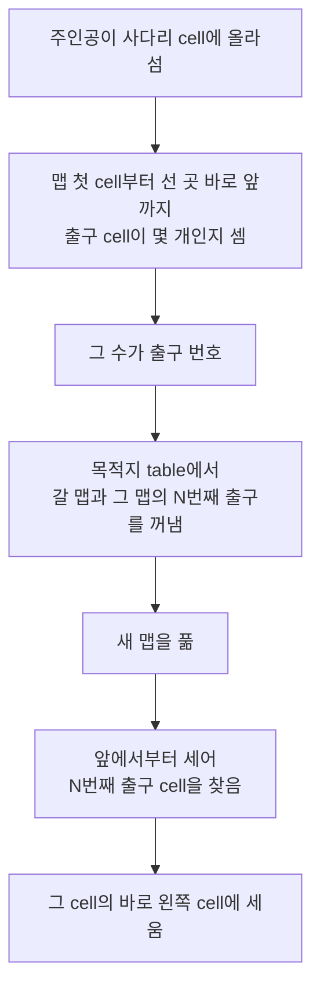

[개요](/games/romhacking/journal/dq4/overview/)에서 말했듯이 이 프로젝트는 패미콤판 드래곤 퀘스트 4를 슈퍼 패미콤판 드래곤 퀘스트 5 엔진 위에 옮기는 일이다.
DQ4의 마을과 성을 DQ5 엔진에 넣으려면 DQ5가 맵을 어떻게 담고 있는지, 계단을 밟으면 왜 다음 층으로 가는지, 밤은 언제 오는지부터 알아야 한다.
그런데 DQ5의 맵 형식을 정리해 둔 공개 자료가 없었다. (대사나 몬스터 쪽은 있는데 맵만 없다...)
그래서 이 편은 DQ4 이야기가 아니라 DQ5 롬을 뜯어본 이야기다.

## 네 줄 요약

1. DQ5의 맵은 tile을 죽 늘어놓은 그림이 아니라 "이 block을 여기서 저기까지 깔아라" 하는 명령 목록이다.
2. 계단이나 사다리 같은 출구에는 좌표가 없다. 맵에서 몇 번째 출구인지 세어서 잇는다. 닫힌 문도 맵 데이터에 없고 나중에 따로 덮어 그린다.
3. 세계 지도는 롬에 석 장 들어 있다. 인간계, 요정의 나라, 마계다. 하루는 512걸음이고 인간계의 필드를 걸을 때만 시간이 간다.
4. debug 기능의 흔적이 팔린 롬에 남아 있다. 다만 debug 메뉴 본체는 롬 밖에 있었다.

## 맵 데이터는 메모리 어디에 있을까?

단서라고는 일본어 위키의 RAM table에 있는 이 한 줄뿐이었다.

> 7EFC00- 맵 데이터

이것만 믿고 가기엔 찜찜하니 에뮬레이터로 직접 확인해보자. ([에뮬레이터와 Lua 로 확인하기](/games/romhacking/sfc/emulator/)에 방법을 정리해 뒀다.)
방법은 단순하다. 맵이 바뀌는 순간 앞뒤로 WRAM(게임이 쓰는 메모리, 128KB)을 통째로 dump 해서 뭐가 바뀌었는지 보면 된다.
다행히 DQ5는 전원을 켜고 A 버튼만 계속 눌러도 오프닝이 알아서 진행되고, 28초쯤(1650 frame) 지나면 그랑바니아 성 왕좌의 방에서 옆방으로 화면이 넘어간다. 이 장면을 쓰기로 했다.

비교해 보니 `7EFC00` 이 바뀌긴 바뀐다. 오, 위키가 맞나...? 싶었는데
거기에 값을 쓰는 코드를 보니 4바이트짜리 묶음을 계속 반복해서 쓰고 있다. 맵을 통째로 넣는 게 아니라 뭔가를 풀어서 채워 넣는 buffer 같다.

그래서 이번엔 맵이 바뀌는 동안 일어난 메모리 쓰기를 어느 코드가 썼는지 별로 묶어 봤다.
맵이 풀려서 들어가는 곳은 `7EC000` 부터였고, 위키가 말한 `7EFC00` 은 그 buffer의 맨 끝부분일 뿐이었다.
(틀린 말은 아닌데 15KB나 뒤에서부터 알려 준 거다...)
남이 적어 둔 주소는 출발점으로만 쓰고 직접 확인해야 한다는 걸 시작하자마자 배웠다.

## 맵은 그림이 아니라 명령 목록이었다

같은 구간에서 롬을 읽는 코드도 묶어 보니, 수백 바이트를 bit 단위로 읽어 들이는 routine이 하나 나왔다. 이게 맵 본체를 푸는 decoder다.
읽어 보니 맵 데이터는 tile 번호를 가로세로로 늘어놓은 배열이 아니었다. 명령이 딱 네 가지 있는 작은 언어였다.

| 명령  | 하는 일                                   |
| ----- | ----------------------------------------- |
| block | 지금부터 쓸 block을 고른다                |
| put   | 고른 block을 한 곳에 찍는다               |
| fill  | 두 위치를 모서리로 하는 직사각형을 채운다 |
| end   | 끝                                        |

block은 가구나 벽 한 덩어리 같은 tile 묶음이다(예: 2×2 tile).
그러니까 맵 하나는 "벽 block을 골라서 여기부터 저기까지 깔고, 탁자 block을 골라서 저기에 하나 놓고..." 를 죽 적어 놓은 것이다.
맵에 따라서는 그보다 먼저 배경 block 하나로 전체를 바둑판처럼 깔아 두고 시작한다.

_아까 그 왕좌의 방 옆방. 초록 틀은 put으로 하나씩 찍은 block, 파란 틀은 fill로 채운 직사각형이다. 이 방은 명령 209개로 끝난다._

이 decoder를 Python으로 옮겨서 게임이 푼 결과와 비교해 보니 12,512바이트가 전부 같았다. 됐다! 싶어서 나머지 맵도 전부 풀어 봤다.

**346개 가운데 21개만 풀렸다.**

처음 고른 옆방이 하필 드문 경우였다.
대부분의 맵(307개)은 방금 말한 배경 깔기부터 하는 맵이었는데 이 방은 그게 없어서 그 경로를 아예 안 만들었던 거다.
나머지 18개는 내가 가정을 잘못한 탓이었다. 위치를 적는 bit 수가 맵 크기에 따라 달라지길래(10~14bit) block 번호도 그럴 줄 알았는데, block 번호는 맵이 크든 작든 11bit였다.
둘을 고치니 346개가 다 풀렸다.
(그 뒤로는 뭘 만들든 346개를 전부 실행해 보고 나서야 맞았다고 적었다.)

참고로 decoder가 다 푼 뒤의 맵은 8×8 픽셀짜리 cell이 가로세로로 놓인 형태고, cell 하나가 메모리에서 8바이트를 차지한다.
아래층 tile과 위층 tile, 그리고 걸을 수 있는지 같은 속성이 들어 있다. 뒤에 나올 이야기는 거의 다 이 속성 바이트 이야기다.

## 계단을 밟으면 어디로 갈까?

이제 맵과 맵이 어떻게 이어지는지 보자.
당연히 "이 맵 (7,23)에 서면 저 맵 (10,41)로 보낸다" 같은 table이 있을 줄 알았다. 그런데 출구 데이터에는 **좌표가 없다.**

오프닝이 끝나고 처음 조작할 수 있는 곳이 배 선실이다. 여기서 사다리를 밟는 순간의 코드를 읽어 봤다.
게임은 맵의 첫 cell부터 주인공이 선 cell 바로 앞까지 훑으면서, 속성이 출구인 cell이 몇 개 있었는지 센다. 그 수가 출구 번호다.
그 번호로 목적지 table을 찾으면 갈 맵과 "그 맵의 몇 번째 출구"가 나온다.
새 맵을 풀고 나서는 똑같이 앞에서부터 세어서 그 번째 출구 cell을 찾고, 거기에 주인공을 세운다.

_떠나는 맵에서도 도착하는 맵에서도 좌표 대신 몇 번째 출구인지만 쓴다._

_배 선실과 그 아래층. 빨간 틀이 출구 cell, 초록이 밟은 곳과 도착한 곳이다._

그러니까 맵에 계단 block을 놓은 순서가 곧 연결 번호다. 맵을 만드는 사람이 계단을 하나 끼워 넣으면 그 뒤 계단의 번호가 전부 밀린다.
(DQ4 맵을 새로 넣을 때 이 순서를 직접 맞춰야 한다는 뜻이기도 하다 ㅠㅠ)
도착 위치가 출구 cell의 바로 왼쪽인 건 인물이 가로로 cell 두 개를 차지하고 좌표는 왼쪽 cell 기준이라서다. 통 앞에서 주인공이 cell 하나만큼 일찍 멈추는 것도 같은 이유다.

그럼 계단 없이 마을 끝으로 그냥 걸어 나가는 건 어떻게 될까?
이건 출구 cell이 아니라 눈에 안 보이는 사각형이 맡는다. "이 사각형 안에 들어오면 저 맵 저 좌표로 보낸다" 는 record가 따로 있고(이쪽은 좌표가 있다), 걸을 때마다 게임이 그 사각형 안에 들어왔는지 검사한다.
이 프로젝트에서는 영역 이동이라고 부른다.
405개가 있는데 그중 114개는 사각형이 맵 바깥에 걸쳐 있다. 실내 맵에서 가장자리로 걸어 나가는 길은 대부분 맵 밖에 깔아 둔 이 사각형이었다.

여기서도 한 번 헛다리를 짚었다.
출구 cell 수와 목적지 table의 항목 수가 안 맞는 맵이 87개 있길래 "남는 항목이 가장자리로 나가는 출구겠지" 하고 적어 뒀는데, 직접 걸어 나가 보니 아니었다.
남는 항목은 그냥 끝 표시였고 가장자리는 위의 사각형이 맡고 있었다.

## 닫힌 문은 왜 맵에 없지?

롬만으로 그린 맵을 게임 화면과 겹쳐 보면 딱 한 군데씩 다른 곳이 있었다. 닫힌 문이다.
닫힌 문과 창살은 맵 데이터에 없다. 맵을 다 푼 뒤에 문 table을 보고 그 위에 덮어 그린다. 문은 249개다.

문마다 flag가 하나씩 있어서 켜져 있으면 열린 모양으로 그린다.
그런데 이 flag는 다른 마을이나 던전으로 넘어갈 때 지워진다. 마을을 나갔다 오면 열어 둔 문이 다시 닫혀 있는 게 이 때문이다.

같은 table에 잠금 종류도 들어 있다. 249개 중 207개는 그냥 열리는 문이고, 나머지는 열쇠 단계를 본다.
최후의 열쇠가 있으면 3, 마법의 열쇠면 2, 열쇠 기술을 배웠으면 1이고 이 값이 문의 잠금 값 이상이면 열린다.
낮에만 열리는 문, 열쇠로는 절대 안 열리고 인물의 script만 열 수 있는 문도 따로 있다.

## debug 모드가 남아 있을까?

여기까지는 전부 배 선실에서 실험했다. 문제는 필드(세계 지도)였다.
배에서 내려 필드로 나가면 곧바로 슬라임 전투가 걸리고 그 뒤로는 이야기를 한참 진행해야 한다. 맵 346개를 일일이 걸어서 찾아갈 수는 없다.
혹시 개발자들이 쓰던 debug 모드가 롬에 남아 있지 않을까?

debug 기능은 보통 2P 패드로 켠다. 2P 입력을 읽는 코드를 찾아보니 롬 전체에 딱 한 곳 있었다.
조건은 두 가지다. 롬의 특정 바이트 하나(`01:8000`)가 `FF` 가 아닐 것, 그리고 SELECT를 누를 것.
팔린 롬은 그 바이트가 `FF` 라서 평소에는 절대 안 켜진다.

그럼 그 바이트를 바꾸면 되겠네? 바꾸고 SELECT를 눌러 봤다. 호출은 실제로 일어난다. 그런데 뛰어가는 주소가 `30:9495` 다.
DQ5 롬은 1.5MB라 bank(64KB 단위의 주소 구역) `2F` 까지만 있다. `30` 은 롬 바깥이다.
롬 header의 크기 값은 2MB로 적혀 있으니, 개발용 기판에는 512KB가 더 꽂혀 있었고 debug 메뉴는 거기 들어 있었던 것으로 보인다.
문은 남아 있는데 문 뒤의 방을 떼고 판 거다. 아쉽다...

대신 같은 바이트를 보는 곳이 몇 군데 더 있었고, 이쪽은 롬 안에 코드가 남아 있다. 그 바이트를 `00` 으로 바꾸면 이런 일이 생긴다.

- B 버튼을 누른 채 걸으면 벽이든 바다든 그냥 지나간다.
- 몬스터 격투장에서 시합이 무작위로 정해지는 대신 숫자를 입력하는 window가 뜬다. 3을 넣었더니 슬라임 A·B·C의 시합이 나왔다. (이쪽은 바로 옆 바이트 `01:8001` 도 같이 `00` 이어야 한다.)

개발하는 동안 이걸로 맵을 가로질러 다니고 격투장 시합을 골라서 확인하지 않았을까... 싶다.

어쨌든 장면을 고르는 메뉴는 없으니 도구는 직접 만들어야 했다.
먼저 필드에서 왜 전투가 걸리는지부터 봤다. encounter rate를 0으로 바꿔도 전투가 걸리길래 한참 헤맸는데, 이건 random encounter가 아니라 event였다. 처음 필드에 나갈 때 flag 하나를 보고 거는 전투라, 그 flag만 켜 두니 조용히 걸을 수 있었다.
그다음 선실 사다리의 목적지를 메모리에서만 살짝 바꿔 원하는 맵으로 보내는 도구를 만들었다(롬 파일은 건드리지 않는다).
이게 생긴 뒤로는 코드만 읽고 적어 둔 것들을 하나씩 직접 걸어서 확인할 수 있게 됐다.

## 세계 지도는 석 장이었다

필드는 실내 맵과 형식이 전혀 다르다. 256×256 크기의 지도가 단순한 run-length 압축으로 들어 있고, 필드에 나갈 때 통째로 풀린다.
마을이나 성으로 들어가는 건 입구 table이 맡는다. 필드 좌표가 table에 적힌 좌표와 정확히 같으면 그 마을로 들여보낸다.

그런데 이 입구들을 세계 지도에 찍어 보니 몇 개가 바다 한가운데나 산꼭대기에 찍혔다.
마침 입구를 판정하는 코드에는 정체 모를 2bit 값을 비교하는 부분이 있었다. 처음엔 이걸 유년기와 청년기를 구분하는 값이라고 읽었다.

그 값을 1과 2로 고정하고 바다 위 입구에 서 봤다.
1로 두니 눈 덮인 땅의 동굴 앞이다. 2로 두니 보라색 바다에 둘러싸인 어두운 땅이다.
시대 값이 아니었다. **세계를 고르는 값**이었고, 롬에는 세계 지도가 석 장 들어 있었다.

_왼쪽부터 인간계, 요정의 나라, 마계. 노란 틀이 입구다. 요정의 나라와 마계는 지도 왼쪽 위 구석만 쓰고 있어서 두 배로 키워 그렸다._

DQ5를 해 본 사람이라면 다 아는 그 세 세계다. 바다 위에 찍혔던 입구는 요정의 나라와 마계의 입구였고, 같은 좌표를 다른 지도에 찍으니 제자리에 놓였다.

세계 사이를 오가는 길은 찾기가 까다로웠다. 종류마다 다른 곳에 숨어 있었기 때문이다.
요정의 나라로 가는 길은 위에서 본 영역 이동에 하나 있는데 돌아오는 길은 거기 없고, 코드 안에 박힌 예외 table에 있었다.
마계는 그 어느 table에도 없다. 밟으면 순간이동하는 cell과, 여신상 손가락에 반지를 끼우는 그 event가 맡고 있었다.

## 방향인 줄 알았는데 층이었다

이 편에서 가장 오래 속은 값 이야기다.

먼저 DQ5가 벽을 어떻게 막는지부터 보자. cell의 속성 바이트에는 "몇 층에서 걸을 수 있는 cell인가" 가 bit로 들어 있고, 인물은 저마다 "나는 지금 몇 층에 있다" 는 값을 갖고 있다.
둘을 AND 해서 0이면 못 지나간다. 그러니까 벽은 "벽"이라는 값이 따로 있는 게 아니라 어느 층에도 속하지 않는 cell이다.

_초록은 1층에서 걸을 수 있는 바닥, 빨강은 어느 층도 아닌 벽이다. 노랑은 걸을 수는 있지만 위층 tile에 가려지는 곳(벽 바로 아래)이다._

확인은 주인공의 층 값을 강제로 바꿔서 했다. 1층으로 두면 바닥을 cell 다섯 개만큼 걸어가는데, 2층으로 바꾸면 같은 곳에서 한 발짝도 못 간다.

여기까지는 일찍 알았다. 문제는 맵을 넘어갈 때였다.
입구 table에도, 영역 이동 record에도 뜻 모를 바이트가 하나씩 있었는데 이걸 전부 "도착했을 때 바라보는 방향"이라고 적어 뒀다.
값이 1인 입구로 들어가서 아래로 걸어 보고는 "1은 아래" 라고 확인까지 했다.

그런데 어떤 맵은 들어가기만 하면 주인공이 꼼짝을 안 한다.
A 버튼을 누르면 command window는 뜨니까 입력이 죽은 건 아니다. 대체 왜...?
주인공의 층 값을 보니 2였고, 그 맵의 바닥은 전부 1층이었다.

그 바이트는 방향이 아니라 **도착할 층**이었다. 1층뿐인 맵에 2층짜리 주인공을 세웠으니 못 걷는 게 당연하다.
"1은 아래" 라는 확인은 1층인 맵에서 아래로 걸어 본 것일 뿐이었다. 아무 값이나 넣어도 통과했을 확인이니 확인이 아니었던 거다.
통행을 층으로 정한다는 걸 이미 알고 있었는데도, 맵을 넘는 table에 층이 실려 다닌다는 건 한참 뒤에야 알았다.

(비슷한 실수가 하나 더 있다. 탈것을 정하는 값을 바꿨더니 주인공이 물 위를 지나가길래 "배"라고 적어 뒀는데, 화면을 다시 보니 붉은 마법의 융단을 타고 있었다...)

## 하루는 몇 걸음일까?

DQ4는 낮과 밤이 있는 게임이다. 그래서 DQ5의 낮밤을 그대로 빌려 쓸 수 있는지가 중요했다.

DQ5의 시간은 숫자 하나다. 이 값이 240 이상이면 밤이고, 맵을 그릴 때 밤이면 palette와 인물 목록을 밤용으로 바꾼다.
값을 밤으로 고정하고 왕좌의 방을 띄워 봤다.

_그랑바니아 성 왕좌의 방의 낮(왼쪽)과 밤(오른쪽). 노란 틀이 인물이다. 색도 바뀌고 서 있는 사람도 바뀐다._

그럼 이 값은 언제 오를까?
필드에서 100초(6000 frame)를 걸으면서 지켜봤는데 한 번도 안 바뀐다.
코드를 찾아 읽어 보니 걸음마다 1씩 올리긴 하는데 조건이 세 개 붙어 있었다.

- 필드일 것. 마을이나 던전 안에서는 아무리 걸어도 시간이 안 간다.
- 인간계일 것. 요정의 나라와 마계에는 밤이 오지 않는다.
- 시간 멈춤 flag가 꺼져 있을 것.

실험에 쓰던 savestate(에뮬레이터가 그 순간을 통째로 저장해 둔 것)가 바로 이 셋째 조건에 걸려 있었다. 유년기에는 이 flag가 켜져 있어서 시간이 아예 멈춰 있다.
게마에게 파파스를 잃고 노예 생활이 시작되는 장면에서 flag가 꺼지고, 그때부터 시간이 흐른다.

flag를 끄고 다시 걸어 보니 98걸음에 정확히 98이 올랐다.
값은 511 다음에 0으로 돌아가니 하루는 512걸음이다. 낮이 240걸음, 밤이 272걸음. 밤이 조금 더 길다.
해 질 녘과 새벽은 따로 상태가 있는 게 아니고, 필드 palette가 낮과 밤의 경계 몇 걸음 동안만 다른 색으로 바뀌는 것이다.

걷지 않고 시간을 바꾸는 것들도 같은 값을 직접 쓴다. 여관에서 자고 나면 언제나 아침의 같은 시각(80)이 되고, 낮밤을 뒤집는 주문 라나루타는 밤이면 그 아침 값을, 낮이면 밤 값(400)을 쓰고 맵을 다시 불러온다.
아까 본 문도 여기 엮여 있어서, 낮에만 열리는 문은 밤에 열려고 하면 안에서 잠겨 있다는 메시지가 나온다.

512걸음짜리 시계 하나에 색, 인물, 문이 다 걸려 있으니 DQ4의 낮밤도 이 값 하나만 잘 다루면 된다.

## 그럼 사람들은 어디에 있지?

마을 사람은 맵 데이터 안에 없다. 맵마다 인물 목록이 따로 있고, 한 명이 "어디에, 어떤 그림으로, 낮에만/밤에만/둘 다" 를 적은 entry 하나다.
이야기가 진행되면 같은 마을에도 다른 사람이 서 있는데, DQ5는 사람을 한 명씩 넣고 빼는 게 아니라 flag를 보고 그 맵의 인물 목록을 통째로 바꾼다.
그 사람들이 무슨 말을 하고 어떻게 움직이는지는 [2편 대사와 사건](/games/romhacking/journal/dq4/dq5-events/)에서 이어서 보자.

## 아직 못 한 것

- 맵 header에 던전 계열 맵에서 주로 6이 들어 있는 값이 하나 있는데, 이걸 읽는 코드를 못 찾았다. 던전 걷기, 전투, 저장, 탈것, 리레미트, 루라까지 다 해 봐도 한 번도 안 읽는다. 지금으로서는 안 쓰는 값으로 보인다.
- debug 메뉴 본체. 롬 밖에 있었으니 이건 아마 영영 못 볼 것 같다.

## 더 보기

주소와 table 전체는 sfc-dq4 저장소의 형식 문서에 있다.

- [실내 맵 형식](https://github.com/perfectacle/sfc-dq4/blob/main/sfc/dq5/docs/dq5-map-format.md): 맵 record, 명령, cell 속성, 출구, 영역 이동, 문, 인물 목록
- [필드 형식](https://github.com/perfectacle/sfc-dq4/blob/main/sfc/dq5/docs/dq5-field-format.md): 세계 지도 석 장, 입구 table, 탈것, 낮밤, debug 벽 통과
- 도구: [dq5map.py](https://github.com/perfectacle/sfc-dq4/blob/main/sfc/dq5/tools/dq5map.py)(맵 decoder), [dq5exit.py](https://github.com/perfectacle/sfc-dq4/blob/main/sfc/dq5/tools/dq5exit.py)(출구), [dq5field.py](https://github.com/perfectacle/sfc-dq4/blob/main/sfc/dq5/tools/dq5field.py)(세계 지도), [dq5warp.lua](https://github.com/perfectacle/sfc-dq4/blob/main/sfc/dq5/tools/lua/dq5warp.lua)(장면 이동)

여기서 읽어 낸 형식에 DQ4의 맵을 거꾸로 넣는 이야기는 [6편](/games/romhacking/journal/dq4/writing/)에 있다.
