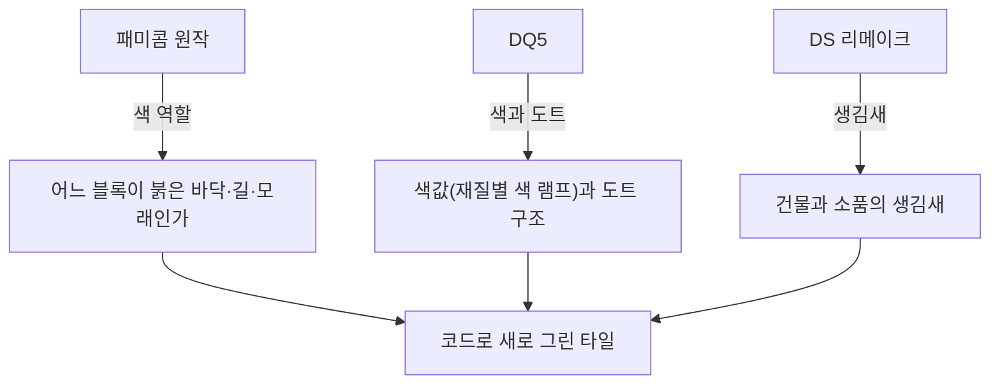
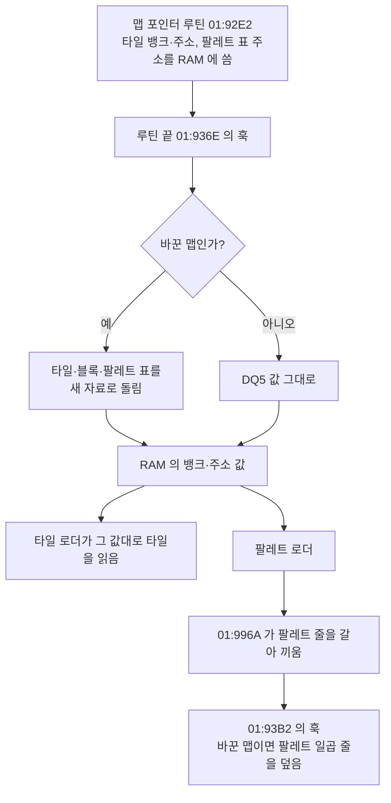
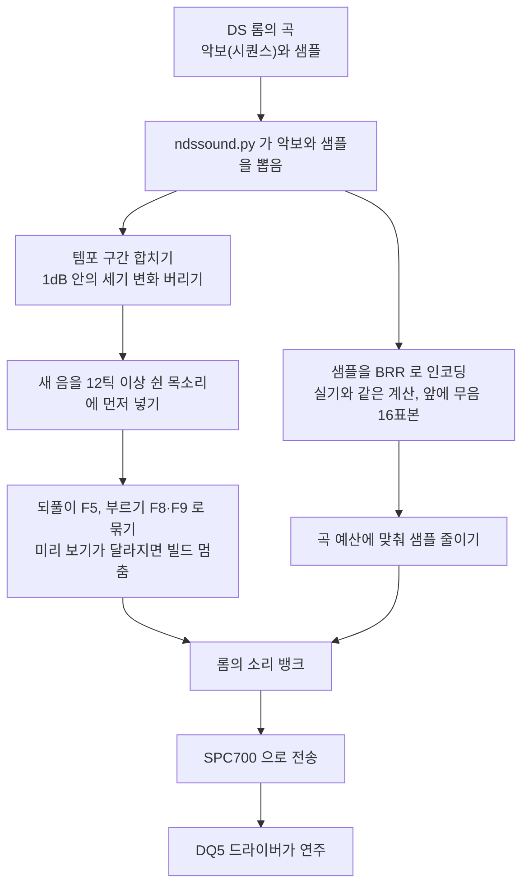
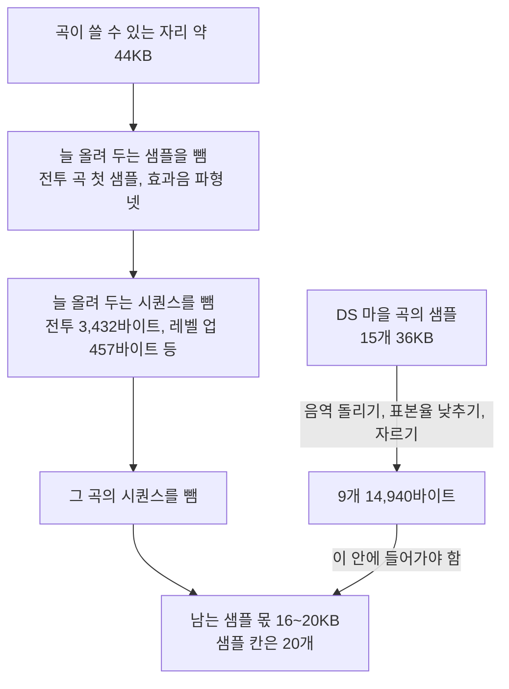
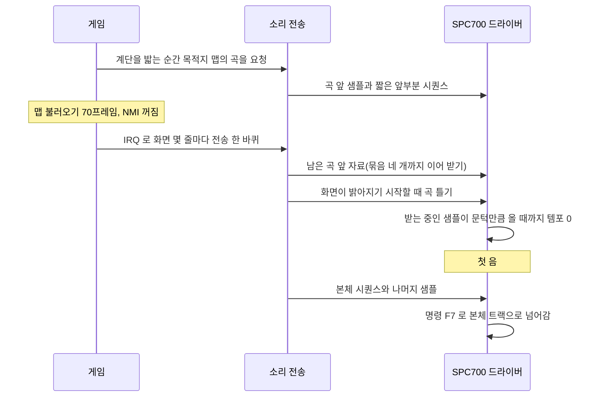

[앞 편](/games/romhacking/journal/dq4/windows/)까지는 창과 글자를 다뤘습니다. 이번 편은 화면의 나머지 절반과 귀에 들리는 것, 곧 맵 그림과 소리입니다. 패미콤판 DQ4 의 맵 배치는 [5편](/games/romhacking/journal/dq4/originals/)에서 읽어 두었고, DQ5 가 맵을 그리고 소리를 내는 방식은 [1편](/games/romhacking/journal/dq4/dq5-maps/)과 [4편](/games/romhacking/journal/dq4/dq5-graphics-sound/)에서 풀어 두었습니다. 여기서는 그 둘을 이어 붙입니다.

두 주제는 닮은 데가 없어 보이지만 같은 벽에 부딪혔습니다. 그림은 「8×8 타일 하나는 팔레트 한 줄만 쓴다」 와 「VRAM 의 이 자리는 다른 장면이 쓴다」 에, 소리는 「SPC700 의 메모리는 64KB 이고 샘플 칸은 20개다」 에 계속 걸렸습니다. 새로 만든 자료를 넣는 일보다, 엔진이 이미 쓰고 있는 자리를 피하는 일이 훨씬 길었습니다.

## 1. 닌텐도 DS 의 색은 드래곤 퀘스트처럼 보이지 않았다

처음에는 바트랜드 성 마을과 이무르 마을 두 곳의 타일부터 그렸습니다. 남의 그림은 쓰지 않으므로 타일은 모두 코드로 새로 그립니다. 색감은 DS 리메이크의 텍스처를 기준으로 삼았는데, 완성한 시안을 보니 흔한 인디 게임처럼 보였습니다. 느낌만으로는 고칠 수 없어서 DQ5 마을 맵과 색 통계를 견줬습니다.

```text
DQ5 알카파     평균 채도 0.70  잔디 #00ff18 13.5%, #009c00 8.7%
DQ5 라인하트   평균 채도 0.73  잔디 #00ff18 29.0%, 물 #0021ff
새 이무르      평균 채도 0.40  잔디 #4a8442 21.0%, 바닥 #9ca5a5 15.8%
새 바트랜드    평균 채도 0.36  물 #296b9c
```

색 수는 비슷했습니다(DQ5 44~50색, 시안 60~61색). 다른 것은 채도와 명암 폭이었습니다. DQ5 는 원색에 가까운 밝은 면과 거의 검은 그림자를 함께 씁니다. 그래서 재질마다 DQ5 에서 뽑은 색 램프로 팔레트를 다시 짰습니다. 잔디는 `102900`·`005200`·`009c00`·`4abd00`·`00ff18`, 물은 `00298c`·`0021ff`·`0063ff`·`0094ff` 입니다.

색만 바꿔서는 모자랐습니다. DQ5 타일을 확대해 도트 구조를 뜯어보니 잔디는 밝은 바탕에 어두운 점을 성기게 찍고, 벽은 크림색 윗면 밑에 점 질감 벽돌을 두고, 길은 황토 벽돌을 바구니 짜임으로 깝니다. 이 구조를 따라 다시 그렸습니다. 돌 무늬는 16칸 둘레로 감싼 보로노이 분할로 만들어, 되풀이해 깔아도 이음매가 보이지 않습니다.


_게임 안의 이무르. 밝은 바탕에 어두운 점을 성기게 찍은 잔디, 크림색 윗면 밑에 벽돌을 둔 벽, 바구니 짜임으로 깐 황토 벽돌 길이 모두 한 화면에 보입니다._

그래도 하나가 더 틀려 있었습니다. 이무르 바깥 길이 회색 돌로 나왔는데, 패미콤 원작에서 그 블록은 주황 벽돌 길입니다. DS 판의 흙길을 따라가다 원작의 색 역할을 버린 것입니다. 그래서 기준을 셋으로 나눴습니다. 어느 블록이 붉은 바닥이고 길이고 모래인지는 패미콤 원작을, 색값과 도트 구조는 DQ5 를, 건물과 소품의 생김새만 DS 판을 따릅니다. 기준과 대응표는 [환경 그래픽 문서](https://github.com/perfectacle/sfc-dq4/blob/main/sfc/dq4/docs/dq4-environment-format.md)에 있습니다.


_이무르 남쪽 들머리. 왼쪽은 패미콤 원작, 오른쪽은 포팅 롬입니다. 가운데 길은 원작의 주황 벽돌 자리에 그대로 벽돌 길을 깔았고, 가게 안의 붉은 바닥과 도구점·여관의 자리도 원작과 같습니다. 오른쪽의 일행은 라이안과 호이민입니다._



_세 기준이 정하는 것. 한 타일을 그릴 때 무엇을 어디서 가져오는지가 서로 겹치지 않습니다._


_이무르 마을. 블록 배치는 패미콤 원작 그대로이고 타일만 새로 그렸습니다._

## 2. 블록 시트 수십 장을 다 그리지 않는 법

패미콤 DQ4 의 실내 맵은 279곳이고, 맵마다 블록 시트(16×16 블록 서른두 개쯤의 묶음) 하나를 고릅니다. 같은 시트를 쓰는 마을끼리는 대응표가 그대로 맞으므로, 바트랜드와 이무르의 시트 둘만으로 마을 16곳이 따라왔습니다. 문제는 나머지 마흔 가지 넘는 시트였습니다.

마을·성 시트 열 가지는 시트마다 표를 쓰는 대신 그림으로 묶었습니다. 블록 정의의 타일 주소 넷과 팔레트 세 색이 같으면 같은 그림입니다. 쓰이는 블록 305개가 서로 다른 그림 95종으로 줄었고, 새로 정할 그림은 57종이었습니다. 뜻은 시트 그림만 보고 정하면 틀립니다. 크림 바탕의 T자를 허수아비로 그렸는데 맵에서는 묘지에 셋씩 늘어선 묘비였고, 파랑과 흰 물결을 흐르는 물로 그렸는데 옥좌 위 벽에 걸린 휘장이었습니다. 그 뒤로는 반드시 원작 맵과 나란히 놓고 확인했습니다.


_바트랜드 성 왕좌의 방. 왼쪽은 패미콤 원작, 오른쪽은 포팅 롬입니다. 융단과 벽, 방 위쪽의 파란 물결 블록까지 블록마다 원작의 자리에 새 그림이 놓였고, 원작의 화로 넷은 돌기둥으로 그렸습니다. 왼쪽 아래의 창은 패미콤이 가만히 서 있을 때 띄우는 것으로, 라이안의 HP 27 과 MP 0 이 적혀 있습니다._

던전·탑 시트 서른세 가지는 이 방법으로도 끝나지 않습니다. 쓰이는 블록 853개에 서로 다른 그림이 700종을 넘었습니다. 동굴은 같은 바위를 비탈·벼랑 모서리·그늘로 열 가지 넘게 나눠 그리고 시트마다 색만 바꾸기 때문입니다. 대신 통행 속성을 세어 보니 벽이 1,071번, 바닥이 457번이고 나머지는 물·계단·상자 몇 가지뿐이었습니다. 그래서 시트마다 벽·바닥 재질 한 쌍만 정하고, 표에 없는 블록은 속성으로 고르게 했습니다. 석상·기둥·광산 들보처럼 벽이나 바닥으로 칠하면 뜻이 사라지는 것만 표에 적으니 853개 가운데 174개였습니다. 마물의 성은 보라 타일을 따로 그리지 않고, 회색 석재 색을 보라로 바꾼 팔레트를 그 맵에 줍니다.


_재질로 그린 던전·탑 여덟 곳. 윗줄은 왼쪽부터 광산, 밀리는 바닥이 깔린 던전, 나무 속, 둘레가 검은 허공인 마지막 길입니다. 아랫줄은 천공성, 보라 팔레트를 준 마물의 성, 그리고 떨어지는 칸을 하늘로 그린 두 곳입니다._

재질로만 칠하면 바위 기둥의 둥근 윤곽과 벼랑 끝이 뭉개집니다. 처음에는 원작 블록의 색으로 픽셀마다 벽과 바닥을 가르려 했는데, 패미콤의 디더(두 색을 점점이 섞는 기법) 때문에 바위와 흙이 뒤섞였습니다. 원작 시트를 크게 키워 보니 모양이 있는 블록은 거의 검은 윤곽선이나 하늘로 모양을 냅니다. 그래서 재질은 블록마다 하나로 두고 검은 픽셀과 하늘색 픽셀만 따로 칠했습니다. 윤곽이 없는 동굴 비탈만 대각선으로 나눕니다. 이렇게 모양을 살린 블록이 처음에 81개였고 지금은 112개입니다. 한 타일은 팔레트 한 줄만 쓰므로 하늘 모서리가 바위 줄의 크림색으로 나오는데, 덜 거슬려 그대로 두었습니다.

## 3. 새 맵을 DQ5 엔진에 넣기

그림이 맞는지 보려면 엔진에서 그려 봐야 합니다. DQ5 의 타일 로더는 타일 뱅크와 주소, 팔레트 표 주소를 RAM 에서 읽고, 그 값은 맵 포인터 루틴 `01:92E2` 가 맵마다 써 넣습니다. 그래서 루틴 끝 `01:936E` 에 [훅](/games/romhacking/sfc/hooking/)을 걸어 바꾼 맵일 때만 새 자료를 가리키게 했습니다. 훅은 모두 여섯 곳입니다.

| 자리            | 하는 일                              |
| --------------- | ------------------------------------ |
| `01:936E`       | 타일·블록·팔레트 표를 새 자료로 돌림 |
| `01:93B2`       | 맵 팔레트 일곱 줄을 덮음             |
| `01:8F84` 등 셋 | 매 프레임 루틴을 물 루틴으로         |
| `01:F42D`       | 문 물체 목록을 새 항목으로           |

이 가운데 맵을 불러올 때 도는 앞의 두 훅이 원래 흐름의 어디에 끼어드는지 보면 이렇습니다.



_로더는 고치지 않습니다. 로더가 읽을 주소를 바꿔 놓고, 팔레트는 DQ5 가 마지막으로 손대는 자리 뒤에서 덮습니다._

첫 시도는 걸을 수는 있는데 배경이 검었습니다. 맵 레코드를 [뱅크](/games/romhacking/sfc/banks/) `50` 에 두었기 때문입니다. 로더는 레코드를 읽는 동안 데이터 뱅크를 그 뱅크로 둔 채 `LDA $1823` 같은 낮은 WRAM 을 절대 주소로 읽습니다. 뱅크 `40` 이상에는 낮은 WRAM 의 거울이 없어서, 이 명령이 자기 마지막 바이트 `18` 을 오픈 버스로 읽었습니다. 레코드와 블록 정의는 뱅크 `40` 아래로 옮기고, DMA 로 읽는 타일만 위쪽 뱅크에 둡니다.

다음에는 연못에 검은 줄이 생겼습니다. 빌린 맵 자리에 원래 걸려 있던 장치가 새 맵을 덮은 것입니다. 움직이는 타일은 원래 블록 번호로 물을 먼저 올리고 매 프레임 그 슬롯에 원래 물 그림을 썼고, 맵 위 물체는 공통 타일을 셀 위에 덮었습니다. 팔레트도 로더 직후에 덮었더니 그 뒤에 불리는 `01:996A` 가 한 줄을 다시 갈아 끼워 잔디가 갈색이 됐습니다. 훅을 그 호출 자리로 옮겨 해결했습니다.

검사는 게임 메모리로 합니다. 워프한 뒤 WRAM·VRAM·CGRAM 을 덤프해 셀 버퍼의 타일 워드로 맵 전체를 다시 그리고, 오프라인으로 그린 비교 맵과 픽셀까지 견줍니다. 바트랜드는 398,848픽셀에서 차이 0 이었습니다.


_처음 엔진에 올린 두 맵. 왼쪽이 바트랜드, 오른쪽이 이무르입니다. 아직 DQ5 실내 맵 자리를 빌린 때라 원래 인물이 그대로 서 있습니다._

빌린 자리로는 그림만 확인할 수 있었습니다. 바트랜드의 성 마을과 성 안이 서로 다른 DQ5 그룹에 놓여 계단을 이을 수 없었고, 원래 인물과 출구도 남았습니다. 그래서 1장의 맵은 패미콤 그룹 하나를 DQ5 의 새 그룹 하나에 맵 순서 그대로 넣었습니다. 계단은 블록 머리에 출구 표시를 넣어 잇고, 성문처럼 칸을 밟아 넘어가는 길은 DQ5 의 영역 이동 레코드로 옮겼습니다. 여기서 사각형을 두 줄 높이로 만들었다가 엉뚱한 줄에 섰습니다. `2A:F636` 을 읽어 보니 높이가 1 이 아니면 도착 Y 를 비례로 정하는 세로 사각형으로 다룹니다. 인물과 사건을 얹는 일은 [10편](/games/romhacking/journal/dq4/chapter1/)에서 다룹니다.


_새 그룹에 넣은 뒤의 바트랜드 성 마을. 위 그림과 달리 DQ5 의 인물이 없고, 길 위에는 라이안과 호이민이 있습니다._

훅에서 배운 것도 하나 적어 둡니다. 바꾼 맵 찾기 루틴이 `SEP #$30` 으로 들어가는데, 인덱스가 8비트가 되는 순간 X·Y 의 상위 바이트가 0 이 되고 16비트로 돌아와도 돌아오지 않습니다. Y 를 스택에 넣지 않은 탓에, 손대지 않은 DQ5 맵 두 곳에서 문이 사라졌습니다. 지금은 모든 훅이 `PHP REP #$30 PHA PHX PHY` 로 들어갑니다.

## 4. 물과 분수, 그리고 모래로 덮인 화면

DQ5 의 움직이는 타일은 맵 목록과 원래 블록 번호에 묶여 있어 새 맵에 쓸 수 없었습니다. 그래서 맵마다 매 프레임 불리는 루틴 자리(`7E:1AA6`~)를 새 루틴으로 바꿨습니다. 새 루틴은 VRAM 을 직접 쓰지 않고, NMI 가 처리하는 DMA 목록에 항목을 넣습니다. 24프레임마다 물 그림 세 장을 돌려 끼웁니다.

이 루틴이 같은 증상의 버그를 두 번 냈습니다. 화면 전체가 크림 바탕의 회색 점으로 덮이고 주인공도 보이지 않는 것입니다. 첫 번째는 물이 없는 맵이었습니다. 셀 버퍼로 다시 그린 맵은 멀쩡했으므로 PPU 상태를 덤프해 배경 층을 하나씩 그렸더니, BG1 전체가 가리키는 빈 타일(슬롯 0)에 무늬가 들어 있었습니다. 물 루틴은 물 타일의 슬롯을 표에서 읽는데, 물이 없는 맵은 그 값이 0 이라 물 그림을 슬롯 0 에 쓴 것입니다. 맵마다 물 flag 를 두어 고쳤습니다.

두 번째는 전투가 끝난 뒤였습니다. 슬롯 표 `7E:6000` 을 전투가 작업 메모리로 쓰고, 맵으로 돌아올 때 다시 만들지 않습니다. 물이 있는 맵 33곳을 덤프해 보니 물 타일은 늘 슬롯 `BE`~`C1` 이었습니다. 물이 블록 0 이라 로더가 가장 먼저 올리기 때문입니다. 그래서 슬롯을 고정으로 쓰고, 빌드는 물이 블록 0 이 아니면 멈춥니다.

이무르 연못 한가운데의 분수는 나중에 물과 함께 움직이게 했습니다. 분수 타일 번호를 물 다음으로 두면 슬롯도 물 다음을 받으리라 보았는데 아니었습니다. 슬롯은 타일 번호가 아니라 블록 번호 순으로 받습니다. 분수 블록을 1번으로 옮기자 `C2`~`C5` 를 받았습니다.

## 5. 문은 맵이 아니라 물체다

패미콤판의 문은 블록입니다. 그대로 그리면 열리지 않습니다. DQ5 의 닫힌 문은 맵 레코드가 아니라 맵 위 물체 표 `01:D2FC` 에 있으므로, 문 블록 자리는 바닥으로 그리고 그 위에 DQ5 문 물체(2×3셀 문, 4×4셀 성문)를 올렸습니다. 열쇠 문도 구조가 같았습니다. 패미콤의 문 속성은 열쇠 단계마다 다르고 DQ5 문 항목의 끝 바이트에도 잠금 단계가 있어 그대로 옮겼습니다.


_바트랜드 성 앞. 왼쪽은 패미콤 원작, 오른쪽은 포팅 롬입니다. 원작의 성문은 검은 아치 블록이고, 오른쪽의 나무 성문은 바닥 위에 올린 DQ5 의 성문 물체입니다. 왼쪽 아래의 창은 패미콤이 가만히 서 있을 때 띄우는 라이안의 HP·MP 창입니다._

처음 그린 문은 분홍색이었습니다. 공통 문 타일이 팔레트 5·6번 줄의 정해진 색 번호를 쓰기 때문입니다. DQ5 맵 여덟 곳의 팔레트를 보니 그 칸은 어느 맵이나 같은 색이었습니다. 새 팔레트도 그 자리에 같은 색을 두고, 새 그림이 쓰던 번호는 남은 칸으로 옮겼습니다.

자리 문제가 뒤따랐습니다. 문 항목은 읽는 코드가 `LDA $D2FC,Y` 이고 데이터 뱅크가 `01` 이라 뱅크 01 에 있어야 하는데, 그 뱅크의 빈 자리는 304바이트뿐입니다. 맵이 늘자 넘쳤습니다. 문 루틴으로 들어오는 입구 여섯이 모두 데이터 뱅크를 스택에 넣었다가 되돌리는 것을 확인하고, 훅에서 데이터 뱅크를 `3D` 로 바꿨습니다. 다만 문 루틴이 훅 뒤에 뱅크 01 의 다른 표도 읽을 수 있습니다. 에뮬레이터의 읽기 콜백으로 검사 전체를 돌리며 읽은 주소를 모으니 `FD97`~`FEAE` 뿐이어서, 그 둘레 288바이트만 같은 주소로 복사했습니다. 뱅크 01 에는 중계 코드 24바이트만 남았습니다.

여는 방법은 원작과 일부러 다르게 했습니다. 패미콤판과 DQ5 는 명령 창에서 「문」 을 골라야 열립니다. DS 판을 돌려 보니 잠기지 않은 문은 방향키만 눌러도 열렸습니다. 그래서 걸어 들어가면 문이 열리게 하고, 명령 창의 문 명령도 반 블록 비켜 선 자리에서 듣도록 찾는 칸을 넓혔습니다. 열쇠 없이 잠긴 문으로 걸어가면 메시지만 떠서 심심했는데, 벽에 부딪힐 때의 DQ5 효과음을 앞에 붙였습니다. 자세한 것은 [형식 문서(1장)](https://github.com/perfectacle/sfc-dq4/blob/main/sfc/dq4/docs/dq4-chapter1-format.md)에 있습니다.

벽 위 간판은 바탕색이 틀렸습니다. 간판을 나무 줄에 그렸더니 벽돌 바탕이 그 줄의 가장 가까운 회갈색으로 바뀐 것입니다. 나무 줄에 벽돌 색 다섯을 넣을 자리가 없어서, 반대로 간판을 벽돌 줄로 옮겼습니다. 그 줄의 붉은 갈색 램프를 나무 판으로 씁니다.

## 6. 세계 지도: 빌린 블록에서 새 타일까지

필드는 실내 맵과 형식이 달라 따로 옮겼습니다. 패미콤 필드의 블록 (x, y) 를 DQ5 세계 지도의 블록 (x, y) 에 그대로 둡니다. 첫 단계에서는 지형이 맞는 DQ5 블록을 빌렸습니다. DQ5 의 블록을 지형 값과 타일 속성으로 나눠 바다·언덕·산·풀밭·숲에 맞는 것을 고르는 식입니다. 그림은 DQ5 그대로지만 걷기·배·조우가 바로 맞습니다.

입구도 다릅니다. 패미콤은 입구 블록에 들어서면 들어가지만, DQ5 는 좌표 표로만 정하고 주인공이 8픽셀씩 걷습니다. 입구를 한 칸에만 두면 옆 칸으로 지나치므로 블록의 네 칸을 모두 입구로 넣었습니다. DQ5 의 원래 마을 입구 53개는 지도 밖에 만든 작은 산섬으로 몰아 두었습니다. 지우지 않은 것은 루라(ルーラ)의 행선지 그룹이 표에 꼭 있어야 하기 때문입니다.

다음으로 그림을 바꿨습니다. 빌린 블록의 타일을 덮어쓰면 여러 블록이 나눠 쓰는 타일이 함께 바뀌므로, 새 블록 열일곱 개와 새 타일 70개를 더했습니다. 색은 DQ5 의 낮 팔레트에서 가장 가까운 색을 고릅니다. 팔레트를 새로 짜면 밤 팔레트까지 새로 만들어야 하기 때문입니다. 마을에 맞춘 초록이 필드에서는 너무 밝아 한 단계 어둡게 맞췄고, 모래는 가장 가까운 색이 옅은 회색이라 눈밭처럼 보여서 DQ5 의 모래 색으로 따로 옮겼습니다.

바다만은 바뀌지 않았습니다. 움직이는 바다 타일 넷은 필드 타일이 아니라 `01:A719` 의 128바이트 원본으로 만듭니다. 필드를 불러올 때 이것을 한 픽셀씩 돌린 16벌을 `7E:C000` 에 만들고, 몇 프레임마다 한 벌을 VRAM 에 올립니다. 세계마다 돌리는 방향이 달라 가로로도 세로로도 이어지는 물결이어야 하는데, 새로 그린 물결은 16픽셀 안에서 양쪽이 모두 이어지게 그려 둔 것이라 한 그림으로 세 세계를 맞췄습니다.


_바트랜드 성 아래, 이무르 앞, 다리, 사막, 암초 옆. 낮밤 팔레트는 DQ5 것을 그대로 씁니다._

그런데 필드에서 싸우면 전투 배경 위·아래 띠에 보이는 풀밭과 숲이 줄무늬로 깨졌습니다. 필드와 전투의 VRAM 을 256워드씩 견주니 워드 `4000`~`5DFF` 를 전투 배경 그림이 통째로 덮고 있었습니다. 새 타일 70개를 DQ5 타일 512개 뒤에 붙였는데, 그 자리가 바로 여기였습니다. 원래 DQ5 는 512개만 써서 깨지지 않습니다. 옮긴 세계에는 DQ5 블록이 바다밖에 남지 않아 512개 가운데 489개가 비어 있었으므로, 새 타일을 그 안으로 옮겼습니다. 그러면 필드 타일을 다시 압축해야 하는데 처음에는 원래 자리를 21바이트 넘었습니다. 덜 줄어드는 타일을 골라 바꿔 넣는 차례를 바꿔 12,563바이트로 맞췄습니다(원래 12,965). 지도와 입구의 자리는 [필드 형식 문서](https://github.com/perfectacle/sfc-dq4/blob/main/sfc/dq4/docs/dq4-field-format.md)에 있습니다.


_같은 무리(슬라임과 큰 지렁이)를 만난 전투. 왼쪽은 패미콤 원작, 오른쪽은 포팅 롬입니다. 원작은 배경이 검고, 포팅 롬은 DQ5 처럼 숲 배경 위·아래로 필드의 풀밭·숲·산이 띠로 보입니다. 고친 뒤라 띠가 깨지지 않습니다. 원작의 명령 창은 위에서부터 공격, 도망, 방어, 도구입니다._

맵 바깥도 손봤습니다. 성 마을 서쪽 끝에 서면 화면 절반이 검었습니다. 패미콤은 맵 밖을 맵 머리의 바깥 블록으로 채우는데, DQ5 가 맵 밖을 그리는 방법(검정, 한 색, 맵 가장자리 되풀이) 가운데 맞는 것이 없었습니다. 아무 맵도 쓰지 않는 방법 5 의 루틴 포인터를 바꿔 「맵 안에서 바깥 블록이 놓인 칸을 되풀이」 하게 했습니다. 2층 방 둘레의 하늘은 가로 줄 무늬를 넣었더니 16픽셀마다 되풀이되어 바다처럼 보였습니다. 구름결·작은 구름·디더 시안을 견줘 봐도 격자가 보였고, DQ5 의 천공성도 맵 바깥이 단색이라 무늬 없는 한 색으로 정했습니다.

## 7. DS 의 악보를 SPC700 의 시퀀스로

소리는 DS 리메이크의 편곡을 옮깁니다. DS 롬의 곡은 악보(시퀀스)와 샘플로 들어 있어, [ndssound.py](https://github.com/perfectacle/sfc-dq4/blob/main/nds/dq4/tools/ndssound.py) 가 악보와 샘플을 뽑고 변환기가 DQ5 의 [SPC700 드라이버](/games/romhacking/sfc/sound/) 형식으로 바꿉니다. 첫 곡은 성의 곡 「왕궁의 미뉴에트」 였습니다.

첫 삽입은 `SPC budget exceeded (48062/44195 bytes)` 로 멈췄습니다. 변환한 시퀀스가 15,217바이트로, DQ5 에서 가장 큰 곡의 세 배가 넘었습니다. 명령별로 세어 보니 원인은 음표가 아니었습니다. DS 악보는 템포를 1 BPM 단위로 1,918번 바꾸고 세기도 음마다 다릅니다. 그대로 옮기면 경계마다 음이 쪼개집니다. 누적 시각 오차가 0.012초 이하가 되게 템포 구간을 합치고, 1dB 안의 세기 변화는 쓰지 않게 하자 6,894바이트가 됐습니다.

롬에 넣어 들어 보니 음정이 바뀔 때마다 스위치를 딸깍거리는 소리가 났습니다. 원인은 셋이었고 하나씩 벗겨졌습니다.

- 샘플 인코더가 실기와 다르게 계산했습니다. SNES 의 압축 샘플 형식 BRR 은 넘친 값을 16비트로 자른 뒤 1비트 밀어서 부호가 뒤집히는데, 인코더는 15비트로 자른다고 보았습니다. 실기와 같은 계산으로 풀어 보니 네 샘플 가운데 둘의 신호 대 잡음비가 13~17dB 였고, 오차를 실기 계산으로 재는 인코더를 다시 쓰자 27dB 위로 올라갔습니다.
- DQ5 의 원래 샘플 38개는 모두 무음 블록으로 시작하는데 새 샘플은 첫 블록부터 큰 값이었습니다. 16표본 무음을 앞에 붙였습니다.
- 드라이버는 음이 끝나기 1틱 전에 다음 바이트를 미리 봅니다. 다음이 음이면 키 오프(KOF)로 약 8ms 만에 끊고, 쉼표면 부드럽게 줄입니다. 변환기가 같은 성부를 같은 목소리에 이어 붙여서, 크게 울리던 음이 박마다 여러 목소리에서 동시에 끊겼습니다. 새 음을 12틱 이상 쉰 목소리에 먼저 넣자 그런 음이 775개에서 160개로 줄었습니다.

이 「미리 보기」 는 시퀀스를 줄일 때 다시 걸렸습니다. 드라이버에는 횟수 되풀이(`F5`)와 서브루틴 부르기(`F8`·`F9`)가 있어, 되풀이되는 토막을 묶으면 크기가 줄어듭니다. 드라이버 코드를 읽어 제약부터 확인했습니다. 부르기는 세 겹까지이고 되풀이 셈은 트랙마다 하나입니다. 그런데 실행 순서와 시각만 맞춘 첫 압축은 필드 곡에서 키 오프를 43번 더 냈습니다. 미리 보기는 실행상의 다음이 아니라 실제 자리의 다음 바이트를 보기 때문에, 음 바로 뒤에 `F8` 이 오면 원래 없던 끊김이 생깁니다. 그래서 묶기 전후로 (틱, 바이트, 미리 본 것이 쉼인지)를 견주어 다르면 빌드가 멈추게 했습니다. 50곡 합계가 328,484바이트에서 246,762바이트가 됐습니다. 변환 규칙은 [사운드 포팅 문서](https://github.com/perfectacle/sfc-dq4/blob/main/sfc/dq4/docs/dq4-sound-port-format.md)에 있습니다.

여기까지를 한 줄로 이으면 DS 롬의 곡 하나가 SPC700 에서 울리기까지 거치는 단계가 됩니다. 샘플 줄이기와 전송은 다음 두 절에서 다룹니다.



_뽑은 뒤로 악보와 샘플이 따로 가다가 롬의 소리 뱅크에서 다시 만납니다. 딸깍 소리의 세 원인은 인코딩, 무음 블록, 목소리 고르기 칸에서 하나씩 고쳤습니다._

## 8. 44KB 예산과 늘 올려 두는 곡

SPC700 의 메모리 64KB 가운데 곡이 쓸 수 있는 자리는 약 44KB 입니다. 여기서 늘 올려 두는 샘플과 시퀀스, 그 곡의 시퀀스를 빼면 샘플 몫은 16~20KB 이고, 샘플 칸은 20개입니다. DS 의 마을 곡은 샘플 15개에 36KB, 필드 곡은 40KB 였습니다.

그래서 곡마다 예산을 정하고 손실이 가장 작은 줄이기부터 하나씩 고르는 도구를 만들었습니다. 줄이는 방법은 셋입니다. 쓰는 음이 적은 음역을 이웃 샘플로 돌리기, 표본율 낮추기(8000 → 6000 → 4500 → 3200Hz), 반복 없는 긴 샘플 자르기. 매번 「손실 ÷ 줄어드는 바이트」 가 가장 작은 것을 고릅니다. 마을 곡은 샘플 9개 14,940바이트가 됐습니다.

곡 45개를 한 롬에 넣으니 이번에는 샘플 번호가 모자랐습니다. 번호는 162개인데 곡마다 따로 만들면 167개가 필요했습니다. DS 곡들이 같은 파형 묶음을 나눠 쓰므로, 같은 원본에서 나온 샘플은 표본율이 조금 달라도 함께 쓰게 해 149개로 줄였습니다. 롬의 소리 뱅크도 열두 개에서 열여덟 개로 늘렸습니다.

전투 곡은 다른 문제였습니다. DQ5 는 전투 곡의 시퀀스와 첫 샘플을 켤 때 올려 두고 내리지 않습니다. 그래서 조우하면 6프레임 만에 울립니다. 새 전투 곡을 늘 올려 두면 모든 곡의 예산이 6KB 씩 줄어서, 처음에는 목록에서 빼고 조우할 때 보냈습니다. 결과는 142프레임이었습니다. 적이 나타났다는 메시지가 뜨고 명령 창이 열린 뒤에야 곡이 시작합니다.

조우 판정과 전투 곡 명령 사이는 0프레임이라 미리 보낼 틈이 없었습니다. 곡 자리마다 지연을 재서 늦으면 안 되는 곡을 가렸더니 보통 전투와 레벨 업 둘뿐이었습니다. 이 둘만 다시 늘 올려 두었습니다. 대신 값을 치렀습니다. 전투 시퀀스는 트랙을 목소리에 고정하고 겹치는 층 하나를 빼 3,432바이트로 줄였고, 넣은 곡이 쓰지 않는 DQ5 의 현 샘플(9,889바이트)을 늘 두는 목록에서 뺐습니다. 레벨 업 징글은 전투 곡의 트럼펫·현·스네어를 빌려 새 샘플 없이 457바이트입니다. 전투 곡은 5프레임 만에 울립니다.

결국 곡 하나의 샘플 몫은 44KB 에서 앞의 것들을 차례로 빼고 남은 자리입니다.



_늘 올려 두는 것이 늘면 모든 곡의 샘플 몫이 그만큼 줄어듭니다. 전투 곡을 늘 두는 값이 곡마다 6KB 였던 까닭입니다._

## 9. 맵에 들어가면 곡이 2초 늦게 나온다

맵 곡이 남았습니다. 화면이 밝아진 뒤 곡이 나오기까지 DQ5 는 −26~+39프레임인데, 옮긴 곡은 +133~+192프레임이었습니다. 3초 가까이 조용합니다. 악기 수는 줄이지 않기로 하고 여섯 단계로 줄였습니다.

1. **곡 앞 샘플만 먼저.** 곡을 틀기 전에는 처음에 쓰는 샘플만 보내고 나머지는 곡이 울리는 동안 보냅니다. 처음에는 「처음 4틱 안에 쓰는 샘플」 로 골랐더니 배 곡에서 낮은 현과 플루트가 늦게 와 음이 빠졌습니다. 도착 전에 쓰여 빠지는 음이 0 이 될 때까지 하나씩 더하게 바꿨습니다.
2. **빨리 받기.** 프레임마다 보낸 3바이트 묶음을 세어 보니 한계는 주고받는 왕복이었습니다. SPC 쪽 받기 루틴이 묶음을 네 개까지 이어 받게 고쳐 프레임당 71묶음이 88묶음이 됐습니다.
3. **곡 나누기.** 곡을 짧은 앞부분과 본체로 나누고 본체는 곡이 시작한 뒤 보냅니다. 드라이버에서 아무 일도 하지 않던 명령 `F7` 을 「본체 시퀀스의 이 트랙으로 넘어가기」 로 바꿨습니다.
4. **받는 중에 울리기.** 샘플 하나는 다 오기 전에 재생을 시작합니다. 재생 자리가 받은 끝을 앞지르지 않는 최소 문턱을 계산하고, 그만큼 올 때까지 템포를 0 으로 붙듭니다.
5. **출구에서 미리 요청.** 원래는 화면이 다 어두워진 뒤 곡을 요청합니다. 계단을 밟는 순간 목적지 맵의 곡 번호를 미리 구해 요청합니다.
6. **불러오는 동안 보내기.** 소리 전송은 NMI 가 선점하는 코루틴이라, NMI 를 끄는 맵 불러오기 70프레임 동안 멈춥니다. 게임이 쓰지 않는 IRQ 를 켜서 화면 몇 줄마다 전송을 한 바퀴씩 돌렸습니다.

여섯 단계를 모두 넣은 뒤, 계단을 밟고 나서 첫 음이 나기까지 게임과 SPC700 이 주고받는 순서입니다.



_원래는 화면이 다 어두워진 뒤에야 첫 줄이 시작됐고, 맵을 불러오는 70프레임 동안은 아무것도 오가지 않았습니다._

| 맵(곡) | DQ5 | 처음 | 여섯 단계 뒤 |
| ------ | --- | ---- | ------------ |
| 성     | +39 | +173 | 0            |
| 마을   | +14 | +169 | −15          |
| 동굴   | −8  | +149 | −9           |
| 배     | +39 | +193 | −10          |

음수는 화면이 밝아지는 16프레임 연출 도중이라는 뜻입니다. 「처음」 은 전투 곡을 늘 올려 둔 직후에, 마지막 열은 여섯 단계를 막 넣은 때에 세이브스테이트에서 잰 값입니다. 뒤에 적는 까닭으로 전원부터 다시 재니 성 −2, 마을 −9, 동굴 −9, 배 −10 이었습니다. 맵 불러오기 자체를 줄이는 길도 봤습니다. 검은 화면의 절반 이상을 맵 칸을 같은 값으로 채우는 고리가 쓰고 있었지만, 그 고리를 고쳐도 화면과 곡 사이 간격은 그대로라 손대지 않았습니다.

### 세이브스테이트로 잰 값이 틀렸다

이 실측은 대부분 배 선실의 [세이브스테이트](/games/romhacking/sfc/emulator/)에서 워프해 쟀습니다. 여기에 함정이 있었습니다. 세이브스테이트의 SPC 메모리에는 그 상태를 만든 롬의 드라이버와 곡 표가 그대로 들어 있습니다. 표를 바꾼 롬으로 불러오면 드라이버가 옛 표로 샘플을 찾습니다. 그래서 상태를 불러온 뒤 롬의 표를 SPC 메모리에 다시 써 주는 Lua 로 보정했습니다.

곡 번호를 늘린 뒤 이 보정이 깨졌습니다. 보스 곡의 첫 음이 +348프레임으로 나왔는데, 세이브스테이트 없이 전원부터 켜서 재니 +155 였습니다. SPC 가 어디에 쓰는지 감시해 보니, 늘어난 표가 상태의 옛 샘플 자리와 겹쳐 받은 자료와 보정이 서로를 덮고 있었습니다. 출구 효과음이 끝나지 않고 18프레임마다 되풀이됐고, 그것이 전송을 늦췄습니다. 그 뒤로는 재는 롬마다 전원부터 배 선실 상태를 새로 만들어([dq4shipstate.lua](https://github.com/perfectacle/sfc-dq4/blob/main/sfc/dq4/tools/lua/dq4shipstate.lua)) 보정 없이 잽니다. 앞서 세이브스테이트에서만 본 것은 모두 다시 쟀습니다.

### 곡 번호, 보스, 탈것

DQ5 의 곡 번호 `00`~`31` 이 다 차서 번호를 `47` 부터 늘렸습니다. 드라이버와 전송 코드는 「`32` 이상은 효과음」 으로 보므로, 그 비교 여덟 군데를 범위 검사를 하는 9바이트 도우미 호출로 바꿨습니다. 나눈 곡의 본체도 이 새 번호를 씁니다.

보스 곡은 DQ5 도 늘 올려 두지 않으므로 전투 화면이 열리는 약 109프레임 안에만 울리면 됩니다. 곡 앞 샘플 줄이기와 나누기로 +155 를 +77 로 당겼습니다(타이틀에서 명령을 넣어 잰 값이고, 필드의 사건 전투로 재면 +87 입니다).

계단이 아닌 전환을 재다가 큰 버그도 찾았습니다. 성에서 필드로 나가면 필드 곡이 7초쯤 뒤에 멈췄습니다. 맵을 옮길 때 앞 곡의 대기열 칸이 `FF` 로 지워지는데, 본체를 보내는 코드가 그 칸의 한 비트만 보고 「떠난 곡」 의 본체를 보낸 것입니다. 그 본체가 자리를 차지해 다음 곡의 본체가 실리지 못했습니다. 첫 음만 재던 실측에서는 드러나지 않았습니다.

배와 마법 융단에서 내릴 때는 필드 곡 샘플을 다시 받느라 원본보다 1초쯤 길게 조용했습니다. 두 가지로 줄였습니다. 앞 곡과 다음 곡이 함께 쓰는 샘플은 정리할 때 버리지 않고, 타고 있는 동안 필드 곡의 앞 샘플을 탈것 곡의 남는 자리에 미리 받아 둡니다. 배에서 내린 뒤 첫 음이 +103 에서 +60 이 됐습니다(원본 +39). 용에서 내릴 때는 같은 필드 곡을 처음부터 다시 틀던 것을 끊지 않고 잇게 했습니다.

## 10. 효과음과 귀로 맞추기

효과음은 방침부터 정했습니다. DQ5 것이 기본이고, 나란히 들어 확실히 나은 것만 DS 것으로 바꿉니다. DS 효과음은 634개이고 PCM 샘플을 쓰는 것이 많습니다. 반면 DQ5 효과음은 늘 올려 두는 52~70바이트짜리 작은 파형 넷만 씁니다. 샘플 칸 20개를 이미 다 쓰는 곡이 다섯이라 칸을 하나도 늘릴 수 없었습니다.

- **잡음뿐인 소리.** 계단, 적이 맞는 소리처럼 DS 가 잡음 채널로만 내는 것은 샘플 없이 옮깁니다.
- **파형 자리 바꾸기.** DS 의 UI 소리는 짧은 파형 한 주기를 되풀이합니다. 반복 구간의 주기를 평균해 32표본 한 주기(36바이트)로 만들고, DQ5 가 늘 두는 파형 자리에 원래 크기 이하로 넣습니다.
- **곡에 붙이기.** 무기 타격음은 샘플이 1.4~1.9KB 라 늘 둘 수 없습니다. 보통 전투 곡의 레코드 끝에 붙여 곡이 울리는 동안 받고, 다 오기 전의 공격은 DQ5 소리를 냅니다. DQ5 는 무기 종류로 소리를 고르는데, 무기 번호로 표를 보는 받침을 넣어 무기마다 다른 소리를 냅니다.
- **안 쓰는 샘플 자리.** 문 소리는 DS 것이 낫다고 골랐지만 늘 두면 곡 수십 개의 샘플을 다시 줄여야 했습니다. 승인한 곡을 건드리지 않으려고 한동안 DQ5 소리로 두었다가, DQ5 여관 곡만 쓰던 늘 두는 샘플 자리(952바이트)에 0.2초짜리로 넣었습니다.

대응표를 만들 때 추정으로 적은 것은 실측에서 뒤집혔습니다. 우리 편이 맞는 소리와 공격이 빗나가는 소리를 반대로 적어 두었습니다. 자동 보행으로 전투를 50번쯤 돌리며 효과음 명령과 일행 HP 를 함께 적으니, 한쪽은 67번 가운데 67번 HP 가 바뀌었고 다른 쪽은 17번 가운데 한 번도 바뀌지 않았습니다.

곡의 세기와 음색은 귀로 맞췄습니다. DS 원곡과 이식판을 나란히 듣는 일을 열네 번 되풀이했습니다. DS 곡은 12~16트랙인데 배경 음악에 쓸 목소리는 일곱이라 음이 빠집니다. DS 가 메아리로 넣은 지연 복사 트랙이 목소리를 차지해 화음이 비는 일이 많아서, 그런 트랙은 목소리가 모자랄 때 먼저 양보하게 했습니다. 한 곡을 고치면 예산과 샘플 나눠 쓰기를 타고 다른 곡이 바뀌므로, 설정마다 전 곡의 샘플·시퀀스 바이트를 견줘 고친 곡만 바뀌었는지 봤습니다.

청취용 렌더에도 함정이 있었습니다. SPC 상태를 덤프해 렌더하는데, 덤프한 순간 드라이버가 샘플을 받는 중이면 렌더가 무음이 됩니다. 곡이 시작한 뒤에 덤프하면 앞이 잘립니다. 그래서 곡이 시작하기 한두 프레임 전부터 차례로 덤프해, 무음이 아닌 첫 판을 씁니다.

소리를 얹은 롬에서만 나오는 버그도 둘 있었습니다. 이어하기에서 기록을 고르면 메뉴 곡([7편](/games/romhacking/journal/dq4/title-menu/) 참고)이 줄어들며 느려지고 뭉개졌습니다. SPC 의 시간이 모자란 것이었습니다. 드라이버는 틱마다 트랙 10칸을 여덟 번씩 훑는데, 여기에 페이드의 음량 계산이 겹치면 한 바퀴가 타이머 주기를 넘습니다. 한 번만 훑게 고치자 메뉴 곡의 쉬는 시간이 38% 에서 67% 가 됐습니다. 또 하나는 교회였습니다. 되살린 뒤 대화가 멈췄습니다. DQ5 는 짧은 징글을 틀고 그 곡이 끝나기를 기다리는데, 대응표가 그 자리에 되풀이하는 곡을 넣었습니다. 같은 꼴의 기다림 자리를 롬 전체에서 모아 그 곡이 끝나는 곡인지 시퀀스로 판정하는 검사([dq4songwait.py](https://github.com/perfectacle/sfc-dq4/blob/main/sfc/dq4/tools/dq4songwait.py))를 남겼습니다.

마지막으로 빌드 시간입니다. 곡 넣기 빌드 한 번이 11분이었습니다. 프로파일러로 보니 89% 가 시퀀스 묶기였습니다. 곡 앞 샘플을 늘려 가며 다시 변환하느라 한 빌드에서 묶기를 344번 부릅니다. 묶기 결과를 입력과 코드의 해시로 캐시하자 53초가 됐고, 롬은 바이트까지 같았습니다.

## 틀렸던 것들

- **DS 판의 색을 따르면 된다.** 평균 채도가 DQ5 의 절반이었습니다. 생김새는 참고할 만하지만 드래곤 퀘스트다운 색은 DQ5 에서 나옵니다.
- **시트 그림만 보면 블록의 뜻을 안다.** 묘비를 허수아비로, 휘장을 흐르는 물로 그렸습니다. 원작 맵에서 놓인 자리를 보고서야 알았습니다.
- **다시 그린 맵이 맞으면 화면도 맞다.** 검사가 셀 버퍼만 보고 BG1 을 보지 않아, 물 루틴이 빈 타일을 덮는 것을 두 번 놓쳤습니다.
- **비교만 하는 훅은 아무것도 바꾸지 않는다.** 감싼 루틴이 돌려준 A 를 덮었고, `SEP #$30` 은 Y 의 상위 바이트를 지웠습니다.
- **인코더가 말한 신호 대 잡음비면 샘플은 괜찮다.** 그 값은 인코더 자기 모형으로 잰 것이었습니다. 실기와 같은 계산으로 풀어야 합니다.
- **실행 순서와 시각만 같으면 소리가 같다.** 드라이버는 실제 자리의 다음 바이트를 미리 보고 끊을지 정합니다.
- **세이브스테이트에 표만 다시 쓰면 실측할 수 있다.** 롬이 SPC 메모리 배치를 바꾸면 보정이 받은 자료를 덮습니다. 시간은 전원부터 잽니다.

## 남은 것

- 옆으로 들어가는 출구와 그룹 도착 방향을 패미콤 방향에 맞추기.
- 필드의 물가 이음새. 패미콤 필드에는 해안선 블록이 없어 땅과 바다가 반듯하게 맞닿습니다.
- 목소리 일곱의 한계로 음이 빠지는 곡. 글로켄과 트럼펫이 빠지는 곡이 남아 있습니다.
- 샘플을 쓰는 DS 효과음 가운데 자리가 없어 넣지 못한 것(회심의 일격 등).
- 트랙 훑기를 바꾼 뒤 트랙이 여럿인 효과음의 처리 순서가 거꾸로가 됐습니다. 귀로는 확인하지 못했습니다.
