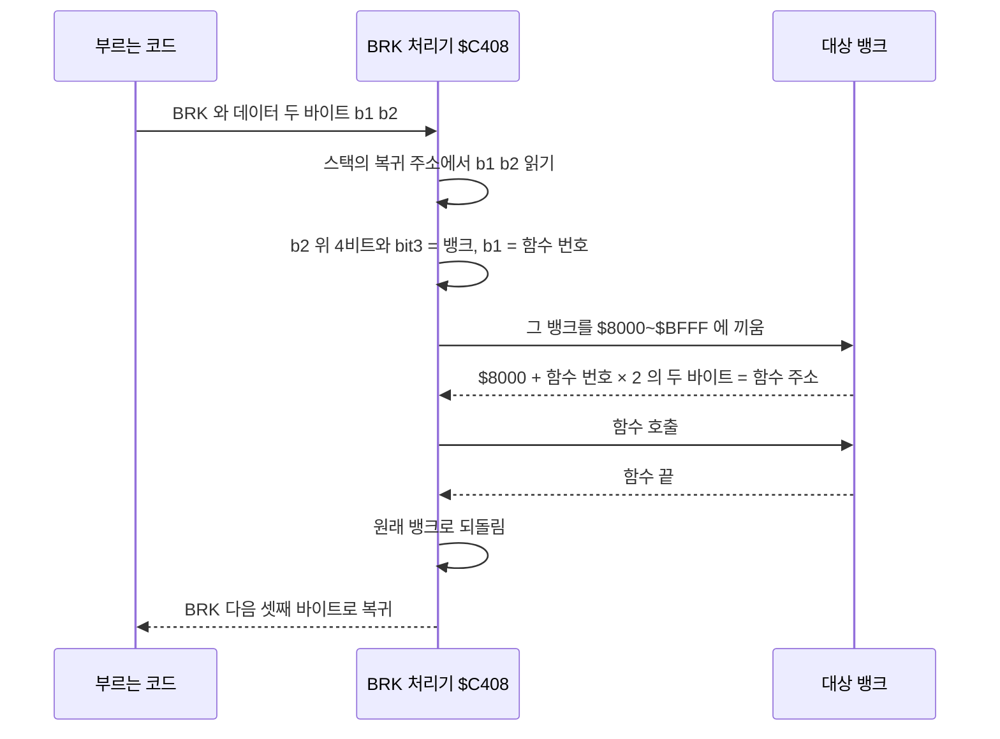
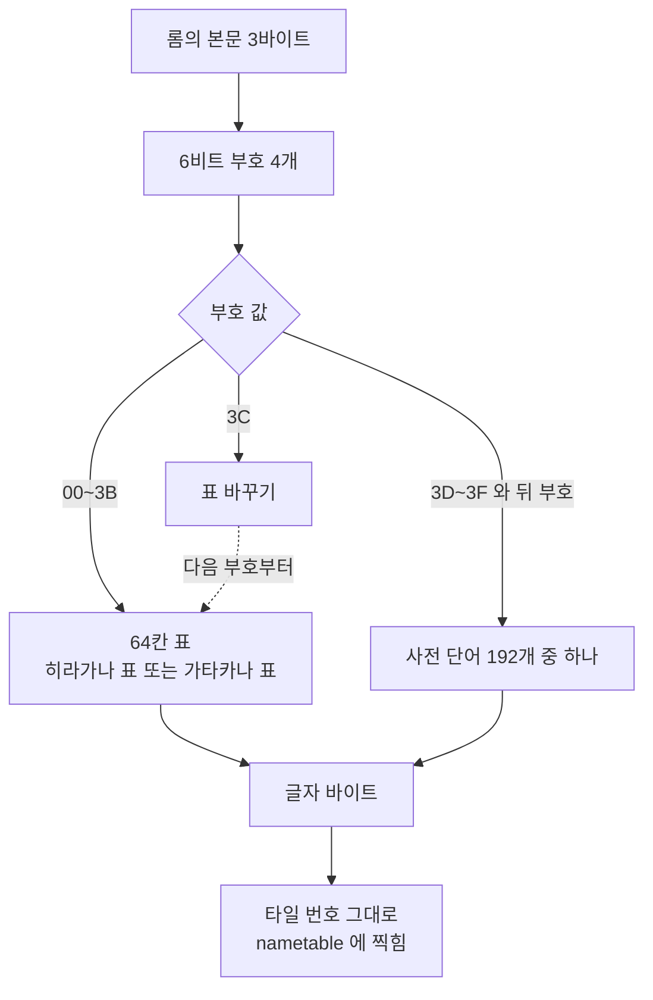
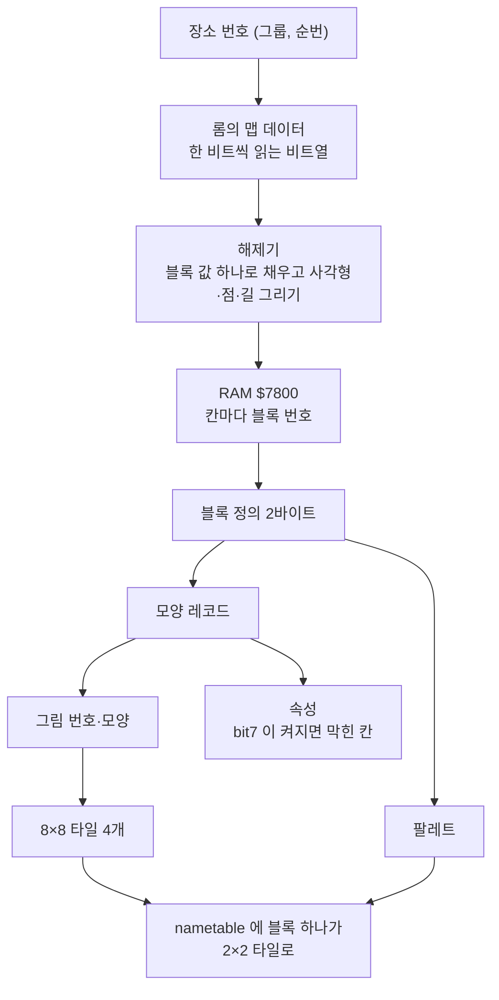
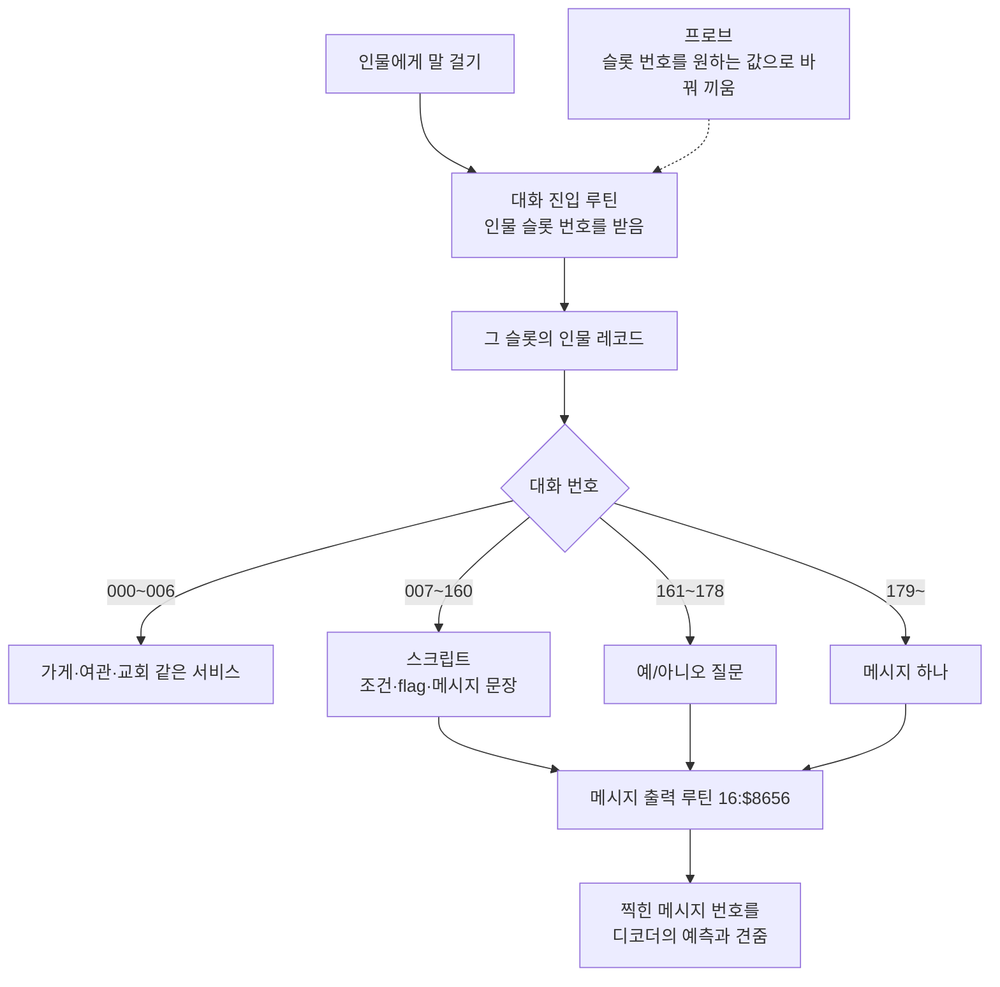
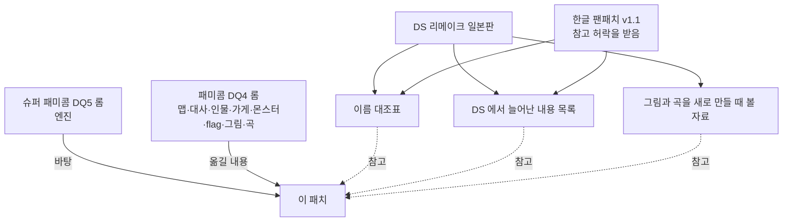

[1편](/games/romhacking/journal/dq4/dq5-maps/)부터 [4편](/games/romhacking/journal/dq4/dq5-graphics-sound/)까지는 그릇이 될 슈퍼 패미콤 「드래곤 퀘스트 V」 엔진을 읽었습니다. 이번 편은 그 그릇에 담을 내용물 이야기입니다. 옮길 대상인 패미콤판 「드래곤 퀘스트 IV」(일본판 Rev A) 롬에서 맵·대사·인물·가게·몬스터·flag·그림·곡을 어떻게 읽어 냈는지가 본문의 대부분이고, 끝에 참고 자료로 본 닌텐도 DS 리메이크와 그 한글 팬패치에서 무엇을 얻었는지를 적습니다.

여기서 다루는 것은 「무엇을 어떻게 읽어 냈나」 까지입니다. 읽어 낸 값을 DQ5 엔진에 써 넣는 이야기는 [6편](/games/romhacking/journal/dq4/writing/)부터 이어집니다. FC 롬은 고치지 않습니다. 데이터를 뽑는 곳으로만 씁니다.

## 1. 실험 환경과 뱅크 호출

FC DQ4 롬은 iNES 헤더로 보면 매퍼 1(MMC1), PRG 512KB(16KB [뱅크](/games/romhacking/sfc/banks/) 32개), CHR-RAM, 배터리 백업입니다. CPU 는 6502 이고, `$8000`~`$BFFF` 에 뱅크 하나를 바꿔 끼우고 `$C000`~`$FFFF` 는 고정 영역으로 씁니다. 512KB 를 쓰는 보드라 고정 영역도 256KB 절반마다 따로 있어서, 뱅크 `0F` 와 `1F` 가 번갈아 고정 영역이 됩니다. 두 뱅크는 같은 주소에 같은 공통 루틴을 갖지만 16KB 중 6548바이트는 다릅니다.

도구는 SFC 쪽과 같은 방식으로 맞췄습니다. 직접 만든 패치 도구 모음 [kr-patch-toolkit](https://github.com/perfectacle/kr-patch-toolkit) 에 FC 용 헤더 읽기, 6502 디스어셈블러, 실행된 코드만 모아 찍는 커버리지 리스팅을 넣었고, 에뮬레이터 MesenCE 를 화면 없이 돌리는 [Lua 프로브](/games/romhacking/sfc/emulator/)를 FC 메모리 타입에 맞게 다시 썼습니다. 프로브는 실행된 주소를 모으는 `cover`, 읽기와 쓰기를 모으는 `reads`·`writes`, 특정 주소에 닿을 때 레지스터와 RAM 을 찍는 `trace`, 프레임마다 값을 찍는 `watch` 다섯 가지입니다.

같은 뱅크가 다른 CPU 주소에 올 수 있으니 주소는 두 가지로 적었습니다. `08:$B708` 은 뱅크 `08` 의 CPU 주소 `$B708` 이고, PRG `23708` 은 헤더를 뺀 롬 오프셋입니다.

재현성도 먼저 잡아야 했습니다. 같은 입력을 넣어도 마을 사람이 다르게 움직여 경로가 어긋났는데, MesenCE 에 `--nes.ramPowerOnState=AllZeros` 를 주고 전원을 켜기 전에 SRAM 을 고정하자 같은 입력에 같은 결과가 나왔습니다. 그 위에서 「1장 왕좌의 방」「성 앞마당」「필드」「첫 전투」 세이브스테이트를 롬만으로 다시 만드는 [dq4state.sh](https://github.com/perfectacle/sfc-dq4/blob/main/fc/dq4/tools/dq4state.sh) 를 두고 모든 실험의 출발점으로 삼았습니다.


_「성 앞마당」 세이브스테이트를 불러온 화면입니다. 오른쪽 아래 창은 가만히 서 있으면 뜨는 상태 창으로, 「라이안 / H 27 / M 0 / せ: 1」(이름, HP, MP, 마지막 줄의 1 은 레벨)입니다. 실험은 대부분 이런 화면에서 입력을 넣는 것으로 시작합니다._

첫 수확은 좌표와 맵 전환이었습니다. 왕좌의 방에서 아래로 16, 32프레임씩 걸은 RAM 을 비교해 한 방향으로만 변하는 바이트를 고르니 주인공 좌표는 `$0044`/`$0045`, 한 칸은 16프레임이었습니다. 성 밖으로 나가는 순간의 쓰기를 잡았더니, 맵 값을 쓰는 코드 바로 앞에 `BRK` 와 데이터 두 바이트가 붙어 있었습니다.

### BRK 로 부르는 다른 뱅크

6502 의 `BRK` 는 원래 소프트웨어 인터럽트입니다. DQ4 는 이것을 다른 뱅크의 함수를 부르는 명령으로 씁니다. IRQ/BRK 벡터가 가리키는 `$C408` 의 처리기는 스택에 쌓인 복귀 주소에서 `BRK` 다음 두 바이트를 읽습니다.

```text
0F:C425  LDA ($26),Y   ; b2
0F:C428  AND #$0F
0F:C439  ROR A         ; b2 bit3 을 붙여
0F:C43D  STA $23       ; 5비트 뱅크
0F:C440  LDA ($26),Y   ; b1
0F:C444  STA $24       ; 함수 번호
```

둘째 바이트의 위 4비트와 bit3 이 대상 뱅크, 첫째 바이트가 함수 번호입니다. 처리기는 그 뱅크를 끼운 뒤 `$8000 + 함수 번호 × 2` 의 두 바이트를 함수 주소로 읽습니다. 코드 뱅크마다 앞머리가 함수 표인 셈입니다. 이 규칙을 롬만 읽는 디코더 [dq4bank.py](https://github.com/perfectacle/sfc-dq4/blob/main/fc/dq4/tools/dq4bank.py) 로 옮기고, 처리기 안 세 곳을 `trace` 로 찍은 실행 기록과 맞췄습니다. 부팅 371건, 왕좌의 방에서 성 밖까지 648건, 합쳐 1019건이 모두 같았습니다. 부르는 쪽에서 보면 명령 하나지만, 처리기 안에서는 뱅크를 바꿔 끼우고 되돌리는 일이 아래 순서로 일어납니다.



_BRK 한 번이 다른 뱅크의 함수 호출 한 번입니다. 함수가 끝나면 처리기가 원래 뱅크를 다시 끼우고, 데이터 두 바이트를 건너뛴 자리로 돌아옵니다._

특수 형식도 있습니다. 둘째 바이트의 아래 4비트가 `B` 면 진행 flag 를 다룹니다. 예를 들어 `00 16 CB 80` 은 `$627B + $16` 에 `80` 을 OR 하라는 뜻입니다. flag 를 켜고 끄는 일이 4바이트짜리 명령 하나로 끝나므로, 나중에 「이 flag 를 쓰는 곳을 롬 전체에서 찾기」 가 바이트 검색만으로 가능해졌습니다.

호출 형식을 풀고 나서 다섯 장면(부팅, 보행, 첫 전투, 대화와 명령 창, 조우)의 커버리지를 뱅크별로 세어 [롬 뱅크 지도](https://github.com/perfectacle/sfc-dq4/blob/main/fc/dq4/docs/dq4-rom-map.md)를 만들었습니다. 한 번도 실행되지 않은 뱅크 `00`~`07` 은 데이터 후보였고, 실제로 대사 본문(`00`~`04`), 인물 목록(`05`), 전투 몬스터 그림(`06`·`07`)이었습니다. 롬 전체에서 비어 있는 자리는 1.9KB 쯤뿐입니다. FC 롬 안에서 한글화를 하기 어려운 까닭이기도 합니다.

## 2. 대사: 6비트 부호와 사전

대사를 읽는 코드는 실행되지 않은 뱅크에서 거꾸로 찾았습니다. 이름 입력을 마치고 오프닝 내레이션이 찍히는 120프레임 동안 `reads` 를 돌리니, 뱅크 `00`~`07` 을 읽는 명령은 셋뿐이었습니다.

```text
pc=3DF9B(DF9B) n=35 range=02D53-02D6C first=5
pc=3DFBC(DFBC) n=9  range=02D54-02D6C first=6
pc=3DFC8(DFC8) n=9  range=02D55-02D6D first=7
```

화면에 찍힌 글자는 100자쯤인데 읽은 곳은 27바이트였습니다. 압축이라는 뜻입니다. `0F:$DF99` 를 읽어 보니 바이트를 쪼개 6비트 부호를 꺼내고 있었습니다. 3바이트에 부호 4개가 들어갑니다. 부호를 64칸 표로 바꾸면 글자 바이트가 되는데, 이 값을 내레이션 화면의 nametable(화면에 깔린 타일 번호 표)과 나란히 놓으니 그대로 같았습니다. [글자 바이트가 곧 타일 번호](/games/romhacking/sfc/text/)였습니다. 폰트 타일을 그려 글자를 하나씩 정했습니다.

6비트로는 64가지밖에 못 쓰니 장치가 둘 붙어 있습니다. 부호 `3C` 는 히라가나 표와 가타카나 표를 바꾸고, `3D`~`3F` 는 뒤 부호와 묶여 사전 단어 192개 중 하나를 넣습니다. 사전에는 「なんと(놀랍게도)」「せかい(세계)」 같은 자주 쓰는 말과 숫자가 들어 있고, 0번 단어는 버튼 기다림 표시와 말머리 기호를 묶은 「▼＊「」 입니다. 「버튼을 기다린 뒤 다음 사람이 말하기 시작」 을 부호 하나로 쓰려는 것입니다. 탁점은 따로 떨어진 글자인데, 꾸미는 글자 **앞**에 오고 화면에는 윗줄 같은 칸에 찍힙니다. 부호 하나가 어느 길로 글자가 되는지는 아래 그림과 같습니다.



_부호 하나가 글자가 되는 세 갈래. 어느 길로 가든 끝은 글자 바이트이고, 그 값이 그대로 화면의 타일 번호입니다._

메시지는 16비트 번호로 부릅니다. 포인터 표에는 32개씩 묶은 블록의 시작만 있고, 블록 안에서는 앞 메시지를 끝 부호까지 읽어 건너뜁니다. 블록 88개를 모두 풀어 「블록의 32번째 메시지 끝이 다음 블록 시작과 같은가」 를 보는 것으로 디코더를 검증했고, 메시지는 2633개였습니다.

남은 것은 제어 바이트였습니다. 줄바꿈, 버튼 기다림, 쉼, 효과음, 이름·숫자 치환이 `ED`~`FF` 에 있는데, 대사를 읽기만 해서는 뜻을 알 수 없습니다. 그래서 게임에 아무 메시지나 띄우는 프로브를 만들었습니다. 메시지 출력 루틴 `16:$8656` 에 들어갈 때 번호를 바꿔 끼우는 방식이고, 메시지에 한 번도 안 나오는 제어 바이트는 가짜 바이트를 넣어 띄웠습니다. 자세한 표는 [대사 형식 문서](https://github.com/perfectacle/sfc-dq4/blob/main/fc/dq4/docs/dq4-text-format.md)에 있습니다.

마지막으로 포팅용 출구를 만들었습니다. [dq4text.py](https://github.com/perfectacle/sfc-dq4/blob/main/fc/dq4/tools/dq4text.py) 의 `export` 는 메시지와 이름 목록을 제어 바이트가 `{LINE}` 같은 기호로 바뀐 텍스트로 내보냅니다. 번역과 SFC 제어 코드 변환은 이 텍스트에서 출발합니다.

## 3. 맵, 블록, 필드

마을·성·던전 맵은 앞마당에서 왕좌의 방으로 들어가는 120프레임에 `$6000`~`$7FFF` 쓰기를 걸어 찾았습니다. `0F:$E5D4` 가 `$7800` 부터 1155번 썼고, 같은 구간에 뱅크 `09` 를 1650번 읽는 `0F:$E625` 가 있었습니다. 한 비트씩 읽는 루틴이었습니다. 해제기는 맵 전체를 블록 값 하나로 채운 뒤, 2비트 명령으로 사각형·점·길을 그립니다. 길 명령은 방향을 돌고, 갈림길을 쌓아 두었다가 돌아옵니다. 종이에 펜을 대고 그리는 거북이 그래픽과 같은 방식입니다.

어셈블리를 따라 파이썬으로 옮긴 디코더 [dq4map.py](https://github.com/perfectacle/sfc-dq4/blob/main/fc/dq4/tools/dq4map.py) 는 해제 직후 RAM 덤프와 비교했습니다.

```text
02/01: 1152 바이트 중 0 차이
02/00: 1558 바이트 중 0 차이
```

`02/01` 은 장소 번호입니다. 맵은 (그룹, 순번) 두 바이트로 부르고, 그룹은 대체로 마을이나 성 하나, 순번은 그 안의 층이나 건물입니다. 전부 풀어 「해제가 끝난 자리가 다음 맵 시작과 같은가」 를 보니 경계가 모두 맞았고, 맵은 279개였습니다.

출구는 맵마다 표가 있는 것이 아니었습니다. 10바이트짜리 **연결** 125개가 따로 있고, 연결 하나가 양쪽 끝점 (그룹, 순번, X, Y, flag)를 가집니다. 맵에 들어갈 때 현재 장소와 같은 끝점을 찾아 반대쪽을 목적지로 삼아 RAM 의 출구 표 `$05A0` 을 채웁니다. 인물은 뱅크 `05` 의 그룹별 목록에 있고, 레코드에는 자리·그림 번호·대화 번호와 함께 인물마다 도는 작은 스크립트 블록이 붙습니다. 맵에 들어간 직후의 인물 표를 덤프해 디코더와 맞췄습니다. 형식은 [맵 형식 문서](https://github.com/perfectacle/sfc-dq4/blob/main/fc/dq4/docs/dq4-map-format.md)에 있습니다.

### 블록이 화면이 되기까지

`$7800` 의 칸 하나는 블록 번호입니다. 블록은 16×16 픽셀이고 맵 종류마다 32개가 있습니다. 블록이 8×8 [타일](/games/romhacking/sfc/graphics/) 4개와 팔레트, 그리고 「걸을 수 있는가」 를 정하는 속성으로 바뀌는 과정을 풀어야 그림도 그리고 통행도 옮길 수 있습니다. nametable 에 쓰는 코드에서 거슬러 올라가, 블록 정의 2바이트가 모양 레코드를 고르고 레코드가 그림 번호·모양·속성을 주는 것을 읽었습니다. 그림은 압축 없이 들어 있습니다. 장소 번호에서 화면의 타일까지 거치는 단계를 이으면 아래와 같습니다.



_장소 번호에서 화면까지. 위 절반은 맵 해제, 아래 절반은 블록 풀기입니다. 모양 레코드에서 갈라져 나온 속성은 화면이 아니라 통행을 정합니다._

첫 비교에서 어긋난 칸은 하나하나가 숨은 규칙이었습니다. 벽 아래 칸을 그늘 진 블록으로 바꿔 쓰는 루틴이 있었고, 집 안에 들어가면 바깥을 검게 그리는 규칙이 있었고, 성 앞의 블록 넷은 로드 56프레임 뒤에 성문 연출이 바꾼 것이었습니다. 이런 것을 다 넣은 뒤 맵 종류마다 하나씩 들어가 롬만으로 만든 그림을 덤프와 맞췄습니다.

통행은 걷기로 확인했습니다. 걸으려는 칸의 블록 속성 bit7 이 켜져 있으면 막힙니다. 마을·동굴·탑·성·필드에서 네 방향으로 200프레임씩 누르고, 통행 지도로 예측한 끝 좌표와 실제 끝 좌표를 견줬습니다. 32번 가운데 벽 앞에서 멈춘 23번이 모두 맞았습니다. 독늪, 밀리는 바닥, 문과 열쇠, 카운터 같은 지형 효과는 [블록 형식 문서](https://github.com/perfectacle/sfc-dq4/blob/main/fc/dq4/docs/dq4-block-format.md)에 값 표로 모았습니다. 이 표가 [1편](/games/romhacking/journal/dq4/dq5-maps/)에서 읽은 DQ5 블록 속성과 짝을 맞출 재료입니다.


_4절의 워프 도구로 옮겨 간 이무르 마을입니다. 풀밭, 벽돌 길, 돌벽, 나무, 카운터, 침대가 저마다 16×16 블록 하나이고, 화면 한 줄에 블록 16개가 놓입니다. 벽·나무·카운터처럼 지나갈 수 없는 칸이 속성 bit7 이 켜진 블록입니다._

### 필드

세계 지도는 형식이 다릅니다. 250×250 칸이고, 줄마다 4바이트 레코드가 있으며, 줄 데이터는 위 3비트가 타일·아래 5비트가 길이인 RLE 입니다. 재미있는 것은 읽는 방향입니다. 레코드가 줄 가운데의 기준점을 따로 들고 있어서, 게임은 X 에 따라 기준점에서 앞으로 읽거나 거꾸로 읽습니다. 좌표 하나의 타일을 찾을 때 줄 전체를 풀지 않으려는 장치입니다. 게임의 조회 함수 `0F:$D259` 에 들어가는 좌표와 나오는 타일을 147번 모아 디코더와 맞췄습니다.

필드 그림을 화면과 픽셀로 견주다 물가에서 막혔습니다. 롬 격자로는 그냥 물인 칸이 화면에서는 블록 표에 없는 타일 조합이었습니다. 블록을 그리기 직전 코드를 읽으니, 물 블록이면 왼쪽·아래·오른쪽·위 칸이 물인지를 비트로 모아 16가지 물가 블록 중 하나로 바꾸고 있었습니다. 물가는 데이터가 아니라 이웃 칸으로 정해지는 것이었습니다. 필드 형식은 [필드 형식 문서](https://github.com/perfectacle/sfc-dq4/blob/main/fc/dq4/docs/dq4-field-format.md)에 있습니다.

## 4. 워프 도구와 조우

여기까지는 1장 첫머리 세이브스테이트 주변만 볼 수 있었습니다. 맵이 279개인데 걸어서 갈 수는 없습니다. 그래서 왕좌의 방 세이브스테이트 하나에서 아무 맵, 아무 필드 자리로 옮겨 조작 가능한 상태를 만드는 [워프 도구](https://github.com/perfectacle/sfc-dq4/blob/main/fc/dq4/docs/dq4-warp.md)를 만들었습니다.

장소 번호와 좌표 RAM 을 직접 고치면 화면·인물·출구 표가 따라오지 않습니다. 대신 게임이 맵을 바꿀 때 지나는 길에 올라탔습니다. 출구 표 `$05A0` 은 RAM 에 있으니, 주인공 둘레 네 칸을 원하는 목적지로 가는 출구로 써 두고 한 걸음만 걸으면 됩니다. 그 뒤는 진짜 문을 밟은 것과 같아서 게임이 알아서 맵을 풀고 인물을 놓습니다. 맵 6곳과 필드 3곳에서 도착 직후의 인물 표와 출구 표가 디코더와 모두 같았습니다.

조우는 워프의 첫 손님이었습니다. 전투 직전 80프레임의 커버리지로 뱅크 `18` 리스팅을 만들어 걸음마다 도는 루틴을 읽었습니다. 필드 좌표로 구역 지도를 읽고, 구역마다 레코드가 기본 조우율과 무리 후보 칸을 줍니다. 조우율은 기본값 × 상태 배수 × 지형 배수이고, 난수가 그보다 작으면 전투입니다.

식을 읽었다고 끝이 아닙니다. 조우는 확률이라 한두 번 싸워서는 맞는지 알 수 없습니다. [enc.lua](https://github.com/perfectacle/sfc-dq4/blob/main/fc/dq4/tools/lua/enc.lua) 는 시행마다 세이브스테이트를 다시 불러 기다리는 프레임 수를 바꾸고(난수가 달라집니다), 원하는 구역으로 필드 좌표를 옮긴 뒤 위아래로 걷습니다. 조우 판정마다 조우율과 난수를, 무리가 정해지면 구역·칸·몬스터를 적습니다.

```text
구역 05: 나온 몬스터 スライム, はさみくわがた, おおみみず, エアラット, きりかぶおばけ
work/enc-z05/enc.txt: 판정 304번(난수 < 조우율 20번), 전투 20번, 다름 0
```


_조우 판정을 지나 무리가 정해진 뒤의 화면입니다. 아래 오른쪽 목록은 「슬라임 — 1마리 / 큰 지렁이 — 1마리」, 왼쪽 명령 창은 「라이안 / 공격 / 도망 / 방어 / ▶도구」 입니다. 프로브는 이 목록에 오른 몬스터가 구역 레코드의 무리 후보 칸에 있는지를 봅니다._

첫 줄의 몬스터는 슬라임, 가위 사슴 벌레, 큰 지렁이, 에어랫, 그루터기 요괴입니다. 구역 일곱 곳에서 240번 싸웠습니다. 조우 판정 3975번의 조우율이 모두 식과 같았고, 전투 240번의 몬스터가 모두 표의 칸 안에 있었습니다. 낮 50번에는 한 번도 안 나온 칸이, 걸음 카운터 `$62ED` 를 밤으로 돌려 놓은 30번에는 8번 나오는 것으로 밤 전용 칸도 확인했습니다. 이어서 던전 21개 층 158번과 보스전 같은 특수 전투 34개 전부도 같은 방식으로 맞췄습니다. 결과는 [조우 형식 문서](https://github.com/perfectacle/sfc-dq4/blob/main/fc/dq4/docs/dq4-encounter-format.md)에 있습니다.

## 5. 대화, 인물 블록, 가게

인물에게 말을 걸면 어느 메시지가 나오는지를 롬만으로 내는 것이 다음 목표였습니다. 출발점은 이미 아는 메시지 출력 루틴입니다. 왕에게 말을 걸며 그 루틴과 대화 진입을 같이 찍으니, 인물 레코드에서 꺼낸 대화 번호가 네 갈래로 나뉘었습니다.

| 대화 번호   | 하는 일                    |
| ----------- | -------------------------- |
| `000`~`006` | 가게·여관·교회 같은 서비스 |
| `007`~`160` | 스크립트 346개             |
| `161`~`178` | 예/아니오 질문             |
| `179`~      | 메시지 하나                |

스크립트는 조건·flag·메시지 문장으로 된 작은 언어입니다. 파서는 게임의 「문장 하나 실행」「문장 하나 건너뛰기」 루틴의 길이 규칙을 그대로 옮겨 만들고, 스크립트 346개를 모두 읽었을 때 모르는 바이트가 0개가 될 때까지 표를 늘렸습니다.

실측에서 인물에게 걸어가는 것이 문제였습니다. 길 찾기로 걸어가 말을 거는 드라이버를 만들었지만, 인물이 돌아다녀서 성 앞에서는 5명에게만 닿았습니다. 방법을 바꿨습니다. 아무 인물에게나 말을 건 순간, 대화 진입 루틴에 들어온 인물 슬롯 번호를 원하는 값으로 바꿔 끼웁니다. 한 자리에 서서 그 맵의 모든 인물과 대화할 수 있습니다. 맵 4곳의 인물 57명, 말 걸기 86번에서 기록된 메시지와 디코더의 예측이 모두 같았습니다. 말을 건 순간부터 메시지가 찍히기까지의 길과, 프로브가 끼어드는 자리는 아래와 같습니다.



_말을 건 뒤 메시지가 나오기까지의 길. 프로브는 맨 앞의 슬롯 번호만 바꾸고, 그 뒤는 게임이 원래 하던 대로 흘러갑니다._

인물에 붙은 블록은 따로 해석기가 있었습니다. 걷기, 숨기, 메시지 띄우기, flag 쓰기, 자동 장면이 모두 이 블록 명령입니다. 명령 60가지의 길이와 뜻을 풀어 롬 전체 블록 2131개를 못 읽는 명령 없이 푸는 [디코더](https://github.com/perfectacle/sfc-dq4/blob/main/fc/dq4/tools/dq4npcblock.py)를 만들었습니다. 1장 바트랜드 왕좌의 방의 첫 장면도 이 블록 명령입니다. [대화 스크립트 형식](https://github.com/perfectacle/sfc-dq4/blob/main/fc/dq4/docs/dq4-script-format.md)과 [인물 블록 형식](https://github.com/perfectacle/sfc-dq4/blob/main/fc/dq4/docs/dq4-npcblock-format.md)이 [10편](/games/romhacking/journal/dq4/chapter1/)에서 1장 사건을 옮길 때의 설계도입니다.


_왼쪽은 패미콤 원작, 오른쪽은 같은 방을 DQ5 엔진에 옮긴 화면입니다. 왼쪽에서 왕 둘레에 선 사람들이 인물 레코드 하나씩이고, 이들을 걷게 하고 말하게 하는 것이 레코드에 붙은 블록 명령입니다. 왼쪽 화면의 오른쪽 아래 창은 상태 창 「라이안 / H 27 / M 0 / せ: 1」 입니다._

가게는 아는 답에서 거꾸로 찾았습니다. 1장 바트랜드 성 아래 마을 무기점은 곤봉, 구리 검, 가시 채찍, 체인 낫을 팝니다. 아이템 ID 로 `01 02 09 04` 입니다. 그대로는 롬에 없었지만, 마지막 바이트에 끝 표시 bit7 을 켠 `01 02 09 84` 는 딱 한 곳에 있었습니다. 그 앞 두 바이트가 장소 번호 `02 00` 이었습니다. 가게 줄은 「그룹, 순번, 품목들」 이고, 가게 종류는 인물 레코드의 대화 번호가 곧 정합니다. 보물상자는 표에 좌표가 없었습니다. 속성이 「상자」 인 블록을 맵 안에서 가로 줄 순서로 센 순번이 내용물 표의 번호입니다. 상자 160개에 발밑·서랍·항아리·대화로 받는 물건까지 합쳐 「맵·자리 → 얻는 것」 238줄로 묶었습니다. 형식은 [가게 형식 문서](https://github.com/perfectacle/sfc-dq4/blob/main/fc/dq4/docs/dq4-shop-format.md)에 있습니다.

## 6. 몬스터, 성장, AI, 내성

숫자 표도 아는 답에서 출발했습니다. 「やくそう」(약초)를 글자표로 바이트로 바꿔 롬에서 찾으니 한 곳에 있었고, 그 둘레가 길이 바이트 + 이름이 이어진 목록이었습니다. 주문·직업·아이템·몬스터 같은 이름 목록 8개의 포인터가 `0B:$B006` 에 모여 있었습니다. 아이템 수치는 무기 공격력으로 알려진 2, 7, 12 를 찾아 표에 닿았습니다.

몬스터 표는 22바이트 레코드입니다. 어느 바이트가 무엇인지는 싸워서 정했습니다. 슬라임과 큰 지렁이를 이기면 경험치 +4, 골드 +8 이고, 큰 지렁이 둘이면 +6, +12 입니다. 경험치는 바이트 0~1 의 1 과 3, 골드는 바이트 7 의 2 와 6 이어야 두 전투가 모두 맞습니다.

그 뒤로는 원하는 몬스터와 원하는 인물로 싸우는 장치가 필요했습니다. 조우 판정의 비교 명령을 메모리에서 `CLC; NOP` 으로 바꾸면 걸음마다 전투가 나고, 전투 시작 루틴에서 무리 칸 `$6E45`~`$6E4C` 를 덮어쓰면 그 몬스터가 나옵니다. 인물 레코드를 써 넣으면 1장 필드에서 다른 장의 인물이 싸우게 할 수도 있습니다.

이 장치로 전투의 뼈대가 나왔습니다. 전투의 모든 행동은 행동 ID 1바이트이고, 그 ID 로 처리 루틴·위력·성공률 표를 찾습니다. 몬스터 레코드의 행동 칸은 ID 가 아니라 번호여서 변환 표를 한 번 거칩니다. 호이미 슬라임의 칸은 `25` 인데 전투에서 실제로 쓴 ID 가 `29`(호이미)인 것을 보고 알았습니다. 몬스터 전용 행동의 뜻은 표가 아니라 코드에 있어서, 전투 중 몬스터의 행동 ID 를 `3C` 부터 `FF` 까지 196개를 하나씩 바꿔 끼우고 그 차례에 나온 메시지를 모았습니다.

### 내성 칸 15개

내성은 의심에서 시작한 확인이 좋은 예입니다. 몬스터 레코드에는 2비트짜리 내성 칸이 15개 있고, 값 0~3 이 확률표 `FF D8 66 00` 을 고릅니다. 0 은 늘 듣고 3 은 절대 안 듣습니다. 칸 이름은 코드를 읽어 붙였고 전투로 확인한 것은 햐드 하나였습니다. 그런데 DS 리메이크의 몬스터 표와 맞대 보니, DS 에서 메라를 막는 자리가 FC 의 「이오」 칸과 156마리 중 153마리에서 맞았습니다. FC 쪽 이름이 틀렸거나 맞대는 방법이 틀렸거나 둘 중 하나입니다.

1장 첫 전투 세이브스테이트에서 라이안이 「공격」 을 고른 직후 행동 칸을 주문 ID 로 바꾸고, 슬라임의 내성 바이트를 메모리에서 고쳤습니다. 칸마다 두 번 돌립니다. 한 번은 그 칸만 3 이고 나머지는 0, 한 번은 그 칸만 0 이고 나머지 14칸이 3 입니다.

```text
칸 2 メラ   그 자리만 3: p=00 → きかなかった
            그 자리만 0: p=FF → ダメージ
칸 8 ザキ   그 자리만 3: p=00 → しななかった
            그 자리만 0: p=FF → いきのねを とめた
```

칸 2 는 메라, 칸 8 은 자키입니다. 내성을 3 으로 두면 「듣지 않았다」「죽지 않았다」 가, 0 으로 두면 데미지와 「숨통을 끊었다」 가 나왔습니다. 15칸이 모두 이름표대로였습니다. 어긋나 보인 까닭은 도구가 내성 값을 칸 순서가 아닌 다른 순서로 늘어놓은 데 있었습니다. 코드 읽기는 맞았고 출력이 헷갈리게 생겼던 것입니다.

성장 표도 같은 방식으로 레벨업을 시켜 맞췄습니다. DQ4 의 특징인 동료 AI(작전)는 가장 오래 걸렸습니다. 후보끼리 견주는 점수 식을 코드에서 읽고, 식으로 다시 셈한 값을 전투 기록과 견줬습니다. 공격·주문 후보의 키 식은 1144번, 회복 대상을 고르는 비교는 561번의 기록과 맞았습니다. 전체 표는 [데이터 형식 문서](https://github.com/perfectacle/sfc-dq4/blob/main/fc/dq4/docs/dq4-data-format.md)에 있습니다. 이 값들을 받을 DQ5 쪽 구조는 [3편](/games/romhacking/journal/dq4/dq5-battle/)에서 읽었고, 넣는 이야기는 [6편](/games/romhacking/journal/dq4/writing/)이 다룹니다.

## 7. 진행 flag 184개와 디버그 스위치

저장 데이터부터 봤습니다. 게임은 진행 상태를 SRAM 작업 영역에 두고, 저장할 때 그 영역을 모험의 서 칸에 통째로 복사합니다. 칸 앞 두 바이트는 CRC-16(다항식 `1021`)입니다. 칸의 바이트 하나만 바꾸고 불러오면 「모험의 서 1번은 사라져 버렸습니다」 가 나오고, 다시 계산한 CRC 를 같이 쓰면 정상으로 불러와졌습니다. 형식은 [저장 형식 문서](https://github.com/perfectacle/sfc-dq4/blob/main/fc/dq4/docs/dq4-save-format.md)에 있습니다.


_저장 기록이 있을 때의 메뉴입니다. 위에서부터 「▶모험을 한다 / 표시 속도를 바꾼다 / 모험의 서를 만든다 / 모험의 서를 복사한다 / 모험의 서를 지운다」 입니다. 첫 줄로 모험의 서를 불러올 때 칸 앞머리의 CRC 를 검사합니다._

진행 flag 는 `$627B`~`$62EE` 에 있습니다. 1절의 BRK flag 명령, 대화 스크립트의 flag 문장, 인물 블록의 flag 명령을 롬 전체에서 모으니 한 비트씩 다루는 flag 가 184개였습니다. 문제는 뜻입니다. 화면으로 뜻을 확인한 것은 13개뿐이고, 나머지 171개는 쓰는 곳 근처의 대사로 짐작한 「추정」 이었습니다.

처음 생각은 장마다 이야기 순서대로 플레이하며 하나씩 켜 보는 것이었습니다. 171개를 손으로 하기에는 너무 많았습니다. 방향을 뒤집었습니다. 비트마다 「쓰는 곳」 은 이미 압니다. 쓰는 곳마다 그곳에 닿는 장면을 롬에서 기계로 만들고, 그 장면에서 그 비트가 실제로 켜지는지만 보면 됩니다. 대화가 쓰는 flag 는 그 맵으로 워프해 대화 번호를 바꿔 끼워 말을 걸고, 스크립트 나무에서 그 문장까지 지나는 조건을 거꾸로 모아 미리 맞춥니다. 블록이 쓰는 flag 는 그 맵에 워프해 대사만 넘깁니다. 어느 시나리오든 대상 비트를 먼저 꺼 둬야 켜지는 순간이 기록에 남습니다.

1차로 433번을 돌려 57개가 켜졌습니다. 못 켠 것을 열어 보니 이유가 몇 가지로 모였습니다. 대사가 길어 A 14번으로는 flag 문장까지 못 갔고(30번으로 늘림), 돈을 치러야 했고(골드를 가득 채움), 이벤트 안에 보스전이 있어 전투에서 졌습니다(보스전을 부르는 22곳을 메모리에서 지워 건너뜀). 이런 식으로 조건을 맞춰 가며 「추정」 을 171, 80, 66, 29, 11, 0 으로 줄였습니다. 마지막 11개 가운데 셋은 쓰는 루틴을 부르는 곳을 롬에서 못 찾아 한때 「쓰이지 않음」 으로 닫았는데, 앞 루틴의 조건 분기로 닿는 길이 있었고 장면을 돌리니 켜졌습니다. 184개 모두 장면으로 확인했습니다. 장마다 사건 순서로 늘어놓은 표는 [이야기 진행 문서](https://github.com/perfectacle/sfc-dq4/blob/main/fc/dq4/docs/dq4-story-format.md)에 있습니다.

### 제품판에 남은 개발 기능

장 시작 루틴을 읽다가 이상한 검사를 봤습니다.

```text
1E:A35B  LDA $C000
1E:A35E  AND #$08
1E:A360  BNE $A372
```

`$C000` 은 고정 영역의 첫 바이트이고, 바로 뒤부터는 점프 표입니다. 코드가 아니라 스위치 바이트였습니다. 제품판 값은 `FF` 이고 비트가 0 이면 기능이 켜집니다. 에뮬레이터 메모리에서 이 바이트를 `F7` 로 바꾸자 불러오기 직후 「시나리오 1 2 3 4 5」 창이 떴고, 고른 장에서 바로 시작했습니다. 장 시작 세이브스테이트 다섯 개가 여기서 나왔습니다. 같은 바이트의 다른 비트에는 벽 통과(bit7), 조우 끄기(bit6), 몬스터 무리를 고르는 전투 테스트 창이 걸려 있습니다. [디버그 문서](https://github.com/perfectacle/sfc-dq4/blob/main/fc/dq4/docs/dq4-debug.md)에 비트마다 켜는 법이 있습니다. 분석용으로만 썼고 패치에는 넣지 않습니다.

## 8. 원작 그림과 소리

FC 그림은 SFC 로 그대로 옮기지 않습니다. 인물과 맵은 DQ5 규격으로 새로 그립니다. 그래도 옆에 펴 놓을 원본은 필요해서, 롬에서 그림을 전부 뽑는 도구를 만들었습니다. 뽑은 그림은 저작권 데이터라 저장소에 넣지 않고, 뽑는 방법만 [그림 문서](https://github.com/perfectacle/sfc-dq4/blob/main/fc/dq4/docs/dq4-fcgfx.md)와 [스프라이트 형식 문서](https://github.com/perfectacle/sfc-dq4/blob/main/fc/dq4/docs/dq4-fcsprite-format.md)에 남겼습니다.

전투 몬스터는 스프라이트가 아니라 배경 타일이었고, 타일 16바이트를 롬에서 그대로 찾으면 일부만 나왔습니다. 압축입니다. 실행 커버리지로 뱅크 `14` 의 해제 코드를 읽었습니다. 16비트 마스크로 0 인 바이트를 빼는 단순한 압축이었습니다. 그림 194개의 데이터는 71가지뿐입니다. 방황하는 갑옷 계열 다섯 종처럼 같은 그림에 팔레트만 바꾼 몬스터가 많기 때문입니다. 전투를 강제로 일으켜 몬스터 26종의 화면과 롬으로 그린 그림을 견주니 22164픽셀이 모두 같았습니다.

### 드라이버를 통째로 돌리기

소리는 다른 길을 택했습니다. 드라이버는 고정 뱅크 `1F` 에 있고, 소리 데이터는 대부분 뱅크 `19` 에 있습니다. 악보 바이트의 명령을 하나씩 파이썬으로 옮겨 적을 수도 있지만, 리듬 꼴이나 되풀이 셈 같은 데서 틀리기 쉽습니다. 그래서 앞서 만들어 둔 6502 해석기 [dq4cpu.py](https://github.com/perfectacle/sfc-dq4/blob/main/fc/dq4/tools/dq4cpu.py) 에 소리 칩(APU) 쓰기를 모으는 껍데기만 씌워, 롬의 드라이버 코드를 그대로 돌렸습니다.

검증에는 게임이 실제로 쓴 APU 값이 필요합니다. 효과음 요청을 원하는 곡 번호로 바꿔 끼우는 식으로 게임 안에서 곡 50개를 하나씩 틀고, 프레임마다 APU 쓰기를 기록했습니다.

```text
곡 50개   견준 프레임 97379, 다름 0, 해독한 음 9431 중 맞음 9431
효과음 55개 견준 프레임 10384, 다름 0, 해독한 음 2781 중 맞음 2781
```

해석기가 롬 코드 그대로이니 APU 쓰기가 같은 것은 당연한 면이 있습니다. 그래서 「해독한 음」 을 따로 셌습니다. 드라이버가 음을 읽는 자리에서 음 사건을 꺼내고, 그 음이 시작하는 프레임의 실측 쓰기에 그 음높이의 주기 값이 있는지 봅니다. 이 음 사건과 엔벨로프 57개, 비브라토 12개를 곡마다 JSON 과 MIDI 로 내보냅니다. [SPC700](/games/romhacking/sfc/sound/) 악보로 다시 편곡할 때의 원본입니다. 형식은 [소리 형식 문서](https://github.com/perfectacle/sfc-dq4/blob/main/fc/dq4/docs/dq4-sound-format.md)에 있고, DQ5 엔진에서 다시 울리는 이야기는 [9편](/games/romhacking/journal/dq4/environment-sound/)입니다.

## 9. DS 리메이크: 대사와 이름

닌텐도 DS 판 「드래곤 퀘스트 IV」 는 패치의 바탕이 아닙니다. 패치는 끝까지 SFC DQ5 롬 위에 FC DQ4 의 내용을 얹어 만듭니다. DS 판은 세 가지를 얻으려고 읽었습니다. 이름을 통일할 대조표, DS 에서 늘어난 내용의 목록, 그림과 곡을 새로 만들 때 볼 참고 자료입니다. 한글 팬패치(v1.1)는 「다른 팬 해킹의 데이터는 쓰지 않는다」 는 원칙의 예외입니다. 참고 허락을 받았고, 명칭·번역 대조와 늘어난 내용 확인에만 썼습니다. 롬에서 뽑은 대사 본문과 그림은 저장소에 넣지 않습니다. 롬 넷의 몫을 그림으로 나누면 아래와 같습니다.



_롬 넷이 이 패치에 대는 것. 실선 둘만 패치에 실제로 들어가고, DS 쪽에서 오는 점선은 모두 참고입니다._

DS 롬은 FC 와 달리 파일 시스템이 있습니다. 풀면 파일이 4827개 나옵니다. 일본판과 한글판을 풀어 파일을 비교하니 216개가 달랐습니다. 207개가 일본어 대사 폴더 전부이고, 나머지는 폰트 2개, 메뉴 문자열이 든 실행 파일, 로고였습니다. 먼저 대사 형식부터 풀었습니다.

대사 파일(`MPT0`)은 머리 32바이트, 6바이트 색인, UTF-8 본문입니다. 압축이 없습니다. 색인의 위치 값을 바이트로 읽었다가 둘째 문자열이 첫째 문자열 한가운데서 시작해, 4바이트 단위라는 것을 알았습니다. 952개 파일의 문자열 91,398개가 모두 풀렸습니다. 일본판 롬인데 유럽 다섯 언어 대사도 들어 있어서 영어 이름은 롬에서 바로 얻었습니다.

### 한자로 읽히는 한글

한글판의 인물 이름 파일을 같은 방법으로 읽으니 라이안(ライアン) 자리가 한자 「居章牢」 로 나왔습니다. 문자 코드는 그대로 두고 폰트 그림만 한글로 바꾼 것입니다. 두 롬의 폰트 파일을 비교하니 2075개 글리프 중 1400개가 달랐습니다.


_바뀐 글리프 32개를 코드 순으로 놓은 것. 왼쪽 8개는 순서 없는 음절이고, 그 뒤로 「가각간갇갈감…」 이 이어집니다._

대사를 읽으려면 「이 코드는 어느 음절인가」 표 1400줄이 필요합니다. 손으로 다 읽는 대신 순서를 이용했습니다. 바뀐 코드를 정렬하면 앞 58개(자주 쓰는 음절이 순서 없이 놓인 자리)를 지나 한자 코드가 커지는 순서로 KS X 1001 의 음절이 깔려 있습니다. 글리프를 기준 폰트와 견줘 후보를 내고, 순서 제약으로 정렬을 맞춥니다. 처음에는 확인용 이름 20개 중 1개만 맞았습니다. 크리프트(クリフト)가 「크리퓬튬」 으로 읽혔습니다. 픽셀 폰트가 「프」 의 ㅍ 을 위쪽에 크게 그리고 ㅡ 를 맨 아래 줄에 두는데, 기준 폰트는 납작하게 그리기 때문이었습니다. 가로·세로를 따로 늘려 상자를 맞추자 15개, 초성·중성·종성 조각으로 후보를 합성하고 음절 빈도를 더하자 20개가 맞았습니다. 남은 것은 크게 그려 눈으로 대조했습니다. 최종 표는 자동 1286자, 눈 판독 114자입니다. 순서 검사는 사람의 판독 실수도 세 번 잡았습니다. 고친 글자가 KS 순서를 거스르면 그 판독이 틀린 것이기 때문입니다.

### 용어집

이름 표 8개(아이템, 인물, 몬스터, 주문·특기, 메뉴, 작전, 능력치·직업, 지명)를 일본어·영어·한글 팬패치로 나란히 놓고, FC 롬의 이름 목록에 같은 이름이 있는지를 붙였습니다. 813줄입니다. 여기에 「이 패치가 쓸 이름」 열을 채웠습니다. 순서는 이렇습니다. 공식 한국어판 드래곤 퀘스트에 같은 일본어 이름의 번역이 있으면 그것을 씁니다(DQ4 는 한국어판이 없어 다른 작품에서 찾았습니다). DS 에서 이름이 바뀐 것은 FC 이름을 따릅니다. 그 밖에는 팬패치 표기를 쓰되, 오타나 같은 이름의 다른 표기는 고칩니다. 원칙만으로 정하지 못한 줄은 제가 직접 정했습니다.

813줄 가운데 팬패치 표기를 그대로 쓴 것이 649줄로 가장 많고, 공식 한국어판 용어가 50줄, FC 이름을 따른 것이 5줄입니다.

5절에서 본 1장 무기점의 「가시 채찍」 이 「FC 이름」 줄의 예입니다. DS 는 그 자리의 아이템을 「성스러운 나이프」 로 바꿨지만, 이 패치는 FC 판을 옮기는 것이므로 FC 이름을 새로 옮겼습니다. 대조표와 원칙은 [명칭 대조표 문서](https://github.com/perfectacle/sfc-dq4/blob/main/nds/dq4/docs/glossary.md)에, 팬패치를 읽은 방법은 [DS 대사 형식 문서](https://github.com/perfectacle/sfc-dq4/blob/main/nds/dq4/docs/text-format.md)에 있습니다. 대사 파일 번호로 내용을 나누니 DS 에서 늘어난 분량도 보였습니다. 동료 대화가 7,796줄로 가장 큽니다. 무엇을 옮기고 무엇을 안 옮길지는 [늘어난 것 문서](https://github.com/perfectacle/sfc-dq4/blob/main/nds/dq4/docs/extras.md)에 판단을 적어 두었습니다.

## 10. DS 리메이크: 표, 그림, 곡

DS 쪽 실험 환경은 desmume 코어를 화면 없이 돌리며 버튼·터치를 넣고 RAM 을 읽고 쓰는 [ndsplay.py](https://github.com/perfectacle/sfc-dq4/blob/main/nds/dq4/tools/ndsplay.py) 입니다. DS 롬에도 개발용 기능이 남아 있었습니다. 부팅 디버그 메뉴, 몬스터를 골라 싸우는 전투 테스트, 이야기 진행도를 한 번에 맞추는 프리셋입니다. 이것들을 되살려 서장과 1~6장 시작 세이브스테이트를 전원부터 만들고, 맵 544개의 화면을 한 장씩 찍었습니다.

MesenCE 의 Lua 프로브 같은 것이 없어서 방법을 몇 가지 만들었습니다. 곡을 부르는 함수를 잡을 때는 함수의 첫 명령을 RAM 빈 자리의 기록 루틴으로 가는 분기로 바꿨습니다. 그래픽 자료를 **읽는 코드**를 찾을 때는 desmume 코어에 메모리 감시를 넣어 따로 빌드했습니다. 내성 확률처럼 화면 통계로는 끝이 안 나는 규칙은 함수를 떼어 냈습니다. 전투 장면의 RAM 을 덤프해 CPU 에뮬레이터 unicorn 에 그대로 올리고, 함수 하나만 인자를 바꿔 가며 부릅니다. 난수 함수에 갈고리를 걸어 0~999 를 하나씩 넣으면 확률이 정확한 숫자로 나옵니다.

수치 표는 `PARAM` 폴더와 실행 파일 안에 고정 길이 레코드로 있습니다. 몬스터 표는 60바이트 레코드 315개입니다. FC 표와 맞대 보니 이름이 같은 몬스터 가운데 156마리는 값이 같고 52마리는 달랐습니다(경험치를 내리거나 보스 HP 를 올린 식의 조정). 이 패치는 FC 값을 유지합니다. 이벤트 스크립트는 명령이 347가지이고, 해석기의 분기표를 찾아 하나씩 돌려 뜻을 붙였습니다. 형식은 [표 형식 문서](https://github.com/perfectacle/sfc-dq4/blob/main/nds/dq4/docs/param-format.md)와 [스크립트 형식 문서](https://github.com/perfectacle/sfc-dq4/blob/main/nds/dq4/docs/script-format.md)에 있습니다.

### 그림

DS 판 그림은 인물·몬스터·맵을 새로 그릴 때의 참고 자료입니다. 그대로 넣지 않습니다. 몬스터가 재미있습니다. 텍스처는 머리·팔·꼬리를 따로 그린 부품 모음이고, 애니메이션 파일(`DSSA`)이 프레임마다 「몇 번 부품을 어디에, 어떤 배율과 회전과 투명도로」 를 16바이트 기록으로 줍니다.


_왼쪽이 부품 모음, 오른쪽이 첫 프레임을 조립한 모습. 앞의 기록을 먼저 깔아야 앞발이 배 앞에 옵니다._

애니메이션 파일이 없는 몬스터 124개는 다른 몬스터의 색만 바꾼 것이었습니다. FC 가 팔레트만 바꿔 몬스터 수를 늘린 것과 같은 방식이 DS 에도 남아 있습니다.

맵은 3D 입니다. 모델 파일에서 삼각형을 모아 깊이 버퍼로 칠해 위에서 본 그림을 만들었습니다. 처음에는 성 바깥 맵이 덤불 하나로 나왔습니다. 모델 파일에 맵 본체와 소품 모델이 함께 들어 있고, 소품을 어디에 놓는지는 따로 배치표가 있었습니다. 배치를 넣자 침대와 가구가 제자리에 놓였습니다. 형식은 [그래픽 형식 문서](https://github.com/perfectacle/sfc-dq4/blob/main/nds/dq4/docs/graphics-format.md)에 있습니다.


_모델과 배치표로 다시 그린 실내 맵. DQ5 규격의 2D 맵을 새로 그릴 때 방 구조를 보는 참고 그림입니다._


_세계 지도 일부(가로세로 32칸). 같은 세계를 DS 가 어떻게 그렸는지 FC 필드와 견줄 수 있습니다._

FC 맵 그룹에 이름을 붙일 때도 DS 가 쓰였습니다. FC 롬에는 장소 이름과 맵 그룹을 잇는 표가 없어서, 롬 글자로 이름을 못 붙인 그룹 24개는 필드 위 자리를 DS 일본판 지명과 맞춰 이름을 붙였습니다.

### 곡

DS 의 소리는 표준 묶음 형식(`SDAT`)이라 목록은 쉽게 나왔습니다. 곡 50개, 효과음 634개, 샘플 362개입니다. 곡을 소리로 들으려면 시퀀서가 필요해서 새로 짰습니다. 합성이 맞는지 에뮬레이터 녹음과 견주려 했는데 녹음이 리듬이 안 보일 만큼 뭉개져 있었습니다. 코어의 소리 동기 방식을 의심했지만, 원인은 세이브스테이트에 남아 있던 서곡 스트림이었습니다. 원인을 치우고 곡 50개를 합성과 견줬고, 그 대조로 합성의 채널 뺏기 규칙 하나를 고쳤습니다.

DS 곡은 두 군데에 쓰였습니다. 하나는 이름입니다. FC 롬에는 곡 이름이 없어서, DS 곡과 선율을 맞춰 FC 곡에 이름을 붙였습니다. 장면 이름만 보고 짝지었던 필드 곡 둘은 선율 대조에서 서로 뒤바뀐 것이 드러났습니다. 다른 하나는 악보입니다. DS 곡과 효과음의 악보를 FC 곡과 같은 꼴의 JSON 으로 내보내, DS 에만 있는 곡을 옮길 때도 FC 곡과 같은 변환기를 쓸 수 있게 했습니다. 형식은 [소리 형식 문서](https://github.com/perfectacle/sfc-dq4/blob/main/nds/dq4/docs/sound-format.md)에 있습니다.

## 틀렸던 것들

- **읽기 프로브가 4백만 번을 셌습니다.** 롬 읽기를 모으는 첫 판에서 대기 루프 하나가 4백만 번 「읽기」 로 잡혔습니다. 6502 는 1바이트 명령의 다음 바이트, 분기 목적지, 복귀 주소를 더미로 읽습니다. 메모리 피연산자가 있는 명령의 읽기만 세도록 고치자 표 읽기만 남았습니다.
- **`$0028` 이 맵 번호라고 봤습니다.** 성을 드나들 때 바뀌어서 그렇게 봤는데, 맵 전체에서 값이 74가지뿐이었습니다. 맵 종류(블록 세트) 번호였고, 장소는 (그룹, 순번)입니다. 맵 수도 처음에는 269개로 셌습니다. 그룹의 길이를 「다음 그룹 포인터까지」 로 재서 마지막 그룹의 10개를 빼먹은 것이고, 279개가 맞습니다.
- **대화 조건 `02` 를 「말 건 방향」 으로 봤습니다.** 실제로는 카운터 너머인지였습니다. 여관 주인에게 왼쪽·오른쪽·위·아래와 두 칸 아래에서 말을 걸어 보니, 바로 옆에서는 잡담이 나오고, 카운터 너머 두 칸 아래에서 걸어야 숙박이 열립니다.
- **DS 대사의 메시지 번호를 「파일 이름 × 1000 + 색인」 으로 읽었습니다.** 952개 중 922개 파일에서 번호가 어긋나, 동료 대화 표의 절반이 「없는 번호」 로 보였습니다. 파일 머리에 첫 메시지 번호가 따로 있었습니다.

## 남은 것

- flag 와 장면의 짝은 모두 장면을 돌려 확인했지만, 장마다 늘어놓은 사건 순서는 한 장을 처음부터 끝까지 돌려 본 것이 아닙니다. 이야기 차례로 놓은 것이라, 포팅하면서 장마다 통으로 확인합니다.
- FC 곡 가운데 징글 11곡은 DS 곡 이름을 정하지 못했습니다.
- 공식 표기 중 「낮은 신뢰」 로 둔 27줄은 게임 화면이나 공식 자료로 다시 확인해야 합니다.
- DS 스크립트 명령 가운데 173가지는 분류만 하고 뜻을 붙이지 못했습니다. 6장을 옮길 때 필요한 것부터 풉니다.
