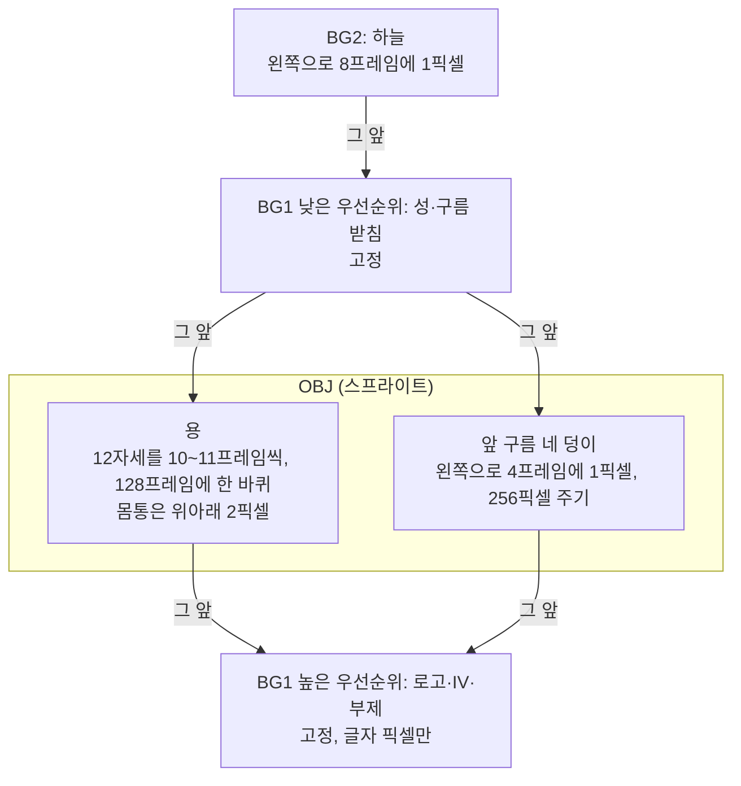
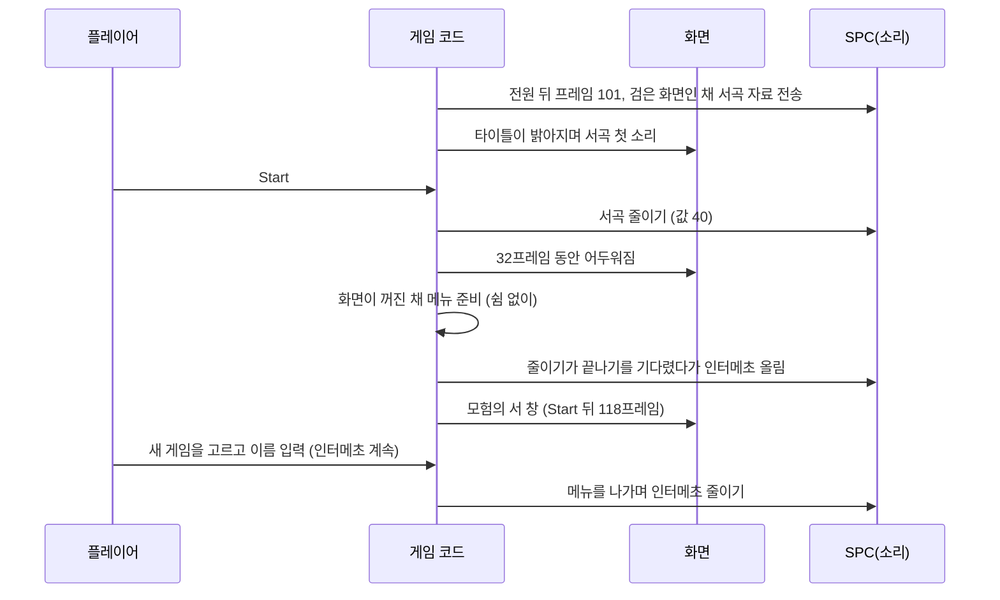
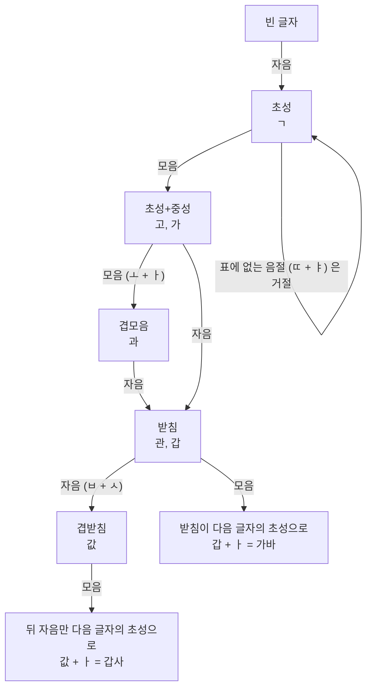
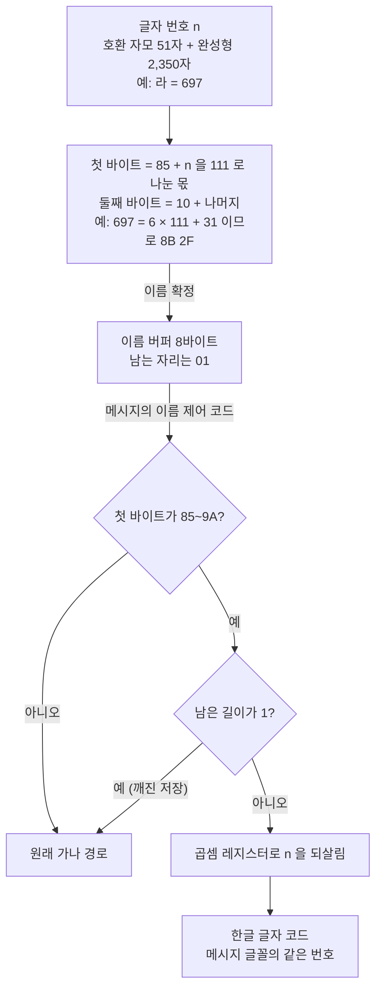

이번 편은 전원을 켠 순간부터 「새 게임」 을 고르고 이름을 지어 첫 맵에 서기 직전까지를 다룹니다. 드래곤 퀘스트 V(DQ5)의 이 구간은 제작사 표기, 모험의 서 메뉴, 가나 이름 입력으로 되어 있습니다. 여기에 드래곤 퀘스트 IV(DQ4)의 한글 타이틀을 끼우고, 서곡을 울리고, 메뉴와 메시지를 한글로 바꾸고, 자모를 조합해 이름을 넣는 입력기를 만들었습니다.


_왼쪽은 패미콤(FC) 원작이 전원 뒤에 띄우는 화면이고, 오른쪽은 이 편에서 만든 한글 타이틀입니다. 1~5절이 오른쪽 화면을 만든 이야기입니다._

엔진이 타이틀을 어떻게 그리는지는 [4편](/games/romhacking/journal/dq4/dq5-graphics-sound/)에서, 롬을 늘리고 코드를 끼우는 일반적인 방법은 [6편](/games/romhacking/journal/dq4/writing/)에서 다뤘습니다. 이 편에서는 그 위에서 화면 하나하나를 바꾸며 부딪힌 문제를 차례로 적습니다. 화면에 보이는 것은 모두 에뮬레이터 MesenCE 에서 확인했고, 실제 슈퍼 패미콤(SFC) 기기에서는 확인하지 못했습니다.

## 1. 정지 그림 한 장을 DQ5 시작 구간에 잇기

출발점은 256×224 크기의 한글 타이틀 그림 한 장입니다. 용과 구름, 붉은 한글 로고, 금색 IV, 부제 「인도받은 자들」 이 들어 있습니다. 부제를 크게 키운 안도 만들어 보았지만 작은 부제 쪽을 골랐고, 그 색 번호 PNG 를 원본으로 고정했습니다. 이후 단계에서는 이 그림을 다시 줄이거나 색을 다시 고르지 않습니다.


_초기 정지 그림입니다. 부제 글자와 성 주변은 뒤 절에서 다시 다듬었습니다._

SFC 배경은 8×8 타일 하나가 16색 팔레트 하나만 쓸 수 있습니다([타일·팔레트·폰트](/games/romhacking/sfc/graphics/)). 그림을 117색·890타일로 정리해 4bpp 타일 그림, 배경 팔레트 8벌, 32×32 타일맵으로 내보냈습니다. 먼저 이 자료만 띄우는 독립 미리보기 롬을 만들어 화면 57,344픽셀이 원본 그림과 모두 같은지 확인한 뒤에 DQ5 에 연결했습니다.

연결할 자리는 실행 추적으로 찾았습니다. DQ5 는 `00:A6ED` 에서 `03:FDE8` 의 시작 구간으로 들어가고, 초기화가 끝난 `03:FDFB` 다음에 화면을 그리며, `03:FE5C` 에서 끝냅니다. 그래서 `03:FDFB` 에 [후킹](/games/romhacking/sfc/hooking/)을 걸어 늘린 롬의 `30:8000` 으로 보내고, 끝나면 `03:FE5C` 로 돌아가게 했습니다. 원래 초기화와 메뉴 처리는 그대로 씁니다. 이때 롬은 1.5MiB 에서 2MiB 로 늘렸습니다([롬 확장](/games/romhacking/sfc/expansion/)). 타이틀 타일은 VRAM 위쪽에 올려 메뉴 글꼴 영역을 건드리지 않고, 끝날 때 팔레트와 화면 설정을 되돌립니다. A 를 눌러 돌아간 메뉴 화면은 원본과 픽셀이 같았고 CGRAM(팔레트 메모리) 512바이트도 같았습니다.

첫 연결에서 두 가지를 배웠습니다. 하나는 세로 스크롤입니다. 화면을 한 줄 올리려고 PPU 의 스크롤 레지스터에 직접 값을 썼는데, 화면이 한 줄 밀린 채였습니다. DQ5 의 NMI(화면 한 장을 다 그린 뒤 걸리는 인터럽트) 처리기가 매 프레임 WRAM `7E:0033` 의 값을 레지스터에 다시 쓰기 때문입니다. 타이틀 동안에는 그 WRAM 값을 바꾸고, 돌아가기 전에 원래 값을 되돌렸습니다. 다른 하나는 음악입니다. DQ5 의 제작사 표기 구간은 소리가 없고, 메뉴 직전에 곡 `10` 을 시작합니다. 오디오 초기화가 돌았다는 것만으로 타이틀에서 음악이 난다고 볼 수 없어서, 사운드 명령이 실행되는 시점과 실제 SPC 출력을 따로 관찰했습니다. 그 명령을 타이틀 진입으로 옮기고 원래 자리의 중복 실행을 막았습니다.

배치와 재현 명령은 [타이틀 형식 문서](https://github.com/perfectacle/sfc-dq4/blob/main/sfc/dq4/docs/dq4-title-format.md)에 있습니다.

## 2. 움직이는 타이틀: 화면 통째 교체에서 레이어로

첫 판은 정지 그림에 밝아지는 도입과 로고의 짧은 광택만 얹었습니다. 띄워 보니 이것으로는 모자랐습니다. 정지 그림을 고른 것이지, 페이드만 있는 연출을 완성으로 삼으려던 것이 아니었습니다. 대기 중에도 용이 날갯짓하고 구름이 흘러야 했습니다.

기준은 닌텐도 DS(DS) 판을 실제로 돌려서 얻었습니다. 일본판과 한글 팬패치판을 3,600프레임 실행해 보니 구름은 왼쪽으로 초당 약 10~11픽셀 흐르고, 날갯짓은 약 2.2~2.4초에 한 번 되풀이됩니다. DS 의 두 화면과 3D 용을 그대로 옮길 수는 없고, 그래픽을 가져다 쓰지도 않습니다. 움직임의 빠르기만 참고하고 용 자세와 구름은 따로 만들었습니다.

처음에는 화면 전체를 자세마다 그려 두고 VRAM 의 두 영역에 번갈아 올렸습니다. 896타일을 통째로 보내야 하니 화면 교체가 약 7.5fps 에 그쳤고, 자세를 늘려도 오래 멈춘 그림 사이를 건너뛸 뿐이었습니다. 게다가 화면 아래쪽에 다른 프레임이 섞여 보였습니다. 전송이 귀선 시간(화면을 그리지 않는 짧은 틈) 안에 끝나는지만 확인해서는 원인이 나오지 않았습니다. 범인은 어셈블리 한 줄이었습니다. 어셈블러는 마스크 상수를 8비트 즉시값으로 조립했는데, 그 자리의 CPU 는 16비트 상태였습니다. [65c816](/games/romhacking/sfc/cpu/)은 상태에 따라 즉시값을 한 바이트 더 읽으므로, 바로 뒤의 캐리 초기화 명령을 값의 일부로 삼켰습니다. 그 결과 일부 전송이 다음 롬 뱅크를 읽었습니다. 명령의 폭을 명시해 고쳤습니다.

방식 자체도 바꿨습니다. 화면을 레이어로 나누면 움직이는 부분만 보내면 됩니다.

| 요소         | 레이어            | 깊이                |
| ------------ | ----------------- | ------------------- |
| 흐르는 하늘  | BG2               | 가장 뒤             |
| 성·구름 받침 | BG1 낮은 우선순위 | 하늘 앞, 앞 구름 뒤 |
| 용·앞 구름   | OBJ               | 성 앞               |
| 로고·IV·부제 | BG1 높은 우선순위 | 앞 구름 위          |

하늘은 하드웨어 스크롤로 밀고, 용은 고정 몸통과 날개로 나눠 바뀐 스프라이트 타일만 보냅니다. 레이어를 나누자 색 번호의 뜻이 달라졌습니다. 로고에는 검정까지 16색을 다 쓰는 타일이 있습니다. 4bpp 배경에서 색 0 을 투명으로 내주면 한 색이 모자랍니다. 그래서 배경 모드를 Mode 3 로 바꿔 BG1 을 8bpp 로 쓰고, 색 0 은 투명, 색 16 은 불투명 검정으로 두어 로고의 색을 그대로 지켰습니다.

메모리가 맞아도 화면이 맞는 것은 아니었습니다. VRAM 과 OAM(스프라이트 표)이 기대한 값과 같은데도 날개 끝이 빠져 보였습니다. 쓰지 않는 32픽셀 스프라이트를 Y=240 에 숨겼더니 화면 위쪽 16줄로 감겨 들어와, 한 주사선에 그릴 수 있는 스프라이트 수를 먹고 있었습니다. 숨길 때는 Y=224 로 보냅니다. 화면 밖으로 나간 반복 구름도 X 만 밖으로 보내지 않고 Y 를 224 로 둡니다. 최종 예산은 다음과 같습니다.

| 항목               | 값                             |
| ------------------ | ------------------------------ |
| BG1 전경           | 280타일(상한 384)              |
| BG2 하늘           | 443타일                        |
| 한 주사선 최대     | 9스프라이트·33타일(상한 32·34) |
| 프레임당 최대 전송 | 1,988바이트                    |

전송량 1,988바이트는 타일 차분 최대 1,376바이트에 OAM 544바이트와 앞 구름 OAM 68바이트를 더한 값입니다. 전체 규격은 [타이틀 애니메이션 문서](https://github.com/perfectacle/sfc-dq4/blob/main/sfc/dq4/docs/dq4-title-animation.md)에 있고, 생성기는 [dq4titlelayers.py](https://github.com/perfectacle/sfc-dq4/blob/main/sfc/dq4/tools/dq4titlelayers.py), 실행 루틴은 [dq4titlelayers.asm](https://github.com/perfectacle/sfc-dq4/blob/main/sfc/dq4/tools/dq4titlelayers.asm)입니다.

## 3. 날갯짓의 리듬과 글자만 남기는 마스크

레이어로 나눈 판은 검사를 모두 통과했습니다. 연속 화면 1,001장이 독립 합성 결과와 픽셀이 같았습니다. 그런데 실제로 본 장면은 자연스럽지 않았습니다. 날개가 크게 연속으로 변형되고, 용의 주둥이 끝이 잘렸고, 글자 둘레의 하늘은 멈춘 채 주변 구름만 흘렀습니다. 화면이 계산과 같다는 것과 보기 좋다는 것은 다른 문제였습니다.

주둥이는 몸통을 고정 사각형으로 잘라서 생긴 일입니다. 원본에서 약 23픽셀, 화면에서 약 3픽셀이 잘려 있었습니다. 사각형 대신 알파가 이어진 덩어리 전체를 뽑도록 바꿨습니다.

날갯짓은 방향을 잘못 잡았습니다. 프레임마다 처리할 수 있게 되었으니 날개도 매 프레임 부드럽게 변형하면 좋으리라 여겼습니다. 제가 바란 것은 SFC 다운 리듬, 곧 작은 자세를 잠깐씩 유지하는 쪽이었습니다. 진폭을 줄인 12자세를 각각 10~11프레임씩 유지해 128프레임에 한 바퀴 돕니다. 위치와 스크롤은 매 프레임 갱신하되, 그림은 열두 장뿐입니다. 몸통은 위아래 2픽셀씩 떠다닙니다.

글자 둘레의 멈춘 하늘은 마스크가 넓어서였습니다. 처음에는 로고 주변을 다각형으로 넉넉하게 둘러 전경으로 고정했습니다. 그러면 IV 의 두 글자 사이, 부제 주변의 하늘까지 함께 멈춥니다. 원본 그림과 대조해 글자·장식·외곽선만 고르는 마스크를 다시 만들었습니다. 남긴 약 1만 픽셀의 색은 바꾸지 않았고, 구멍으로는 흐르는 하늘이 보입니다.

성 앞에는 둥근 64×32 구름을 스프라이트로 따로 띄웠습니다. 성은 낮은 우선순위, 구름은 그 위, 글자는 다시 그 위입니다. 구름이 지나갈 때 성 아랫부분이 가려지고 첨탑은 드러나며 글자는 가려지지 않습니다. 하늘은 8프레임에 1픽셀, 앞 구름은 4프레임에 1픽셀씩 왼쪽으로 흐릅니다. 뒤에 앞 구름은 한 종류에서 세 형태(둥근·납작한·폭이 좁은)와 네 색조로 늘려, 네 덩이가 높이를 달리해 256픽셀 주기로 지나가게 했습니다. 용의 스프라이트 칸 가운데 비어 있던 두 칸을 구름 그림에 돌려 써서 스프라이트 그림 자리는 늘지 않았습니다.

뒤에서 앞으로 쌓이는 차례와, 레이어마다 무엇이 얼마나 빨리 움직이는지를 한 장에 모으면 다음과 같습니다.



_위가 가장 뒤, 아래가 가장 앞입니다. 움직이는 것은 하늘과 스프라이트뿐이고, BG1 의 성과 글자는 고정입니다._

## 4. 성과 구름의 겹침을 고친 긴 길

성 주변은 한 번에 끝나지 않았습니다. 고칠 때마다 다른 문제가 드러났고, 그 과정에서 SFC 배경의 성질 하나를 제대로 배웠습니다.

첫 문제는 휑한 성 밑입니다. 성의 윤곽을 따라 자른 마스크는 밑동을 둘러싼 원래 구름까지 지웠습니다. 앞 구름이 가리는 동안에는 괜찮지만, 지나가고 나면 성이 하늘에 떠 있는 것처럼 보였습니다. 원본 그림의 청보라 구름 1,195픽셀을 성과 같은 전경에 받침으로 남겼습니다.

그러자 왼쪽 아래의 작은 조각이 주변과 따로 놀았습니다. 앞 구름이 지나가는데 그 조각만 구름 위에 남았습니다. 원인은 우선순위의 단위였습니다. SFC 배경의 우선순위는 픽셀마다가 아니라 8×8 타일마다 정합니다. 부제 오른쪽으로 뻗은 가는 장식선의 끝이 성 구름과 같은 타일에 들어 있었고, 글자 몫으로 타일을 높은 우선순위에 올리자 같은 타일의 구름 121픽셀도 함께 올라간 것입니다. 이 문제는 화면 대조 검사로는 잡히지 않았습니다. 화면을 미리 계산하는 합성기에도 같은 규칙이 들어 있어서, 틀린 화면끼리 서로 같았기 때문입니다. 문제 장면을 실제 롬의 특정 프레임에서 재현한 뒤, 「구름에 가려져야 할 픽셀이 높은 우선순위를 갖고 있지 않은가」 를 따로 세는 검사를 만들었습니다.

처음에는 장식선 끝이 든 네 타일의 우선순위 비트를 낮춰 해결했습니다. 장식선 끝 30픽셀이 성과 함께 구름 뒤로 가는 것은 자연스럽다고 판단했습니다. 그런데 화면에서는 장식선이 잘린 것처럼 보였습니다. 조각 자체도 여전히 어색해 보여서 왼쪽 아래 313픽셀은 아예 표시하지 않기로 했습니다. 기술적으로 겹침을 바로잡았다고 해서 보는 사람이 원하지 않는 조각을 살려 둘 이유는 없었습니다.

최종 규칙은 더 단순합니다. **글자가 든 타일에는 글자 픽셀만 남깁니다.** 같은 타일에 있던 성과 구름 픽셀은 마스크에서 빼고, 그 자리로는 흐르는 하늘이 보입니다. 이렇게 빠진 것은 받침 왼쪽 끝 51픽셀과 첨탑 꼭대기 3픽셀뿐입니다. 장식선은 다시 높은 우선순위로 올라와 구름 위에 남습니다. 첨탑 꼭대기 3픽셀은 IV 의 아래 끝과 타일을 나눠 쓰고 있어 성의 나머지보다 높은 우선순위를 갖고 있었는데, 앞 구름이 지나는 줄 밖이라 앞의 검사에 걸리지 않았습니다. 검사를 화면 전체로 넓혔습니다.

남은 것은 마스크 가장자리의 흔적이었습니다. 조각을 직사각형으로 비운 탓에 구름 받침이 곧게 잘려 보여서, 비우는 영역을 비스듬한 다각형으로 바꾸고 받침 끝을 둥근 구름 덩이처럼 남겼습니다. 부제 문양과 성 기둥 사이, 그리고 로고 둘레에는 마스크가 붙잡은 하늘 픽셀이 남아 있었습니다. 하늘은 흐르는데 그 픽셀만 멈춰 있으니 잡티와 띠로 보입니다. 로고 전체에 일괄 정리를 거는 방법과 하늘에 흔한 색을 따라 번지며 지우는 방법은 글자 안쪽까지 깎아서 버렸고, 문제가 된 두 상자 안에서만 행마다 가장 바깥의 어두운 외곽선 너머를 빼는 식으로 좁혀서 고쳤습니다.

부제는 아예 다시 찍었습니다. 원래 부제는 글꼴이 아니라 그림 속 글자를 줄인 것이라 여러 색이 섞여 자글자글했고, 좌우 문양의 길이도 달랐습니다. 큰 글꼴에 그라데이션을 준 안은 이질적이었고, 원래 모양에 색만 정리한 안은 「들」 처럼 획이 쌓인 글자가 읽기 어려웠습니다. 고른 것은 픽셀 글꼴 Galmuri9 를 흰 채움과 남색 외곽선으로 찍고 획을 오른쪽으로 1픽셀 넓힌 안입니다. 넓히면 1픽셀 틈이 닫히는 칸은 넓히지 않아 「자들」 이 뭉개지지 않게 했습니다. 문양은 왼쪽만 그리고 뒤집어 좌우를 맞췄습니다. 이 그림을 만드는 도구는 [dq4titlesubtitle.py](https://github.com/perfectacle/sfc-dq4/blob/main/sfc/dq4/tools/dq4titlesubtitle.py)입니다.


_실제 롬에서 찍은 최종 타이틀입니다. 1절의 초기 그림과 견주면 부제가 흰 채움과 남색 외곽선의 픽셀 글꼴로 바뀌었고 양옆 문양의 길이가 같으며, 성은 밑동에 구름 받침을 두고 서 있습니다._

## 5. 타이틀 자료를 줄이고 다른 뱅크로 옮기기

타이틀은 그림 자료가 큽니다. 처음 배치는 뱅크 `31` 부터 `39` 초입까지를 차지했고, 그중 용의 타일 차분 자료만 98,848바이트였습니다. 뒤에 맵을 써 넣기 시작하자 이 자리가 아쉬워졌습니다.

먼저 줄였습니다. 차분 자료를 세어 보니 전송 198개 가운데 서로 다른 것은 97개뿐이었고, OAM 프레임 128개 가운데 서로 다른 것은 10개였습니다. 생성기가 전송마다 자료를 뒤에 덧붙이고 있었던 것입니다. 같은 바이트열은 한 벌만 두고 모두 그 주소를 가리키게 했습니다. 이미 롬의 다른 곳(스프라이트 초기 그림 등)에 같은 바이트열이 있으면 그것을 읽고, 전송 목록 칸의 끝 표시 뒤에 남는 빈 곳에도 끼워 넣었습니다. 새로 두는 자료는 16,512바이트로 줄었습니다. DMA 가 읽는 주소만 바뀌고 길이와 순서는 같으니 화면은 그대로여야 합니다. 대기 2,400프레임의 화면을 프레임마다 견주어 다른 장이 0 임을 확인했습니다. 여기서 재는 법 하나를 고쳤습니다. 에뮬레이터의 화면 캡처 함수로 찍으면 같은 롬을 두 번 돌려도 1~3프레임씩 흔들려 669장이 다르게 나왔습니다. 프레임 끝의 화면 버퍼를 직접 읽고 프레임 건너뛰기를 끄자 같은 롬끼리 차이가 0 이 되었습니다.

다음은 옮기기입니다. 새 맵 레코드와 인물 목록은 뱅크 `30`~`3F` 를 벗어날 수 없습니다. 엔진이 데이터 뱅크를 그 자료의 뱅크로 둔 채 낮은 WRAM 을 절대 주소로 함께 읽기 때문입니다([뱅크와 매핑](/games/romhacking/sfc/banks/)). 그 귀한 자리를 타이틀 그림이 가장 많이 차지하고 있었습니다. 타이틀 코드는 자료를 DMA 와 24비트 주소 읽기로만 읽으므로 뱅크를 가리지 않습니다. 그래서 타이틀 단계에서 롬을 바로 4MB 로 늘리고, 그림 자료를 뱅크 `42`~`47` 로 하나씩 옮겼습니다. 코드는 `30:8000` 그대로입니다.

옮긴 뒤 같은 프레임 16곳에서 VRAM·OAM·CGRAM 을 덤프해 견줬습니다. OAM 과 CGRAM 은 모두 같았고, VRAM 은 타이틀이 올리지 않는 칸 2,165바이트만 달랐습니다. 이 칸은 같은 롬을 두 번 돌려도 달라지는 초기화되지 않은 VRAM 이라 비교에서 뺐습니다. 하나 걸린 것은 메뉴 준비 루틴입니다. 이 루틴은 낮은 WRAM 을 절대 주소로 쓰는 코드라 `42` 로 갈 수 없어서 타이틀 코드 뒤 `30` 에 남겼습니다. 옮길 수 있는 것과 없는 것을 가르는 기준이 「그림이냐 코드냐」 가 아니라 「낮은 WRAM 을 절대 주소로 읽느냐」 였던 셈입니다.

## 6. 서곡과 모험의 서 곡

타이틀에서 DQ5 메뉴곡 대신 DQ4 서곡이 나와야 했습니다. 패미콤(FC) 악보와 DS 판 녹음의 빠르기, DQ5 곡의 악기 배치를 합쳐 서곡을 DQ5 소리 엔진의 시퀀스로 만든 과정은 [9편](/games/romhacking/journal/dq4/environment-sound/)에서 다룹니다. 여기서는 그 곡을 타이틀과 메뉴에 잇는 부분만 적습니다. 자리와 명령은 [타이틀 서곡 문서](https://github.com/perfectacle/sfc-dq4/blob/main/sfc/dq4/docs/dq4-overture-format.md)에 있습니다.

### 곡 번호 하나에 두 곡

DQ5 메뉴곡이 바로 시퀀스 `10` 이라 덮어쓸 수 없었습니다. 쓰지 않는 곡 번호를 찾으려 했지만, 롬에서 바이트 꼴을 검색하는 방법으로는 우연히 같은 바이트가 섞여 「안 쓴다」 를 확정할 수 없었습니다. 대신 DQ5 가 스스로 쓰는 수법을 빌렸습니다. 동굴 전투 곡처럼 트랙 머리에 조건 갈래를 두어, 한 시퀀스에 원래 곡과 서곡을 함께 담았습니다. 타이틀은 갈래 값을 붙인 명령 `0C 10 01` 로, 원래 곡은 `01 10` 으로 틉니다.

샘플을 더하자 전원을 켜도 타이틀까지 가지 못했습니다. 조각을 하나씩 되돌려 보니 곡마다 쓰는 샘플 묶음을 적은 표가 원인이었고, SPC 의 RAM 은 통째로 쓰레기였습니다. 이 표는 소리 드라이버를 SPC 로 올려 보내는 전송의 마지막 블록 끝에 붙어 있습니다. 표가 4바이트 늘어나면 블록 길이와 바로 뒤의 끝 표시도 함께 옮겨야 했습니다.

### 타이틀이 뜨는 시간

서곡을 넣자 타이틀이 늦게 떴습니다. 전원부터 프레임마다 화면 밝기와 첫 발음을 재서 기준을 세웠습니다.

| 롬             | 처음 보임 | 다 밝아짐 | 첫 소리 |
| -------------- | --------- | --------- | ------- |
| 원본 DQ5       | 102       | 102       | 1694    |
| 서곡 전 타이틀 | 187       | 243       | 180     |
| 서곡, 처음     | 198       | 254       | 191     |
| 서곡, 고친 뒤  | 186       | 242       | 179     |

타이틀은 프레임 101 에 들어와 곡 자료가 SPC 로 갈 때까지 검은 화면으로 기다립니다. 전송은 3바이트마다 SPC 의 응답을 기다려 프레임당 약 118바이트밖에 못 보냅니다. 보낼 양을 줄이는 수밖에 없었습니다. 곡보다 먼저 보낼 샘플을 첫 팡파르가 쓰는 3개로 줄이고, 되풀이되는 줄 덩어리를 서브루틴으로 묶어 시퀀스를 3,968바이트에서 2,380바이트로 줄였습니다. 화면을 먼저 띄우고 소리를 나중에 내면 화면은 프레임 105 에 뜨지만, 소리가 1.5초 늦습니다. 화면과 소리는 함께 나와야 했고, 밝아지는 연출을 줄이고 싶지도 않았습니다. 타이틀의 화면 연출은 건드리지 않는다는 방침은 이 뒤로도 계속 지켰습니다.

### 메뉴로 넘어갈 때의 소리

타이틀을 나갈 때 서곡이 뚝 끊기지 않게, 어두워지는 루틴의 첫 명령에서 곡 줄이기 명령을 보냅니다. 명령에 딸린 값을 `20` 으로 두면 메뉴까지 소리가 30% 남아 끊겼고, `40` 으로 올리자 0 까지 줄었습니다.

메뉴 곡은 세 번 바뀌었습니다. 처음에는 DQ5 원래 메뉴곡을 틀었고, 다음에는 서곡을 이름 입력까지 이어 틀었습니다. FC 를 전원부터 돌려 지금 곡 변수를 기록해 보니, FC 는 모험의 서부터 이름 입력까지 서곡이 아닌 다른 곡을 틀고 있었습니다. DS 판도 같은 화면에서 같은 선율의 인터메초(インテルメッツォ)를 틉니다. 그래서 타이틀은 서곡, 모험의 서부터는 DQ4 의 인터메초로 정했습니다.

이 과정에서 「곡이 멈췄다」 를 재는 방법을 두 번 고쳤습니다. 처음에는 엔진의 지금 곡 변수 `$1D8B` 가 `FF` 가 되는 것을 멈춤으로 읽었습니다. 그런데 직접 들어 보면 새 게임을 고른 뒤에도 메뉴 곡이 서술 내내 울렸습니다. 변수는 바뀌었지만 SPC 는 계속 연주하고 있었던 것입니다. 다음에는 SPC 의 발음 명령(KON) 수를 셌는데, 곡을 줄이는 중에도 KON 은 계속 나오므로 소리가 나는지를 가리지 못했습니다. 마지막으로 목소리마다 엔벌로프와 음량을 프레임마다 읽어, 둘 다 0 이 아닌 프레임을 세는 것으로 정착했습니다. 진짜 원인은 한 바이트였습니다. 메뉴를 나갈 때 엔진이 「곡 `10` 을 줄여라」 고 보내는데, 줄이기 명령은 지금 곡이 인자와 같을 때만 듣습니다. 메뉴 곡 번호를 바꾼 뒤로는 아무것도 줄지 않았던 것이고, 그 인자 바이트(`00:A71B`)를 새 곡 번호로 바꿔 해결했습니다.

### 메뉴가 늦게 뜨던 것

타이틀에서 Start 를 누르면 메뉴 창이 뜨기까지 144프레임, 약 2.4초가 걸렸습니다. 프레임마다 화면 밝기, 소리 포트 쓰기, SPC 소리 크기를 남겨 구간을 나눴습니다. 어두워지는 32프레임 뒤에, 화면이 꺼진 채 DQ5 의 메뉴 준비 루틴 `02:F9E3` 이 약 46프레임을 쓰고 있었습니다. 이 루틴은 표를 채우고 VRAM 을 지우면서 덩어리마다 한두 프레임씩 쉽니다. 화면이 켜져 있을 때 귀선 시간에 맞추려는 쉼인데, 지금은 화면이 꺼져 있으니 쉴 까닭이 없습니다. 원본 DQ5 는 이 루틴을 전원을 켤 때 한 번만 부릅니다. 타이틀이 메뉴로 돌아가며 한 번 더 부르고 있었던 것입니다. 같은 일을 쉬지 않고 하는 루틴을 따로 두었습니다.

쉼을 다 빼자 이번에는 서곡이 원래 크기의 약 28% 에서 뚝 끊겼습니다. 메뉴 곡을 올리기 시작하면 앞 곡이 바로 멈추기 때문입니다. 어두워지는 연출과 소리 줄이기는 바꾸지 않기로 했으므로, 줄이기가 끝나는 프레임까지 17프레임을 기다렸다가 곡을 올립니다. 창은 144프레임에서 118프레임으로 당겨졌습니다. 창이 뜬 뒤의 VRAM·CGRAM·OAM 은 고치기 전과 같았습니다.

전원부터 새 게임까지, 화면이 바뀌는 시점과 곡이 바뀌는 시점을 나란히 놓으면 이렇게 됩니다. 소리 명령이 화면 전환보다 먼저 나가는지 뒤에 나가는지를 보면 됩니다.



_곡은 두 번 바뀝니다. 타이틀에서는 서곡, 모험의 서부터 이름 입력까지는 인터메초이고, 두 곡 모두 그 화면을 나갈 때 줄이기 명령을 받습니다._

## 7. 모험의 서 메뉴를 한글로

메뉴에는 큰 벽이 하나 있었습니다. DQ5 의 창 글자는 바이트가 곧 BG3 타일 번호이고, 고정 글자 타일은 가나 138칸뿐입니다. 한글을 넣을 칸이 없습니다. 창 글자 전반의 해법은 [8편](/games/romhacking/journal/dq4/windows/)에서 다루고, 여기서는 메뉴에서만 통하는 지름길을 씁니다.

메뉴 화면 일곱 장의 VRAM 을 덤프해 보니 워드 주소 `2000`~`7FFF` 가 모두 0 이었습니다. 타이틀이 나가면서 VRAM 을 다 지우고, 메뉴에는 BG1·BG2 그림이 없기 때문입니다. BG3 타일 번호는 10비트라 `200`~`3FF` 까지 가리킬 수 있습니다. 그래서 메뉴 문구를 빌드할 때 문자열째로 그려 8픽셀 폭의 세로 열로 자르고, 이 빈 VRAM 에 올려 둡니다. 창 자료에는 「열 k 부터 n 개를 늘어놓아라」 는 뜻의 세 바이트 `9F n k` 만 씁니다. 12바이트이던 원래 문구가 3바이트가 되니, 창 자료는 모두 원래 자리에 들어갔습니다. 열 그림 8KB 는 타이틀이 끝나는 마지막 점프를 가로채, 화면을 끈 채 DMA 로 올립니다.


_왼쪽은 원본 DQ5, 오른쪽은 포팅 롬의 같은 화면입니다. 왼쪽 위 창은 「모험의 서를 만든다」, 그 아래 창은 「모험의 서 1·2·3」 입니다. 창의 자리와 크기는 그대로이고 글자만 열 그림으로 바뀌었습니다._


_기록이 없을 때의 첫 메뉴, 다섯 항목 메뉴, 표시 속도, 지우기 확인입니다._

첫 롬은 글자가 나오긴 했는데 화면 바탕 전체가 격자 무늬였습니다. BG1·BG2 의 타일 그림 바탕 주소도 같은 워드 `2000` 이었습니다. 0 으로 채운 BG1·BG2 타일맵이 타일 0, 곧 새로 올린 열 0·1 의 그림을 4bpp 로 읽어 화면 가득 깔고 있었던 것입니다. 열을 2 부터 쓰고 안 쓰는 칸을 0 으로 두자 바탕이 검게 돌아왔습니다.

글자의 세로 자리도 예상과 달랐습니다. 창은 항목마다 글자 줄과 빈 줄, 두 줄을 씁니다. 한글은 가나보다 키가 크니 위 빈 줄로 올려 그리려 했습니다. 타일맵을 덤프해 보니 가나의 탁점이 글자 위 줄에 놓이고, 첫 항목의 위 줄은 창 테두리였습니다. 위로는 갈 수 없습니다. 한글을 아래 빈 줄 쪽으로 내려 그리고, 마지막 항목 아래가 테두리와 겹치지 않게 창 높이를 한 줄 늘렸습니다.


_왼쪽은 FC 원작, 오른쪽은 포팅 롬의 기록이 있을 때 메뉴입니다. FC 의 항목은 위부터 「모험을 한다」, 「표시 속도를 바꾼다」, 「모험의 서를 만든다」, 「모험의 서를 옮긴다」, 「모험의 서를 지운다」 입니다. 오른쪽에서는 항목마다 글자 줄과 빈 줄을 쓰는 창에 키 큰 한글 다섯 줄이 테두리와 겹치지 않고 들어간 것을 보면 됩니다._

예/아니요 창은 다른 함정이었습니다. 지우기 확인에 뜨는 예/아니요는 메뉴 전용 창이 아니라 게임 안 교회 같은 곳에서도 여는 공용 창 `32` 였습니다. 게임 안에서는 그 VRAM 자리가 맵 그림이라 열 그림을 쓸 수 없습니다. 창 표를 읽는 코드는 아홉 군데나 되어서 하나하나 고치는 대신, 창 표의 해당 칸이 WRAM `7E:1AC0` 을 가리키게 했습니다. 메뉴에 들어갈 때 한글 창 자료를 그리로 복사하고, 맵을 불러올 때마다 원래 자료를 복사합니다.

글꼴은 공개 픽셀 글꼴 Galmuri 를 씁니다. 처음에는 12픽셀 폭의 Galmuri11 을 골랐다가, 이름 입력까지 넣고 보니 원작보다 글자가 커서 어색해 보여 다시 견줬습니다. 원작 가나 칸 크기에 맞는 Galmuri7 은 「을」 이 「올」 처럼 뭉개졌습니다. 결국 창 글자는 Galmuri9, 한 칸이 8픽셀인 자모판만 Galmuri7, 메시지는 원작 가나 크기에 맞는 Galmuri11 로 정했습니다.

직접 띄워 보니 두 가지가 걸렸습니다. 커서를 움직여도 소리가 없고, 첫 메뉴에서 B 를 누르면 창이 사라졌다 다시 떴습니다. 둘 다 원본 DQ5 도 그랬습니다. 입력이 있을 때와 없을 때의 실행 커버리지를 견주어 선택 처리 루틴과 B 갈래를 찾았고, 커서 자리가 바뀌었을 때만 효과음을 내게 하고 첫 메뉴에서만 B 를 막았습니다. 메뉴의 범위와 창 번호는 [메뉴 형식 문서](https://github.com/perfectacle/sfc-dq4/blob/main/sfc/dq4/docs/dq4-menu-format.md)에 있습니다.

## 8. 메시지 셋 때문에 3,200개를 다시 부호화하다

메뉴에는 창 문구 말고 메시지가 셋 남아 있었습니다. 지우기 확인, 지운 뒤, 기록이 깨졌을 때의 문장입니다. DQ5 의 메시지는 [허프만 부호](/games/romhacking/huffman/)로 압축되어 있고([2편](/games/romhacking/journal/dq4/dq5-events/)), 한글 글자를 더하려면 부호 트리 자체를 다시 만들어야 합니다. 문장 셋을 바꾸려고 보행 메시지 3,200개를 통째로 새 트리로 다시 부호화했습니다.

커진 트리와 다시 부호화한 메시지는 원래 자리에 들어가지 않습니다. 그래서 새 메시지와 디코더 사본은 빈 뱅크 `65` 부터 두었습니다(대사가 늘어난 뒤로는 자리를 다시 옮겼습니다). 디코더를 높은 뱅크에 둬도 되는지가 걱정이었습니다. 앞서 적어 둔 메모에는 「낮은 WRAM 이 비치는 뱅크에 둬야 한다」 고 적혀 있었습니다. 디코더를 디스어셈블해 보니 직접 페이지의 포인터와 자기 뱅크의 트리만 읽고 있었습니다. 직접 페이지는 데이터 뱅크와 무관하므로 `65` 에 둬도 됩니다. 정작 낮은 WRAM 이 필요한 쪽은 글자 그림을 읽는 루틴이었습니다. 이 루틴은 글자 묶음의 뱅크를 데이터 뱅크로 삼은 채 낮은 WRAM 을 절대 주소로 읽습니다. 그래서 한글 2,401자의 글자 그림은 높은 뱅크가 아니라, 메시지를 옮겨 비워진 원래 메시지 자리(`07:D77C` 부터)에 넣었습니다.

같은 루틴에 조건이 하나 더 있었습니다. 주소를 더하다 올림이 뱅크 바이트로 넘어가도 주소를 `8000` 으로 고쳐 주지 않습니다. 묶음이 뱅크 끝을 넘으면 다음 뱅크의 엉뚱한 곳을 읽습니다. 묶음은 한 뱅크 안에 두고, 넘치면 다음 뱅크 처음에서 새 묶음을 엽니다. 확인을 위해 지우기 메시지를 뱅크 끝의 마지막 글자와 다음 뱅크의 첫 글자(「땟」 과 「땠」)로 바꾼 시험 롬을 띄워 경계의 글자가 제 모양인지 보았습니다.


_위부터 지우기 확인, 지운 뒤, 기록이 깨졌을 때의 메시지입니다._

번역에도 작은 궁리가 들어갔습니다. 원문은 「모험의 서 1 을 지웁니다」 꼴인데, 칸 번호가 변수라 한국어 조사가 걸립니다. 「일을·이를·삼을」 처럼 숫자에 따라 조사가 바뀌기 때문입니다. 「1번을」 처럼 「번」 을 붙여 조사를 하나로 고정했습니다.

빌드는 마지막에 새 롬만으로 메시지 3,200개를 다시 풀어, 바꾼 셋을 뺀 나머지가 원래와 같은지 확인합니다. 기록 깨짐 메시지는 저장 데이터의 바이트 하나를 뒤집은 SRAM 으로 켜서 띄웠습니다. 부호화 도구는 [dq4menumsg.py](https://github.com/perfectacle/sfc-dq4/blob/main/sfc/dq4/tools/dq4menumsg.py)입니다.

## 9. 자모를 조합하는 이름 입력

DQ5 의 이름 입력은 가나판에서 글자를 골라 네 글자까지 넣습니다. 한글은 완성형 글자를 판에 다 늘어놓을 수 없으니, 자모를 골라 조합하게 했습니다. 구조는 [이름 입력 형식 문서](https://github.com/perfectacle/sfc-dq4/blob/main/sfc/dq4/docs/dq4-name-entry-format.md)에 있습니다.


_왼쪽은 원본 DQ5 의 가나판이고, 오른쪽은 자모판입니다. 왼쪽의 탭은 「모험의 서」, 창 제목은 「이름을 넣어 주세요」, 오른쪽 세 항목은 「가타카나」, 「되돌리기」, 「끝」 입니다. 오른쪽은 쌍자음 줄과 두벌식 세 줄에서 자모 일곱 개를 골라 「라이안」 세 글자를 만든 상태이고, 넷째 칸은 비어 있습니다._

### 여덟 바이트에 네 글자

DQ5 의 이름 버퍼는 여덟 바이트입니다. 한 글자에 두 바이트를 쓰면 네 글자가 들어갑니다. 호환 자모 51자와 KS X 1001 완성형 2,350자에 차례로 번호 n 을 붙이고, n 을 111 로 나눈 몫과 나머지를 두 바이트에 나눠 담습니다. 남는 자리는 원래 엔진의 이름 끝 부호 `01` 로 채웁니다. 첫 판은 두 바이트 모두 기존 가나 범위에 들어가게 했는데, 이 결정은 뒤에 문제를 낳았습니다(10절).

### 조합과 지우기

자모판은 쌍자음 줄과 두벌식 세 줄입니다. 입력 중인 글자의 초성·중성·종성 상태를 스택에 쌓아 두고, B 나 「지우기」 는 상태를 하나 되돌립니다. 받침 뒤에 모음이 오면 받침을 다음 글자의 초성으로 옮기고, 겹받침이면 뒤 자음만 옮깁니다. 완성형 표에 없는 음절이나 다섯째 글자가 생기는 입력은 받지 않고 직전 상태로 돌아갑니다.

글자 하나가 만들어지는 갈래는 다음과 같습니다. B 나 「지우기」 는 지나온 화살표를 하나 거슬러 올라갑니다.



_아래 두 상자는 다음 글자의 초성+중성 상태입니다. 다섯째 글자가 생기는 입력도 표에 없는 음절과 같이 제자리에 머뭅니다._

| 입력                    | 결과                             |
| ----------------------- | -------------------------------- |
| `ㄱㅏㅂㅅㅏ` 뒤 B 두 번 | 갑사 → 갑ㅅ → 갑                 |
| `ㄱㅗㅏㄴ` 뒤 B 네 번   | 관에서 과 → 고 → ㄱ → 빈 이름    |
| `ㄸㅑ`                  | 표에 없는 음절이라 거절, ㄸ 유지 |
| `ㄹㅏㅇㅣㅇㅏㄴ`        | 라이안                           |

규칙은 먼저 파이썬 기준 구현으로 만들고 테스트했지만, 그것으로 롬 안의 65c816 루틴이 맞다고 볼 수는 없습니다. 실제 롬을 띄워 같은 입력을 넣고 조합 상태와 이름 칸의 VRAM 을 기준과 견줬습니다.

### 엇나가는 커서

자모판을 그리자 위아래 이동이 엇나갔습니다. 엔진은 선택 번호에 한 줄의 칸 수를 더하거나 빼서 위아래로 움직이는데, 한 줄이 11칸인데도 엔진이 센 값은 7이었습니다. 줄 폭을 세는 루틴이 첫 줄에서 고를 수 있는 칸만 세고 빈칸은 세지 않았습니다. 첫 줄 끝에 「아무것도 그리지 않는 선택 칸」 을 빈칸 수만큼 더해 화면은 그대로 두고 폭만 11로 맞췄습니다.

빠르게 방향을 바꿀 때의 문제는 더 미묘했습니다. 위를 누른 직후 왼쪽을 누르면 입력이 사라지거나, 왼쪽을 계속 누르고 있는데 이동이 다시 시작됐습니다. 먼저 새로 넣은 커서 효과음을 의심했지만, 효과음이 있는 롬과 뺀 롬에서 같은 입력을 돌린 로그가 같아 배제했습니다. 프레임 단위로 입력을 주며 추적하니 원인은 둘이었습니다. 엔진은 커서를 그린 뒤 다음 프레임을 먼저 기다려서 그 사이의 한 프레임짜리 입력을 놓칩니다. 그리고 방향 비트 전체가 조금이라도 바뀌면 새 입력으로 봅니다. 위와 왼쪽을 함께 누르다 위만 떼면, 계속 누르고 있던 왼쪽이 새로 눌린 것으로 처리되어 한 칸 더 갔습니다. 실제로 눌린 방향 가운데 하나만 골라 반복 상태를 관리하도록 바꿨습니다. 새로 누른 방향을 먼저 고르고, 그 방향을 누르는 동안에는 다른 방향을 떼어도 반복을 다시 시작하지 않습니다. 이 문제는 원본 DQ5 의 모든 창에 있던 것이어서, 뒤에 같은 처리를 게임 안 창 전체로 넓혔습니다. 좌우 끝에서의 이동도 원래의 빈칸 탐색 대신 자모판 배열에 맞춘 이웃 표로 바꿨습니다.

### 완료 키는 Start 가 아니었다

조합 검사에 Start 로 이름을 확정하는 단계를 넣자 검사가 시간 초과로 끝났습니다. 처음에는 창 머리의 바이트 하나를 「Start 허용 비트」 로 오해해 그 값을 보존하는 쪽으로 고쳤는데, 그 바이트는 제목의 위치였습니다. 잘못 고친 것과 그 가정으로 만든 테스트를 되돌리고 입력 변환 경로를 읽었습니다. 엔진은 컨트롤러의 Y 비트를 옮겨 「완료」 로 쓰고, 물리 Start 는 버립니다. 원본 이름 입력의 완료 키는 처음부터 Y 였습니다. 원래 동작을 유지하되, 자모판에서는 원시 패드 값을 따로 읽어 Start 를 누르면 커서가 「끝」 으로 가게 했습니다. 확정은 그 뒤 A 로 합니다.

### 기록 목록의 이름

이름을 저장하고 메뉴로 돌아오자 목록에는 가나 네 글자가 찍혀 있었습니다. 저장은 맞고 그리는 쪽이 바이트를 가나로 읽은 것입니다. 이름을 그리는 자리를 찾을 때 처음 짚은 처리기는 숫자를 그리는 것이었고, 실제 호출과 이름 버퍼를 함께 기록해 진짜 경로를 찾았습니다. 이 공통 루틴은 게임 안 상태 창도 쓰므로 메뉴에 있을 때만 한글로 그리게 했습니다. 이름 그림은 기록마다 다른 타일에 둡니다. 한 벌을 세 줄이 같이 쓰면 마지막 이름으로 모두 바뀌기 때문입니다. 글자 아랫부분이 테두리와 겹쳐서 창 자료의 높이를 늘렸는데 화면은 그대로였습니다. 목록 창은 기록 수에 따라 엔진이 높이를 다시 계산하고 있었습니다. 그 계산에 한 줄을 더했습니다. 뒤에 다른 검사가 무작위 입력으로 교회의 기록 창에 닿으면서, 빈 칸에 찍히는 「사용하지 않음」 문구가 따로 떨어진 문자열이 아니라 코드 바로 뒤에 거꾸로 놓인 열 바이트라는 것도 알게 되어 함께 한글로 바꿨습니다.


_지금 롬에서 저장 기록 하나를 넣고 「모험을 한다」 를 고른 화면입니다. 이름은 한글 「라이안」 으로 그려지지만, 이름 아래쪽에 검은 띠가 보이고 장소 이름은 가나(이무르)로 나옵니다. 둘 다 아직 고치지 못했습니다._

## 10. 게임 안 메시지에 이름 찍기

마지막 줄기는 지은 이름이 게임 안 대사에 나오게 하는 일의 시작입니다. 메시지 속 이름 제어 코드의 처리기를 따라가니, 이름 바이트를 하나씩 글자 코드로 바꾸는 호출이 보행 메시지에서는 한 곳뿐이었습니다. 그 호출만 가로채면 됩니다.

걸림돌은 9절에서 정한 부호였습니다. 두 바이트가 모두 가나 범위라, 바이트만 봐서는 한글 이름인지 가나 이름인지 구별할 수 없습니다. 원래 가나 이름의 바이트 `10 10 10 10` 이 한글 부호로는 「ㄱㄱ」 으로도 읽힙니다. 표시가 필요했습니다. 이름 바이트가 지나가는 출력 루틴 셋을 디스어셈블해 각각이 특별하게 다루는 바이트를 모으고, 원래 가나판이 내는 바이트도 조사했습니다. 어디에도 걸리지 않는 범위 `85`~`9A` 를 첫 바이트로 삼았습니다.

```text
한 글자 = (85 + n // 111), (10 + n % 111)    상수는 16진수
라이안  = 8B 2F 93 3C 91 5A 01 01
```

가로챈 루틴은 첫 바이트가 이 범위면 CPU 의 곱셈 레지스터로 n 을 되살려 한글 글자 코드를 쌓고, 아니면 원래 가나 경로로 보냅니다. 글자 그림은 8절에서 넣은 메시지 글꼴을 같은 번호로 쓰도록 미리 맞춰 두었습니다. 루틴이 들어간 자리는 메시지 디코더를 뱅크 `65` 로 옮기며 비워진 54바이트로, 꼭 맞게 찼습니다. 코드를 다시 읽다가 구멍을 하나 찾았습니다. 깨진 저장에서 표시 바이트가 이름의 마지막 바이트이면, 둘째 바이트를 읽으며 남은 길이가 0 아래로 넘어가 버퍼를 넘겨 씁니다. 남은 길이가 1 이면 원래 경로로 보내는 확인을 넣었습니다.

저장할 때의 계산과 메시지에 찍을 때의 갈래를 이으면 다음과 같습니다. 가나 이름과 깨진 저장이 어느 갈래로 빠지는지를 보면 됩니다.



_바이트 값은 16진수, 번호 n 과 111 은 10진수입니다. 위 세 상자는 이름 입력이, 마름모부터는 가로챈 메시지 루틴이 하는 일입니다._


_아직 DQ5 의 대사가 남아 있던 때의 시험 화면입니다. 이름 자리에만 한글이 찍힙니다._

확인은 DQ5 의 배 선실 장면에서 했습니다. 이름 버퍼에 바이트를 직접 써넣고 말을 걸어, 루틴이 쌓은 글자 코드를 파이썬 기준과 견줬습니다. 한글 세 글자, 여덟 바이트를 다 쓰는 네 글자, 범위의 처음과 끝, 뱅크 경계의 글자, 원래 가나, 탁점 가나, 깨진 저장을 모두 넣었습니다. 가나 이름은 원래 표 값 그대로 나왔습니다.

부호를 바꿨으니 첫 판 부호로 저장한 기록은 가나로 보이게 됩니다. 저장 파일을 바꿔 주는 도구 [dq4namesave.py](https://github.com/perfectacle/sfc-dq4/blob/main/sfc/dq4/tools/dq4namesave.py)를 만들었습니다. 원본을 덮어쓰지 않고, 고른 칸이 옛 한글 부호로 읽힐 때만 이름 8바이트와 칸 체크섬을 바꿉니다.

이 단계에서 한글로 찍히는 것은 보행 메시지뿐입니다. 상태 창이나 전투 창은 바이트를 곧바로 타일로 찍는 다른 길이라 한글 이름이 깨진 글자로 보였습니다. 그 길은 [8편](/games/romhacking/journal/dq4/windows/)에서 이어집니다.

## 틀렸던 것들

- **「화면이 계산과 같으면 맞다」**: 성 조각이 구름 위에 남는 문제는 실제 화면과 합성기가 같은 틀린 우선순위를 그려서 대조 검사를 통과했습니다. 타일 단위로 정해지는 성질은 「가려져야 할 픽셀」 을 따로 세어야 잡힙니다.
- **「메모리가 같으면 화면도 같다」**: VRAM 과 OAM 이 기대와 같아도 날개 끝이 빠졌습니다. 화면 밖에 숨긴 스프라이트가 위로 감겨 주사선 한도를 먹고 있었습니다.
- **「매 프레임 처리할 수 있으면 매 프레임 변형해야 부드럽다」**: 날개를 연속으로 변형한 판은 어색했습니다. 채택된 것은 열두 자세를 잠깐씩 유지하는 쪽입니다.
- **「장식선 끝은 구름에 가려져도 자연스럽다」**: 화면에서는 선이 잘린 것으로 보였습니다. 글자의 일부는 항상 앞에 있어야 했고, 글자 타일에 글자만 남기는 규칙으로 돌아갔습니다.
- **「지금 곡 변수가 바뀌었으니 곡이 멈췄다」**: 변수는 `FF` 가 되었지만 SPC 는 계속 연주했습니다. 발음 명령 수도 줄어드는 곡을 가리지 못해, 목소리별 엔벌로프와 음량으로 재게 되었습니다.
- **「화면을 먼저 띄우거나 부팅 중에 곡을 미리 보내면 빨라진다」**: 먼저 띄우면 소리가 1.5초 늦고, 미리 보내려 해도 SPC 가 드라이버를 받는 동안에는 대기열이 멈춰 있어 효과가 없었습니다.
- **「완료 키는 Start」**: 창 머리의 바이트를 Start 허용 비트로 오해해 엉뚱한 곳을 고쳤습니다. 원본의 완료 키는 Y 였고, 물리 Start 는 입력 변환에서 버려집니다.

## 남은 것

- 실제 SFC 기기에서의 확인은 기기를 쓸 수 없어 작업 범위에서 뺐습니다. 이 편의 결과는 모두 에뮬레이터 기준입니다.
- 메뉴 곡을 SPC 로 보내는 동안 창을 그리지 않아, 곡을 얹은 롬은 원본 DQ5 보다 메뉴가 약 28프레임 늦게 뜹니다. 전송과 창 그리기의 차례를 바꾸거나 전송량을 줄여야 합니다.
- 옮기기 전의 원래 메시지 자리를 색인 밖에서 읽는 코드가 있는지는 실행해 본 장면에서만 확인했습니다.
- 둘째 바이트의 범위는 확인하지 않으므로, 깨진 저장에서는 이름 자리에 엉뚱한 글자가 찍힐 수 있습니다.
- 기록 목록에서 이름 아래쪽에 검은 띠가 보이고, 이어 할 장소의 이름이 가나로 나옵니다(9절의 화면).
