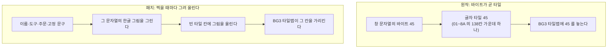
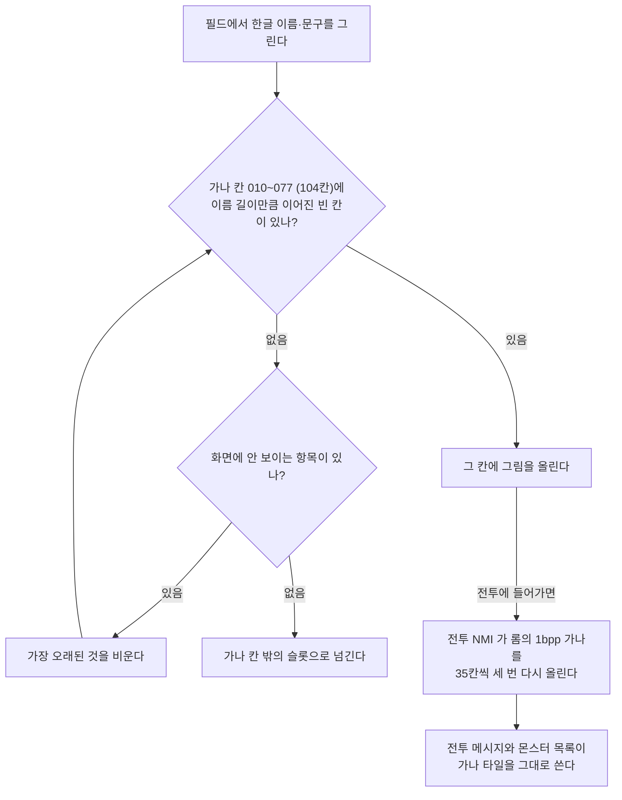
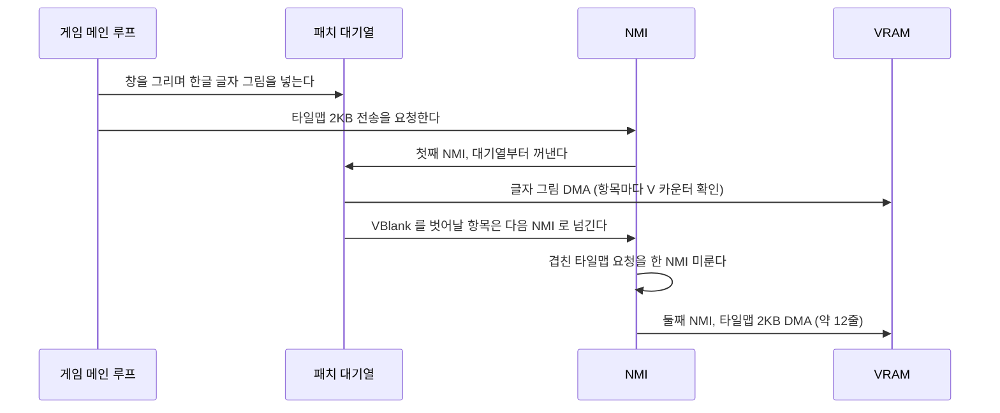
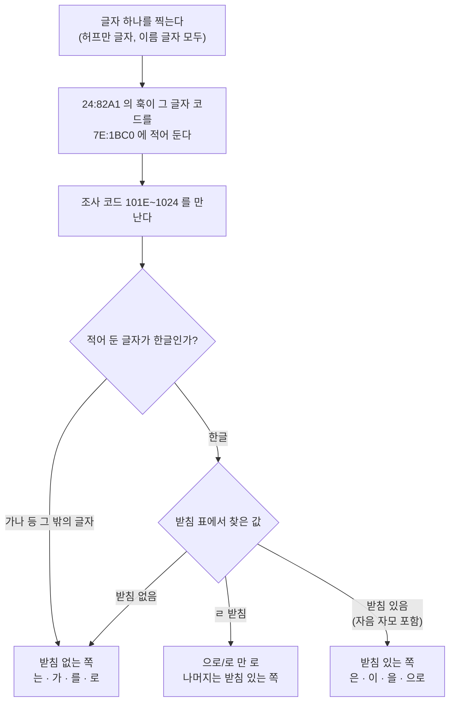
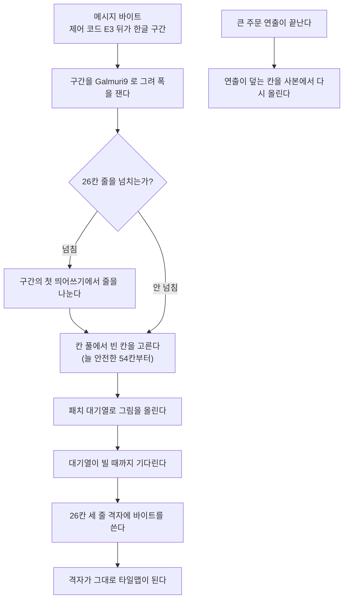

[7편](/games/romhacking/journal/dq4/title-menu/)에서 타이틀과 모험의 서, 이름 입력을 한글로 바꿨습니다. 그런데 한글 이름을 넣고 게임에 들어가면 이름이 곧바로 깨집니다. 명령 창도, 도구 목록도, 전투 메시지도 전부 일본어 가나입니다. 이번 편은 게임 안의 모든 창과 메시지를 한글로 바꾼 과정입니다.

대사 창의 큰 글자는 [2편](/games/romhacking/journal/dq4/dq5-events/)에서 본 것처럼 글자마다 그림을 그려 올리는 캔버스 방식이라 한글 글꼴만 넣으면 됩니다. 어려운 쪽은 작은 창입니다. 가나 한 글자가 타일 한 칸이라는 전제로 짜인 엔진에, 한 글자가 타일 한 칸에 들어가지 않는 한글을 넣어야 했습니다. 글자를 올릴 자리를 찾는 일부터 VBlank 시간을 맞추는 일까지, 문제가 층층이 나왔습니다.

## 1. 타일 한 칸에 글자 하나

드래곤 퀘스트 V 의 창 글자는 바이트가 곧 BG3 [타일](/games/romhacking/sfc/graphics/) 번호입니다. 창 문자열의 바이트 `45` 는 글자표를 거치지 않고 그대로 타일 `45` 를 화면에 놓습니다. 글자 타일은 `01`~`8A` 의 138칸뿐입니다. 숫자가 `02`~`0B`, 가나가 `10`~`7A`, 나머지는 ▼ 나 「Lv」 같은 기호입니다. 탁점이 붙은 가나는 글자 바로 윗줄에 탁점 타일을 따로 찍습니다. 그래서 목록은 한 항목이 「글자 줄 + 그 위 탁점 줄」 두 줄, 16점 간격입니다.


_왼쪽은 드래곤 퀘스트 V 원판, 오른쪽은 포팅 롬입니다. 원판의 명령 창은 「말하기(はなす) 주문(じゅもん) / 강함(つよさ) 도구(どうぐ) / 장비(そうび) 작전(さくせん) / 문(とびら) 조사(しらべる)」 이고, 가나 한 자가 타일 한 칸입니다. 탁점은 글자 윗줄에 따로 찍혀 있습니다. 오른쪽의 「대화 주문 / 상태 도구 / 장비 작전 / 문 조사」 와 일행 창의 이름은 이 편에서 만든 길로 그려 올린 것입니다._

완성형 한글 2,350자를 138칸에 넣을 수는 없습니다. 방법은 하나입니다. 문자열을 찍을 때마다 그 문자열의 그림을 그려 빈 타일 칸에 올리고, 타일맵이 그 칸을 가리키게 합니다. 주인공 이름만이 아니라 도구, 주문, 몬스터 이름, 「대화」 같은 고정 문구까지 창에 찍히는 한글은 모두 이 길을 지나야 합니다. 원작의 길과 패치의 길을 나란히 놓으면 글자 하나가 화면에 닿기까지 무엇이 더 끼는지 보입니다.



_원작은 바이트를 타일맵에 놓으면 끝이지만, 패치는 그림을 그리고 올릴 빈 칸을 구하는 두 단계가 더 있습니다. 이 편의 문제는 거의 다 그 두 단계에서 나옵니다._

먼저 글꼴 크기를 정했습니다. 처음에는 메뉴에 대사와 같은 Galmuri11 을 썼다가 돌려 보니 원작보다 글자가 커서 「노안 패치」 같았습니다. 원작 화면과 나란히 놓고 다시 골랐습니다. 같은 Galmuri 의 세 크기를 BDF 에서 재면 이렇습니다.

```text
Galmuri7   7×7 (8점 진행)   완성형 2,350자 모두 있음
Galmuri9   9×9 (10점 진행)
Galmuri11 11×11 (12점 진행)
```

원작 창 글자는 8×8 타일에 7점 남짓, 대사 글자는 11×13 칸입니다. 대사에 Galmuri11 을 쓴 것은 크기가 맞고, 창에 쓴 것이 한 단계 컸습니다. Galmuri7 은 원작 칸과 크기가 같지만 받침이 뭉개져 「모험을」 의 「을」 이 「올」 처럼 보였습니다. 원작 가나와 높이가 비슷하고 받침이 또렷한 Galmuri9 로 정했습니다.


_왼쪽부터 원작, Galmuri11, Galmuri9, Galmuri7 입니다. 위는 기록 목록, 아래는 이름 입력입니다._

이 결정에는 값이 따릅니다. Galmuri7 은 8점 글자 줄 하나에 들어가 한 열이 타일 1칸입니다. Galmuri9 는 높이가 9점이라 글자 맨 윗줄이 위 탁점 줄로 넘어가고, 한 열이 타일 2칸입니다. 폭도 한 자가 10점이라 넉 자 이름이 4칸이 아니라 5칸입니다. 6열짜리 이름 여덟 개가 든 목록이면 Galmuri7 은 48칸, Galmuri9 는 96칸을 씁니다. 타일 칸을 두 배 쓰는 글꼴을 고른 셈이고, 이 뒤의 문제는 거의 다 여기서 나옵니다.

## 2. 글자 타일을 올릴 자리

빈 칸이 얼마나 있는지부터 쟀습니다. VRAM 덤프에서 BG3 타일맵이 가리키는 칸을 세는 [dq4bg3tiles.py](https://github.com/perfectacle/sfc-dq4/blob/main/sfc/dq4/tools/dq4bg3tiles.py) 를 만들어 장면마다 돌렸습니다. BG3 글자 칸은 `000`~`17F` 384칸이고, 그 바로 뒤 `180`~`1FF` 자리는 타일맵이 차지합니다.

| 장면               | 쓰는 칸 | 남는 칸           |
| ------------------ | ------- | ----------------- |
| 필드 명령 창       | 37      | `093`~`17F` 전부  |
| 대화 메시지        | 238     | 가나·숫자 칸뿐    |
| 도구 목록 + 메시지 | 267     | 안 쓰는 가나 약간 |
| 전투 명령          | 36      | `099`~`17F` 전부  |

창만 떠 있을 때는 넉넉합니다. 문제는 대사 메시지가 뜰 때입니다. 대사 글자 캔버스가 `096`~`17F` 234칸을 통째로 씁니다. 도구를 쓰면 도구 목록이 뜬 채로 「~을 도구로 써 보았다」 같은 메시지가 나오므로, 목록 이름과 캔버스가 한 화면에 함께 있어야 합니다. 그때 남는 칸은 화면에 없는 가나 타일뿐이었습니다.

그래서 두 곳에서 자리를 얻었습니다. 하나는 타일맵 자리입니다. BG3 타일맵이 `180`~`1FF` 128칸 몫의 VRAM 을 깔고 앉아 있으니, 타일맵을 다른 빈 VRAM 으로 옮기면 그 칸이 빕니다. [1편](/games/romhacking/journal/dq4/dq5-maps/)에서 맵마다 VRAM 을 어디까지 쓰는지 재 둔 자료가 출발점이었습니다. 필드에서는 VRAM 워드 `7800` 에, 실내에서는 `3C00` 에 타일맵을 둡니다.

옮기는 일은 생각보다 길었습니다. 전투 중에는 화면이 꺼지지 않아 VBlank 밖의 VRAM 쓰기가 버려집니다. 그래서 바라는 자리와 지금 자리를 따로 두고, 둘이 다르면 다음 전체 전송이 도는 VBlank 에서 바꿉니다. 타일맵 주소를 즉값으로 쓰는 코드도 지금 자리 기준으로 다시 계산하게 했습니다. 마을에서 전투가 시작될 때는 전투 그림이 16프레임 안에 옛 자리를 덮어 약 40프레임 동안 검은 칸이 보였고, 전투 시작 훅에서 NMI 를 끄고 화면을 끈 채 한 번에 옮겨 풀었습니다.

처음 자리 표는 「실내 맵에 도착한 직후」 의 VRAM 쓰기만 본 자료로 정했습니다. 나중에 맵 364개의 보행, 전투 61벌, 특수 장면 35벌을 다시 재 보니 `3C00` 에 둔 실내 맵 일곱 곳이 그 자리를 쓰고 있었습니다. 한 맵은 성 탑 꼭대기 그림이 깨져 있었는데, 처음에는 입력 시점 차이로 여겼던 것입니다. 맵마다 그 맵과 특수 장면, 전투가 모두 비워 두는 자리를 다시 골랐습니다. 자리 표와 고친 곳은 [형식 문서의 BG3 타일맵 옮기기](https://github.com/perfectacle/sfc-dq4/blob/main/sfc/dq4/docs/dq4-window-text-format.md#bg3-타일맵-옮기기)에 있습니다.

다른 하나는 가나 칸입니다. 창 글자를 모두 한글로 바꾸면 창은 가나를 쓰지 않습니다. 가나 타일 100칸 남짓은 캔버스 밖에 있어 메시지가 떠도 지워지지 않습니다. 이 칸을 빌리는 이야기는 4절에서 합니다.

## 3. 이름부터, 그리고 창 글자 엔진

비운 `180`~`1CF` 에 처음 올린 것은 일행 창(이름과 HP·MP 가 나오는 작은 창)의 주인공 이름입니다. 이름은 8바이트(한글 넉 자)인데, 이름을 찍는 `04:ABCF` 는 앞 4바이트를 그대로 타일 번호로 찍습니다. 그래서 한글 이름이 가나 조각으로 깨져 나왔습니다. 이 루틴을 [후킹](/games/romhacking/sfc/hooking/)해, 이름 입력이 넣어 둔 글리프 넉 자를 10점 간격으로 겹쳐 그립니다. 이름 줄 5칸과 그 위 테두리 줄 5칸을 그려 올리고, 글자 맨 윗줄은 창 위 테두리 타일 그림에 합성합니다. 원작이 탁점을 테두리 줄에 덮어쓰는 것과 같은 방식입니다.

이름 칸이 4칸에서 5칸이 되면서 창도 넓혀야 했습니다. 창 머리의 너비만 바꾸면 아무 일도 없었습니다. 일행 창은 사람이 늘 때마다 너비 +5, x −5, 내용 10바이트 옮기기를 코드의 상수로 합니다. 세 상수를 함께 바꾸자 사람마다 6칸으로 섰습니다. 사람을 고르는 창 13개도 같은 모양이라 모두 한 칸 왼쪽으로 옮기고 한 칸 넓혔습니다. 오른쪽에는 이어 열리는 창이 붙어 있어 오른쪽으로는 넓힐 수 없었습니다.

이름 다음은 도구 목록입니다. 여기서 만든 것이 이후 모든 창이 쓰는 공통 엔진입니다. 구조는 이렇습니다.

- **한글 표**: [dq4windowtext.py](https://github.com/perfectacle/sfc-dq4/blob/main/sfc/dq4/tools/dq4windowtext.py) 가 롬의 이름 표를 일본어 이름으로 읽어 [5편](/games/romhacking/journal/dq4/originals/)의 명칭 대조표와 잇습니다. 번호가 아니라 이름으로 잇는 것은 DQ4 데이터를 옮기며 번호가 바뀌어도 그대로 쓰기 위해서입니다. 그림은 열마다 9바이트(위 줄 몫 1바이트 + 글자 줄 8바이트)의 1bpp 로 뱅크 `58` 에 둡니다.
- **슬롯**: 타일 칸을 20칸·14칸·8칸짜리 슬롯으로 나눕니다. 같은 창 자리에 같은 크기를 다시 그리면 같은 슬롯을 쓰고, 아니면 가장 오래 쓰지 않은 슬롯을 내줍니다.
- **돌려주기**: 원래 루틴이 나아가던 만큼만 창 해석기의 자리를 나아갑니다. 한글이 가나보다 짧으면 남는 칸은 빈칸으로 채웁니다.


_왼쪽 「도구」 창에서 사람을 고르면 오른쪽에 그 사람의 도구 목록이 뜹니다. 「천 옷」, 「노송나무 막대」, 「하늘을 나는 구두」 는 모두 한글 표의 그림을 슬롯에 올린 것입니다. 사람 고르기 창의 이름 칸도 5칸으로 넓힌 모양입니다._

첫 시도는 목록이 그려지긴 했지만, A 로 목록을 고르면 커서가 생기지 않고 메뉴가 닫힌 것처럼 됐습니다. 원래 롬과 창 해석 호출을 줄마다 견주어 차이를 없앴는데도 같았습니다. 그림 전송 한 줄만 빼면 정상이었습니다. 원인은 게임의 NMI 전송 목록을 빌려 쓴 것이었습니다. 이 목록은 게임이 프레임 끝에 한 번 만들어 보내는 장치입니다. 창을 그리는 도중에 끼어들어 쓰면 게임이 아직 만들고 있는 목록이 먼저 나가거나 동기화가 어긋납니다.

```text
f42 001946=E9 pc 00:882C
f43 001946=EF pc 00:885A
```

NMI 가 도는 작업 주소 `$1946` 을 감시한 기록입니다. 평소에는 `00:8DE9`, 게임이 목록을 보낼 때만 `00:8CEF` 로 바뀌었다 돌아옵니다. 그래서 게임 목록은 건드리지 않고, 패치만 쓰는 전송 대기열을 따로 두어 NMI 에서 DMA 로 보내게 했습니다. 이 대기열이 6절의 주인공입니다.

같은 엔진에 주문 목록을 얹고, 이어서 고정 문구를 바꿨습니다. 빌드 때 창 레코드에서 가나 덩이를 일본어로 읽어 문구 표와 잇고, 그 자리를 새 접두 `9E k`(고정 문구 k번)로 바꿉니다. 명령 창은 「대화 주문 / 상태 도구 / 장비 작전 / 문 조사」 가 됐습니다. 항목 하나가 네 칸뿐이라 모두 두 자 낱말입니다.

## 4. 메시지 캔버스와 가나 칸 슬롯

엔진이 돌자마자 메시지 창과 부딪혔습니다. 슬롯을 캔버스 `096`~`17F` 안에 두었기 때문입니다. 증상은 둘이었습니다. 메시지가 뜨면 목록 이름이 지워지고, 메시지 창의 빈 줄에 주황색과 검은색 선이 보였습니다.

선의 정체는 VRAM 주소 쓰기를 기록해 찾았습니다. 캔버스를 쓰는 곳은 `00:8EB9` 하나였고, 메시지 동안 매 프레임 캔버스 전체의 평면 0 만 보냅니다. 평면 0 은 매번 다 덮이니 남는 것은 평면 1 입니다. 위 줄 합성이 테두리 무늬가 든 평면 1 까지 올렸고, 그 무늬가 선으로 보였습니다. 게임이 캔버스를 보내기 직전에 캔버스 안 슬롯의 평면 1 을 `FF` 로 되돌리고 슬롯을 비우게 했습니다.

메시지와 함께 보이는 일이 가장 많은 명령 창 여덟 문구는 캔버스 밖 `1D0`~`1FF` 48칸에 문구마다 자리를 고정했습니다. 타일맵을 옮겨 얻은 칸입니다.

그래도 목록 이름과 창 제목은 메시지 동안 비었습니다. 여기서 가나 칸을 꺼냈습니다. 필드에서는 가나 칸 `010`~`077` 104칸을 한글 슬롯으로 돌려 씁니다. 걸리는 것은 전투입니다. 전투 메시지와 몬스터 목록은 그때까지 가나 타일을 썼고, 게임은 전투에 들어갈 때 가나 그림을 다시 올리지 않습니다. 필드에서 가나 칸을 덮었으면 패치가 되돌려야 합니다. 되돌릴 그림을 따로 둘 필요는 없었습니다. VRAM 의 가나 칸과 롬의 1bpp 창 글자를 견주니 105칸이 모두 같았습니다.

```text
칸 010  VRAM 20 ff fc ff 20 ff 3c ff 66 ff aa ff 92 ff 64 ff
        롬   20    fc    20    3c    66    aa    92    64
```

평면 0 이 롬의 1bpp 그대로이고 평면 1 은 `FF` 입니다. 전투 NMI 에서 35칸씩 세 번에 나눠 롬에서 다시 올립니다.

가나 칸을 슬롯으로 쓰자 새 숙제가 생겼습니다. 본문에 가나가 남은 창은 이제 필드에서 뜨면 깨집니다. 창 레코드를 전부 훑어 남은 가나를 찾고, 대화 번호를 `00`~`3F` 로 바꿔 가며 어느 창이 실제로 열리는지 쟀습니다. 동료 맡기는 곳, 기록 창, 「주문을 쓸 수 없다」 같은 한 줄 창을 차례로 바꿨습니다. 한글 표에 없는 드래곤 퀘스트 V 고유 이름과 가나로 지은 이름은 Galmuri9 의 가나 글리프로 같은 슬롯에 그립니다. 원래 가나 타일을 쓰는 글자가 필드에 하나도 남지 않아야 했기 때문입니다.

슬롯 나누기도 여러 번 고쳤습니다. 가나 칸을 작은 슬롯 몇 개, 중간 몇 개, 큰 것 몇 개로 나누면 어느 장면에서든 한 크기가 모자랐습니다. 동료 맡기는 곳에서는 중간 문구가 셋인데 중간 슬롯이 둘이라 「헤어지기」 가 캔버스로 넘쳐 메시지 창에 비쳤습니다. 가게 팔기 목록에서는 9열 이름이 큰 슬롯을 넘쳤습니다. 결국 가나 칸은 고정 크기를 버리고 이름 길이만큼 잘라 쓰게 했습니다. 그릴 때마다 살아 있는 항목으로 104칸 점유 비트맵을 만들어 빈 연속 칸을 찾습니다. 자리가 없으면 화면에 보이지 않는 항목 가운데 가장 오래된 것을 비웁니다. 보이는 항목은 밀어내지 않습니다. 이름 하나가 가나 칸에서 자리를 얻는 판정과, 전투에 들어갈 때 그 칸을 가나로 돌려놓는 길을 함께 그리면 이렇습니다.



_빌린 칸은 화면에 보이는 동안에는 빼앗기지 않습니다. 가나 칸 밖으로 넘긴 이름이 어디로 가는지는 5절에서 다룹니다._

## 5. 「보임」 을 재는 일

슬롯을 내줄 때 「이 슬롯이 지금 화면에 보이는가」 를 알아야 합니다. 이것이 생각보다 어려웠습니다.

처음에는 창 타일맵 버퍼 `7E:5000` 을 훑어 그 슬롯을 가리키는 칸이 있는지 봤습니다. 그런데 게임은 다른 창을 여는 동안 버퍼를 0 으로 비웁니다. 화면은 그대로인데 버퍼만 비는 프레임이 있습니다. 상태 창(힘·공격력 같은 능력치를 보는 화면)을 「상태 → 상태 보기 → 누구의」 순서로 열면 「성별 : 남자」 가 뒤 창의 제목 글자로 바뀌어 나왔습니다. 게임이 뒤 창을 버퍼에 다시 그리고 앞 창은 저장한 타일맵으로 되돌리는 사이에, 보이는 라벨 슬롯을 안 보인다고 여겨 내준 것입니다.


_도구 하나를 고르면 창 넷이 겹칩니다. 뒤로 물러난 명령 창과 도구 목록은 어두워졌을 뿐 글자가 그대로 보입니다. 맨 앞의 「어떻게 할까 / 쓰기 / 건네기 / 버리기」 를 그릴 자리를 구하면서 뒤 창의 슬롯을 내주면 안 되는 까닭입니다._

판정을 아예 끄자 이번에는 닫힌 창 문구가 가나 칸을 계속 붙들어 「예 / 아니요」 가 캔버스로 넘쳤습니다. 답은 재는 시점이었습니다. 게임이 창 타일맵을 VRAM 으로 보내는 NMI 의 버퍼가 곧 화면입니다. 그때의 버퍼로만 「보임」 을 잽니다.

같은 원리로 뒤의 문제들도 풀었습니다. 가나 칸이 꽉 찼을 때는 닫혀 있는 명령 창의 전용 칸 `1D0`~`1FF` 를 빌려 줍니다. 그런데 빌린 글자가 보이는 동안 뒤에 깔린 명령 창이 다시 그려지면 같은 칸을 덮었습니다. 명령 창 문구 여덟 개의 자리를 모두 재서 하나라도 화면에 남아 있으면 빌려 주지 않게 했습니다. 가게에서 커서를 옮길 때 동료 창의 「소지 중」 과 「없음」 이 바뀌며 글자가 깨지던 것도 보이는 슬롯에 다른 문구를 덮은 탓이었습니다.

가나 칸으로도 모자라 캔버스로 넘치는 목록도 있습니다. 한 사람이 물건을 12칸 가지므로, 팔기 목록 열두 줄은 104칸에 들어가지 않습니다. 넘친 이름은 캔버스 슬롯으로 가는데, 그 슬롯 자리를 목록 창이 덮는 칸으로 골랐습니다. 메시지 창은 캔버스를 26칸씩 차례로 가리키고 목록 창은 그 가운데 13칸을 가립니다. 20칸이 이어져야 하던 슬롯을 글자 줄과 위 줄로 떼어 13칸 안에 넣었고, 배치는 손으로 맞추다 안 돼 무작위 탐색으로 찾았습니다.


_가게에서는 물건 목록, 값, 장비 비교 창이 한 화면에 뜹니다. 여기에 메시지 창까지 겹치면 타일 칸이 가장 빠듯해집니다._

## 6. VBlank 안에 끝내기

슈퍼 패미콤은 화면을 그리지 않는 VBlank 동안에만 VRAM 에 쓸 수 있습니다. 그 밖의 쓰기는 조용히 버려집니다. 원작은 이 시간을 거의 다 씁니다. 패치의 대기열이 끼어들면서 글자가 빠지거나 깨지는 일이 세 번 났습니다.

**첫째, 창 아래쪽이 비었습니다.** 상태 창의 라벨을 한글로 그리자 오른쪽 창의 20번째 줄부터 옛 내용이 남았습니다. 실행 기록에 주사선 번호를 더해 찍었습니다.

```text
343 049D3C  sl=201  $0BEC=0000 대기열=4   ; 게임이 2KB 전송을 건다
344 60CA99  sl=244  $0BEC=0080 대기열=4   ; NMI: 패치 대기열부터
344 008E88  sl=252  $0BEC=0080 대기열=0   ; 그 뒤 2KB DMA 시작
```

게임은 창이 바뀌면 타일맵 버퍼 2KB 를 통째로 보냅니다. 이 DMA 가 약 12줄 걸립니다. 패치의 대기열을 먼저 보내느라 주사선 252 에서 시작하면 VBlank 끝(261)을 넘깁니다. 둘이 겹치는 NMI 에서는 하나를 미뤄야 합니다. 먼저 패치의 대기열을 미뤘더니 명령 창 글자가 끝내 올라오지 않았습니다. 명령 창이 떠 있는 동안 게임이 매 프레임 전송을 걸기 때문입니다. 반대로 게임의 타일맵 요청을 한 NMI 미루게 했습니다. 그러면 새 글자 그림이 타일맵보다 먼저 VRAM 에 있게 되어 순서도 맞습니다.

**둘째, 전투에서는 창이 아예 뜨지 않았습니다.** 도구가 없는 동료로 「도구」 를 고르면 「가진 도구가 없다」 창이 떠야 하는데 메뉴만 어두워졌습니다. 필드는 타일맵 전송이 매 NMI 돌지만 전투는 요청이 있을 때 한 번만 돕니다. 미룬 요청이 끝내 가지 않았습니다. 전투에서는 거꾸로 대기열 쪽을 미룹니다.

**셋째, 라벨 하나가 빠졌습니다.** 상태 창의 「방어력」 만 나오지 않았습니다. 슬롯 수가 모자라서라고 보고 배분을 바꿨지만 그대로였습니다. 타일맵은 그 자리를 가리키는데 그림이 비어 있었습니다. 대기열 DMA 의 주사선을 쟀습니다.

```text
DMA 시점 주사선(300~470 프레임)
252 253 256 257 258 259 260 261 … 0 1
```

주사선 0 과 1 은 이미 VBlank 밖입니다. NMI 앞부분이 길어진 프레임에 대기열 끝 항목이 버려진 것입니다. 대기열이 항목마다 V 카운터를 읽어 VBlank 를 벗어날 것 같으면 남은 항목을 다음 NMI 로 넘기게 했습니다. 그때까지 다른 화면에서 글자가 가끔 빠지던 것도 같은 까닭이었을 수 있습니다. 세 번을 고친 뒤 필드에서 글자 그림과 타일맵이 VRAM 에 닿는 순서는 다음과 같습니다.



_필드에서는 그림이 타일맵보다 한 NMI 먼저 갑니다. 전투에서는 미루는 쪽이 반대여서, 타일맵 요청을 먼저 보내고 대기열을 다음 NMI 로 넘깁니다._

나중에 더 빠듯한 사실이 나왔습니다. NMI 첫머리에서 주사선을 재니 늘 240 이었습니다. 이 게임은 화면 239줄 모드라 VBlank 가 240~261, 22줄뿐입니다. 그 안에 스프라이트 표(OAM) 전송 3줄 남짓과 타일맵 2KB 12줄이 들어갑니다. 전투 배경 그림을 보내는 DMA 는 원본에서도 VBlank 끝까지 100 마스터 클럭 남짓만 남기고 끝납니다. 모든 NMI 가 지나는 공통 입구에 건 받침은 대기열이 비어 있어도 526 마스터 클럭을 썼고, 그만큼 밀린 전투 배경 DMA 의 꼬리 약 46바이트가 버려져 배경에 검은 칸이 생겼습니다. WRAM 은 원본과 같은데 VRAM 만 달라서, DMA 를 거는 순간의 주사선을 찍어 보고서야 알았습니다. 공통 입구는 원래대로 두고, NMI 작업마다 게임 전송 바로 앞에 따로 걸었습니다.

목록 창이 뜨는 프레임에 이름이 한 프레임 늦게 올라와 줄이 비는 것도 같은 문제의 다른 얼굴입니다. 그림을 먼저 보내면 옛 메시지 창에 비치고, 타일맵을 먼저 보내면 빈 줄이 보입니다. 게임이 타일맵 전송을 요청하는 순간에 보낼 그림의 DMA 표를 미리 짜 두고, 다음 NMI 첫머리에서 타일맵과 그림을 패치가 한꺼번에 보내게 했습니다. 재 보니 타일맵이 주사선 257 에, 이름 둘이 260.9 에 끝났습니다.

## 7. 창을 하나씩

엔진이 서면 나머지는 창마다 사정을 맞추는 일입니다. 창은 수십 개지만 걸린 문제는 세 갈래였습니다.

**첫째, 한글이 가나 자리보다 넓습니다.** 이름이 5칸이 되자 대열 바꾸기 창에서는 이름 뒤의 「Lv:」 가, 전투 일행 창에서는 창 모서리가 다섯째 칸을 덮었습니다. 이름 뒤에 나아가는 칸 수를 늘리고 창을 한 칸씩 넓혔습니다. 다만 모든 목록에서 늘리면 숫자 열이 밀리는 창이 있어, 이름 뒤에 오는 코드를 보고 가릅니다. 상태 창은 「Ex」 한 칸이던 경험치 줄에 「경험치 :」 를 넣으려고 오른쪽으로 네 칸 넓혔습니다. 레코드가 97바이트에서 115바이트로 길어져 뱅크 `04` 끝의 빈 자리로 옮겼습니다. 넓어진 것은 화면만이 아닙니다. 작전 이름을 더하자 글자 그림을 두는 뱅크 32KB 가 넘쳤고, 열마다 16바이트로 두던 그림을 9바이트로 줄였습니다.


_전투 일행 창도 사람마다 이름 5칸에 맞춰 넓혔습니다. 아래 명령 창의 「공격 / 방어 / 도구」 와 몬스터 목록의 「슬라임」, 「큰 지렁이」 도 같은 엔진으로 그립니다._


_왼쪽은 드래곤 퀘스트 V 원판, 오른쪽은 포팅 롬입니다. 원판의 능력치 창은 「힘(ちから) / 민첩(すばやさ) / 방어력(みのまもり) / 현명함(かしこさ) / 운(うんのよさ) / 최대 HP / 최대 MP / 공격력 / 수비력 / Ex」 이고, 오른쪽은 맨 아래 「Ex」 가 「경험치」 가 되면서 창이 오른쪽으로 넓어졌습니다. 이름 아래 직함 줄 「파파스의 아들」 은 원판의 「パパスのむすこ」 를 옮긴 문구가 그대로 남은 것입니다._

**둘째, 게임이 쓰는 자리와 겹칩니다.** 가장 크게 터진 곳은 가게입니다. 사기를 고르면 게임이 멈췄습니다. 가게는 창 상태를 `7E:4000` 에 잠시 맡겼다가 되돌립니다. 그런데 동료 창의 한글 이름 그림이 3절의 NMI 전송 목록, 곧 같은 자리에 붙으면서 되돌린 창 번호가 `35` 에서 `80` 으로 바뀌었습니다. 처음에는 슬롯이 모자라 목록이 밀린 것으로 봤다가, 원래 롬과 견주고서야 흐름이 멈춘 것을 알았습니다. 이름 그림까지 패치의 대기열로 보내게 해서 풀었습니다. 교회 창과 「예 / 아니요」 창은 메시지와 함께 뜨는 창이라 처음에는 명령 창처럼 전용 칸을 줬습니다. 그러자 도구를 버릴 때의 「예 / 아니요」 가 뒤에 깔린 명령 창의 「대화 / 주문」 자리에 비쳤습니다. 가나 칸 슬롯이 생긴 뒤 일반 슬롯으로 옮겼습니다. 가게의 여러 개 사기 같은 기능 쪽은 [10편](/games/romhacking/journal/dq4/chapter1/)에서 다룹니다.


_도구점에서 「사기」 를 고른 화면입니다. 위는 물건 이름과 값, 아래는 고른 물건을 누가 몇 개 가졌는지 보여 주는 동료 창입니다. 이 동료 창의 이름 「라이안」 을 그리는 순간이 게임을 멈추게 한 자리였습니다._

**셋째, 원작 루틴이 남긴 값을 그대로 믿을 수 없습니다.** 원작은 가나 타일을 찍기만 하면 됐으므로 넘어가던 것들이, 그림을 그리는 쪽에서는 문제가 됩니다. 주문이 없는 칸에서 게임은 이름을 새로 받지 않고 빈칸만 찍습니다. 패치는 앞서 받은 번호로 그림을 그려, 「전투 주문」 창에 「슬라임」 이 나왔습니다. 창 제목의 글자 칸만 바탕이 어둡던 것도 앞서 그린 뒤 창의 색 값이 남아 있던 탓이었습니다. 문자열이 예상한 꼴이 아닌 곳도 있습니다. 「(이름)의 도구」 처럼 이름 코드가 낀 제목은 따로 다뤄야 했습니다. 기록 목록의 빈 칸에 찍는 「사용하지 않음」 문구는 롬에 거꾸로 놓여 있어 바로 찾지 못했고, 타일맵 칸 쓰기를 감시해 거슬러 올라갔습니다.

문구는 닌텐도 DS 리메이크 한글 팬패치의 메뉴와 맞대 보고 어색한 것을 고쳤습니다. 같은 일본어 문구가 있는 것은 115개 가운데 59개였습니다. 능력치 화면은 「강함」 에서 「상태」 로, 모두의 HP 를 채우는 명령은 「만땅」 에서 「전원 회복」 으로 바꿨습니다. 창 레코드와 문구 표는 [창 글자 형식 문서](https://github.com/perfectacle/sfc-dq4/blob/main/sfc/dq4/docs/dq4-window-text-format.md#창-글자)에 있습니다.

## 8. 깨진 칸을 찾는 검사

창이 늘수록 사람이 화면을 한 장씩 보는 것으로는 감당이 안 됐습니다. 한 창을 고치면 슬롯 순서가 바뀌어 다른 창이 깨집니다. 그래서 VRAM 덤프에서 깨진 칸을 찾는 [dq4windowcheck.py](https://github.com/perfectacle/sfc-dq4/blob/main/sfc/dq4/tools/dq4windowcheck.py) 를 만들었습니다. [에뮬레이터](/games/romhacking/sfc/emulator/)를 화면 없이 돌려 대화 번호를 바꾼 장면과 무작위 입력을 걷게 하고, 프레임마다 VRAM 과 슬롯 표를 덤프해 규칙으로 봅니다.

| 규칙 | 걸리는 경우                                                      |
| ---- | ---------------------------------------------------------------- |
| 가나 | 타일맵이 가나 칸을 가리키는데 그림이 롬 가나도, 패치 슬롯도 아님 |
| 비침 | 살아 있는 캔버스 슬롯을 남의 칸(메시지 창)이 가리킴              |
| 덮임 | 빌린 슬롯의 그림이 다시 그리지도 않았는데 바뀜                   |
| 빈칸 | 슬롯이 화면에 보이는데 그림이 아직 캔버스 그대로임               |

규칙은 문제가 나올 때마다 하나씩 늘었습니다. 처음 돌렸을 때 가게 멈춤을 비롯해 열 장면이 걸렸고, 무작위 입력은 사람이 찾지 못한 장면을 찾아 줬습니다. 오류 처리에서만 여는 디버그 창 「에러입니다!!」(エラーデス！！)가 그 예입니다. 가나 타일을 그대로 찍는 창이라 필드에서 깨졌습니다. 그 글자 한 칸만 슬롯에서 빼면 슬롯이 밀려 같은 창의 다른 글자를 덮었고, 네 칸을 다 빼면 가나 칸이 다섯 덩이로 갈라져 긴 이름이 들어갈 자리가 없어졌습니다. 칸을 빼지 않고 이 창도 Galmuri9 가나로 슬롯에 그리게 했습니다.

76장면이 모두 통과한 뒤에도 매 프레임 재면 한두 프레임짜리 문제가 남아 있었습니다. 30프레임마다 재던 검사에 매 프레임 판정을 더했고, 6절 끝의 「타일맵과 그림을 한꺼번에」 는 그 판정을 0 으로 만들다 나온 것입니다.

검사 자체도 틀릴 수 있었습니다. 고친 롬으로 돌리자 무작위 입력 장면이 실행할 때마다 다른 곳에서 걸렸습니다. 검사가 불러 쓰던 세이브스테이트가 롬보다 오래돼, 불러오자마자 엉뚱한 주소를 실행하고 있었습니다. 출발 상태를 그때그때 검사 롬에서 만들게 하자 결과가 실행마다 같아졌습니다.

## 9. 받침을 보는 조사 코드

창 다음은 메시지입니다. 명령 창에서 「조사」 를 고르면 「(이름)은 발밑을 조사했다!」 가 나와야 합니다. 이름은 실행 중에 들어오므로 「은」 인지 「는」 인지 미리 적어 둘 수 없습니다. 받침을 보고 조사를 고르는 메시지 코드를 새로 만들었습니다.

이름 코드의 처리기를 따라가 보니, [허프만 부호](/games/romhacking/huffman/)에서 읽은 글자도, 이름처럼 대기열에서 꺼낸 글자도 모두 `24:82A1` 한 곳을 지나갑니다. 여기에 훅을 걸어 마지막에 찍은 글자 코드를 `7E:1BC0` 에 적어 둡니다. 조사 코드는 그 글자를 받침 표(호환 자모 51자 + 완성형 2,350자)에서 찾아 둘 중 하나를 찍습니다.

| 코드   | 받침 있음 | 받침 없음 |
| ------ | --------- | --------- |
| `101E` | 은        | 는        |
| `101F` | 이        | 가        |
| `1020` | 을        | 를        |
| `1021` | 으로      | 로        |

「과/와」, 「아/야」, 「이여/여」 까지 일곱 개입니다. ㄹ 받침 뒤는 「로」 이고, 이름을 자음 자모로만 지으면 받침 있는 쪽으로 봅니다. 「ㅂㅂㅂㅂ는」 이 아니라 「ㅂㅂㅂㅂ은」 입니다. 글자를 찍는 길에 건 훅에서 조사가 골라지기까지를 따라가면 이렇습니다.



_조사 코드는 이름이 무엇인지 모릅니다. 바로 앞에 찍힌 글자 하나만 보고 고르므로, 이름이든 물건 이름이든 같은 코드로 됩니다._


_「라이안」 은 이름 입력에서 넣은 이름이라 메시지에는 적혀 있지 않습니다. 뒤의 「은」 도 「은/는」 가운데 하나를 고르라는 표시로만 적혀 있고, 화면에 나올 때 정해집니다. 이 화면은 10절에서 다루는 전투 메시지입니다._

코드 번호를 고르는 데서 한 번 틀렸습니다. 처음에는 메시지 3,200개에 한 번도 쓰이지 않는 번호에 걸었습니다. 조사는 맞게 골라졌지만 뒤의 띄어쓰기가 빠지고 오류 창이 떴습니다. `1100` 번대 코드는 들어가기 전에 「말하는 인물」 을 찾는 처리를 거칩니다. `1009`·`1014` 처럼 전투 해석기가 이름 코드로 쓰는 번호도 있었습니다. 안 쓰이는 번호가 빈 번호는 아니었던 것입니다. `1000` 번대 표 뒤에 `101E`~`1024` 를 새로 받게 범위 검사를 고쳤습니다.

메시지 안의 물건 이름(`{100A}`)과 주문 이름(`{100B}`)도 한글로 바꿨습니다. 원래 길은 이름을 1바이트씩 모으므로 16비트 한글 글자 코드를 담을 수 없습니다. 이름 종류를 고르는 공통 자리에 훅을 걸어, 한글 이름이 있으면 바이트 길을 건너뛰고 글자 코드를 대기열에 바로 씁니다. 「구리 검을 샀다」 처럼 이름 뒤 조사도 받침대로 골라집니다.

이 코드로 필드 시스템 메시지 116개(조사, 상자, 문, 주문, 도구)와 가게·여관·교회 대사 172개를 옮겼습니다. 서술문은 「~했다.」 꼴로 썼습니다. 명세는 [조사 코드 형식 문서](https://github.com/perfectacle/sfc-dq4/blob/main/sfc/dq4/docs/dq4-josa-format.md)에, 엔진은 [dq4josa.py](https://github.com/perfectacle/sfc-dq4/blob/main/sfc/dq4/tools/dq4josa.py) 에 있습니다.

## 10. 전투 메시지, 그리고 메시지의 끝

전투 메시지 432개는 길이 또 다릅니다. [3편](/games/romhacking/journal/dq4/dq5-battle/)에서 본 대로 전투 글은 대사 캔버스를 쓰지 않고, 창 글자처럼 바이트가 곧 타일입니다. 26칸 세 줄의 글자 격자에 바이트를 쓰면 그대로 타일맵이 됩니다. 한글 구간을 그때그때 그려 빈 칸에 올리는 엔진을 따로 만들었습니다.

빈 칸부터 다시 쟀습니다. 전에 「전투 중 타일맵이 가리키지 않는 칸」 을 빈 칸으로 봤다가 공격 연출이 그 칸에 그림을 올려 틀린 적이 있습니다. 이번에는 원본에서 주인공 주문과 몬스터 행동 `00`~`C5` 를 모두 돌리며(346실행) 프레임마다 글자 칸이 바뀌는지 봤습니다. 공격 연출만으로도 `0B0`~`122` 가 덮였습니다. 한 번도 바뀌지 않은 것은 타일맵을 옮겨 얻은 `1D0`~`1FF` 와 자투리 여섯 칸뿐이었습니다.

칸 풀을 셋으로 나눴습니다. 늘 안전한 54칸을 먼저 쓰고, 큰 주문 연출만 덮는 칸은 연출이 끝날 때 사본에서 다시 올립니다. 사본은 드래곤 퀘스트 V 의 「맡긴 동료」 자리에 둡니다. DQ4 에는 몬스터 동료가 없어 비는 WRAM 입니다. 되살리기가 실제로 도는지는 주인공에게 큰 주문 베기라곤을 외우게 해서 쟀습니다. 연출 끝 훅만 원래 바이트로 되돌린 롬에서는 메시지 앞머리 자리에 연출 그림이 남았습니다.

메시지 안의 한글은 비어 있던 제어 코드 `E3` 뒤에 둡니다. 글자마다 두 바이트로 두자 긴 메시지가 한도 128바이트를 넘어, 자주 쓰는 글자를 1바이트로 쓰는 글자 표를 넣었습니다. 메시지를 하나씩 바꿔 끼워 모두 띄워 보는 검사 [dq4battlemsgcheck.py](https://github.com/perfectacle/sfc-dq4/blob/main/sfc/dq4/tools/dq4battlemsgcheck.py) 를 만들어 돌리니 85칸 풀을 다 쓰는 화면이 14개 나왔습니다. 큰 주문 연출만 덮는 칸을 더 넣어 풀을 161칸으로 늘렸습니다.

화면에서 고친 것은 주로 이름과 구간의 이음매입니다.

- **조사 앞 틈**: 이름 띠가 타일 경계에서 끝나 「부하 는」 처럼 벌어졌습니다. 이름의 덜 찬 마지막 열을 다음 구간으로 넘겨 이어 그립니다.
- **긴 줄**: 빌드는 이름을 일곱 칸으로 세는데, 한글 일곱 자 이름은 그보다 넓습니다. 구간을 다 그려 폭을 잰 뒤 넘치면 줄을 바꿉니다. 그러자 「노송나무 막대 / 를 몸에 걸쳤다!」 처럼 조사가 다음 줄로 떨어져서, 구간의 첫 띄어쓰기에서 줄을 나누게 했습니다.
- **창 테두리**: 첫 줄의 위 칸은 창 위 테두리 줄입니다. 원작이 탁점을 「테두리 + 탁점」 타일로 바꾸는 줄 올림 고리를 따라, 테두리 바탕 위 칸을 따로 두고 줄이 올라갈 때 바꿉니다.
- **한 프레임 옛 그림**: 「레벨」 이 한 프레임 동안 「레뀰」 로 보였습니다. 줄 올림을 의심했지만 6절의 NMI 순서 문제였습니다. 글자를 격자에 쓰기 전에 대기열이 빌 때까지 기다립니다.


_전투 메시지 두 줄입니다. 이름 「라이안」 과 「의 공격!」, 몬스터 이름 「슬라임」 과 「에게」 가 틈 없이 이어집니다._

이렇게 고친 뒤 전투 메시지의 한글 구간 하나가 화면에 나오기까지 거치는 단계는 다음과 같습니다.



_위 줄기는 구간 하나를 찍을 때마다 돌고, 아래 두 상자는 큰 주문 연출이 끝날 때 따로 돕니다._

레벨이 오르면 게임이 멈추는 버그도 여기서 나왔습니다. 줄 올림 고리에 넣은 분기를 24비트 숫자 주소로 적었는데, 어셈블러 asar 가 낮은 바이트를 그대로 분기 거리로 넣었습니다. 분기는 다른 루틴의 꼬리로 갔고, 스택에서 한 바이트를 더 꺼낸 채 돌아갔습니다. 라벨로 적자 고쳐졌습니다. 이름 창을 만들 때도 16비트 구간의 작은 즉값이 8비트로 들어가 뒤 명령이 한 바이트씩 어긋난 적이 있습니다. asar 가 즉값의 폭을 값 크기로 정하기 때문입니다. 명세는 [전투 메시지 형식 문서](https://github.com/perfectacle/sfc-dq4/blob/main/sfc/dq4/docs/dq4-battle-text-format.md)에 있습니다.

메시지에서 마지막으로 고친 것은 A 를 두 번 눌러야 넘어가던 문제입니다. 한 쪽짜리 서술인데 A 를 한 번 눌러도 아무 일이 없어 보이고, 한 번 더 눌러야 넘어갔습니다. 메시지 끝 코드 `1010` 은 ▼ 를 띄우고 A 를 기다립니다. 그런데 이 서술을 띄우는 인물 명령 `21` 은 창을 닫기 전에 A 를 한 번 더 기다립니다. 첫 A 는 ▼ 만 지우고 글은 그대로라 눌리지 않은 것처럼 보였습니다. 새로 누른 단추를 읽는 코드를 프레임마다 모아 닫기 대기 루프 `00:982B` 를 찾았고, 메시지를 띄우는 명령이 스스로 기다리면 끝 코드를 `1001`(기다리지 않음)로 두게 했습니다. 판정은 [dq4msgwait.py](https://github.com/perfectacle/sfc-dq4/blob/main/sfc/dq4/tools/dq4msgwait.py) 가 합니다. 레벨업 줄처럼 어느 줄이 마지막인지 돌려 봐야 아는 경우는 ▼ 를 줄 끝이 아니라 다음 줄 앞에 두어 풀었습니다.

메시지가 늘자 자리도 모자라졌습니다. 메시지 덩어리 뒤쪽은 소리 데이터가 막고 있어 늘릴 수 없었습니다. 메시지 색인은 16개 묶음마다 첫 메시지의 시작 비트를 가리키므로, 묶음 경계에서는 흐름을 끊어 다른 뱅크로 옮길 수 있습니다. 첫 자리가 차면 다음 묶음부터 둘째 자리 `61:B000`~ 에 이어 쓰게 했습니다. 첫 자리를 일부러 줄여 메시지 400개를 둘째 자리로 넘긴 롬으로 걷기 검사가 모두 통과하는 것을 확인했습니다.

## 틀렸던 것들

- **타일맵이 가리키지 않으면 빈 칸이다.** 한 프레임 덤프에서 가리키지 않던 전투 칸에 공격 연출이 잠깐 그림을 올렸습니다. 빈 칸은 모든 행동을 돌려 「한 번도 바뀌지 않았다」 로 확인해야 했습니다.
- **게임의 NMI 전송 목록을 빌려 쓰면 된다.** 이름 한 줄은 됐지만 목록에서는 게임의 창 흐름이 어긋났습니다. 그 전에 NMI 대기 중 다른 작업, 목록 항목 크기, 작은 스택을 차례로 의심했고 모두 아니었습니다.
- **캔버스에 패치 그림이 남는 것은 게임이 쓴 만큼만 보내서다.** 실제로는 캔버스 전체의 평면 0 을 매번 보냈고, 남은 것은 패치가 올린 평면 1 이었습니다.
- **글자가 빠진 것은 슬롯이 모자라서다.** 「방어력」 이 빠졌을 때도, 가게 목록이 바뀌었을 때도 먼저 슬롯 수를 의심했습니다. 하나는 VBlank 를 넘긴 DMA 였고 하나는 게임 흐름이 멈춘 것이었습니다.
- **「보임」 은 지금 버퍼를 보면 안다.** 게임은 화면과 상관없이 버퍼를 비우고 다시 그립니다. 타일맵을 보내는 NMI 의 버퍼만 화면과 같습니다. 그 판정 코드를 VBlank 일 앞에 뒀다가 타일맵 DMA 를 밀어 메시지 창이 깨진 것도, 레지스터를 망가뜨려서가 아니라 시간 탓이었습니다.
- **메시지에 안 쓰이는 코드 번호는 비어 있다.** 쓰이지 않을 뿐 처리기는 살아 있었고, 조사 코드를 거기에 걸자 오류 창이 떴습니다.
- **깨진 화면은 패치의 버그다.** 옛 타일맵 자리를 기억하는 세이브스테이트, 맵을 불러오기 전이라 창 사본이 없는 세이브스테이트 때문에 멀쩡한 코드를 여러 번 의심했습니다. 검사의 출발 상태는 검사할 롬에서 새로 만들어야 합니다.

## 남은 것

- 필드 메시지의 몬스터 이름 코드 `{100F}` 는 이름 뒤에 Ａ·Ｂ 를 붙이는 흐름 때문에 아직 가나로 찍힙니다. 전투 몬스터 목록의 구별 글자도 남았습니다.
- 월드 필드에서는 넘친 목록 이름을 묶어 두는 버퍼 자리를 게임이 써서 묶지 않습니다. 그 장면이 실제로 있는지는 재지 않았습니다.
- 명칭 대조표에 없는 드래곤 퀘스트 V 고유 물건과 주문은 가나 그대로이고, 그 뒤 조사는 받침 없는 쪽이 됩니다.
- 전투 글에서 줄을 나누는 곳은 구간의 첫 띄어쓰기뿐입니다. 그 앞까지도 줄에 들지 않으면 구간째 다음 줄로 갑니다.
- 상태 창의 직함 줄은 드래곤 퀘스트 V 의 「파파스의 아들」 을 옮긴 문구 그대로입니다. 드래곤 퀘스트 IV 에 맞는 문구로 바꾸지 않았습니다.
