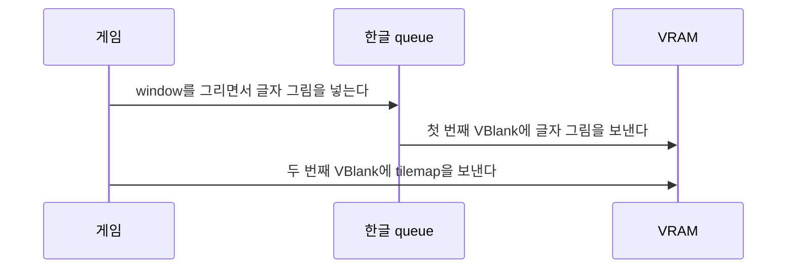

[7편](/games/romhacking/journal/dq4/title-menu/)에서 타이틀과 모험의 서, name entry 화면까지 한글로 바꿨다.
그런데 한글로 이름을 짓고 게임에 들어가면 그 이름부터 깨져서 나온다. command window도, 도구 목록도, 전투 메시지도 전부 일본어 가나 그대로다.

한글패치를 하다 보면 꼭 만나는 벽이 여기 있다.
**가나 한 글자가 tile 한 개인 window에 한글 2,350자를 어떻게 넣지?**
이번 편은 처음부터 끝까지 이 질문 이야기다.

## 네 줄 요약

1. DQ5의 window 글자는 byte가 곧 tile 번호고, 글자 tile은 138개뿐이다. 한글은 글자를 찍을 때마다 그림을 그려서 빈 tile에 올리는 수밖에 없다.
2. 그러면 올릴 tile이 모자란다. BG3 tilemap을 다른 곳으로 옮겨 128개를 얻고, 안 쓰게 된 가나 tile 104개를 빌려 썼다.
3. 시간도 모자란다. VRAM은 VBlank라는 짧은 틈에만 고칠 수 있는데 원작이 그 틈을 이미 거의 다 쓴다. 글자가 빠지고 깨지는 버그는 대부분 여기서 나왔다.
4. 조사는 "을(를)"로 때우지 않는다. 바로 앞 글자의 받침을 보고 은/는, 이/가, 을/를을 고르는 code를 메시지에 새로 넣었다.

## window의 글자는 byte가 곧 tile 번호다

먼저 원판 화면부터 보자.


_왼쪽이 DQ5 원판, 오른쪽이 포팅 롬이다. 가나는 한 글자가 tile 하나에 딱 들어간다._

왼쪽 command window의 はなす, じゅもん, つよさ... 는 글꼴로 그린 게 아니다.
window 문자열에 byte `45` 가 있으면 BG3(글자와 window를 그리는 layer)의 tile `45` 번을 그 위치에 그대로 놓는다. 글자표 같은 것도 안 거친다.
글자 tile은 `01`~`8A` 의 138개가 전부고, 숫자와 가나와 ▼ 같은 기호 몇 개가 들어 있다.

じゅもん 의 じ 처럼 탁점(글자 오른쪽 위에 찍는 두 점)이 붙는 가나는 조금 다르다. 글자 tile은 し 를 쓰고, 바로 윗줄에 탁점만 있는 tile을 따로 찍는다.
그래서 목록 한 줄은 실제로는 "글자 줄 + 그 위 탁점 줄" 두 줄이다. 이게 뒤에서 꽤 쓸모가 있다.

(여담인데 이 command 여덟 개는 패미콤 DQ4와 이름도 놓인 순서도 같다. DQ5 엔진을 고른 덕에 command window는 글자만 바꾸면 됐다.
오른쪽의 "상태"는 원작의 つよさ, 흔히 "강함"으로 옮기는 그 command다. 닌텐도 DS 리메이크 한글 팬패치의 메뉴와 비교해 보고 "상태"로 정했다.)

이제 문제가 보인다.
완성형 한글 2,350자를 tile 138개에 넣을 방법은 없다.
그러니 문자열을 찍을 때마다 그 문자열의 그림을 그려서 비어 있는 tile에 올리고, tilemap(화면의 어느 위치에 몇 번 tile을 놓을지 적은 table)이 그 tile을 가리키게 해야 한다.
주인공 이름만 그런 게 아니라 도구, 주문, 몬스터 이름, "대화" 같은 고정 문구까지 window에 찍히는 한글은 전부 이렇게 간다.

원작은 byte를 tilemap에 놓으면 끝인데, 우리는 "그림을 그린다"와 "올릴 빈 tile을 구한다"가 더 붙는다. 이 편의 삽질은 거의 다 이 두 단계에서 나왔다.

(message window의 큰 대사 글자는 사정이 다르다. [2편](/games/romhacking/journal/dq4/dq5-events/)에서 본 것처럼 원작부터 글자마다 그림을 그려 올리는 canvas 방식이라 한글 글꼴만 넣으면 된다.)

## 글꼴은 왜 Galmuri9일까?

그릴 글꼴부터 정해야 한다.
처음엔 window에도 대사와 같은 Galmuri11을 썼는데, 띄워 보니 원작보다 글자가 확 커서 window가 꽉 차 보였다.
그래서 원작 화면 옆에 Galmuri 세 크기를 나란히 놓고 다시 골랐다.


_왼쪽부터 원작, Galmuri11, Galmuri9, Galmuri7이다._

Galmuri7은 7×7 픽셀이라 8×8 tile 하나에 쏙 들어간다. 원작과 구조가 똑같아지니 기술적으로는 제일 편하다.
그런데 받침이 뭉개진다. "모험을"의 "을"이 "올"처럼 보인다. 한글은 받침이 안 읽히면 끝이라 탈락.
Galmuri9는 원작 가나와 높이가 비슷하고 받침도 또렷하다. 이걸로 정했다.

대신 tile을 훨씬 많이 먹는다.
Galmuri9는 높이가 9픽셀이라 tile 하나(8픽셀)를 1픽셀 넘는다. 넘친 맨 윗줄은 위쪽 탁점 줄에 그린다(아까 그 탁점 줄이다. 원작이 탁점을 올리던 방식 그대로다).
그러니 글자 한 자가 세로로 tile 두 개를 먹는다. 폭도 한 자에 10픽셀이라 넉 자짜리 이름이 tile 4개가 아니라 5개다.
너비가 tile 여섯 개인 이름 여덟 개가 뜨는 목록이면 Galmuri7로는 tile 48개, Galmuri9로는 96개가 든다.

읽기 좋은 글꼴을 고른 대가로 tile을 두 배 쓰게 된 건데, 문제는 그럴 tile이 없다는 거다.

## 그린 글자를 올릴 빈 tile이 없다

BG3가 글자용으로 쓰는 tile은 384개다. 장면마다 얼마나 쓰는지 VRAM(화면용 메모리)을 dump해서 세어 봤다.

command window만 떠 있을 때는 넉넉하다. 37개밖에 안 쓴다.
문제는 message window가 뜰 때다. 대사 canvas가 tile 234개를 통째로 가져간다.
그리고 이 게임은 window와 메시지가 같이 뜨는 화면이 많다. 도구를 쓰면 도구 목록이 뜬 채로 "~을 도구로 써 보았다"가 나온다.


_도구 하나를 고르면 window 넷이 겹친다. 뒤로 물러난 window의 글자도 그대로 보여야 한다._

384개의 사정을 대충 그리면 이렇다.

```text
001 ~ 08A   숫자, 가나, 기호 (원작 글자 tile 138개)
096 ~ 17F   대사 canvas (234개. 메시지가 뜨면 전부 쓴다)
180 ~ 1FF   BG3 tilemap이 깔고 앉은 곳 (128개 분량)
```

빈 tile은 두 군데서 구했다.

### tilemap을 옮겨서 128개

SFC는 tile 그림과 tilemap을 같은 VRAM 안에 나눠 둔다. DQ5는 BG3 tilemap을 글자 tile 바로 뒤에 붙여 놨는데, 이 tilemap을 다른 빈 VRAM으로 치우면 그만큼이 tile 128개 분량으로 빈다.
[1편](/games/romhacking/journal/dq4/dq5-maps/)에서 맵마다 VRAM을 어디까지 쓰는지 조사해 둔 게 여기서 도움이 됐다.

말은 쉬운데 한 번 크게 틀렸다.
처음 고른 주소는 "실내 맵에 막 도착했을 때"만 보고 정한 거였다. 나중에 맵 전체를 걸어 다니고 전투와 이벤트 장면까지 다 돌려 보니, 실내 맵 열한 곳이 그 주소를 쓰고 있었다.
사실 그 전에 성 탑 꼭대기 그림이 깨진 화면을 본 적이 있는데 대수롭지 않게 넘겼었다... 그게 이거였다.
맵마다 겹치지 않는 주소를 다시 골랐다.

### 가나 tile을 빌려서 104개

window 글자를 전부 한글로 바꾸면 window는 더 이상 가나를 안 쓴다.
가나 tile은 canvas 밖에 있으니 메시지가 떠도 지워지지 않는다. 한글 그림을 올려 두기에 딱 좋다.
그래서 필드에서는 가나 tile 104개를 한글용 slot으로 돌려쓴다.

걸리는 건 전투였다. 전투 쪽은 그때까지 가나 tile을 그대로 쓰고 있었는데, 게임은 전투에 들어갈 때 가나 그림을 다시 올려 주지 않는다. 덮어쓴 쪽이 돌려놔야 한다.
다행히 돌려놓을 그림을 따로 챙길 필요는 없었다. VRAM의 가나 tile과 롬에 들어 있는 글자 그림을 비교해 보니 그대로였다. 전투에 들어가면 롬에서 다시 올린다.

slot을 나누는 방법도 여러 번 갈아엎었다.
처음엔 20개짜리, 14개짜리, 8개짜리처럼 크기를 정해 놨는데, 어느 장면에서든 꼭 한 크기가 모자랐다.
결국 고정 크기를 버리고 이름 길이만큼 잘라 쓰게 했다. 빈 곳이 없으면 화면에 안 보이는 것 중에 가장 오래된 것을 비운다. 보이는 건 뺏지 않는다.

### 그런데 "지금 화면에 보이는가"를 어떻게 알지?

이게 생각보다 어려웠다.
처음엔 window용 tilemap buffer를 훑어서 그 slot을 가리키는 곳이 있으면 보이는 걸로 쳤다.
그런데 게임은 다른 window를 여는 동안 이 buffer를 0으로 싹 비웠다가 다시 그린다. 화면은 멀쩡한데 buffer만 비어 있는 frame이 있다.
status window를 열면 "성별 : 남자"가 뒤에 있는 window의 제목 글자로 바뀌어 나왔다. 멀쩡히 보이는 글자를 안 보인다고 판단해서 그 slot을 남에게 줘 버린 거다.

판정을 아예 꺼 봤더니 이번엔 닫힌 window의 문구가 slot을 계속 붙들어서 "예 / 아니요"가 올라갈 곳이 없어졌다.
결국 보는 시점을 바꿨다. 게임이 tilemap을 VRAM으로 보내는 바로 그 순간의 buffer만 진짜 화면과 같다. 그때의 buffer로만 판정한다.

이쯤 되니 사람 눈으로 화면을 한 장씩 보는 건 감당이 안 됐다. window 하나를 고치면 slot 순서가 바뀌어서 엉뚱한 window가 깨진다.
그래서 에뮬레이터를 화면 없이 실행해서, 버튼을 무작위로 눌러 가며 frame마다 VRAM을 dump해 깨진 tile을 찾는 test를 만들었다.
이 test가 사람은 못 찾을 화면을 하나 찾아 줬다. DQ5가 오류 처리에서만 여는 debug용 window "エラーデス！！"(에러입니다!!)다.
가나 tile을 그대로 찍는 window라 필드에서 깨졌고, 이것도 같은 방식으로 그려 주게 고쳤다.

## 글자가 가끔 빠진다... 범인은 VBlank였다

tile을 구했으니 이제 그림을 VRAM에 올리면 된다. 그런데 아무 때나 올릴 수가 없다.

SFC는 화면을 한 장 다 그리고 다음 화면을 그리기 전까지 잠깐 쉰다. 이 틈이 VBlank고, VBlank가 시작될 때 걸리는 interrupt가 NMI다.
VRAM은 이 틈에만 안전하게 고칠 수 있다. 그 밖에서 쓴 건 에러도 없이 조용히 버려진다.
틈은 1초에 60번 오고, 한 번이 scanline 22줄 그릴 시간밖에 안 된다.

원작도 당연히 이 틈에 VRAM을 고친다. 처음엔 게임이 원래 쓰는 전송 목록에 한글 그림을 끼워 넣었다.
이름 한 줄은 잘 됐는데, 도구 목록에서는 A를 눌러도 cursor가 안 생기고 메뉴가 닫힌 것처럼 됐다. 게임이 아직 만들고 있는 목록에 중간에 끼어들어서 순서가 꼬인 거였다.
그래서 게임 것은 건드리지 않고, 한글 그림만 담는 queue를 따로 만들어 NMI에서 DMA(메모리를 통째로 빠르게 복사하는 기능)로 보내게 했다.

queue를 만들었다고 끝이 아니었다. 원작이 22줄을 이미 거의 다 쓰고 있어서, 내 글자를 끼우면 원작 것이 밀려나 버려진다.
이걸로 세 번을 당했다.

- **status window 아래쪽에 옛 화면이 남았다.** window가 바뀌면 게임은 tilemap 2KB를 통째로 보내는데 이게 12줄쯤 걸린다. queue를 먼저 보내고 나면 tilemap이 VBlank 끝을 넘겨서 뒷부분이 잘렸다. 둘이 겹치면 tilemap을 다음 VBlank로 한 번 미루게 했다. 글자 그림이 먼저 올라가 있고 tilemap이 뒤따라오니 순서도 맞다.
- **전투에서는 window가 아예 안 떴다.** 필드는 tilemap을 매번 보내지만 전투는 요청이 있을 때 딱 한 번만 보낸다. 미룬 요청이 영영 안 갔다. 전투에서는 반대로 queue 쪽을 미룬다.
- **status window에서 "방어력"만 안 나왔다.** 처음엔 slot이 모자라서라고 보고 배분을 바꿔 봤지만 그대로였다. tilemap은 제대로 가리키는데 그림이 비어 있는 걸 보고서야 전송을 의심했다. queue의 맨 끝 항목이 VBlank를 살짝 넘겨서 버려진 거였다. 지금은 항목을 하나 보낼 때마다 지금 몇 번째 scanline인지 보고, 넘길 것 같으면 남은 건 다음 VBlank로 넘긴다.

필드에서는 이 순서로 간다.



_글자 그림이 한 VBlank 먼저 간다. 전투에서는 미루는 쪽이 반대다._

제일 황당했던 건 전투 배경에 검은 구멍이 난 일이다.
NMI가 공통으로 지나는 입구에 hook을 걸어 놨는데, queue가 비어 있어도 "비었나?" 확인하는 데 시간이 조금 든다. 그 조금 때문에 원작의 전투 배경 전송이 밀려서 끝부분 수십 byte가 잘렸다.
원작이 VBlank를 얼마나 아슬아슬하게 쓰는지 이때 알았다. 공통 입구는 원래대로 돌려놓고, 필요한 곳에만 따로 hook을 걸었다.

## "을(를)"은 쓰지 않는다

window 다음은 메시지다.
command window에서 "조사"를 고르면 "(이름)은 발밑을 조사했다!"가 나와야 한다.
그런데 이름은 플레이어가 짓는다. "라이안"이라고 지으면 "은"이고 "라이"라고 지으면 "는"인데, 메시지를 쓰는 시점에는 알 수가 없다.
한글패치된 게임을 해 봤다면 "(이름)은(는)"이나 "을(를)"로 때운 메시지를 수없이 봤을 거다. 이건 꼭 피하고 싶었다.

그래서 받침을 보고 조사를 고르는 code를 메시지에 새로 넣었다. 메시지 원고는 이렇게 쓴다.

```text
{P}{은} 발밑을 조사했다!
{I}{을} 샀다.
```

`{P}` 는 이름, `{I}` 는 물건 이름이 들어갈 곳이고, `{은}` `{을}` 이 조사 code다. 화면에는 이렇게 나온다.

```text
라이안은 발밑을 조사했다!
구리 검을 샀다.
```

원리는 단순하다.
이 게임에서 대사 글자는 압축을 푼 것이든 이름처럼 끼워 넣은 것이든 전부 한 routine을 지나 찍힌다. 거기에 hook을 걸어서 마지막에 찍은 글자를 적어 둔다.
조사 code를 만나면 그 글자를 받침 table에서 찾아 둘 중 하나를 찍는다. 이름이 뭔지는 몰라도 된다. 바로 앞 글자 하나만 보니까 이름이든 물건이든 주문이든 같은 code로 된다.

| 받침 있음 | 받침 없음 |
| --------- | --------- |
| 은        | 는        |
| 이        | 가        |
| 을        | 를        |
| 으로      | 로        |
| 과        | 와        |
| 아        | 야        |
| 이여      | 여        |

자잘한 규칙이 두 개 있다.
ㄹ 받침 뒤는 "으로"가 아니라 "로"다("칼으로"가 아니라 "칼로"니까).
그리고 이름을 자음으로만 지으면 받침이 있는 쪽으로 본다. name entry 화면에서 "ㅂㅂㅂㅂ"라고 지으면 "ㅂㅂㅂㅂ는"이 아니라 "ㅂㅂㅂㅂ은"이 나온다. 비읍비읍비읍비읍은, 이라고 읽을 테니까.


_"라이안"도 뒤의 "은"도 메시지 원고에는 없다. 화면에 찍힐 때 정해진다._

삽질은 code 번호를 고를 때 했다.
처음엔 메시지 3,200개에서 한 번도 안 쓰이는 번호를 골라서 걸었다. 조사는 잘 골라지는데 뒤의 띄어쓰기가 사라지고, 급기야 아까 그 "에러입니다!!" window가 떴다.
안 쓰이는 번호라고 비어 있는 번호가 아니었다. 메시지에 안 나올 뿐 처리하는 code는 살아 있어서, 어떤 번호는 말하는 인물을 찾으러 가고 어떤 번호는 전투에서 이름 code로 쓰이고 있었다.
결국 기존 번호 범위 바로 뒤에 새 번호 일곱 개를 받게 고쳤다.

이 code로 조사, 상자, 문, 주문, 도구 같은 필드 메시지와 가게, 여관, 교회 대사를 한글로 옮겼다.

## 전투 메시지는 또 사정이 다르다

"라이안의 공격! 슬라임에게 4의 데미지!!"가 뜨는 전투 메시지는 대사 canvas를 쓰지 않는다. [3편](/games/romhacking/journal/dq4/dq5-battle/)에서 본 것처럼 window 글자와 같은 방식, 그러니까 byte가 곧 tile이다.
한 줄에 26글자씩 세 줄짜리 격자에 byte를 쓰면 그게 그대로 tilemap이 된다. 여기에도 한글 그림을 그려서 빈 tile에 올리는 엔진을 따로 만들었다.


_이름과 "의 공격!", 몬스터 이름과 "에게"가 틈 없이 이어진다._

전투에서는 빈 tile 찾기가 훨씬 까다롭다.
예전에 "tilemap이 안 가리키는 tile이면 비었겠지" 했다가 공격 연출이 거기에 그림을 올려서 깨진 적이 있다.
이번엔 원본 DQ5에서 주문과 몬스터 행동을 전부 한 번씩 실행해 보면서(346번이다) frame마다 글자 tile이 바뀌는지 봤다.
끝까지 한 번도 안 바뀐 건 tilemap을 옮겨서 얻은 곳과 자투리 여섯 개뿐이었다. 평범한 공격 연출만으로도 꽤 넓은 범위가 덮인다.

그래서 늘 안전한 tile부터 쓰고, 큰 주문 연출이 덮는 tile은 연출이 끝나면 사본에서 다시 올린다.
사본을 둘 메모리가 마땅치 않았는데, DQ5에는 몬스터 할아범에게 맡긴 동료 몬스터를 기억하는 공간이 있다. DQ4에는 동료 몬스터가 없으니 거기가 통째로 빈다. 그걸 빌렸다.

화면에서 고친 건 주로 이름과 문장이 만나는 이음매다. 다른 한글패치에서도 자주 보이는 것들이다.

- 이름 그림이 tile 경계에서 끝나서 "부하 는"처럼 조사 앞이 벌어졌다. 이름의 덜 찬 마지막 부분을 뒤 문장으로 넘겨서 이어 그린다.
- 긴 이름 때문에 줄이 넘치면 "노송나무 막대 / 를 몸에 걸쳤다!"처럼 조사만 다음 줄로 떨어졌다. 이름 뒤 첫 띄어쓰기에서 줄을 나누게 해서 "노송나무 막대를 / 몸에 걸쳤다!"가 됐다.
- "레벨"이 한 frame 동안 "레뀰"로 보였다. 앞에서 본 VBlank 순서 문제였다. queue가 다 나갈 때까지 기다렸다가 글자를 쓴다.

메시지 쪽에서 하나만 더.
A를 눌렀는데 아무 일도 없고 한 번 더 눌러야 넘어가는 메시지가 있었다.
메시지 끝에서 ▼ 를 띄우고 A를 기다리는데, 그 메시지를 띄운 명령도 window를 닫기 전에 A를 한 번 더 기다리고 있었다. 첫 A는 ▼ 만 지우니 안 눌린 것처럼 보인 거다.
띄우는 쪽이 스스로 기다리는 경우엔 메시지 끝에서 기다리지 않게 했다.

## 아직 못 한 것


_오른쪽 이름 아래를 보자._

- **라이안이 파파스의 아들이다.** status window의 이름 아래 직함 줄에 DQ5 주인공의 "파파스의 아들"이 번역된 채 그대로 남아 있다. 바트랜드의 왕궁 전사가 졸지에 파파스의 아들이 됐다... DQ4에 맞는 직함으로 아직 못 바꿨다.
- 필드 메시지에 나오는 몬스터 이름은 아직 가나다. 이름 뒤에 A, B를 붙이는 흐름이 얽혀 있어서 못 건드렸다.
- 한글 이름을 못 정한 DQ5 고유 물건과 주문은 가나 그대로 나오고, 그 뒤의 조사는 받침 없는 쪽으로 찍힌다.

## 더 보기

- [window 글자 형식](https://github.com/perfectacle/sfc-dq4/blob/main/sfc/dq4/docs/dq4-window-text-format.md): slot, tilemap 옮기기, queue, window별 사정
- [조사 code 형식](https://github.com/perfectacle/sfc-dq4/blob/main/sfc/dq4/docs/dq4-josa-format.md)
- [전투 메시지 형식](https://github.com/perfectacle/sfc-dq4/blob/main/sfc/dq4/docs/dq4-battle-text-format.md)
- 깨진 tile을 찾는 test: [dq4windowcheck.py](https://github.com/perfectacle/sfc-dq4/blob/main/sfc/dq4/tools/dq4windowcheck.py)
- 개념이 낯설다면: [tile과 palette](/games/romhacking/sfc/graphics/), [hooking](/games/romhacking/sfc/hooking/)
