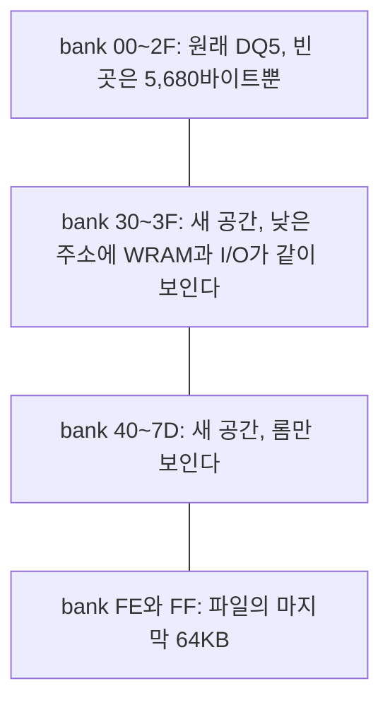

앞의 네 편은 DQ5 롬을 읽는 이야기였다. 맵이 어떻게 압축돼 있는지, 대사가 어디 있는지, 몬스터 HP가 몇 번째 바이트인지 같은 것들.
그런데 이 프로젝트가 하려는 건 읽기가 아니라 쓰기다. DQ5 엔진에 DQ4의 마을과 대사와 인물을 넣어야 한다.
그럼 남의 게임 엔진에 새 맵, 새 대사, 새 인물은 어떻게 끼워 넣을까?

읽을 줄 알면 쓰는 건 금방일 줄 알았는데 전혀 아니었다.
decoder(압축된 데이터를 푸는 코드)가 있다고 encoder(다시 압축하는 코드)가 저절로 생기지 않고, 고친 데이터는 대부분 원래 있던 곳에 안 들어가고, 넓은 곳으로 옮기면 엔진이 못 읽는다.
이번 편은 그 삽질 모음이다. 연재에서 가장 기술적인 편이라 게임 이야기가 궁금한 분은 보물상자와 라인하트 성이 나오는 절만 골라 읽고 [다음 편](/games/romhacking/journal/dq4/title-menu/)으로 넘어가도 된다.

## 네 줄 요약

1. 1.5MB 롬을 4MB로 늘리면 빈 bank가 80개 생긴다. 다만 엔진이 아무 데서나 읽어 주지는 않는다. 앞쪽 16개(bank `30`~`3F`)만 메모리가 같이 보이는 특별한 구역이고, 엔진이 읽는 table은 대부분 여기에만 둘 수 있었다.
2. 쓰는 도구는 전부 "원본을 읽었다가 고치지 않고 다시 쓰면 같은 바이트가 나오는가"로 검증했다. 맵 364개 중 46개가 달랐고, 그걸 파다가 맵 형식을 잘못 알고 있던 걸 찾았다.
3. 엔진이 안 쓰는 메모리를 찾는 건 "몇 장면 실행해 보니 안 쓰더라"로는 안 된다. 오프닝의 배 장면 딱 한 곳에서만 쓰는 1바이트가 숨어 있었다.
4. 도구가 많아지면 서로 같은 주소를 덮어쓴다. 사람이 주소를 정하지 않게 하고, build 단계마다 바뀐 바이트를 장부에 적어 검사한다.

## 롬을 늘리면 어디가 생길까?

DQ5 롬은 1.5MB다. SFC는 주소를 [bank](/games/romhacking/sfc/banks/)(64KB 단위의 주소 구역)로 나누는데, DQ5는 bank `00`~`2F` 를 꽉 채워 쓴다.
여기에 DQ4의 맵과 대사와 그림을 더 넣을 공간은 없으니 롬 파일을 4MB로 [늘린다](/games/romhacking/sfc/expansion/).
그러면 bank `30` 부터 새 공간이 생기는데, 이 새 bank들이 다 같은 성격이 아니다.



_4MB로 늘린 롬의 bank 배치. `3F` 와 `40` 사이의 경계가 이 편 내내 발목을 잡는다._

bank `00`~`3F` 는 주소 앞쪽 절반(`0000`~`7FFF`)에 WRAM(게임이 쓰는 메모리)과 I/O register가 mirror로 같이 보인다. 어느 bank에 있든 `$198E` 같은 짧은 주소로 메모리를 읽고 쓸 수 있게 해 둔 것이다.
bank `40` 부터는 이 mirror가 없다. 롬만 보인다.
지금은 "그래서 뭐?" 싶겠지만 조금 뒤에 table을 옮길 때 이게 문제가 된다.

파일의 마지막 64KB는 어디로 보이는지 몰랐다. 순서대로면 bank `7E`·`7F` 인데 거긴 WRAM 본체가 차지하고 있기 때문이다.
그래서 bank마다 자기 번호를 적어 넣은 시험용 롬을 만들어 에뮬레이터에서 읽어봤고, `FE`·`FF` 로 접근하면 나온다는 걸 확인했다.

### 0이 길게 이어지면 빈 곳 아닌가?

새 bank로 넘어가는 코드를 끼우려면([hooking](/games/romhacking/sfc/hooking/)) 원래 bank 안에도 몇 바이트짜리 stub을 둘 곳이 필요하다.
롬 해킹에서 흔히 하는 생각이 "0이 길게 이어진 곳은 안 쓰는 곳"이다. 진짜 그런지 확인해보자.

0이나 FF가 64바이트 넘게 이어지는 곳을 찾으니 32곳이 나왔다.
여기에 읽기·실행 감시를 걸고 전원을 켠 뒤 2분 남짓(8,000 frame)과 장면 다섯 개를 실행해봤다.
결과부터 말하면 bank 한가운데에 있는 0 덩어리는 전부 읽혔다. 세계 지도 데이터나 table의 일부였던 것이다. (0도 데이터다...)

그럼 bank 끝에 있는 0은 괜찮을까? 여기도 딱 1바이트가 읽혔다.
곡 데이터를 2바이트씩 소리 칩으로 보내는 코드가 데이터 끝을 1바이트 넘겨 읽는 것으로 보인다.
그래서 규칙을 "bank 끝의 0 덩어리만, 그것도 시작에서 16바이트는 띄우고"로 정했고, 남은 건 22곳 5,680바이트였다.
나중에 곡 49개를 전부 틀고, 실내 맵 346곳을 걷고, 몬스터 236종과 싸우면서 다시 감시했는데 이 22곳은 한 번도 안 읽혔다.

## 읽었다가 그대로 다시 쓰면 같은 바이트가 나올까?

쓰는 도구를 만들 때 기준은 하나였다.
**원본을 꺼냈다가 아무것도 안 고치고 다시 넣으면 원래 바이트가 그대로 나와야 한다.**
이게 안 되면 형식을 덜 아는 것이고, 그 상태로 고친 값을 넣으면 뭐가 깨져도 내 탓인지 도구 탓인지 알 수가 없다.

첫 도구는 몬스터·도구·주문 table이었다.
DQ5는 값 하나를 여러 바이트에 쪼개 넣는다. 예를 들어 몬스터 HP는 25바이트짜리 record의 3번 바이트 8비트에 10번 바이트의 아래 3비트를 이어 붙인 11비트다.
그래서 값마다 (몇 번 바이트, 몇 번째 비트부터, 몇 비트)를 적어 두고 읽을 때와 쓸 때 같은 목록을 쓰게 했다. 쓸 때는 그 비트만 바꾸니까 뜻을 모르는 비트는 그대로 남는다.
슬라임의 HP를 300으로 고친 롬으로 전투에 들어가 봤더니 메모리에 정확히 300이 올라왔다. 10번 바이트의 비트까지 제대로 읽힌다는 얘기다.

대사 쪽도 됐다. 아래는 오프닝 배의 선실에서 파파스에게 말을 거는 장면의 대화 script를 고친 것이다.


_왼쪽 위가 원본. 조건을 뒤집으면 항구에 도착했을 때 대사가 먼저 나오고(오른쪽 위), script를 15바이트에서 41바이트로 늘리면 원본에 없던 선택지도 붙는다(오른쪽 아래)._

### 맵 364개 중 46개가 달랐다

문제는 맵이었다.
실내 맵 하나는 9바이트 header, 블록을 놓는 명령들을 비트 단위로 이어 붙인 bitstream, 그 뒤에 벽·출구 같은 속성을 덧칠하는 pass 세 개로 돼 있다([1편](/games/romhacking/journal/dq4/dq5-maps/)).
decoder는 이걸 풀어서 결과만 남기지 명령은 안 남긴다. 그래서 명령 단위로 푸는 코드와 다시 묶는 코드를 새로 짰다.

처음 실행해보니 364개 중 46개가 원본과 달랐다.
길이는 같고, 마지막 바이트의 아래 nibble(반 바이트, 4비트)만 달랐다.

```text
맵 02/04: 원본 0E, 다시 쓴 것 00
맵 1E/01: 원본 84, 다시 쓴 것 80
```

데이터가 반 바이트에서 끝나서 남은 반 바이트다. 게임은 여기를 안 읽는데 원본에는 0이 아닌 값이 들어 있었던 것.
"게임이 안 읽으니 상관없지 않나?" 하고 넘어갈 수도 있었다. 그래도 기준은 기준이니 남은 nibble까지 보존하게 고쳤다.

그랬더니 이번엔 다른 게 튀어나왔다. 다시 쓴 record의 끝이 다음 맵의 시작을 몇 바이트씩 넘는 곳이 90여 곳이나 됐다.
pass 사이의 경계를 잘못 알고 있었던 거다.
나는 pass가 끝나면 다음 pass는 새 바이트에서 시작한다고 생각했는데, 실제로는 앞 pass가 반 바이트에서 끝나면 다음 pass가 그 남은 반 바이트에서 바로 시작한다. 빈틈없이 붙어 있는 것이다.
이걸 고치고 나서야 364개 맵 233,794바이트가 전부 원본과 같아졌다.

바이트가 대충 맞는다고 넘어갔으면 이 오류를 품은 채로 DQ4 맵을 만들었을 거다. 생각만 해도 아찔하다...

참고로 DQ4 맵을 넣을 때 내 손에 있는 건 명령이 아니라 "여기에 이 블록"이라는 목록이다.
그래서 목록을 명령으로 바꾸는 compiler도 따로 만들었다. 원본 맵을 목록으로 펼쳤다가 다시 명령으로 만들면 게임에 올라오는 맵은 똑같고 크기만 6.7% 커진다. (원작 제작진이 손으로 겹쳐 놓은 큰 덩어리를 다 못 따라간 만큼이다.)

## table을 옮겼는데 왜 게임이 깨지지?

여기까지는 원래 있던 걸 고치는 이야기다.
그런데 DQ4의 마을은 DQ5의 마을과 출구 수도, 사람 수도, 상자 수도 다르다. 원본 table은 빈틈없이 붙어 있어서 항목 하나만 늘어도 뒤에 있는 코드를 덮어쓴다.
그러니 table을 통째로 넓은 곳으로 옮겨야 한다.

옮기는 것 자체는 쉽다. 데이터를 복사하고 그 table을 가리키는 주소 몇 개만 고치면 된다.
문제는 **어느 bank로 옮길 수 있느냐**다.

SFC의 CPU에는 DB register(data bank register)라는 게 있다. database가 아니다.
`LDA $EB0E,Y` 처럼 bank 없이 16비트 주소만 적은 명령은 DB register가 가리키는 bank에서 읽는다.
비유하자면 DB는 지금 펴 놓은 책의 권 번호다. 엔진은 "몇 쪽"만 말하고, 몇 권인지는 펴 놓은 책을 따른다.

table을 다른 bank로 옮겼으면 그 table을 읽는 동안 DB도 새 bank로 바꿔 줘야 한다. 여기까지는 당연하다.
그런데 엔진은 table을 읽는 그 잠깐 사이에 `STA $198E` 같은 식으로 메모리에도 값을 쓴다. 이 명령도 DB를 따라간다.
bank `00`~`3F` 는 앞에서 본 것처럼 낮은 주소에 WRAM이 같이 보이니까 문제가 없다.
bank `40` 이상으로 옮기면? 거긴 WRAM이 안 보인다. 엔진은 메모리에 쓴다고 썼는데 값은 어디에도 안 남고, 게임이 조용히 망가진다.
책으로 치면 `30`~`3F` 권에는 앞쪽에 공용 메모지가 끼워져 있는데 `40` 권부터는 없는 것이다.

그러니 table을 옮기기 전에 "DB가 이 bank를 가리키는 동안 엔진이 뭘 읽고 쓰는지"를 전부 알아야 한다.
코드를 검색해서는 DB를 바꾸는 곳이 한 군데인 줄 알았는데 읽어 보니 더 있었다. 못 미더워서 에뮬레이터 Lua script로 DB가 바뀐 순간부터 되돌아올 때까지 실행한 명령과 접근한 주소를 전부 모았다.
실내 출구 table의 경우 명령 417개가 실행됐고, 그 가운데 롬을 읽는 건 table 읽기 네 곳뿐이고 나머지는 전부 메모리 접근이었다.

결론은 table마다 달랐다.

- 맵, 인물, 출구 색인처럼 읽는 동안 메모리를 같이 쓰는 table은 bank `30`~`3F` 에만 둔다.
- 출구의 목적지 table은 DB를 아예 안 건드리고, 읽는 명령만 bank까지 적는 긴 주소 형태로 바꿨다. 두 명령은 길이가 같아서 opcode 1바이트씩만 고치면 된다. 이러면 `40` 이상에도 둘 수 있다.
- 레벨업·조우 table은 같은 routine이 주문 습득 목록도 같이 읽어서 bank `23` 밖으로 못 나간다. 같은 bank 안에서만 옮겼다.
- 말을 걸었을 때 실행되는 대화 script는 bank `06` 고정인데 빈 곳이 496바이트뿐이다. 전체를 다시 빽빽하게 채워 넣는 식으로 버틴다.

이러다 보니 16개뿐인 bank `30`~`3F` 가 금싸라기 땅이 됐다.

## 257번째 보물상자는 어디에 기록하나

DQ5는 보물상자를 256개까지만 셀 수 있다. 상자 번호가 8비트이기 때문이다.
DQ4의 상자를 얹다 보면 넘칠 수 있으니 번호를 16비트로 넓히는 hook을 세 군데에 넣었다.

그런데 번호보다 어려운 문제가 따로 있었다. 257번째 상자를 "열었다"는 기록을 어디에 두느냐다.
열린 상자는 세이브에 들어가야 한다. 안 그러면 불러올 때마다 상자가 다시 차 있을 테니까.
세이브되는 메모리 범위는 정해져 있고(`7E:2000`~`2A9F`), 그 안은 DQ5가 이미 쓰고 있다.

그래서 장면 770개를 실행하면서 이 범위의 주소마다 몇 번 읽고 쓰는지를 셌고, 한 번도 접근이 없는 40바이트짜리 틈을 찾았다.
40바이트면 320비트니까 상자 320개를 더 기록할 수 있다. 합쳐서 576개다.

함정이 하나 있었다.
상자에 손을 대도 "열림"까지 안 가는 경우가 있다. 잠긴 상자, 가방이 가득 찼을 때, 상자 몬스터에게 전멸했을 때다.
이때 hook이 임시로 적어 둔 값이 남아서, 다음에 여는 엉뚱한 상자가 열린 걸로 기록될 수 있었다.
상자를 여는 hook이 맨 처음에 이 값을 무조건 지우게 했고, 세 경우를 게임에서 하나씩 만들어 확인했다.

## 맵을 바꿔도 따라오는 코드

DQ5의 맵 번호에 DQ4의 마을을 그려 넣어도, 그 번호에 묶여 있던 DQ5의 코드는 그대로 남는다.
DQ5에는 맵마다 "들어올 때 한 번 실행하는 routine"과 "매 frame 실행하는 routine"을 적어 둔 table이 있다(항목 162개).

라인하트 성을 보자.


_오른쪽 맵의 노란 틀. 걸어서는 갈 수 없는 벽 바깥에 출구가 하나 숨어 있다._

오른쪽 맵에 들어오면 맵별 routine이 벽 바깥 빈 곳에 출구를 하나 더 만든다.
어디에 쓰는 출구인지는 확인 못 했다. 헨리 왕자가 납치되는 사건이 이 맵에서 벌어지니 그 장면용이 아닐까 싶다.
이 맵에 DQ4의 성을 그려 넣으면 계단의 출구 번호가 하나씩 밀려서 엉뚱한 곳으로 나가게 된다.

매 frame routine은 더 곤란하다.
레누르 성 옥상에는 주인공이 특정 위치(탑의 문 앞)에 서면 탑 안으로 옮기는 routine이 걸려 있다.
여기에 DQ4 맵을 올리면 아무것도 없는 바닥 한가운데에서 순간이동을 당한다.


_왼쪽이 원래 동작, 오른쪽이 매 frame routine을 table에서 뺀 것. 같은 곳에 서도 아무 일이 없다._

그래서 이 table을 꺼내 고치는 도구를 만들었다. DQ4 맵을 올리는 번호는 DQ5의 routine을 떼어 낸다.
(훑어보다가 원본에도 영영 실행되지 않는 항목이 넷 있다는 걸 알았다. 조건 없는 항목이 둘씩 겹쳐 있어서 둘째는 차례가 안 온다.)

맵 번호 자체가 모자랄 때도 있다. DQ4의 성에 방이 더 많으면 DQ5에 없던 번호가 필요하다.
처음엔 도구에 없는 번호를 줘도 아무 말 없이 성공하더니 바로 뒤에 있는 다른 맵의 pointer를 덮어썼다...
맵 번호를 읽는 코드를 전부 찾아보니 110곳쯤이고, 대부분은 "이 맵이면 이렇게"라는 비교였다. 번호를 index로 써서 table을 바로 읽는 곳은 네 종류뿐이었는데 이쪽이 위험하다. 항목이 없으면 table 밖을 읽기 때문이다.
실제로 새 그룹(맵 묶음)을 만들었더니 인물 table 뒤에 있던 코드 2바이트를 pointer로 읽어서 I/O register 영역을 인물 목록인 줄 알고 읽었다. 그때 화면에 이상한 사람이 안 나온 건 순전히 운이었다.

좋은 소식도 있었다. 그룹 번호를 범위로 검사하는 코드는 전부 "`50` 보다 작은가"였다.
DQ5가 안 쓰는 그룹 `36`~`4F` 도 엔진이 평범한 실내 맵으로 취급해 준다는 뜻이다. DQ4의 새 마을과 성이 들어갈 번호가 이렇게 정해졌다.

## 새 게임은 누구로 시작하나

DQ4는 장마다 주인공이 다르다. 그러니 새 게임을 시작할 때의 일행을 바꿀 수 있어야 한다.
전원을 켜고 새 게임을 고르는 순간 세이브 영역에 값을 쓰는 코드를 감시해봤다.
하는 일은 셋이었다. 세이브 영역을 0으로 지우고, 롬에 있는 64바이트(골드, 이름, 일행 수와 순서)를 복사하고, 인물 table의 첫 42바이트를 일행 첫 slot에 복사한다. 이 첫 42바이트가 주인공이다.

여기를 고치면 시작 일행이 바뀐다. 다만 하나 놓친 게 있었다.
주인공 레벨만 3으로 바꿨더니 첫 장면에서 "다음 레벨까지 경험치"가 레벨 4 기준으로 바뀌어 있었다. 게임이 레벨업 table을 보고 값을 다시 계산하기 때문이다.
레벨을 바꾸면 도구가 누적 경험치도 찾아서 같이 넣게 했다.

## 엔진이 정말 안 쓰는 메모리는 어떻게 찾지?

롬 공간만큼 귀한 게 메모리다.
[8편](/games/romhacking/journal/dq4/windows/)의 한글 window는 데이터를 옮겨 둘 WRAM이 246바이트쯤 필요했다. 후보는 `7E:1ABC`~`1BB1` 이었다.

에뮬레이터에서 몇 장면 실행해 보고 "안 쓰네" 하면 될까?
안 된다. 드문 장면 하나가 그 메모리를 쓰고 있으면 한참 뒤에 원인을 알 수 없는 버그로 돌아온다.

그래서 먼저 롬 전체를 뒤졌다. 롬의 모든 바이트를 명령의 시작이라고 치고, 이 범위를 건드릴 수 있게 생긴 곳을 전부 세니 12,786곳이 나왔다.
물론 대부분은 가짜다. 데이터이거나 다른 명령의 중간 바이트를 명령으로 잘못 읽은 것이다.
이걸 어떻게 걸러낼까?

에뮬레이터 MesenCE의 Lua 함수 목록을 보다가 CDL(Code/Data Log)을 꺼내는 함수를 찾았다.
CDL은 에뮬레이터가 롬의 바이트마다 "코드로 실행됐다", "데이터로 읽혔다"를 적어 두는 기록이다.
거기다 실행될 때 CPU가 8비트 mode였는지 16비트 mode였는지도 적혀 있었다. SFC의 CPU는 mode에 따라 같은 명령의 길이가 달라지는데, 이걸 알면 실행된 코드의 명령 경계를 정확히 따라갈 수 있다. 후보가 진짜 명령인지 명령 중간인지가 한 번에 갈린다.

CDL은 실행해본 만큼만 채워지니 장면을 닥치는 대로 늘렸다. 실내 맵 346곳, 몬스터 236종, 카지노까지.
(슬라임 레이스 하나를 실행했더니 그 bank의 실행된 코드가 2,649바이트에서 7,524바이트로 늘었다. 미니게임치고는 꽤 큰 프로그램이다.)

그렇게 걸러내니 진짜 명령이 둘 남았다.

```text
02:A2FF  STZ $1BB1
03:F472  AND $1BB1
```

둘 다 범위의 맨 끝 1바이트를 건드린다.
위는 오프닝의 배 맵에 들어설 때 0으로 지우는 코드고, 아래는 그 배가 항구에 닿는 장면에서 읽는 코드다.
게임 맨 처음의 짧은 장면 하나에서만 쓰는 1바이트가 있었던 것. 몇 장면만 실행해 보고 넘어갔으면 못 찾았다.
범위를 1바이트 줄여서 245바이트만 쓰기로 했다.

마지막은 실측으로 닫았다. 에뮬레이터의 access counter로 범위 안 주소마다 읽기·쓰기 횟수를 세면서 장면 841개를 실행했다.
그 전에 감시가 정말 잡히는지부터 봐야 하니 방금 찾은 배 장면을 먼저 실행해서 그 1바이트만 잡히는 걸 확인했다.
841개 장면에서 원래 게임 코드가 나머지 245바이트에 접근한 횟수는 0이었다.

## 도구끼리 같은 주소를 덮어쓰면?

도구가 하나둘 늘어 꽤 쌓였을 때 전부 한 롬에 합쳐봤다.
바로 터졌다. 맵, 인물, 세계 지도, 대사, 이벤트를 넣는 도구 다섯 개가 이미 넣어 둔 타이틀·메뉴와 죄다 충돌했다.
도구마다 "기본 주소는 새 bank 맨 앞"처럼 편한 대로 잡아 놓은 결과다. 그때까지의 검사는 전부 DQ5 원본에 도구 하나씩만 실행한 거라 몰랐던 거다.
게다가 계산해보니 금싸라기 bank `30`~`3F` 는 524,288바이트인데 넣을 걸 다 합치면 681,634바이트였다. 애초에 다 안 들어간다.

그래서 두 가지를 정했다.

첫째, 도구는 롬을 직접 고치지 않고 "이 주소에 이 바이트를 쓴다, 원래 여기엔 이 바이트가 있었다"는 patch 목록만 낸다.
build할 때 목록을 모아서 두 쓰기가 1바이트라도 겹치거나, 원래 있어야 할 바이트가 실제 롬과 다르면 build를 거부한다.
롬을 직접 고치면 나중에 실행한 도구가 조용히 이기는데, 이러면 최소한 시끄럽게 실패한다.

둘째, 주소를 사람이 정하지 않는다.
build 도구가 이미 차 있는 곳을 예약해 두고, 작업마다 앞에서 알아낸 제약(이 table은 `30`~`3F` 만, 이벤트 script는 뒤쪽 bank도 가능)에 맞는 빈 곳을 골라 준다.

여기에 장치를 하나 더 붙였다. 이름은 장부다.
DQ4 build는 타이틀, 메뉴, 1장, 곡, 인물 그림 순으로 단계마다 롬 파일을 하나씩 남긴다.
각 모듈에 "뭘 썼니?" 하고 묻는 대신 **단계 롬을 바로 앞 단계 롬과 비교해서** 바뀐 바이트 범위를 적는다. 모듈이 늘어도 장부 쪽은 손댈 게 없다.
그리고 장부만 보고 검사한다. 뒤 단계가 앞 단계의 바이트를 다시 쓰지 않았는지, 원래 DQ5 코드를 뭉텅이로 덮지 않았는지, hook 109개가 뛰어가는 곳에 실제로 코드가 있는지. 에뮬레이터 없이 1초 남짓이면 끝난다.

처음 실행했을 때 인물 그림 단계가 1장 데이터 22KB를 덮어썼다고 나와서 식겁했다.
덮인 바이트를 까보니 전부 0이었다. 1장 build가 나중에 쓰라고 일부러 비워 둔 곳에 인물 그림이 들어간 것이다.
버그는 아니었지만 장부가 "비운 곳"과 "쓴 곳"을 구분 못 한다는 건 알게 됐다. 지금은 비운 곳을 따로 적고, 거기를 다시 쓰는 건 허용 목록에 이유와 함께 적힌 것만 통과시킨다.
검사가 진짜 잡는지도 봐야 하니 사건 코드를 일부러 덮어쓴 롬을 만들어서 걸리는 걸 확인했다.

통과하는 검사가 정말 뭔가를 보고 있는지는 따로 확인해야 한다. 이 편에서 배운 걸 하나만 꼽으라면 이거다.

## 아직 못 한 것

- 안 쓰는 메모리 조사에서 값을 알 수 없어 끝내 못 지운 후보가 208곳 남았다. 장면 841개에서 한 번도 실행되지 않은 코드들이고, 지금은 진행 test에 같은 감시를 걸어 두는 걸로 대신하고 있다.
- 레벨업·조우 table을 bank `23` 밖으로 꺼내는 방법. 읽는 routine을 고쳐야 한다.
- 장부는 단계 사이만 본다. 한 단계 안에서 모듈끼리 덮어쓴 건 안 보인다.

## 더 보기

도구 목록, patch 목록의 정확한 형식, table마다 둘 수 있는 bank 같은 건 sfc-dq4 저장소 문서에 있다.

- [patch build 형식과 쓰기 도구 전체 목록](https://github.com/perfectacle/sfc-dq4/blob/main/sfc/dq5/docs/dq5-build-format.md)
- [안 쓰는 WRAM을 찾은 과정](https://github.com/perfectacle/sfc-dq4/blob/main/sfc/dq5/docs/dq5-hangul-format.md)
- [도구 점검 문서](https://github.com/perfectacle/sfc-dq4/blob/main/sfc/dq5/docs/dq5-port-tool-audit.md)
- [롬 쓰기 장부](https://github.com/perfectacle/sfc-dq4/blob/main/sfc/dq4/docs/dq4-rom-ledger-format.md)

다음 편부터는 이렇게 마련한 공간에 DQ4를 실제로 넣는다. 먼저 [타이틀 화면과 모험의 서](/games/romhacking/journal/dq4/title-menu/)다.
